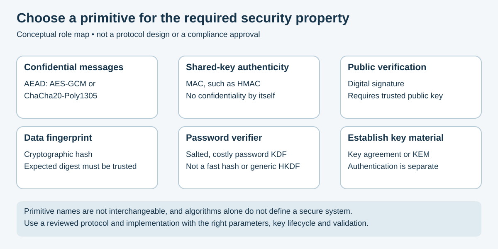
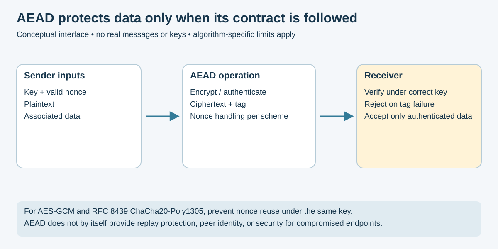
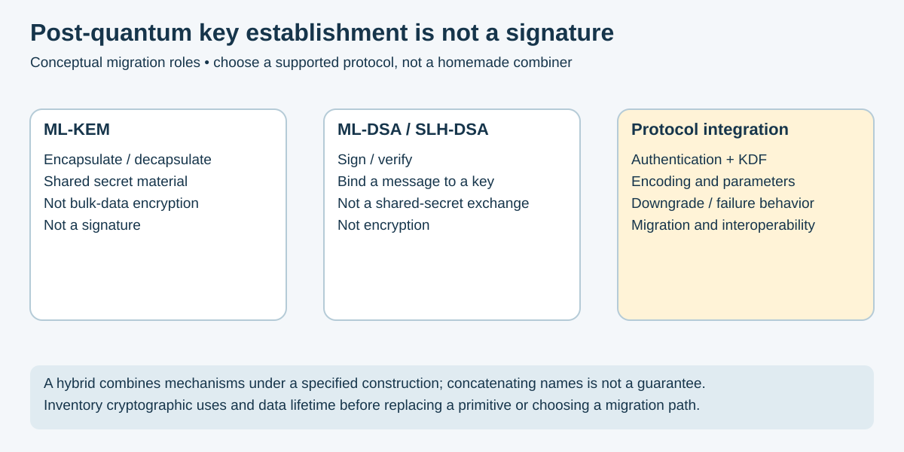

# 🧮 Cryptographic Algorithm Reference

> [!IMPORTANT]
> Educational design-review reference, not an implementation or compliance
> approval. Use reviewed protocols and vetted libraries; verify applicable
> standards, parameters and validated-module requirements for the deployment.

**Companion algorithm guide:** [Algorithmic Parallels To Cryptography, Encryption & Trust](../Algorithms/cryptography-parallels.md) connects this reference to information theory, fast lookup hashes versus SHA-256, certificate trust graphs, TLS composition, Merkle trees, constant-time constraints and post-quantum schemes. For a visual introduction see [Compression vs Hashing vs AEAD & Signatures](../assets/diagrams/algorithms-compression-hashing-encryption.svg).

## 🎯 Purpose

Distinguish cryptographic roles and identify candidate algorithms and parameters,
including legacy restrictions and post-quantum migration concerns.

## ⚙️ Function

Summarize symmetric encryption, key establishment, signatures, hashes and password
functions. Separate general engineering guidance from NIST approval status and
from the requirements of a particular protocol.

## 🏆 Goal

Help a reviewer ask the right algorithm, parameter, implementation and key-lifecycle
questions without treating a primitive name as a complete security design.

## 📋 When to Use

- Reviewing algorithm and parameter choices in a design or codebase.
- Distinguishing new protection from legacy decryption or signature verification.
- Planning migration based on data lifetime, dependencies and applicable policy.

**Source and visual review:** November 20, 2026. Selective reference, not an
exhaustive algorithm catalog. No cryptographic deployment or operational key
change was performed.

---

## 📋 Table of Contents

- [Symmetric Encryption](#symmetric-encryption)
- [Asymmetric Cryptography](#asymmetric-cryptography)
- [Hash Functions](#hash-functions)
- [Key Derivation Functions (Passwords)](#key-derivation-functions-passwords)
- [Post-Quantum Algorithms](#post-quantum-algorithms)
- [Resources](#-resources)

*Original conceptual role map. A hash needs a trusted comparison value; a signature needs a trusted verification key. The diagram is a design-review aid, not a secure protocol specification.*

## Symmetric Encryption

A shared secret key supports efficient bulk protection. Prefer an authenticated
encryption construction supported by the protocol rather than composing modes
and authentication ad hoc.

| Algorithm / Construction | Review Guidance |
|---|---|
| AES-128-GCM / AES-256-GCM | Common AEAD choices. Nonce generation, tag length, message limits and key lifetime must follow the construction and protocol. |
| ChaCha20-Poly1305 | IETF AEAD construction with a 256-bit key; useful where implementation/platform support fits. See [RFC 8439](https://www.rfc-editor.org/rfc/rfc8439). |
| AES-CBC / AES-CTR | Confidentiality modes alone do not authenticate. Use only a reviewed protocol that supplies authentication; avoid designing a new composition. |
| AES-ECB | Unsuitable for general message confidentiality because repeated blocks reveal structure. Specialized internal uses do not make it a message-encryption default. |
| TDEA / 3DES | NIST disallows applying new protection after 2023; specified legacy processing is a separate category. See [NIST's withdrawal notice](https://csrc.nist.gov/News/2023/nist-to-withdraw-sp-800-67-rev-2). |
| DES / RC4 | Do not choose for new protection. Migration and any required legacy processing need explicit policy. |

*Original conceptual AEAD interface. [NIST GCM guidance](https://csrc.nist.gov/pubs/sp/800/38/d/final) and RFC 8439 define construction-specific requirements. Associated data is authenticated, not encrypted.*

For the GCM and ChaCha20-Poly1305 constructions above, prevent reuse of a nonce
with the same key. Follow the protocol's nonce scheme rather than assuming
random generation is always sufficient. Reject authentication failure without
releasing unauthenticated plaintext. AEAD does not alone establish peer identity
or prevent replay.

## Asymmetric Cryptography

Public/private key schemes have **different roles**: key agreement or
encapsulation establishes secret material; signatures authenticate messages under
a verification key. Neither role is interchangeable with bulk encryption.

| Algorithm / Family | Role And Limits |
|---|---|
| X25519 | A key-agreement function using Curve25519; not a signature. Use the complete protocol, validation and KDF requirements. See [RFC 7748](https://www.rfc-editor.org/rfc/rfc7748). |
| Ed25519 | An EdDSA signature scheme; not key agreement. Deterministic signing does not remove implementation, side-channel or key-management risks. See [RFC 8032](https://www.rfc-editor.org/rfc/rfc8032). |
| ECDSA / ECDH with P-256 or P-384 | Signature and key-agreement uses respectively; nonce/validation requirements differ. Check protocol and approved implementation requirements. |
| RSA | Choose strength, padding and key lifetime under policy. RSA-2048 and RSA-3072 do not provide identical classical strength; neither solves the quantum threat. |
| RSA at or below 1024 bits | Do not use for new protection. Any legacy verification/decryption must be assessed under its separate policy. |
| DSA | Do not select for new signature generation; FIPS 186-5 retains a separate legacy-verification allowance. |
| Static DH versus ephemeral DH | Ephemeral secrets can support forward secrecy in a correctly authenticated protocol when managed and erased appropriately. The algorithm name alone is insufficient. |

[FIPS 186-5](https://csrc.nist.gov/pubs/fips/186-5/final) concerns digital
signatures, not a universal approval of every protocol using the named curves.
For RSA, [RFC 8017](https://www.rfc-editor.org/rfc/rfc8017) distinguishes
RSAES-OAEP encryption, RSASSA-PSS signatures and the separate PKCS #1 v1.5
encryption/signature encodings. Prefer the protocol's modern supported schemes;
do not conflate weaknesses of legacy encryption padding with a blanket claim
that all PKCS #1 v1.5 signatures are broken.

These classical public-key families require a post-quantum transition plan.
Increasing RSA or elliptic-curve key sizes does not make them quantum-resistant.

## Hash Functions

A hash is a deterministic digest, not encryption and not sender authentication.
Integrity comparison is useful only when the expected digest is itself trusted.

| Family | Review Guidance |
|---|---|
| SHA-256 / SHA-384 / SHA-512 | SHA-2 fixed-length digests; choose output length and use under the actual protocol. |
| SHA-3 / SHAKE | Different standardized constructions; SHAKE is an extendable-output function, so output length is part of the design. |
| BLAKE2 / BLAKE3 | Distinct modern families with different specifications and modes. Suitability does not imply NIST/FIPS approval. |
| SHA-1 | Avoid for new designs; NIST's published transition ends its use for applying cryptographic protection by December 31, 2030. Verifying or processing information protected before then is a separate legacy case under applicable policy; see [NIST's SHA-1 policy](https://csrc.nist.gov/projects/hash-functions/nist-policy-on-hash-functions). |
| MD5 | Broken collision resistance; do not use as an adversarial security fingerprint. |

Use a supported MAC such as HMAC, a signature, or an AEAD construction when
authentication is required. The appropriate choice depends on shared-key versus
public-verification requirements. A bare digest does not supply those properties.

## Key Derivation Functions (Passwords)

A password verifier needs a salted, deliberately expensive password function.
A fast digest can make offline guesses cheap; the actual guessing difficulty also
depends on password entropy, cost parameters and attacker resources.

| Function | Review Guidance |
|---|---|
| Argon2id | Memory-hard option described in [RFC 9106](https://www.rfc-editor.org/rfc/rfc9106); choose memory, time and parallelism parameters within the application's resource budget. |
| scrypt | Memory-hard password KDF specified in [RFC 7914](https://www.rfc-editor.org/rfc/rfc7914). |
| bcrypt | Mature password-hashing option; input-length and encoding limits depend on the implementation. Do not silently truncate or invent a prehash scheme. |
| PBKDF2 | CPU-cost password derivation; not memory-hard. Approval depends on parameters and implementation, not the name alone. |
| Fast MD5/SHA digest of a password | Inappropriate as a standalone password-storage design, even with a salt. |

Generate a fresh salt per password using the library's documented mechanism,
store salt and cost/version metadata with the verifier, and benchmark the cost.
Salts are not secret keys. Rate-limit online attempts independently.

[HKDF (RFC 5869)](https://www.rfc-editor.org/rfc/rfc5869) derives keys from input
keying material; it is not a deliberately slow password-hardening replacement.
Consult the [password-storage guide](https://cheatsheetseries.owasp.org/cheatsheets/Password_Storage_Cheat_Sheet.html)
and applicable validated-module policy when selecting an implementation.

## Post-Quantum Algorithms

NIST's first three finalized PQC standards were published in August 2024:

| Standard | Algorithm | Role |
|---|---|---|
| [FIPS 203](https://csrc.nist.gov/pubs/fips/203/final) | ML-KEM, derived from CRYSTALS-Kyber | Key encapsulation to establish shared secret material; not bulk-data encryption or a signature. |
| [FIPS 204](https://csrc.nist.gov/pubs/fips/204/final) | ML-DSA, derived from CRYSTALS-Dilithium | Digital signatures. |
| [FIPS 205](https://csrc.nist.gov/pubs/fips/205/final) | SLH-DSA, based on SPHINCS+ | Stateless hash-based digital signatures. |

*Original conceptual role comparison. Standards-derived names are not interchangeable with every pre-standard submission or parameter encoding. Use the finalized specifications, applicable errata and supported implementations.*

The [final NIST IR 8547](https://csrc.nist.gov/pubs/ir/8547/final), published in
October 2026, describes transition from quantum-vulnerable key establishment and
signatures. Use it with applicable organization/protocol requirements rather than
the former vague "near-term" RSA recommendation. Inventory dependencies and
data-protection lifetime, including long-lived confidentiality needs.

A hybrid can combine classical and post-quantum mechanisms, but its security
depends on the construction, authentication, combiner and implementation. Do not
treat "use both" as an automatic guarantee or assemble a protocol by concatenating
primitives. Use a supported, reviewed integration and test interoperability and
failure behavior. See the [README PQC section](README.md#-post-quantum-cryptography).

## 📚 Resources

- [NIST SP 800-131A Rev. 2 — final transition guidance](https://csrc.nist.gov/pubs/sp/800/131/a/r2/final).
- [SP 800-131A Rev. 3 — initial public draft](https://csrc.nist.gov/pubs/sp/800/131/a/r3/ipd); draft proposals are not a final revision.
- [NIST IR 8547 — final PQC transition report, October 2026](https://csrc.nist.gov/pubs/ir/8547/final).
- [NIST PQC project](https://csrc.nist.gov/projects/post-quantum-cryptography).
- [FIPS 186-5 — signatures](https://csrc.nist.gov/pubs/fips/186-5/final).
- [RFC 8439 — ChaCha20-Poly1305](https://www.rfc-editor.org/rfc/rfc8439).
- [RFC 9106 — Argon2](https://www.rfc-editor.org/rfc/rfc9106).
- [RFC 8017 — RSA encodings](https://www.rfc-editor.org/rfc/rfc8017).

## Related Files

- [README.md](README.md) — Cryptography index.
- [applied-crypto.md](applied-crypto.md) — Applying algorithms correctly.
- [Classical/](Classical/) — Classical ciphers and their limitations.

