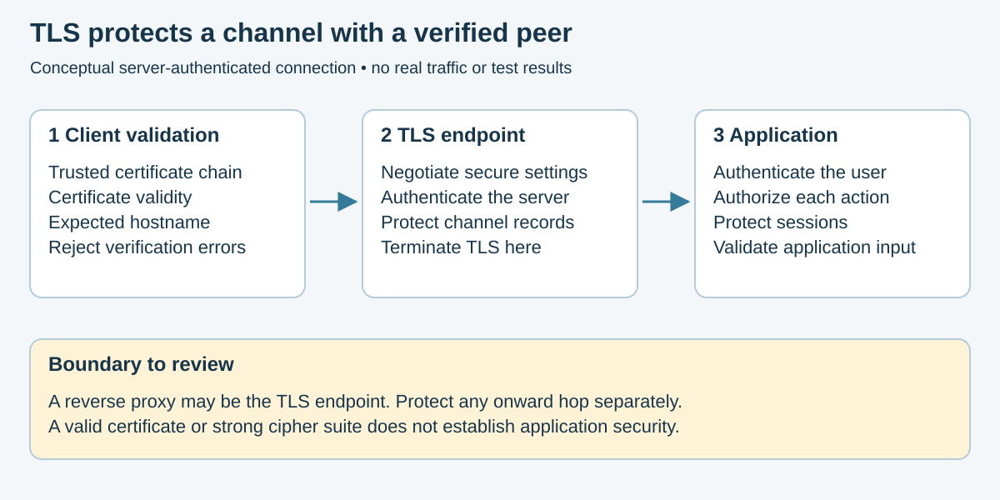
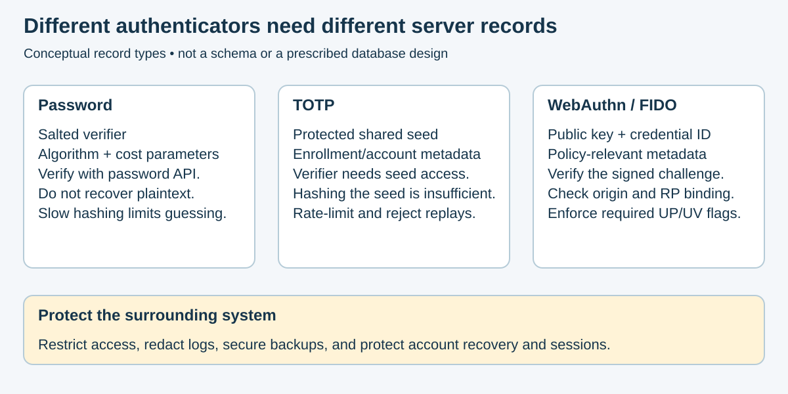
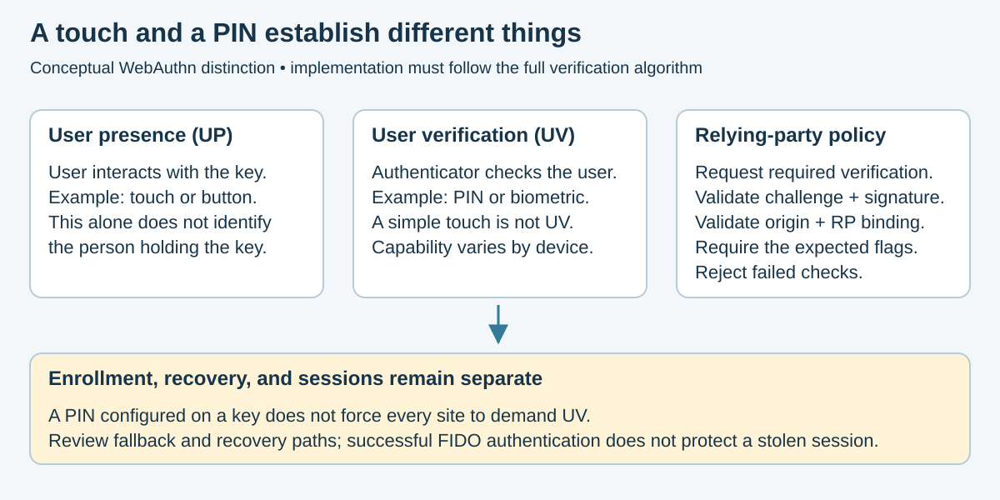
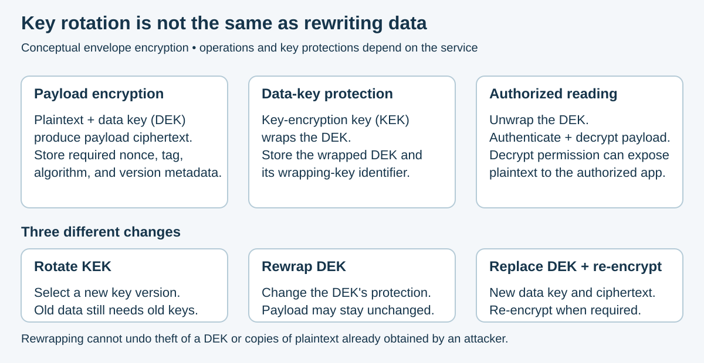

# 🔧 Applied Cryptography

> [!IMPORTANT]
> Educational reference. Use maintained cryptographic libraries and, where policy
> requires them, validated modules in their approved configurations. The failures
> below include protocol and implementation **misuses**. See the
> [section notice](README.md#-important-notice).

## 🎯 Purpose

How to apply cryptography correctly in practice - transport security (TLS),
password storage, MFA/2FA, key management, randomness, and the recurring
mistakes to avoid.

## ⚙️ Function

Covers TLS configuration, password storage, phishing-resistant MFA/2FA,
key management and rotation, secure randomness, and a catalog of common
cryptographic mistakes with fixes.

## 🏆 Goal

Let a reader implement or review the everyday uses of cryptography and
authentication without falling into well-known security traps.

## 📋 When to Use

- Configuring or reviewing TLS
- Implementing password storage
- Implementing or reviewing MFA/2FA
- Selecting passkeys, hardware security keys, TOTP, or other authentication methods
- Implementing key management
- Reviewing code for cryptographic misuse

**Source and visual review:** November 20, 2026. Diagrams are conceptual;
no live TLS, identity-provider, hardware-key, or key-management testing was performed.

---

## 📋 Table of Contents

- [Transport Security (TLS)](#transport-security-tls)
- [Password Storage](#password-storage)
- [Multi-Factor Authentication (MFA/2FA)](#multi-factor-authentication-mfa2fa)
- [Hardware Security Keys](#hardware-security-keys)
- [Key Management](#key-management)
- [Randomness](#randomness)
- [Common Mistakes](#common-mistakes)
- [Resources](#-resources)

---

## Transport Security (TLS)

- **Prefer TLS 1.3**; retain TLS 1.2 only with current secure configuration and a
  compatibility need. Disable TLS 1.0/1.1 and SSLv3.
- **Cipher suites and groups:** use AEAD suites and ephemeral key exchange for
  forward secrecy. In TLS 1.3, the cipher suite does not select the key-exchange
  group or certificate signature algorithm; configure these separately.
- **Certificates:** validate trust chains, validity, and the intended hostname. Follow
  applicable standards and policy for algorithm and security strength. NIST's
  [announced SP 800-52 revision plan](https://csrc.nist.gov/pubs/sp/800/52/r2/final)
  includes a 128-bit minimum, but that revision is pending; verify current
  requirements instead of relying on a universal key-size example. Automate renewal.
- **HTTPS:** deploy HSTS only after validating the site's HTTPS coverage and
  subdomain requirements. It is an HTTP browser policy, not a replacement for
  certificate validation.
- **0-RTT early data:** leave it disabled unless the application protocol has an
  explicit replay-safe design.
- **Test:** tools such as `testssl.sh`, Qualys SSL Labs, or `sslyze` can inspect
  supported configurations. A grade or a single successful handshake does not
  validate application authorization, endpoints, or every client path.

See [RFC 9325](https://www.rfc-editor.org/rfc/rfc9325) for current TLS deployment
recommendations and [RFC 6797](https://www.rfc-editor.org/rfc/rfc6797) for HSTS.

```bash
# Inspect one HTTPS handshake; abort on chain or hostname verification errors.
# POSIX-shell example: replace example.com with an authorized test endpoint.
openssl s_client -connect example.com:443 -servername example.com \
  -verify_hostname example.com -verify_return_error -brief </dev/null
```

The example uses OpenSSL's configured trust store; a private service may require
an explicitly trusted CA file. Keep error output visible. See the
[OpenSSL s_client options](https://docs.openssl.org/3.5/man1/openssl-s_client/).
This is a documentation example, not a recorded connection test.



*Conceptual TLS boundaries. Based on [RFC 9325](https://www.rfc-editor.org/rfc/rfc9325);
this depicts the ordinary server-authenticated case, not a complete handshake or packet capture.*

---

## Password Storage

- Use a dedicated **password-hashing** API. Argon2id and scrypt are memory-hard;
  bcrypt is a different password-hashing design and should not be described as
  memory-hard like them. Prefer a supported Argon2id implementation where policy
  permits; see [RFC 9106](https://www.rfc-editor.org/rfc/rfc9106) and
  [algorithms.md](algorithms.md#key-derivation-functions-passwords).
- With bcrypt, check the library's input-length behavior before migration;
  [Go's bcrypt API](https://pkg.go.dev/golang.org/x/crypto/bcrypt) rejects passwords
  longer than 72 bytes. Do not silently truncate or invent a prehash scheme.
- Use a **unique random salt per password**; the KDF normally handles this.
- Benchmark memory and time costs on deployment hardware, including peak login
  concurrency and denial-of-service limits. Store algorithm, salt, and cost
  parameters with the verifier, and upgrade them during verified logins.
- Consider a server-side **pepper** stored separately in a KMS or HSM.
- Check credentials against breached-password lists and support MFA.
- Never log, email, or store plaintext passwords.
- Never use reversible encryption as a substitute for password hashing.
- Don't count leet substitutions (`P@55w0rd`) as added strength; cracking tools apply them automatically ([details](Classical/security.md#leet-in-passwords)).

---

## Multi-Factor Authentication (MFA/2FA)

Multi-factor authentication requires proof from at least two **different**
authentication-factor categories:

| Factor | Meaning | Examples |
|---|---|---|
| Something you know | Knowledge controlled by the user | Password, PIN |
| Something you have | A device or credential the user possesses | Passkey, hardware security key, authenticator app, smart card |
| Something you are | A biometric characteristic | Fingerprint, facial recognition, iris scan |

A password and a PIN are both knowledge factors and therefore do **not**
constitute 2FA. Two-factor authentication uses two distinct factors,
while MFA uses two or more. A passkey can combine possession with local PIN or
biometric activation, but its name alone does not establish the achieved
assurance level. Require and validate user verification where the policy needs
it; see [NIST SP 800-63B-4](https://pages.nist.gov/800-63-4/sp800-63b.html).

### Recommended Authentication Methods

Use the strongest practical option for the application and its threat model:

1. **Passkeys or FIDO2/WebAuthn security keys**
   - Preferred for administrative, privileged, financial, and high-risk accounts.
   - Resistant to credential phishing because authentication is bound to the
     legitimate application or domain.
   - Use device-bound or hardware-backed credentials when stronger assurance
     and non-exportable keys are required.
   - Allow users to register more than one authenticator to prevent lockout.

2. **Time-Based One-Time Passwords (TOTP)**
   - An acceptable fallback when passkeys or security keys are unavailable.
   - Use the standards-based TOTP protocol defined by RFC 6238.
   - Protect TOTP enrollment secrets using encryption and restricted access.
   - Display the enrollment QR code only during initial setup.
   - Use short validity periods, strict attempt limits, and replay prevention.
   - TOTP codes are still vulnerable to real-time phishing and adversary-in-the-middle attacks.

3. **Push-Based Authentication**
   - Bind approval to the transaction (for example, transferring a displayed
     number into the authenticator); provide application and device context.
     Geolocation is a risk signal, not proof of the requester's identity.
   - Rate-limit requests and block repeated prompts to reduce MFA-fatigue attacks.
   - Never rely on a simple, context-free **Approve/Deny** prompt for privileged access.
   - Push approval is not automatically phishing-resistant.

4. **SMS or Voice Codes**
   - Use only when stronger methods are unavailable or as a carefully controlled
     recovery option.
   - SMS and voice authentication are vulnerable to SIM swapping, number
     reassignment, interception, social engineering, and telecom-provider compromise.
   - Do not use SMS as the preferred factor for privileged or high-value accounts.

5. **Email Codes**
   - Email is generally a weak second factor when the same password, device,
     browser session, or identity provider controls both accounts.
   - NIST SP 800-63B-4 prohibits email for out-of-band authentication. Email
     address confirmation and specified recovery-code delivery are separate
     processes; their availability does not make email a compliant login factor.
     See [NIST's out-of-band requirements](https://pages.nist.gov/800-63-4/sp800-63b.html#out-of-band).

### Implementation Requirements

- Require MFA for administrators, remote access, cloud-management consoles,
  email, financial systems, source-code repositories, and other sensitive services.
- Offer a phishing-resistant authentication option wherever practical.
- Apply MFA consistently across web, mobile, API, VPN, legacy, and recovery paths.
- Require step-up authentication before sensitive actions, including:
  - Changing a password or primary email address
  - Adding, replacing, or removing an MFA factor
  - Disabling MFA
  - Viewing or regenerating recovery codes
  - Elevating to an administrative session
  - Changing payment, security, or account-recovery settings
- Require recent reauthentication with an existing enrolled factor before
  allowing factor replacement.
- If no enrolled factor remains usable, use the documented recovery process
  below; do not silently waive verification or let possession of a session
  alone authorize replacement.
- Do not rely solely on an active session when changing authentication settings.
- Notify the user through a separate channel when a factor is added, removed,
  replaced, or used for account recovery.
- Rate-limit failed authentication attempts and detect repeated MFA prompts.
- Prevent reuse of OTPs, recovery codes, challenges, and authentication assertions.
- Log enrollment, use, failure, removal, and recovery events without logging secrets.
- Protect cookie-based sessions with `Secure`, `HttpOnly`, appropriate `SameSite`
  and scope settings, session renewal, and application-specific CSRF controls.

### TOTP Secret Handling

Unlike passwords, a server normally needs access to the original TOTP secret to
verify future codes. A one-way password hash is therefore not sufficient.
[RFC 6238](https://www.rfc-editor.org/rfc/rfc6238) specifies a shared secret,
protected key storage, and rejection of an already accepted OTP.

- Generate TOTP secrets using a cryptographically secure random-number generator.
- Encrypt TOTP secrets at rest using a KMS, HSM, or protected application key.
- Restrict decryption access to the authentication service.
- Never log or expose TOTP secrets in telemetry, support tools, or error messages.
- Rate-limit verification attempts.
- Reject a previously accepted code within its valid time window.
- Rotate the TOTP secret when compromise is suspected or a factor is re-enrolled.



*Conceptual server records, not a database schema. Compare [Argon2](https://www.rfc-editor.org/rfc/rfc9106),
[TOTP](https://www.rfc-editor.org/rfc/rfc6238), and [WebAuthn credential records](https://www.w3.org/TR/webauthn-3/#credential-record).
Backup, logging, and access controls must cover each record type.*

### Recovery and Factor Replacement

Account recovery must not become an easier way to bypass MFA.

- Generate high-entropy, **single-use recovery codes** with a CSPRNG.
- Store recovery codes using a one-way hash rather than plaintext.
- Show recovery codes only when created or regenerated.
- Invalidate each recovery code immediately after use.
- Invalidate old recovery codes when a new set is generated.
- Encourage enrollment of multiple authenticators, such as two hardware keys.
- Require strong identity verification for help-desk or support-assisted recovery.
- Apply additional review, delays, or step-up verification to recovery requests
  involving privileged or high-value accounts.
- Notify users immediately when recovery is attempted or completed.
- Never use security questions as an authentication or recovery factor.

---

## Hardware Security Keys

For a dedicated current overview of **FIDO2, WebAuthn, passkeys, L1/L2/L3 certification levels** and SoloKeys, see [Security Keys and Passkeys](./security-keys-passkeys.md) and [SoloKeys](./solokeys-guide.md). Hardware FIDO authentication is not itself a removable-drive encryption method; see [Encrypted Storage](./encrypted-storage.md).

Hardware security keys, including YubiKeys, Google Titan Security Keys, FEITIAN
keys, and other FIDO-certified authenticators, store cryptographic credentials
in dedicated hardware.

For hardware-bound FIDO2/WebAuthn credentials, the private key is retained by
the authenticator. The service stores a credential record containing the public
key, identifier, and relevant metadata, rather than a shared signing secret.
Authentication signs a fresh service challenge and binds the result to the
relying party. The service must validate the complete assertion.

### Why Use a Hardware Security Key?

- **Phishing resistance:** FIDO2/WebAuthn credentials are bound to the legitimate
  website or application and cannot be used on a look-alike phishing domain.
- **No reusable server-side secret:** The service stores a public key rather than
  a password-equivalent shared secret.
- **Hardware-backed key protection:** Private keys are generated and retained
  inside the authenticator.
- **Replay resistance:** Each authentication uses a new challenge and signature.
- **User presence:** A touch or button press can confirm participation.
- **User verification:** A PIN or biometric check can verify the user locally.
  A simple touch is not user verification.
- **Portability:** A single key can protect supported accounts across multiple
  computers and mobile devices.
- **Reduced dependence on phones:** Authentication does not require SMS service,
  cellular coverage, or a phone-based authenticator.

> [!IMPORTANT]
> A hardware key is phishing-resistant only when used with a phishing-resistant
> protocol such as **FIDO2/WebAuthn** or FIDO U2F. Using a YubiKey to generate
> TOTP or HOTP codes does not make those codes phishing-resistant.

### Common Hardware-Key Categories

| Category | Examples | Primary Use |
|---|---|---|
| FIDO2/WebAuthn security key | Yubico Security Key Series, Google Titan Security Key, FEITIAN FIDO keys | Phishing-resistant web, cloud, and identity-provider authentication |
| Multi-protocol security key | YubiKey 5 Series | FIDO2, U2F, PIV, OpenPGP, OATH-TOTP/HOTP, and supported legacy authentication |
| Biometric security key | YubiKey Bio Series, FEITIAN BioPass | Hardware-backed FIDO authentication with on-key fingerprint verification |
| Compliance-focused key | FIPS-validated models from supported vendors | Regulated environments requiring specific cryptographic-module validation |

Features vary by model, firmware, connector, and vendor. Confirm protocol,
platform, FIPS, and interface requirements before purchasing or deploying keys.

### Supported Protocols

#### FIDO2 and WebAuthn

FIDO2 combines the FIDO Client to Authenticator Protocol (CTAP) with the W3C
Web Authentication API.

Use FIDO2/WebAuthn for:

- Phishing-resistant MFA
- Passwordless authentication
- Device-bound passkeys
- Administrative and privileged accounts
- Cloud applications and identity providers
- Supported Windows, Linux, macOS, Android, and iOS authentication workflows

A FIDO2 key may store:

- **Non-discoverable credentials:** Commonly used as a second factor alongside
  a username and password.
- **Discoverable credentials:** These let the authenticator locate the account's
  credential without a server-provided credential list and can support
  passwordless sign-in. Discoverability is distinct from backup eligibility:
  passkeys may be device-bound or synced, depending on the authenticator.

Hardware keys have finite storage for discoverable credentials. Capacity varies
by model and firmware, so confirm limits before large deployments.

#### FIDO U2F

FIDO U2F is the predecessor to FIDO2 and remains useful as a phishing-resistant
second factor for compatible legacy applications.

Prefer FIDO2/WebAuthn for new deployments, but retain U2F compatibility when
required by older services.

#### OATH-TOTP and HOTP

Some multi-protocol keys can store OATH-TOTP or HOTP secrets and generate codes
through an authenticator application.

- Codes remain vulnerable to real-time phishing.
- The key stores the shared OTP secret, but the service also requires that secret.
- Backing up OTP credentials may require enrolling multiple keys when the original
  QR code or shared secret is issued.
- Do not confuse hardware-stored TOTP with FIDO2/WebAuthn authentication.

#### PIV Smart Card

PIV-compatible keys can store certificates and private keys for:

- Smart-card authentication
- Certificate-based workstation login
- Client TLS authentication
- Document or code signing
- Encryption and decryption
- Supported SSH and administrative authentication workflows

Change default PIV PINs, PUKs, and management keys before deployment. Protect
management keys separately and document certificate issuance, renewal,
revocation, and recovery procedures.

#### OpenPGP

Supported keys can store OpenPGP keys for:

- Email and file encryption
- Digital signatures
- Git commit signing
- Authentication
- Supported SSH workflows

Plan and protect revocation and recovery material before deployment. An imported
key may have an offline backup; a non-exportable, hardware-generated key may not.
Test the documented recovery design using disposable credentials rather than
assuming a private key can later be exported.

### Selecting a Security Key

Consider the following requirements:

- **Protocol support:** FIDO2/WebAuthn only or multi-protocol support
- **Connector:** USB-A, USB-C, Lightning, or another supported interface
- **Wireless interface:** NFC support for compatible phones and tablets
- **User verification:** PIN or on-key biometric verification; check separately
  whether touch is required for user presence
- **Platform support:** Windows, Linux, macOS, Android, iOS, browsers, and identity providers
- **Durability:** Water, dust, crush, and tamper resistance
- **Credential capacity:** Number of supported discoverable FIDO credentials
- **Compliance:** FIPS 140-3 or other required certification
- **Attestation:** Device and model verification for managed enterprise deployments
- **Management:** Centralized inventory, provisioning, configuration, and revocation support

Purchase security keys directly from the manufacturer or an authorized reseller.
For high-assurance deployments, verify the device, packaging, firmware, and
certification status using manufacturer-supported tools and documentation.

### Recommended Enrollment Process

1. Sign in from a trusted and fully updated device.
2. Confirm the domain before beginning enrollment.
3. Require recent authentication with an existing trusted factor.
4. Initialize a FIDO2 PIN when supported or required.
5. Register the primary hardware security key.
6. Register a separate backup security key.
7. Clearly name each key in the account's security settings.
8. Generate and securely store single-use recovery codes.
9. Test both keys before ending the enrollment session.
10. Confirm that login, recovery, and factor-removal notifications are enabled.

For business deployments, record the assigned user, key model, asset identifier,
issue date, and revocation status without recording PINs, private keys, OTP
secrets, or recovery codes.

### Backup-Key Strategy

A user should not depend on a single physical key.

- Register at least **two separate hardware keys** for important accounts.
- Keep the primary key available for regular use.
- Store the backup key in a secure and physically separate location.
- Test the backup key periodically.
- Never attach the PIN directly to the key.
- Do not store the only recovery code beside the backup key.
- Consider an additional controlled spare for critical business or administrative accounts.
- Revoke a lost or stolen key immediately.
- Register the replacement before removing the final working authenticator.

Hardware-bound FIDO keys such as YubiKey passkeys are designed to be
non-exportable; registering a second hardware key creates a separate credential,
not a clone. Synced passkeys use a different backup model. See
[Yubico's passkey FAQ](https://docs.yubico.com/hardware/yubikey-guidance/best-practices/all-faq-passkeys.html).

### Priority Accounts

Use hardware security keys first on accounts that could be used to compromise
other systems:

- Primary email accounts
- Password managers
- Identity providers and single sign-on platforms
- Domain registrars and DNS providers
- Cloud-management consoles
- Source-code repositories
- Remote-access and VPN platforms
- Financial and payment accounts
- Social-media administration accounts
- Backup-management consoles
- Microsoft 365 and Google Workspace administrator accounts
- Server, hypervisor, firewall, and network-controller administration

Consider using a separate key for highly privileged administration instead of
sharing the same authenticator between routine personal activity and critical
infrastructure access.

### Enterprise Deployment

- Require FIDO2/WebAuthn for administrators and privileged roles.
- Maintain an inventory of issued, spare, lost, revoked, and returned keys.
- Define enrollment, replacement, revocation, and offboarding procedures.
- Keep controlled spare keys available for emergency replacement.
- Require reauthentication before registering or removing a key.
- Notify users and administrators when authentication factors change.
- Use attestation only when the organization must verify approved authenticator
  models or device-bound credentials.
- Test keys with every supported browser, operating system, mobile device, VPN,
  and identity provider.
- Disable or restrict weaker fallback methods that would allow attackers to
  bypass the security key.
- Verify the exact FIPS certificate, hardware model, and firmware version when
  compliance requires a validated cryptographic module.

### Lost, Stolen, or Damaged Keys

1. Use a registered backup key or approved recovery method.
2. Revoke the missing key from every associated account.
3. Review recent authentication and account-recovery activity.
4. Replace the missing key and register the replacement.
5. Investigate any unexpected login, recovery, or factor-change notifications.
6. Update the organization's asset and revocation records.

Where policy requires local PIN or biometric verification, the relying party
must request it and reject assertions without the required UV flag. Merely
setting a PIN on the key does not ensure that every service requires it. Treat a
lost key as potentially compromised and revoke its registered credentials.

### Resetting or Reassigning a Key

Resetting a security key can permanently delete its stored credentials.

Before resetting or reassigning a key:

- Confirm that every protected account has another working authenticator.
- Remove or revoke the key from each account when possible.
- Document the key's return or reassignment.
- Reset each enabled application according to manufacturer guidance.
- Verify that FIDO, PIV, OpenPGP, and OTP credentials have been removed.
- Reinitialize PINs, management keys, and organizational configuration.

Do not reset a key merely because its PIN was forgotten until another recovery
path has been confirmed.

### Limitations

Hardware security keys significantly improve authentication but do not prevent:

- Session-cookie or token theft after authentication
- Malware controlling an already authenticated endpoint
- Malicious OAuth or application-consent grants
- Weak account-recovery procedures
- Social engineering of help-desk personnel
- Authorization and access-control failures
- Abuse by an already authenticated user
- Compromise of applications that retain weaker fallback authentication

Continue to protect endpoints, sessions, recovery workflows, authorization
controls, and identity-provider configurations.



*Conceptual WebAuthn checks, based on [the W3C definitions of presence and verification](https://www.w3.org/TR/webauthn-3/#user-verification).
Touch, verification, registration, and account recovery are separate controls;
this is not a claim that a particular key or service enforces them.*

### Common Hardware-Key Mistakes

| Mistake | Fix |
|---|---|
| Enrolling only one key | Register a primary and physically separate backup key |
| Assuming hardware-stored TOTP is phishing-resistant | Use FIDO2/WebAuthn for phishing resistance |
| Leaving default PIV management credentials unchanged | Change PIN, PUK, and management keys during provisioning |
| Keeping SMS as an unrestricted fallback | Restrict or remove weaker recovery methods |
| Resetting a key before confirming account recovery | Verify another authenticator for every protected account first |
| No lost-key or revocation procedure | Document and test replacement and revocation workflows |
| Treating every key model as equivalent | Verify protocols, firmware, interfaces, capacity, and certifications |
| Buying keys from an unknown reseller | Purchase from the manufacturer or an authorized source |
| Assuming the key protects authenticated sessions | Continue protecting endpoints, cookies, tokens, and session lifetimes |
| Reusing one key for every risk level | Consider separate authenticators for privileged administration |

---

## Key Management

Key management includes authorization, recovery, versioning, and eventual key
destruction, not just algorithm selection. See
[NIST SP 800-57](https://csrc.nist.gov/pubs/sp/800/57/pt1/r5/final).

- **Never hardcode keys** in source, images, or configuration committed to Git;
  scan for leaked secrets.
- **Use a managed key service or secret-management system** with least-privilege
  access. A software vault is not inherently an HSM. Check the product's key
  export, hardware protection, recovery, and audit properties; authenticated
  workloads with decrypt permission can still obtain authorized plaintext.
- Define cryptoperiods and usage limits; rotate after suspected compromise under
  an incident-response plan. Keep key identifiers and versions with ciphertext.
- Distinguish new-key selection, rewrapping data keys, and re-encrypting payloads.
  Creating a new KMS key version does not automatically rewrite old ciphertext.
  Preserve authorized historical decryption until migration and recovery tests
  succeed; do not delete the only key for retained data.
- **Separate** key-encryption keys from data-encryption keys using envelope encryption.
- **Limit blast radius** with per-tenant or per-purpose keys where feasible.
- Log and monitor key usage without exposing key material.



*Conceptual envelope encryption. See [Google Cloud's envelope-encryption model](https://docs.cloud.google.com/kms/docs/envelope-encryption)
and [rotation behavior](https://docs.cloud.google.com/kms/docs/key-rotation).
Exact migration operations depend on the service. Rewrapping cannot undo exposure
of a stolen data key; compromise response may require new data keys and payload
re-encryption. Copies already obtained by an attacker remain exposed.*

---

## Randomness

- Use a **cryptographically secure PRNG**:
  - Linux OS randomness through an appropriate library or [`getrandom(2)`](https://man7.org/linux/man-pages/man2/getrandom.2.html);
    handle errors, partial reads, and early-boot initialization correctly
  - [`secrets` in Python](https://docs.python.org/3/library/secrets.html)
  - [`crypto.randomBytes` in Node.js](https://nodejs.org/api/crypto.html#cryptorandombytessize-callback)
  - [`SecureRandom` in Java](https://docs.oracle.com/en/java/javase/25/docs/api/java.base/java/security/SecureRandom.html),
    without replacing its entropy source with a predictable manual seed
- **Never** use `rand()`, Python's default `random` generator, `Math.random()`, or
  a time-seeded simulation PRNG for
  keys, tokens, OTPs, recovery codes, IVs, salts, or session IDs.
- Generate IVs and nonces according to the cipher's requirements. Randomness and
  uniqueness are different properties; a random nonce can still collide. Use the
  library's documented strategy, per-key message limits, and safe restart behavior.
- **Never reuse** a `(key, nonce)` pair with GCM or ChaCha20-Poly1305.

See [Python's secrets documentation](https://docs.python.org/3/library/secrets.html)
for security-sensitive randomness and [libsodium's AEAD limits](https://doc.libsodium.org/secret-key_cryptography/aead)
for construction-specific nonce and message constraints.

---

## Common Mistakes

| Mistake | Fix |
|---|---|
| Rolling your own crypto or authentication protocol | Use vetted libraries, identity providers, and standard protocols |
| ECB mode | Use an AEAD mode such as GCM or ChaCha20-Poly1305 |
| Reused IV/nonce with GCM | Use a unique nonce per encryption and rotate keys before exhaustion |
| Encryption without authentication | Use a library's authenticated-encryption API or a reviewed protocol; do not invent a composition |
| Fast hash such as MD5 or SHA for passwords | Use Argon2id, scrypt, or bcrypt with a per-password salt |
| Hardcoded or committed keys | Use a KMS/HSM and secret scanning in CI |
| `Math.random()` for tokens or recovery codes | Use a CSPRNG |
| Textbook RSA or new RSAES-PKCS1-v1_5 encryption | Use a reviewed protocol with RSA-OAEP where RSA encryption is required; prefer RSA-PSS for new RSA signatures. Do not conflate legacy signature and encryption padding |
| Trusting unauthenticated ciphertext | Use authenticated decryption; accept and release plaintext only after tag validation succeeds, and fail closed on errors |
| Calling a password and PIN “2FA” | Use factors from two different authentication categories |
| Using SMS as the preferred second factor | Prefer passkeys, WebAuthn security keys, or TOTP |
| Assuming all MFA is phishing-resistant | Use FIDO2/WebAuthn or another verifier-bound cryptographic method |
| Storing TOTP seeds in plaintext | Encrypt secrets with a KMS/HSM and restrict decryption access |
| Reusable or predictable recovery codes | Generate high-entropy single-use codes and store them hashed |
| Weak MFA reset or replacement workflow | Require existing-factor reauthentication, notify the user, and apply risk checks |
| Unlimited push requests | Rate-limit requests and use number matching to reduce MFA fatigue |
| Ignoring the quantum horizon | Inventory vulnerable public-key uses and plan a standards-based PQC transition; use hybrid designs only where a reviewed protocol and policy specify them |

---

The RSA distinction follows [RFC 8017](https://www.rfc-editor.org/rfc/rfc8017).
For PQC planning, see [NIST IR 8547 (final, October 2026)](https://csrc.nist.gov/pubs/ir/8547/final);
combining algorithms does not by itself establish security.

## 📚 Resources

### Cryptography and TLS

- [OWASP Cryptographic Storage Cheat Sheet](https://cheatsheetseries.owasp.org/cheatsheets/Cryptographic_Storage_Cheat_Sheet.html)
- [OWASP Transport Layer Security Cheat Sheet](https://cheatsheetseries.owasp.org/cheatsheets/Transport_Layer_Security_Cheat_Sheet.html)
- [NIST SP 800-57 Part 1 - Key Management](https://csrc.nist.gov/pubs/sp/800/57/pt1/r5/final)
- [testssl.sh](https://testssl.sh/) - TLS configuration testing
- [libsodium](https://doc.libsodium.org/) - high-level cryptography APIs; follow each API's nonce and usage requirements
- [RFC 9325 - Secure TLS Deployment](https://www.rfc-editor.org/rfc/rfc9325)
- [OpenSSL s_client](https://docs.openssl.org/3.5/man1/openssl-s_client/)
- [RFC 9106 - Argon2](https://www.rfc-editor.org/rfc/rfc9106)
- [NIST IR 8547 - PQC Transition](https://csrc.nist.gov/pubs/ir/8547/final)

### MFA and Authentication

- [NIST SP 800-63B-4 - Authentication and Authenticator Management](https://pages.nist.gov/800-63-4/sp800-63b.html)
- [OWASP Multifactor Authentication Cheat Sheet](https://cheatsheetseries.owasp.org/cheatsheets/Multifactor_Authentication_Cheat_Sheet.html)
- [FIDO Alliance Passkeys](https://fidoalliance.org/passkeys/)
- [Web Authentication: WebAuthn Level 3](https://www.w3.org/TR/webauthn-3/)
- [RFC 6238 - Time-Based One-Time Password Algorithm](https://datatracker.ietf.org/doc/html/rfc6238)

### Hardware Security Keys

- [FIDO Alliance](https://fidoalliance.org/) - FIDO standards, certification, and deployment resources
- [FIDO Certified Products](https://fidoalliance.org/certification/fido-certified-products/) - Searchable directory of certified authenticators
- [YubiKey 5 Series Technical Manual](https://docs.yubico.com/hardware/yubikey/yk-tech-manual/)
- [YubiKey Protocols and Applications](https://docs.yubico.com/hardware/yubikey/yk-tech-manual/yk5-apps-index.html)
- [Yubico Hardware-Backed Passkey Guidance](https://docs.yubico.com/hardware/yubikey-guidance/best-practices/all-faq-passkeys.html)

---

## Applied encryption hardware research

See [Encrypted Drives and Removable Storage](./encrypted-storage.md) for production tool categories and recovery controls. [PhantomDrive](./phantomdrive-guide.md) is a separate CH569W hidden-volume experiment with configurable AES-XTS/CTR builds; use only synthetic test files. This guide does not establish an independent security validation of either DIY project; do not present them as validated client-data storage products.

[PNWC ESP32-S3 Encrypted Vault](https://github.com/Pnwcomputers/esp32-s3-encrypted-vault) is a practical development project using AES-256-GCM encrypted microSD storage and a local ESP32-S3 unlock workflow. Read its current threat model, key derivation, firmware build notes and recovery limitations before testing. **The upstream README labels it a development build for disposable test data; do not rely on it for production secrets or irreplaceable files.** This provides a case study in authenticated encryption, key handling, USB exposure, and embedded-device attack surfaces. The upstream status is a project claim, not hardware testing or independent certification performed for this guide.

## Related Files

- [README.md](README.md) - Cryptography section index
- [algorithms.md](algorithms.md) - Algorithm reference by primitive
- [security-keys-passkeys.md](security-keys-passkeys.md) - FIDO2, passkeys, assurance levels
- [solokeys-guide.md](solokeys-guide.md) - SoloKeys setup and safe evaluation
- [encrypted-storage.md](encrypted-storage.md) - removable drive encryption and recovery
- [phantomdrive-guide.md](phantomdrive-guide.md) - experimental hidden encrypted USB
- [Classical/](Classical/) - Classical ciphers, leetspeak, homoglyphs, and cryptanalysis
- [../OPSEC/press-freedom/README.md](../OPSEC/press-freedom/README.md) - source confidentiality and press-freedom protection
- [../Documentation/VPN.md](../Documentation/VPN.md) - Applied transport encryption
- [../WebAppSecurity/owasp-top-10.md](../WebAppSecurity/owasp-top-10.md) - A04 Cryptographic Failures

---

[Section Index](README.md) | [Master Index](../README.md) | [Legal Notice](../LEGAL.md)

