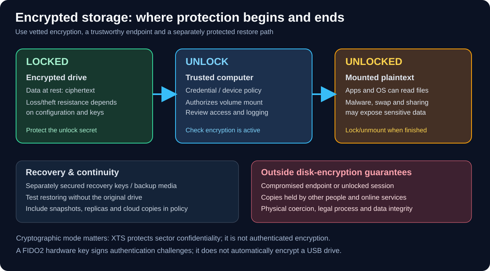

# Encrypted Drives, Removable Storage, and Key Protection

_Last reviewed: 2026-11-01 (documentation review; no hardware testing performed)_

Part of [Cryptography](./README.md) in the [Ultimate Cybersecurity Master Guide](../README.md).

## Purpose

Select, set up, and evaluate encrypted drives for portable workflows, secure backups, and authorized client engagements. This guide distinguishes **data-at-rest encryption** from **authentication keys** and **hidden-volume behavior**.

> [!IMPORTANT]
> Encryption protects a **locked** volume against certain offline access threats. It does not make an unlocked host trustworthy, guarantee data integrity, erase host-side traces, or replace backups. Verify regulatory and client-specific requirements before storing evidence or protected information.

## Choose the right design

*Encryption is strongest against offline access to **locked** data. Once mounted, the trusted host and its applications can access plaintext; use independently protected backups and test recovery.*

| Approach | Common examples | Strengths | Important limitations |
|---|---|---|---|
| Operating-system disk encryption | BitLocker, FileVault, Linux LUKS2/dm-crypt | Mature OS integration, practical full-disk protection | Depends on boot security, configuration, recovery-key custody and endpoint trust |
| Portable encrypted container/volume | VeraCrypt | Cross-platform workflows, file-container option | Software must be available; mount state and host traces remain important |
| Hardware-encrypted removable drive | Vendor-specific encrypted USB SSD/flash drive | May support on-device PIN/keypad, management policies | Claims differ by exact model; verify validation, firmware, unlocking and recovery behavior |
| Experimental hidden encrypted USB | [PhantomDrive](./phantomdrive-guide.md) | Interesting open-source CH569W hardware and stealth-partition research | **Not professionally audited**; not for client secrets or irreplaceable data |
| Experimental DIY vault | [PNWC ESP32-S3 Encrypted Vault](https://github.com/Pnwcomputers/esp32-s3-encrypted-vault) | Hands-on embedded-storage cryptography lab | Development project; validate its threat model and tests; not production storage |
| Hardware authentication / cryptographic token | [SoloKeys, YubiKey, Nitrokey](./security-keys-passkeys.md) | Protect authentication or signing keys; some models also support OpenPGP/PIV cryptographic operations | **Not a general-purpose storage drive**; FIDO2 itself does not encrypt disks |

### Encryption is not the same as authentication

- **Storage encryption:** a secret or key-encryption key controls access to drive contents.
- **FIDO2/WebAuthn:** a private signing key authenticates to a service using origin-bound public-key challenges. It does **not** automatically unlock or encrypt a disk.
- **OpenPGP/PIV on supported multi-protocol devices:** separate application functions can protect private keys for signing or encryption. This requires application-specific setup and backups.
- **Recovery:** an account recovery code or FIDO backup key is not interchangeable with a disk recovery key, LUKS header backup, or VeraCrypt recovery procedure.

Read [Security Keys and Passkeys](./security-keys-passkeys.md) before selecting a token to complement a storage workflow.

## Threat model and selection checklist

Before purchasing or initializing any drive, record:

1. **Data classification:** ordinary files, client evidence, legal records, incident images, or personal secrets.
2. **Attacker access:** lost drive only, a stolen powered-off laptop, malicious USB host, firmware tampering, or an unlocked session.
3. **Platform support:** Windows, Linux, macOS; ability to run installers and preserve file metadata.
4. **Crypto controls:** published protocol/mode, KDF, firmware provenance, updates, independent review or relevant validation.
5. **Recovery:** availability of recovery credentials, restore tests, key rotation, and at least one separately protected backup.
6. **Operational handling:** auto-lock, removable media restrictions, approved transfer channels, USB device trust and malware scanning.
7. **Evidence integrity:** hash manifests, chain-of-custody records, write-protection where needed, and whether the encryption mode authenticates writes.

> [!WARNING]
> AES-XTS is a common disk encryption mode for confidentiality, **not authenticated encryption**. Do not infer tamper detection, integrity, or plausible deniability from an AES-256 label or the existence of a hidden partition.

## Safe inventory: identify a drive without altering it

Use a **disposable test drive first**, confirm the identifier and capacity, and never run format, partition, or encryption-initialization commands against a drive with valuable files.

### Windows (PowerShell; read-only)

~~~powershell
Get-Disk | Select-Object Number,FriendlyName,SerialNumber,Size,PartitionStyle
Get-Volume | Select-Object DriveLetter,FileSystemLabel,FileSystem,Size
manage-bde -status
~~~

The BitLocker status command reports volume encryption state; it does not prove the effectiveness of an entire backup/recovery workflow.

### Linux (read-only inventory)

~~~bash
lsblk -o NAME,SIZE,MODEL,TRAN,FSTYPE,TYPE,MOUNTPOINTS
lsusb
~~~

For a **verified** LUKS device only, optional header inspection (no passphrase entered):

~~~bash
# Replace the example with the known, verified LUKS block-device path.
sudo cryptsetup luksDump /dev/disk/by-id/YOUR-VERIFIED-DEVICE
~~~

Never infer the correct target from /dev/sdX lettering alone; identifiers can change as drives are attached.

## Operational procedure for a client engagement

**Before collection:** verify written scope and retention policy; inventory the drive; check the available capacity and current lock state; confirm the backup and recovery method; record operator and serial number. Prefer vetted encryption over a demonstration build.

**During collection:** keep a validated evidence hash log; use known-clean workstations; minimize time spent unlocked; avoid placing credentials in screenshots, scripts, shared notes, swap, or shell history. For forensic acquisitions, use appropriate write-blocking and preserve originals.

**After collection:** safely dismount and lock; verify the volume is not accessible without the expected credential; preserve recovery materials separately; move evidence into approved storage; test restoration on a spare device; log disposition and retention date.

### Suggested acceptance tests (disposable dummy data only)

- [ ] Device and firmware model identified accurately
- [ ] Locked contents inaccessible on a second clean computer
- [ ] Correct unlock works after safe eject and power cycle
- [ ] Incorrect unlock fails without disclosing meaningful information
- [ ] Files survive normal unplug/reconnect *after safe ejection*
- [ ] Backups can be restored independently of the original device
- [ ] Changes and test files are validated with SHA-256 hashes
- [ ] Recovery materials are not stored on the protected volume alone
- [ ] Applicable compliance and product certification claims independently verified

## Storage technology notes

- **BitLocker / BitLocker To Go:** manage protectors and recovery information through supported Windows and enterprise policy; do not assume removable-drive settings mirror OS-drive defaults.
- **LUKS2/dm-crypt:** securely retain recovery information and, where appropriate, a protected LUKS header backup; destroying or overwriting a header can make data unrecoverable.
- **VeraCrypt:** evaluate encrypted containers and volume support on all intended platforms, plus backup, header recovery, and mount-time exposure.
- **Hardware-encrypted USB:** investigate on-device PIN throttling, failure lockout, key destruction policy, supply-chain and firmware updates. Verify each specific model rather than trusting broad marketing terms.
- **PhantomDrive:** see [the research-specific guide](./phantomdrive-guide.md) for its AES-XTS/CTR build variants and unlock caveats.

## See also

- [PhantomDrive research and safe evaluation](./phantomdrive-guide.md)
- [Security keys, FIDO2, passkeys and certification](./security-keys-passkeys.md)
- [SoloKeys setup and verification](./solokeys-guide.md)
- [Applied Cryptography](./applied-crypto.md)
- [OPSEC and portable workstations](../OPSEC/README.md)
- [PNWC Network Audit Playbook](../PlayBooks/NetworkAuditPlayBook.md)
- [PNWC ESP32-S3 Encrypted Vault](https://github.com/Pnwcomputers/esp32-s3-encrypted-vault)

## Official references

- [NIST SP 800-57 key management](https://csrc.nist.gov/pubs/sp/800/57/pt1/r5/final)
- [OWASP Cryptographic Storage Cheat Sheet](https://cheatsheetseries.owasp.org/cheatsheets/Cryptographic_Storage_Cheat_Sheet.html)
- [Microsoft BitLocker documentation](https://learn.microsoft.com/windows/security/operating-system-security/data-protection/bitlocker/)
- [cryptsetup project](https://gitlab.com/cryptsetup/cryptsetup)
- [VeraCrypt documentation](https://veracrypt.io/en/Documentation.html)

---

[Section Index](./README.md) | [Master Index](../README.md) | [Legal Notice](../LEGAL.md)
