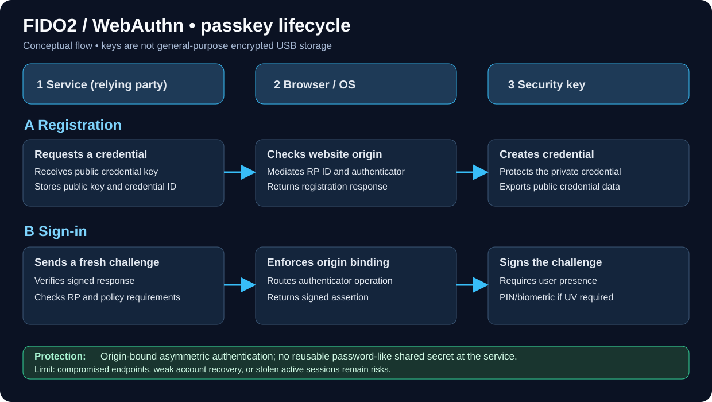

# Hardware Security Keys, FIDO2, Passkeys, and Certification Levels

_Last reviewed: 2026-11-01 (standards and official documentation reviewed; no device testing performed)_

Part of [Cryptography](./README.md). Related: [SoloKeys hands-on guide](./solokeys-guide.md), [Encrypted Storage](./encrypted-storage.md), and [Applied Cryptography](./applied-crypto.md).

## What is a security key?

*FIDO2 overview: the authenticator protects a credential's private key while the service uses public-key challenge verification. Browser origin binding and user presence/verification are separate checks. This is a conceptual diagram, not a certification of any device.*

A **hardware security key** (roaming authenticator) can hold or derive cryptographic credentials used to prove account possession. In a standard FIDO/WebAuthn sign-in, a service verifies a signed challenge using a **public key**; a corresponding private credential secret remains protected by the authenticator's design. Browser origin binding helps resist look-alike login sites.

A key's **touch/user presence** is not necessarily the same as **user verification** (PIN or biometric). Confirm what the service enforces. A hardware key is not inherently a general-purpose encrypted flash drive.

## Protocol and term reference

| Term | What it means | Main use |
|---|---|---|
| FIDO2 | Family of WebAuthn + CTAP standards | Passwordless sign-in and phishing-resistant MFA |
| WebAuthn | W3C browser/platform API for public-key credentials | Website and application registration and sign-in |
| CTAP2 | Client-to-Authenticator Protocol | Communicates with external/roaming authenticators |
| FIDO U2F / CTAP1 | Predecessor protocol; usually password + second factor | Legacy phishing-resistant MFA |
| Passkey | FIDO-based authentication credential | Passwordless account sign-in, or a phishing-resistant factor |
| Discoverable credential | Authenticator can find a credential for an RP without a supplied credential ID | Usernameless/passkey flows where supported |
| Non-discoverable credential | Service provides credential identifier for lookup | Frequently second-factor flows |
| User presence (UP) | User physically acknowledges use, e.g., by touch | Reduces silent authenticator use |
| User verification (UV) | Authenticator verifies PIN, biometric, etc. | Stronger local verification and multi-factor use |
| Attestation | Evidence about authenticator origin/model, when provided and trusted | Managed-device assurance policies |
| AAGUID | Authenticator model/type identifier within FIDO metadata | Enterprise allowlisting with other checks |
| PIV / OpenPGP / OATH | **Separate**, model-dependent cryptographic applications | Smart cards, file/SSH signing/encryption, TOTP/HOTP |

### Passkeys: synced vs device-bound

**Synced passkeys:** credential material is protected and synchronized by a passkey provider across user devices. They improve usability and are phishing-resistant, but organizational assurance depends on provider account security, recovery, device enrollment and sharing controls.

**Device-bound passkeys:** credential private keys remain bound to one authenticator or device. Hardware security keys are a common example; they are useful when organizations need controlled physical custody and stronger non-exportability assurances.

**AAL2/AAL3 are not FIDO certification levels.** NIST SP 800-63B-4 defines authenticator assurance requirements. For **AAL3**, credentials must meet non-exportability, phishing resistance and applicable cryptographic validation requirements; syncable passkeys cannot satisfy AAL3. A FIDO label by itself does **not** certify a complete deployment to NIST AAL3.

## FIDO Authenticator Certification Levels (not protocol versions)

These levels build on each other. A device's **specific model, firmware and certification entry** determine its verified level.

| Level | Description / main assurance distinction |
|---|---|
| **L1** | Baseline FIDO authenticator security and interoperability; safeguards against scalable remote attacks |
| **L1+** | Software-authenticator hardening and additional independent testing |
| **L2** | Stronger isolation of authenticator operations in an allowed restricted operating environment; accredited-lab document review |
| **L3** | Adds independently evaluated protection against physical attacks such as probing and certain fault/side-channel attacks |
| **L3+** | Highest level, including stronger secure-element and invasive-attack resistance requirements |

> [!IMPORTANT]
> **FIDO L2 ≠ FIDO2; FIDO L2 ≠ NIST AAL2; FIDO L2 ≠ FIPS 140 Level 2.**
> Certification claims must be checked in the [FIDO Certified Products database](https://fidoalliance.org/certification/fido-certified-products/) for the **exact product and version**. A vendor claiming FIDO2 protocol support does not by itself establish a particular security certification level.

See the [FIDO Authenticator Security Levels](https://fidoalliance.org/security-certification-authenticator-security-levels/) for the current detailed requirements.

## Comparing devices and approaches

| Device / family | Typical roles | Selection notes |
|---|---|---|
| [SoloKeys / Solo 2](./solokeys-guide.md) | Open-source FIDO2 security key; Solo 2 also documents model-dependent OATH, PIV, and OpenPGP apps | Distinguish production **Secure** firmware lock state from **Hacker** unlocked firmware |
| [YubiKey](https://www.yubico.com/products/) | FIDO2-only and multi-protocol product lines | PIV, OpenPGP, OTP, NFC, firmware and FIPS vary by model |
| [Nitrokey](https://www.nitrokey.com/) | FIDO2 and other model-dependent security functions | Check exact model's secure-element, OpenPGP/PIV and firmware capabilities |
| [Google Titan Security Key](https://store.google.com/) | FIDO security-key sign-in | Verify current model, connectors and account support |
| [FEITIAN](https://www.ftsafe.com/) | FIDO authenticators and smart-card options | Model-specific certification, form factor and enterprise manageability |
| Phone or OS passkey | Convenient platform authenticator | Can be device-bound or synced, depending on credential provider and policy |

Avoid assuming each vendor or product supports the same features, certification level, firmware lifecycle or storage capacity.

## Practical enrollment: two-key policy

1. Confirm the service supports **FIDO2/WebAuthn** and whether it permits security-key-only sign-in or passkey sign-in.
2. Obtain **two trusted, independently identified keys** per high-value account where permitted: a daily key and a separately secured backup.
3. Update the device and operating system through vendor-supported methods. Confirm model and FIDO certification status where required.
4. Open the service's **Security / Passkeys / Security Keys** enrollment screen; do not follow links from unsolicited email.
5. Register the primary authenticator, set a **device PIN** when required, and test sign-in from a clean second browser/session.
6. Register and **test the backup key** independently. Record key identifier, custodian, account, enrollment date and revocation instructions without storing PINs.
7. Review weaker fallback methods, account-recovery codes and help-desk reset procedures. Protect recovery codes offline.
8. Periodically verify key inventory, lost-token response, service policy enforcement and employee offboarding.

> [!WARNING]
> Even a phishing-resistant key cannot protect an already-compromised authenticated session, a malicious endpoint, or an account recovered through an easily phished fallback. TOTP generated on a hardware key is still phishable; FIDO U2F/WebAuthn is the origin-bound protection.

## Enterprise security-key/passkey audit checklist

- [ ] Inventory high-risk accounts (admin, email, IdP, source control, financial portals)
- [ ] Record enrollment method: password + FIDO2 second factor, passkey, or synced passkey
- [ ] Verify WebAuthn origin binding and relying-party configuration
- [ ] Verify whether **user verification** is required rather than only touch
- [ ] Determine whether device-bound credentials and attestation are required
- [ ] Check exact authenticator model, firmware and FIDO certification level
- [ ] Confirm at least two functioning recovery methods with documented custody
- [ ] Review SMS, TOTP, email reset, help-desk escalation and temporary-access paths
- [ ] Test lost-key, replaced-phone and terminated-employee scenarios on **test accounts**
- [ ] Review sign-in logs, access policy, revocation and training

### Optional: Linux read-only FIDO inventory

On a Linux test workstation with the appropriate package installed:

~~~bash
# Debian/Ubuntu package is typically fido2-tools
fido2-token -L
~~~

This enumerates supported authenticators. It does **not** verify certification, credential protection, enrollment correctness or suitability for all target services.

## Security keys and disk/file encryption

The FIDO2 function signs authentication challenges; it is **not** a disk encryption key interface. Selected multi-protocol devices support **OpenPGP**, **PIV**, or integration with software that can use a protected private key; those use different protocols and recovery mechanisms. Verify the exact model and application support first. See [SoloKeys](./solokeys-guide.md) and [Encrypted Storage](./encrypted-storage.md).

## References

- [FIDO Alliance specifications (FIDO2 / WebAuthn / CTAP)](https://fidoalliance.org/specifications/)
- [FIDO authenticator security levels](https://fidoalliance.org/security-certification-authenticator-security-levels/)
- [FIDO Certified Products](https://fidoalliance.org/certification/fido-certified-products/)
- [FIDO passkeys explanation](https://fidoalliance.org/passkeys-2/)
- [NIST SP 800-63B-4](https://pages.nist.gov/800-63-4/sp800-63b.html)
- [W3C WebAuthn](https://www.w3.org/TR/webauthn-3/)

## See also

- [EUCLEAK 2024 Case Study](../CaseStudies/hardware/eucleak-yubikey-2024.md) - Physical ECDSA side channel, affected token versions and vendor guidance

- [SoloKeys and Solo 2 setup](./solokeys-guide.md)
- [Encrypted storage and key protection](./encrypted-storage.md)
- [Applied cryptography / MFA](./applied-crypto.md)
- [OPSEC](../OPSEC/README.md)

---

[Section Index](./README.md) | [Master Index](../README.md) | [Legal Notice](../LEGAL.md)
