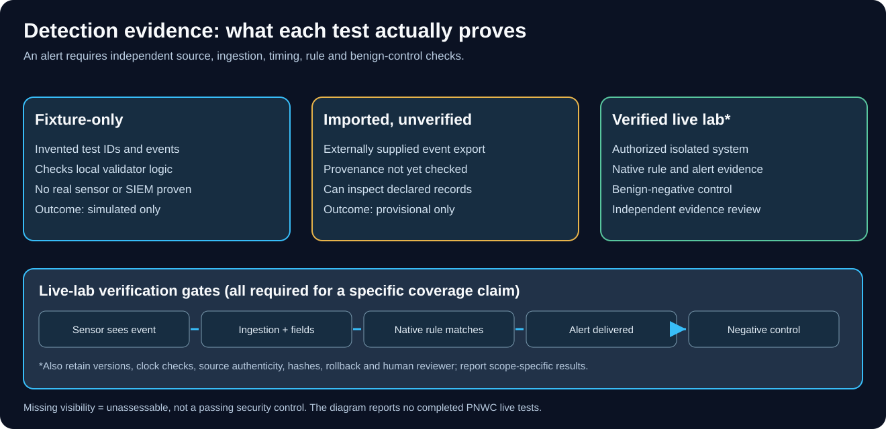

# Offline Canary Detection Evidence Validator

_Introduced November 11, 2026. This is an **evidence comparison tool**, **not** an attack engine, Wazuh emulator, SIEM connection, or hardware certification._

## Purpose & When To Use

Use `tools/lab_detection_validator.py` to compare an investigator's **declared positive and benign-negative controls** against a small normalized telemetry/alert export. It does not issue network requests, run active tests, read real environments automatically or verify who created the input.

The included fixture uses invented IDs and timestamps. It is safe for unit tests but **cannot** establish real endpoint/IDS coverage.

## Evidence Levels & Live-Lab Verification

*Conceptual evidence taxonomy.* The current tool only evaluates records supplied to it. **No real SIEM or EDR has been validated by the diagram or fixture.** A particular deployment may only be called verified when the source, event capture, actual backend evaluation, alert routing, benign control and independent review have been documented.

## Run the Offline Demonstration

From the repository root:

~~~bash
python3 -B -m unittest discover -s tools/tests -p 'test_lab_detection_validator.py' -v
python3 -B tools/lab_detection_validator.py \
  --cases Documentation/fixtures/lab-canary-cases.jsonl \
  --observations Documentation/fixtures/lab-canary-observations.jsonl \
  --evidence-origin fixture --max-latency 120
~~~

**Expected fixture-only assessment:** one true positive and one true negative. `real_siem_validated` remains `false` by design, even when the evaluator accepts imported events. The CI suite verifies the command and strict negative, missing telemetry, duplicate and latency cases. It does not prove current Wazuh/Splunk/Elastic compatibility.

## Input Contracts

Both inputs are **JSONL** (one JSON object per nonblank line, with unique keys in each object). Never put credentials, names, IP addresses or real customer data in committed fixtures.

Use `--output` with a new path to save the report. The tool rejects an existing file, including either input path. Use a fresh name for each run to preserve earlier reports and input evidence.

| File | Required JSON fields | Meaning |
|---|---|---|
| Cases | `test_id`, `source`, `event_time`, `expected_alert`, `expected_rule_ids` | Distinct case per control. UTC-offset ISO-8601 event timestamps and a string-array of expected rule IDs. Negative cases use an empty ID list. |
| Observations | `test_id`, `source`, `kind`, `timestamp` | One normalized **telemetry** or **alert** record, matched to a case and source. Alert records also need a string `rule_id`. |

**Timing contract:** `--max-latency` (seconds; finite and nonnegative) bounds both telemetry and positive-alert timestamps relative to each case's `event_time`. Delayed or prematurely timestamped telemetry is `unassessable`, even for a benign-negative case. Alert attribution is only as trustworthy as the imported `test_id` mapping and exporter; review original records before drawing conclusions.

The export adapter is **not included**. Collect a separately authorized test from an actual product, then transform it to this narrow schema **locally**. An imported file is `--evidence-origin imported-unverified` until its exporter, environment, engine version, hashes and alert mapping have been independently recorded.

## Verdict Semantics

| Verdict | Meaning | Caveat |
|---|---|---|
| `true-positive` | One timely telemetry record and exactly one matching expected-rule alert, both inside the configured latency bound; no unexpected alert | Only a claim about the supplied record set |
| `true-negative` | One timely telemetry record and no alerts for a negative control | Only within captured observations; visibility outside the test window is not established |
| `false-positive` | A negative control had one or more alerts | The analyst must still decide whether those were unexpected |
| `false-negative` | A positive control had no matching unique, timely alert | Wrong-rule, duplicate, missing or late alert is deliberately not a pass |
| `unassessable` | The required unique telemetry record is absent, duplicated, earlier than its test event, or later than the configured latency bound | Lack of visibility or timely attribution is **not** evidence of a passing benign control |

This strict validator rejects timezone-less or malformed timestamps, mismatched sources, unknown test IDs, missing paired controls, duplicate expected rule IDs, nonfinite latency limits and bad field types. A real SIEM export may contain **multiple legitimate telemetry records**; normalize/deduplicate them with an explicitly documented adapter and preserve originals privately. The tool does **not** implement full statistical detection precision, Wazuh correlation timing or event attribution.

## Live-Lab Evidence Still Required For Issue #190

1. Obtain written authorization for a specific isolated canary/VM and note the change window, stop criteria, sensor location and rollback procedure.
2. Capture product/OS/firmware versions, Git commit, actual rule revision, UTC time sync and cryptographic hashes of the test fixtures.
3. Collect a positive and a benign-negative control using **safe synthetic inputs**. Never deploy unreviewed LLM-generated exploits.
4. Run the installed vendor engine's own test mechanism (e.g. `wazuh-logtest`) and then the real ingestion pipeline. Save actual source log/manager/rule/dashboard evidence privately.
5. Produce normalized JSONL from the evidence with a reviewed local mapping and run this validator in `imported-unverified` mode.
6. Verify the hashes, source authenticity, timestamps, alert IDs, field completeness and retention; obtain independent human review. Only then record a specific **verified lab** outcome in the matrix.

**Do not publish** client telemetry, access tokens, real BSSIDs, SIEM hostnames or hardware serials in a public pull request. Different products and firmware revisions require distinct signed-off test entries.

## Related Resources

[Lab/Hardware Verification Matrix](LAB-VERIFICATION-MATRIX.md) · [Wazuh Synthetic Rule Validation](WAZUH-SYNTHETIC-RULE-VALIDATION.md) · [Verification Protocol](REPOSITORY-VERIFICATION-PROTOCOL.md) · [Case Studies](../CaseStudies/README.md)
