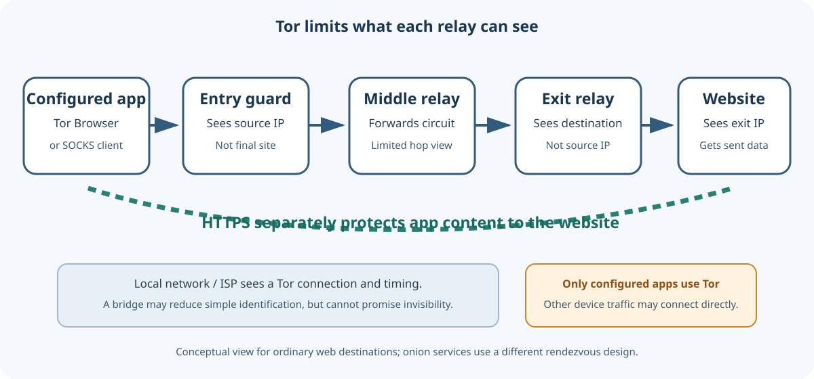
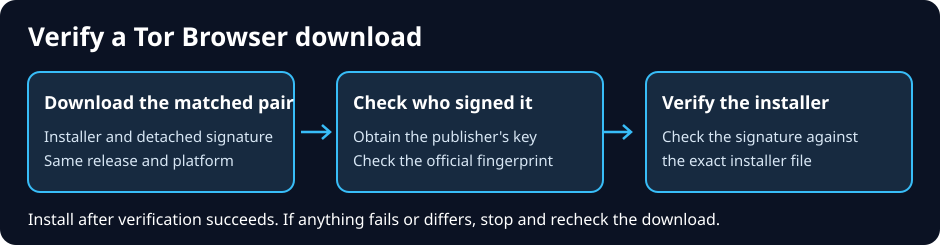

# 🧅 Tor Browser and Tor Network Guide

_Last reviewed: 2026-11-18_

Tor is a network and a set of applications that can reduce what a local network or destination learns about a user's network address. It does not provide perfect anonymity, protect every application on a device, or authorize an investigation.

**Related:** [VPN trust boundaries and safe use](VPN.md) · [Proxy types and DNS leak limitations](../OPSEC/proxy-reference-froxy.md)

## Purpose and scope

This guide explains Tor Browser, the optional Tor daemon SOCKS proxy, bridges, onion services, and verification. Use the [Tor Project documentation](https://support.torproject.org/) and [Tor Browser manual](https://tb-manual.torproject.org/) as the authority for current releases, interface labels, and supported configurations.

Use Tor only where it fits the task and organizational policy. A VPN is not a prerequisite for Tor, and the [Tor Project generally advises against combining Tor Browser with a VPN](https://support.torproject.org/tor-browser/general/vpn-with-tor/) unless the user understands the resulting trust and configuration risks.

> Tor does not protect applications that are not configured to use Tor. It does not erase account identity, browser behavior, endpoint compromise, or information intentionally sent to a service.

## Table of contents

1. [What Tor does and does not do](#1-what-tor-does-and-does-not-do)
2. [Install and update Tor Browser](#2-install-and-update-tor-browser)
3. [Tor Browser practices](#3-tor-browser-practices)
4. [Bridges and connection problems](#4-bridges-and-connection-problems)
5. [Optional Tor daemon and SOCKS use](#5-optional-tor-daemon-and-socks-use)
6. [Onion services](#6-onion-services)
7. [Verification and operational checklist](#7-verification-and-operational-checklist)
8. [Further reading](#8-further-reading)

---

## 1. What Tor does and does not do



*Conceptual circuit: relay roles and the protected application depend on Tor Browser or a correctly configured client. HTTPS provides separate encryption from the browser to the destination.*

Tor Browser sends its traffic through a circuit made from volunteer-operated relays. The entry guard sees the client's network address; the exit relay connects toward an ordinary internet destination. Each relay has a limited view, but traffic timing and other identifiers can still be correlated. For an onion service, the connection uses an onion-service rendezvous design rather than a normal exit relay.

| Observer | What it may learn |
|---|---|
| Local network or ISP | That the device connects to Tor, plus timing and volume. A bridge may make Tor traffic less immediately identifiable, but cannot promise invisibility. |
| Entry guard | The client's network address and that it is connecting into Tor; not the final destination from the circuit alone. |
| Middle relay | Adjacent relay information and traffic timing; not both the origin and destination from a circuit layer alone. |
| Exit relay | The destination address for ordinary web traffic and any application data not protected end-to-end. HTTPS protects the contents of a correctly validated HTTPS session, not all metadata. |
| Destination | The exit relay address, request metadata, and information supplied by the user or application. |

Tor Browser protects its own browser traffic. The Tor daemon exposes a local SOCKS proxy for applications that explicitly use it; it is not a system-wide tunnel or a general-purpose VPN. Apps can ignore proxy settings, make direct connections, or use protocols that do not work over SOCKS.

Tor provides no guarantee against account correlation, tracking through identifying behavior, endpoint malware, traffic analysis, or a user disclosing their identity. Do not describe a Tor session as “untraceable.”

---

## 2. Install and update Tor Browser



- Download Tor Browser only from the [official Tor Project download page](https://www.torproject.org/download/) or a distribution channel linked by the Tor Project.
- Follow the current [installation instructions](https://support.torproject.org/tor-browser/getting-started/installing/) and [signature verification instructions](https://support.torproject.org/tor-browser/getting-started/verifying-tor-browser/). Release filenames, signing keys, package methods, and verification steps change; do not copy a pinned version number or unverified mirror command from an old guide.
- Keep automatic updates enabled where available and restart the browser when an update requires it.
- On Android, use a distribution method linked from the Tor Project's current download page.
- On iOS, use a Tor Project–recommended browser and understand that Apple's platform restrictions mean it is not the Tor Browser desktop application.

Do not run an old Tor Browser because a particular website works better with it. If installation or signature verification fails, stop and resolve the issue through current official instructions.

---

## 3. Tor Browser practices

### Security level

Use the shield icon in Tor Browser to choose a security level appropriate to the work. The labels and effects below follow the Tor Project's current guidance; check its [security-level page](https://support.torproject.org/tor-browser/features/security-levels/) for updated details.

| Level | General effect | Trade-off |
|---|---|---|
| **Standard** | Browser features remain enabled for compatibility. This is the default. | More active web content is available, so exposure to browser and site attacks is greater than at stricter levels. |
| **Safer** | Disables some features that are often risky; JavaScript is disabled on non-HTTPS sites and some fonts/media are restricted. | Some sites may not work correctly. |
| **Safest** | Disables more active features, including JavaScript by default on all sites, and restricts additional media and fonts. | Many modern sites will be partly or fully unusable. |

Choose a level for the threat and content being handled. Do not claim that one level is right for every OSINT task. Tor Browser's fingerprint defenses depend in part on users sharing a common configuration; avoid custom window sizes, unusual settings, and unnecessary personalization.

### Keep the browser profile ordinary

- Do not install additional extensions, themes, or plugins. The Tor Project warns these can weaken privacy, increase attack surface, or make a browser fingerprint more unique.
- Avoid logging into accounts or submitting information that identifies you when identity separation matters.
- Do not change advanced `about:config` settings based on generic “hardening” lists. Use Tor Browser's documented controls and security levels.
- Use HTTPS and verify the correct destination before entering sensitive information.
- Tor Browser's **New Identity** closes tabs and windows, clears browser state, and uses new circuits. It interrupts activity and downloads; it does not create a new human identity or make earlier actions disappear. **New Tor Circuit for this Site** changes the circuit for the current site and is not the same as clearing all browser state. See the [Tor Project explanation](https://support.torproject.org/tor-browser/features/managing-identities/).
- Do not use torrent clients over Tor. They may ignore proxy settings, reveal an address, and impose load on the network.
- Treat documents downloaded through Tor as untrusted. An external document reader may contact the internet outside Tor. Follow the Tor Project's [download guidance](https://support.torproject.org/tor-browser/security/using-tb-safely/); inspect files offline or in an approved isolated environment.

---

## 4. Bridges and connection problems

A bridge is an alternative way to connect to Tor when direct access is blocked. It can make simple network blocking harder; it does not guarantee that an observer cannot identify Tor use.

1. Open Tor Browser's connection settings.
2. Use its built-in bridge options or obtain bridge information through the [official bridge service](https://bridges.torproject.org/) using the current supported method.
3. Follow the Tor Project's [bridge setup guide](https://support.torproject.org/tor-browser/circumvention/using-bridges/). Bridge availability and supported transports can change.
4. If a bridge stops working, request another using the official process rather than sharing private bridge details publicly.

Do not assume a specific bridge type is best for a country or network. Choose from the options available to you, and consider the personal safety implications of attempting to circumvent censorship in your location.

---

## 5. Optional Tor daemon and SOCKS use

The Tor daemon is for applications that explicitly support a SOCKS proxy or have been carefully configured to use one. Installing the daemon does **not** redirect all device traffic through Tor.

For package installation, SOCKS settings, authentication, control ports, and configuration syntax, follow the [Tor Project manual](https://community.torproject.org/onion-services/setup/) and your operating system's current package guidance. Avoid enabling a control port or exposing a SOCKS listener to the LAN unless a specific, reviewed design requires it; keep administrative interfaces local and authenticated.

A minimal connectivity check for a daemon listening on the documented local SOCKS address is:

```bash
curl --socks5-hostname 127.0.0.1:9050 https://check.torproject.org/api/ip
```

The `--socks5-hostname` option asks curl to resolve the destination through the SOCKS proxy. This command only routes that curl request through the local proxy; it does not prove that other apps use Tor. Confirm the daemon's actual listener and use Tor Project guidance for the installed package. Do not expose the SOCKS port publicly.

### Proxy wrappers and assessment tools

A proxy wrapper such as Proxychains may intercept some application traffic, but cannot guarantee that every protocol, subprocess, DNS request, or connection uses Tor. Test a specific tool in an isolated lab before relying on it.

Do not route port scans, brute-force attempts, exploitation, or other unsolicited security tests through Tor. Tor is not an authorization mechanism, and abuse can affect volunteer relays and unrelated users. For an authorized assessment, use the source address and network path agreed with the system owner.

---

## 6. Onion services

Onion services use the `.onion` namespace and are reached through Tor. Their addresses and availability can change. Do not copy long-lived onion-address tables into this guide: retrieve a current onion link from the organization's own official site or documentation and verify the organization's identity before using it. A familiar-looking address is not proof of authenticity.

To host an onion service, use the Tor Project's current [onion-service setup guide](https://community.torproject.org/onion-services/setup/). Hosting an onion service makes the configured application reachable through Tor; it does not secure that application or guarantee that the host cannot be identified through mistakes. Restrict the service to the intended local application, harden it independently, and review logs, metadata, updates, authentication, and access controls before publishing it.

---

## 7. Verification and operational checklist

### Check the browser

Visit [check.torproject.org](https://check.torproject.org) in Tor Browser. This checks the browser connection to that service at that moment. It does not test other apps, every network transition, or the endpoint for compromise. Test sites receive requests and may record them, so use them only when that is acceptable for the work.

For a local SOCKS client, use the curl example in Section 5 and confirm the request reaches the expected Tor check endpoint. Do not use an unrelated IP or DNS test as proof that all device traffic is routed through Tor.

### Before use

- [ ] Tor Browser came from an official source and is current.
- [ ] The task and network path comply with written scope and policy.
- [ ] The security level matches the threat and usability needs.
- [ ] No extra browser add-ons or custom fingerprint settings were added.
- [ ] The account, form data, and downloaded files will not disclose an unintended identity.
- [ ] Any bridge or daemon configuration follows current Tor Project documentation.
- [ ] The specific application being tested is known to use Tor; no system-wide coverage is assumed.

### During and after use

- [ ] Check destination identity and HTTPS before entering sensitive data.
- [ ] Do not use torrenting or send unauthorized scanning/testing through Tor.
- [ ] Handle downloaded files offline or in an approved isolated environment.
- [ ] Record evidence according to the case process; do not claim that Tor activity is untraceable.
- [ ] Close the browser when finished and preserve only authorized evidence.

---

## 8. Further reading

- [Tor Project Support](https://support.torproject.org/)
- [Tor Browser Manual](https://tb-manual.torproject.org/)
- [Tor Browser installation](https://support.torproject.org/tor-browser/getting-started/installing/) · [Signature verification](https://support.torproject.org/tor-browser/getting-started/verifying-tor-browser/)
- [Tor Browser security levels](https://support.torproject.org/tor-browser/features/security-levels/)
- [Using Tor Browser safely](https://support.torproject.org/tor-browser/security/using-tb-safely/)
- [Using Tor Browser with a VPN](https://support.torproject.org/tor-browser/general/vpn-with-tor/)
- [Tor bridges](https://support.torproject.org/tor-browser/circumvention/using-bridges/)
- [Onion services](https://community.torproject.org/onion-services/setup/)

## Related files

- [Documentation index](README.md)
- [VPN Security Guide](VPN.md)
- [Virtual machines](virtualmachines.md)
- [OSINT guide](../OSINT/OSINT_GUIDE.md)

---

_Maintained by: Pacific Northwest Computers (PNWC)_
