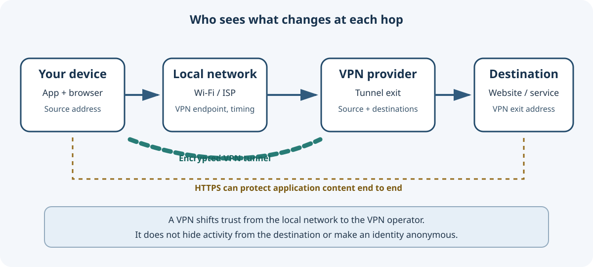

# 🔒 VPN Security Guide

_Last reviewed: 2026-11-18_

A VPN changes which network can observe your connection. It does not make activity anonymous, authorize testing, or protect traffic after it reaches the VPN exit. Use this guide to choose controls for a defined threat model and verify the behavior on your own device.

**Related:** [Proxy types and DNS leak limitations](../OPSEC/proxy-reference-froxy.md) · [Tor Browser guide](TOR.md)

## Purpose and scope

This guide covers VPN trust boundaries, provider evaluation, app kill-switch behavior, DNS, split tunneling, browser checks, Tor combinations, and safe use during authorized security work. Mullvad appears as an example because this guide previously contained Mullvad-specific commands and settings; it is not a blanket product recommendation.

A VPN may protect traffic from local network observers on untrusted Wi-Fi, mask the subscriber IP from destination services, or provide a managed corporate route. Choose the service and configuration to match the actual requirement. Follow client rules and the written engagement scope first: a consumer VPN can change the source address and break allowlists or incident-response evidence collection.

> **Do not assume that a VPN is required or permitted for every OSINT, incident-response, or penetration-test task.** Confirm the approved network path with the system owner or engagement lead. Never access a client network or test target outside written authorization.

## Table of contents

1. [How a VPN changes visibility](#1-how-a-vpn-changes-visibility)
2. [Evaluate a provider](#2-evaluate-a-provider)
3. [Mullvad as a documented example](#3-mullvad-as-a-documented-example)
4. [Kill switch and firewall behavior](#4-kill-switch-and-firewall-behavior)
5. [DNS handling](#5-dns-handling)
6. [Multi-hop](#6-multi-hop)
7. [Split tunneling](#7-split-tunneling)
8. [Browser privacy](#8-browser-privacy)
9. [VPN and Tor](#9-vpn-and-tor)
10. [Authorized security work](#10-authorized-security-work)
11. [Verification and checklist](#11-verification-and-checklist)
12. [Further reading](#12-further-reading)

---

## 1. How a VPN changes visibility



*Conceptual diagram: actual visibility depends on the VPN client, DNS route, application protocol, and provider implementation. HTTPS continues to protect application content between the client and destination.*

A VPN encrypts traffic between the device and a VPN server. It moves trust from the local access network to the VPN operator; it does not remove trust.

| Observer | Typically can observe | Usually cannot see from the tunnel alone |
|---|---|---|
| Local Wi-Fi operator or ISP | That the device connects to a VPN endpoint, timing, volume, and connection failures | The destination IPs or DNS queries carried inside an encrypted tunnel |
| VPN operator | The source network address, account or subscription metadata, tunnel timing/volume, and destinations or DNS it can observe at the exit | HTTPS-protected page content, passwords, and application data protected end-to-end |
| Destination service | VPN exit IP, request metadata, and any information the application sends | The subscriber IP, unless it leaks through another path or is disclosed |
| DNS resolver | Names queried through that resolver, plus the source address it receives | Encrypted application content |

A VPN can reduce exposure to a local network, but it can still be correlated through account activity, cookies, browser fingerprints, endpoint telemetry, timing, or information deliberately sent to a service. HTTPS remains necessary.

---

## 2. Evaluate a provider

Treat provider statements as claims to verify, not guarantees. Compare current documentation and independent evidence for the specific service, app version, platform, and plan.

| Question | What to check |
|---|---|
| What data is collected? | Privacy policy, account/payment identifiers, diagnostics, crash reports, and retention periods |
| What happens during a connection failure? | App kill switch, behavior before connection, behavior after disconnect, and any excluded apps |
| How is the software delivered? | Signed releases, update mechanism, supported operating systems, and source availability for the relevant components |
| What independent evidence exists? | Audit scope, date, version, methodology, unresolved findings, and whether results cover apps or infrastructure |
| Can the service meet operational needs? | Stable exit locations, protocol support, DNS behavior, accessibility, support, and any client allowlisting requirement |
| What are the legal and business risks? | Operator entity, infrastructure partners, ownership changes, and applicable legal process |

Country membership labels alone are not a useful provider score. Legal process, provider architecture, evidence retention, ownership, and the user's own identifiers all matter. Avoid unsupported “best VPN” rankings, fixed-price tables, and blanket claims that a jurisdiction makes a provider safe or unsafe.

A free service is not automatically malicious, and a paid service is not automatically private. Evaluate funding, data practices, independent review, and technical behavior.

---

## 3. Mullvad as a documented example

Mullvad's current desktop app uses WireGuard. The provider completed its announced OpenVPN removal on **2026-01-15**; old guides or router profiles that depend on Mullvad OpenVPN should be migrated and verified before use. See [Mullvad's OpenVPN retirement notice](https://mullvad.net/en/blog/removing-openvpn-from-the-mullvad-vpn-app).

Consult the [current app guide](https://mullvad.net/en/help/using-mullvad-vpn-app) for settings and platform differences. The app's built-in kill switch blocks traffic when a connected tunnel fails. Optional **Lockdown mode** also blocks internet access after you intentionally disconnect or quit. Split-tunneled apps remain an exception and can still reach the internet when Lockdown mode is enabled.

DAITA, multihop, quantum-resistant tunnels, anti-censorship options, DNS content blockers, and split tunneling are configuration choices, not universal “turn everything on” recommendations. Check current app documentation for availability, prerequisites, performance impact, and what traffic each setting covers. A feature label is not proof that a particular risk has been addressed.

For Linux installation and CLI syntax, use the provider's current [installation instructions](https://mullvad.net/en/download/vpn/linux) and [WireGuard CLI guide](https://mullvad.net/en/help/cli-command-wg). Commands and UI labels can change between releases. Avoid copying old commands into a production host without checking the current help output.

Basic status checks, when using the Mullvad CLI:

```bash
mullvad status
mullvad connect
mullvad disconnect
```

Use `disconnect` only when disconnecting is intended by the task and the chosen safety mode. Do not kill the daemon to test leakage: that can leave the machine in an unexpected state and does not validate the complete firewall policy.

---

## 4. Kill switch and firewall behavior

A kill switch is a traffic-blocking policy that should prevent unintended direct internet access if the VPN tunnel fails. The exact behavior varies by app, operating system, startup state, and split-tunnel configuration.

- Test the provider app's documented protection in a disposable lab or non-sensitive session.
- Distinguish failure while connected from the period before the app connects and from an intentional disconnect.
- Decide whether internet access should remain blocked after disconnect. A persistent lockdown can also block updates, local services, and remote access.
- Check which excluded apps, local-network routes, IPv6 paths, and DNS requests remain allowed.
- Keep an approved recovery path before changing firewall policy.

**Do not use a generic UFW “kill switch” recipe.** Rules depend on interface names, VPN endpoint addresses, transport ports, DNS, IPv6, boot ordering, and the existing firewall. A blanket reset or default-deny policy can remove existing protections and cut off SSH or other access. If a manually maintained firewall is required, derive a least-privilege policy from the current provider configuration and the host's existing firewall, save a rollback plan, and review it with the system owner before applying it. Never mix manual rules with an app-managed firewall without understanding which component owns them.

---

## 5. DNS handling

A DNS request can reveal the queried hostname to the resolver even though HTTPS protects page content. A VPN may route DNS through its tunnel, but custom DNS, browser DNS-over-HTTPS, split tunneling, IPv6, or OS resolver policy can create a different path.

1. Start with the VPN client's documented DNS behavior.
2. Avoid adding a second resolver or changing system-wide resolver settings unless the use case requires it.
3. Check browser DNS-over-HTTPS settings; a browser-configured resolver may differ from the OS or VPN resolver.
4. Test from a normal session using a reputable leak-check service, then compare with the provider's own connection check.
5. Treat the result as a snapshot, not proof for every application, network transition, or device state.

Do not assign DNS manually to a guessed interface such as `wg0` or hard-code a provider address without verifying that the interface exists and that the provider supports this configuration. A command that explicitly queries a public resolver (for example, `dig @resolver.example`) tests that resolver; it does not establish which resolver ordinary applications use.

---

## 6. Multi-hop

With multi-hop, traffic passes through two VPN relays before reaching the destination:

```text
Device → entry relay → exit relay → destination
```

The entry relay receives the source address; the exit relay handles traffic toward the destination. This can reduce the information visible to a single relay. It does not guarantee that separate relays have independent ownership, prevent provider-level correlation, hide activity from the VPN operator as a whole, or protect application identity. It usually adds latency and complexity.

Use it only when the threat model explains what additional separation is gained. Confirm that the product actually supports the chosen route and understand whether the first and last relays are operated by the same provider.

---

## 7. Split tunneling

Split tunneling deliberately sends selected apps or destinations outside the VPN. Those paths can expose the ordinary public IP and use a different DNS resolver. Some apps may continue bypassing the VPN even when a “lockdown” mode is enabled.

- Prefer a full tunnel for sensitive work unless a documented requirement needs an exception.
- List every excluded application and destination, who approved the exception, and how it was tested.
- Avoid excluding browsers, command shells, package managers, or assessment tools used for sensitive activity.
- Recheck exceptions after app updates and when switching networks.
- Use the VPN application's supported split-tunnel feature when appropriate; do not paste generic policy-routing or cgroup rules without a specific, reviewed design.

---

## 8. Browser privacy

A VPN does not prevent cookies, account logins, browser fingerprinting, malicious extensions, WebRTC behavior, or endpoint compromise from identifying or exposing the user.

- Keep the browser and operating system updated.
- Use a separate browser profile or managed VM only when it meaningfully separates identities and data.
- Review site permissions, extensions, proxy settings, DNS-over-HTTPS settings, and WebRTC behavior in the browser you actually use.
- Prefer a browser's built-in privacy controls over a pile of extensions or copied `about:config` recipes.
- Do not disable phishing or malware protections as a routine “hardening” step; disabling them trades away protection and should require an isolated environment and a written reason.
- Test exposure with browser-specific tools only from a session where visiting those sites is acceptable. The test site itself receives requests and may log them.

Extensions and browser internals change. Check the browser's current documentation before applying specific settings. Fingerprint spoofing can make a browser more distinctive rather than less.

---

## 9. VPN and Tor

The Tor Project generally does **not** recommend combining Tor Browser with a VPN unless the user understands both systems and configures them correctly. VPN→Tor changes what the ISP and Tor entry relay observe; it does not automatically strengthen anonymity. Tor→VPN is a separate, advanced routing design and should not be represented as a normal Tor Browser setting or a way to “make Tor anonymous.”

Use Tor Browser as documented by the Tor Project for the intended threat model. If a VPN is required by local policy or a specific access constraint, consult the [Tor Project guidance on using Tor Browser with a VPN](https://support.torproject.org/tor-browser/general/vpn-with-tor/) and assess the resulting trust and correlation risks. Do not treat a VPN/Tor stack as a shortcut around identity separation, endpoint safety, or authorization.

---

## 10. Authorized security work

### OSINT and external lookups

Before accessing a third-party service, consider what the service sees and retains: source IP, account, query, timing, and identifiers in the request. A VPN changes the network address observed by that service; it does not prevent the service from seeing the query or associating it with an account. Use an approved research account, isolated environment, and network path. Keep evidence and timestamps according to the case procedure.

Do not rotate exit locations merely to evade rate limits, access controls, or attribution. Match a source region only when required by a legitimate, documented test plan; unexpected geography can trigger fraud controls or make findings less representative.

### Penetration testing and red-team work

- Confirm in writing that the source IP, VPN provider, and test path are allowed by the engagement scope.
- Coordinate with the customer on allowlists and monitoring expectations. A consumer VPN may be prohibited or may obscure evidence needed by defenders.
- Record the approved source address and timestamps in the engagement log. Do not assume the public exit address remains stable.
- Test only the specified assets and methods. A VPN does not expand authorization.
- If a proxy is required by a tool, verify that the tool's DNS and traffic paths also use it; do not assume that `proxychains` captures every protocol or child process.

### Incident response

Use the incident plan's approved egress and evidence-handling procedures. Public threat-intelligence services may retain submitted indicators, account identifiers, and query history; evaluate those risks before uploading client data. Do not send confidential indicators to a third party without authorization, and do not connect to suspected command-and-control infrastructure as a “VPN-protected” lookup.

---

## 11. Verification and checklist

Leak tests are useful observations, not a guarantee. Run them only on a device and session where sending test requests to those services is acceptable. The VPN operator's own status page is useful, but it is not independent verification.

### Session check

1. Confirm the VPN app reports the expected connected state and relay.
2. Check the visible public IP with a service approved for the activity.
3. Run a DNS and IPv6 check; compare observed results with the chosen configuration.
4. Check browser WebRTC behavior in the browser profile being used.
5. If the network changes or the VPN reconnects, repeat relevant checks.
6. For a kill-switch test, use a disposable system or non-sensitive test session and follow the vendor's test procedure. Do not terminate production daemons or alter firewall rules as an ad-hoc test.

### Before work

- [ ] Written scope/policy allows the selected egress path.
- [ ] Correct device, VM, browser profile, and account are in use.
- [ ] VPN state and public egress address are checked where required.
- [ ] DNS, IPv6, browser proxy, and split-tunnel routes match the plan.
- [ ] Kill-switch/lockdown behavior and exceptions are understood.
- [ ] Third-party lookups are approved for the data being submitted.

### During and after work

- [ ] Keep target requests and evidence within the approved scope.
- [ ] Record timestamps, source path, and relevant egress details as required by the case.
- [ ] Do not rotate endpoints to evade monitoring or access controls.
- [ ] Preserve notes and evidence before closing or reverting a lab VM.
- [ ] Disconnect or keep the VPN connected according to the device's operating procedure; verify the expected state afterward.

---

## 12. Further reading

- [Mullvad desktop app guide](https://mullvad.net/en/help/using-mullvad-vpn-app)
- [Mullvad Linux installation](https://mullvad.net/en/download/vpn/linux)
- [Mullvad WireGuard CLI guide](https://mullvad.net/en/help/cli-command-wg)
- [Mullvad OpenVPN retirement notice](https://mullvad.net/en/blog/removing-openvpn-from-the-mullvad-vpn-app)
- [Tor Project: Tor Browser with a VPN](https://support.torproject.org/tor-browser/general/vpn-with-tor/)
- [EFF: Choosing the VPN That's Right for You](https://ssd.eff.org/module/choosing-vpn-thats-right-you)
- [Privacy Guides: VPN overview](https://www.privacyguides.org/en/vpn/)

## Related files

- [Documentation index](README.md)
- [TOR.md](TOR.md) — Tor Browser and daemon guidance
- [Proxy types and DNS leak limitations](../OPSEC/proxy-reference-froxy.md)
- [Virtual machines](virtualmachines.md) — isolation options that may suit a task better than a VPN

---

_Last reviewed: 2026-11-18_  
_Maintained by: Pacific Northwest Computers (PNWC)_
