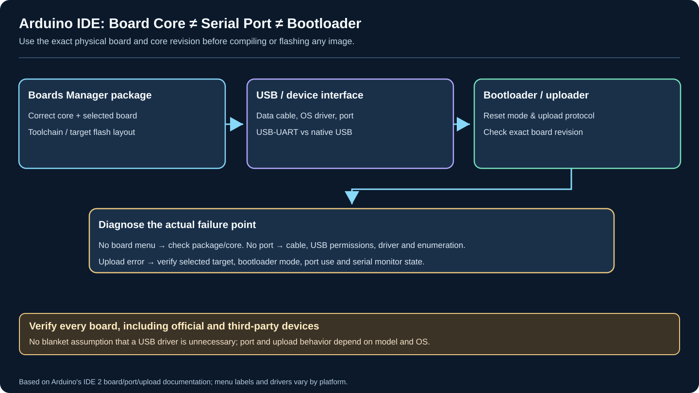

# Arduino IDE Multi-Platform Setup Guide

Setting up the Arduino IDE to be a universal workstation for multiple microcontroller families (Arduino, ESP32, STM32, and others) is a great move. This guide provides the initial configuration to turn your Arduino IDE into a multi-platform powerhouse.

## 🎯 Purpose
One-time setup to turn a stock Arduino IDE 2.x install into a universal workstation covering Arduino, ESP32, ESP8266, STM32, and RP2040 (Pico) boards from a single install - the specific driver/board-package combination that trips people up on a fresh setup.

## ⚙️ Function
Six steps: install IDE 2.x (not legacy 1.8.x), add third-party board manager URLs, install the actual board packages those URLs unlock, tune compiler/upload preferences for easier debugging, install cross-platform sensor/communication libraries, and review USB interface drivers and OS permissions (such as CH34x/CP210x on supported third-party devices); which drivers are needed depends on the **specific device, USB interface and operating system**, not simply whether the board is official.

## 🏆 Goal
Eliminate the most common first-time failure mode with multi-board Arduino IDE setups - a board absent from the target list because a core is not installed or a connection absent from the port list because of USB, cable, OS permissions, driver, native-USB mode or bootloader details.

## 📋 When to Use
- Setting up a new machine for embedded/hardware hacking work spanning multiple microcontroller families
- Adding ESP32/STM32/RP2040 support to an existing Arduino-only IDE install
- Troubleshooting a board that won't show up in Tools > Board or Tools > Port (check Steps 2-3 and 6 respectively)

## Step 1: Use [Arduino IDE 2.x](https://docs.arduino.cc/software/ide-v2/tutorials/getting-started/ide-v2-downloading-and-installing/)

If you haven't already, download the latest **Arduino IDE 2.x** (not the legacy 1.8.x version). Version 2 brings a modern code editor, auto-completion, faster compile times, and a much better board/library manager.

## Board, Port & Upload Diagnostics



*Conceptual troubleshooting map.* [Arduino's official IDE 2 upload tutorial](https://docs.arduino.cc/software/ide-v2/tutorials/getting-started/ide-v2-uploading-a-sketch/) distinguishes board target and selected port. A board absent from the board menu usually concerns the installed platform/core, while a missing port may involve USB cable, host permissions or driver, bootloader state or the selected device. Confirm exact model/revision and backup any existing firmware before writing.

## Step 2: Configure Additional Boards Manager URLs

By default, the IDE only knows about official Arduino boards. To add supported target architectures, install the correct board core from the official Boards Manager catalog or the current upstream platform index. A third-party index URL is needed only when the relevant core is not already available from the configured sources.

1. Open the Arduino IDE.
2. Go to **File** > **Preferences** (Windows/Linux) or **Arduino** > **Settings** (macOS).
3. Look for the field labeled **"Additional boards manager URLs"**.
4. Click the small window icon next to the text box to open it in a larger list, and paste the following URLs (one on each line):

```text
https://espressif.github.io/arduino-esp32/package_esp32_index.json
https://github.com/stm32duino/BoardManagerFiles/raw/main/package_stmicroelectronics_index.json
https://arduino.esp8266.com/stable/package_esp8266com_index.json
https://github.com/earlephilhower/arduino-pico/releases/download/global/package_rp2040_index.json
```

*(Note: The ESP8266 and the Raspberry Pi RP2040/Pico URLs are included as well, since they are incredibly common in multi-board setups).*

## Step 3: Install the Board Cores

Now that the IDE knows where to look, you need to download the actual board packages.

1. Click the **Boards Manager** icon on the left sidebar (it looks like an Arduino Uno board).
2. Search for and install the following packages:
   * **`esp32`** by Espressif Systems
   * **`STM32 MCU based boards`** by STMicroelectronics
   * **`esp8266`** by ESP8266 Community
   * **`Raspberry Pi Pico/RP2040`** by Earle F. Philhower, III *(Highly recommended over the official Arduino mbed core for Pico).*
   * **`Arduino AVR Boards`** *(Usually installed by default, but good to verify for classic Unos/Nanos).*

## Step 4: Optimize IDE Preferences

While you are in **File** > **Preferences**, tweak these settings for a much better developer experience:

* **Show verbose output during:** Check **"compile"** and **"upload"**. This is crucial for troubleshooting when a board refuses to flash or code fails.
* **Compiler warnings:** Set this to **"All"** or **"More"**. It helps catch sloppy code and memory leaks before they become runtime bugs.
* **Display line numbers:** **Checked** (Essential for debugging).
* **Enable Code Folding:** **Checked** (Helps navigate large files).
* **Auto save:** **Checked** (Saves you from losing work).

## Step 5: Essential Universal Libraries

Click the **Library Manager** icon on the left sidebar (it looks like a stack of books) and install a few baseline libraries that are almost universally used across these platforms:

* **Adafruit Unified Sensor:** The backbone for almost all Adafruit sensor libraries.
* **PubSubClient:** The gold standard for MQTT/IoT projects (crucial for ESP32).
* **U8g2** or **Adafruit GFX:** The best libraries for driving OLEDs and LCD screens across different architectures.
* **ArduinoJson:** Essential for parsing web data, configuration files, and APIs.

## Step 6: The "Gotcha" Step - Install USB Drivers

Because you are using third-party boards (especially ESP32s and cloned Arduinos), your computer might not recognize them out of the box. Ensure you have the following drivers installed on your operating system:

* **[CH340 / CH341](https://learn.sparkfun.com/tutorials/how-to-install-ch340-drivers/all):** Extremely common on NodeMCU ESP32/ESP8266 boards and Arduino clones.
* **[CP210x (Silicon Labs)](https://www.silabs.com/software-and-tools/usb-to-uart-bridge-vcp-drivers):** Common on higher-end ESP32 dev boards.

---

**You are all set!** Switching from programming a standard Arduino Uno to a dual-core Wi-Fi enabled ESP32 or a powerful STM32 is now as simple as selecting a different board from the dropdown menu at the top of the IDE.

---

## Related Files
- [README.md](README.md) - Documentation section index: all guides and cheat sheets in this directory
- [vscode.md](vscode.md) - VS Code + PlatformIO: a modern alternative to Arduino IDE with project-level board config
- [evil_m5.md](evil_m5.md) - Evil-M5Project firmware built with Arduino IDE targeting the M5Cardputer (ESP32-S3)
- [bruce_firmware.md](bruce_firmware.md) - Bruce firmware for ESP32 boards; same Arduino IDE + ESP32 board core workflow
- [flipper_zero_guide.md](flipper_zero_guide.md) - Flipper Zero ESP32 Wi-Fi Marauder co-processor setup uses Arduino IDE for ESP32 firmware flashing
- [../HardwareHacking/Chapter1.md](../HardwareHacking/Chapter1.md) - Hardware hacking fundamentals that Arduino IDE supports (serial, I2C, SPI)
