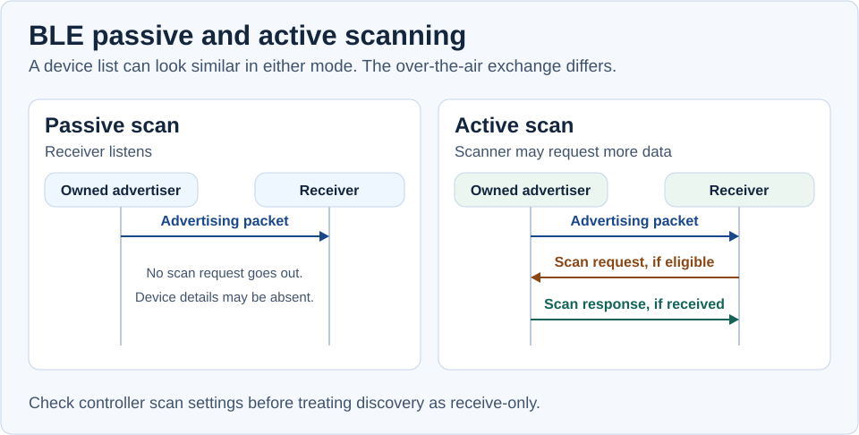

# Passive Bluetooth & BLE Scanning, Packet Sniffing & Privacy

_Reviewed: 2026-11-21. Commands are local-tool examples, not evidence of a completed hardware test._

> [!CAUTION]
> **Authorized reception & privacy first.** A Bluetooth discovery scan can reveal bystanders' devices. Use an owned BLE peripheral in a defined lab, avoid retaining third-party identifiers and obtain consent before monitoring connections. Passive radio reception is not permission to track people, infer identity or decode private communications. See [Legal Notice](../LEGAL.md).

## Purpose & Key Distinctions

A Bluetooth device can be **discovered**, its controller's **HCI events** can be logged, or its **over-the-air link-layer frames** can be captured. These are different levels of visibility. Bluetooth Classic (BR/EDR) and Bluetooth Low Energy (LE or BLE) also have different procedures.

| Method | Does Your Receiver Transmit? | What You Observe | Typical Hardware |
|---|---|---|---|
| **BLE passive scan mode** | No LE scan requests from the receiving controller; it listens for advertising | Advertising reports on channels permitted by the controller | BLE-capable HCI host with explicitly configured passive mode, or dedicated sniffer |
| **BLE active scan mode** | **Yes**: sends scan requests to scannable advertisers | Advertisements plus any scan-response data | Standard BLE HCI host |
| **BlueZ discovery (`bluetoothctl scan on`)** | **Not guaranteed passive**: controller/BlueZ may select active LE scanning; BR/EDR inquiry is also active | High-level device/property changes, not raw RF frames | Linux BlueZ-supported adapter |
| **Local HCI monitoring (`btmon`)** | Monitoring itself does not initiate a scan; logged local host activity may have transmissions | Controller commands, events and HCI traffic involving your host | Linux HCI controller |
| **Dedicated BLE RF sniffing** | A correctly configured *receive-only* sniffer does not transmit | Raw BLE advertising/link-layer frames and, if followed, connection events | nRF52840 sniffer, Sniffle/TI supported hardware, professional analyzer |
| **Bluetooth Classic over-air capture** | Depends on capture platform | BR/EDR packets when supported; difficult hop synchronization | Specialized hardware/analyzer; not generic Nordic BLE sniffer |

**Important correction:** Running `bluetoothctl scan on` is a convenient discovery command, **not proof that the radio is operating in passive LE scan mode**. BlueZ and the controller determine scan parameters; inspect HCI commands (for example with `btmon`), the driver and controller features before making passive-collection claims. Setting `transport le` selects **LE**, not "passive scan."

## BLE Advertising vs Scan Responses



*Conceptual exchange for an owned advertiser. The scan request is conditional on the advertisement type and scanner policy. See the [Bluetooth Core Link Layer specification](https://www.bluetooth.com/wp-content/uploads/Files/Specification/HTML/Core_v7.0/out/en/low-energy-controller/linklayer-ll--specification.html) for the scanning-state rules.*

BLE advertisements carry information such as supported service UUIDs, flags, optional local names and manufacturer data. A scannable advertiser can respond to an **active scan request** with an additional scan-response payload. Passive scans do not request this extra information, so missing names or service details can be expected. Newer extended advertising changes packet structure and uses secondary advertising channels; support depends on the sniffer firmware and PHY.

| Observation | Interpretation | What It Does Not Prove |
|---|---|---|
| Device advertises on channel 37, 38 or 39 | Receiver heard a primary advertising packet | That every other advertising event was captured |
| Name appears only after active scanning | Device may provide name in scan response | That the receiver was passive |
| RSSI changes | Received signal power changed | Reliable distance or precise location |
| Device disappears | Receiver stopped seeing reports | Device powered off or left the area |
| GATT details appear after connecting | Local host performed an additional procedure | A passive advertisement contained those attributes |

## Linux: Observe Your Own BLE Peripheral

Start with a Linux host, an ordinary supported Bluetooth controller and a fictional/owned test BLE beacon. The examples are not a universal recipe for forcing passive HCI scan mode.

```bash
# Read-only environment checks:
bluetoothctl --version
bluetoothctl list
bluetoothctl show
btmon --help

# Open the interactive BlueZ shell:
bluetoothctl
```

Within the interactive prompt:

```text
menu scan
transport le
back
scan on
# Observe owned test beacon advertisements / properties.
scan off
quit
```

If commands vary, use `help` in the installed build. Scan reports may show new/changed device properties and RSSI but not raw BLE PDU bytes. On some releases, `menu scan` exposes filters, including duplicate-report options; their semantics differ from radio scan mode.

### Timestamps & Logging

A terminal session that supports command invocation may permit:

```bash
# 'ts' comes from moreutils. Depending on BlueZ build, this
# one-shot command may exit or stay active; Ctrl-C to stop.
command -v ts
stdbuf -oL bluetoothctl -- scan on | ts '[%Y-%m-%d %H:%M:%S]'
```

**Do not publish raw device identifiers or names** collected near other people. Timestamps generated in the shell are observation timestamps, not hardware RF timestamps. If needed, use a controlled test beacon's known address and synthetic redacted output in documentation.

### Inspect HCI Behavior Rather Than Guessing

```bash
# In a second terminal, inspect the *local controller* while
# starting/stopping an owned-device discovery session.
sudo btmon
```

Look for HCI scan-parameter commands and events; an `LE Set Scan Parameters` / extended scanning configuration can show scan type. Bluetooth controller firmware, kernel and BlueZ may abstract, offload or use newer commands, so don't infer a specific operating mode solely from the appearance of device updates. `btmon` is not an independent 2.4 GHz air sniffer.

## Capturing Raw BLE with Dedicated Hardware

[Nordic's nRF Sniffer for Bluetooth LE](https://academy.nordicsemi.com/courses/bluetooth-low-energy-fundamentals/lessons/lesson-6-bluetooth-le-sniffer/topic/nrf-sniffer-for-bluetooth-le/) uses selected supported nRF development hardware and matching sniffer firmware/software. **The board is not automatically a sniffer just because it contains an nRF52 radio.**

| Device / Capture Path | Advertising Frames | Follow LE Connection | Classic BR/EDR | Caveat |
|---|---|---|---|---|
| Regular BlueZ HCI controller | Processed host discovery | Host's own HCI sessions, **not arbitrary RF traffic** | Host features only | No raw third-party air capture guarantee |
| Nordic nRF52840 DK / dongle + nRF Sniffer | Yes | Selected supported BLE connections | No | Firmware/protocol support, hop-follow and packet-loss limits |
| TI CC26xx / CC13xx + supported SmartRF tool | By supported chipset/firmware | Conditional | No | Verify sniffer software and PHY support |
| Sniffle + approved TI hardware | Yes | Conditional | No | Firmware and hardware-specific |
| Ubertooth One | Legacy BLE research | Limited/conditional | Partial Classic research | Retired hardware, not turnkey full decoding |
| Professional multi-radio / SDR-based BLE analyzer | Depends on purchased model | Multiple connections possible | Product-specific | High cost; verify exact protocol/version licenses |

A development-kit sniffer commonly hops among advertising channels, missing some packets. Capturing a connection requires following its changing data channels and having enough initial information; **even a successful capture may contain encrypted application data**. Do not state that a single dongle can monitor every BLE channel or every simultaneous session.

For technical comparisons, see [Novel Bits: BLE Sniffer Basics & Comparison Guide (2026)](https://novelbits.io/bluetooth-low-energy-ble-sniffer-tutorial/), [Novel Bits: nRF52840 & Wireshark](https://novelbits.io/nordic-ble-sniffer-guide-using-nrf52840-wireshark/) and [Nordic's official sniffer lesson](https://academy.nordicsemi.com/courses/bluetooth-low-energy-fundamentals/lessons/lesson-6-bluetooth-le-sniffer/).

## Why Bluetooth Addresses May Change

BLE can use **public**, **random static**, **resolvable private** and **non-resolvable private** addresses. Privacy-enabled devices can periodically rotate addresses, reducing simple long-term tracking by address. Known peers may be able to resolve certain private addresses using an Identity Resolving Key (IRK); that does **not** give public observers the same capability.

A changing address is **not** proof that two sightings represent different devices. Conversely, a matching name, vendor field, payload or address is **not** proof of the same person. Static identifiers or recognizable payload patterns can weaken privacy even when the address rotates.

| Identifier | Privacy / Attribution Caveat |
|---|---|
| Advertised name | Optional, may be absent/reused/spoofed |
| Public/static MAC | May persist but can be shared by faulty devices or spoofed |
| Resolvable private address | Can rotate; known bonded peers may resolve |
| Non-resolvable private address | Designed to resist simple address correlation |
| Manufacturer/service data | May reveal device type or persistent app-specific content |
| RSSI/time/location | Unreliable person-identification evidence; location is sensitive |

Do not build person-tracking profiles from these fields. Keep anonymized aggregate counts where possible.

## Lab: Verify Passive vs Active Behavior Safely

1. Place one **owned BLE beacon/peripheral** near the receiver in a physically controlled test area; configure a clearly fictional advertised name.
2. Record controller chipset, firmware, BlueZ version, interface, antenna and selected LE discovery policy.
3. With `btmon` open, start a scan and look for active/passive scan configuration in HCI traces. Do not claim passive solely because discovery is quiet.
4. If your hardware/software supports explicit passive LE scanning, compare observations with the same device under active scanning. Document any extra scan-response data without collecting personal identifiers.
5. For Nordic/sniffer firmware, record an RF capture of the owned beacon. Correlate PDU-level fields with high-level BlueZ events and note missing packets.
6. Stop scans, export a **redacted** brief report, remove ephemeral device logs and restore controller settings.

**Success criteria:** Identify (a) which command initiated an RF scan, (b) whether active scan requests were sent, (c) whether the capture was HCI or raw link-layer, and (d) how uncertain packet coverage remains. No other device's location or identity is a valid lab target.

## Troubleshooting & Detection

| Symptom | Check |
|---|---|
| No advertisements | Controller powered, LE supported, test beacon is advertising, scan filters, RF environment |
| Name absent | Passive scan may not collect scan response; advertiser may not broadcast name |
| `ts: command not found` | Install the system's `moreutils` package or omit timestamp pipeline |
| `bluetoothctl -- scan on` exits immediately | Use supported interactive shell; command-invocation behavior varies |
| Many duplicate messages | BlueZ duplicate-data filter, advertising interval, privacy rotation |
| Nordic sniffer sees only some frames | Channel coverage, sniffer firmware, PHY, proximity & packet drops |
| Pairing works but air sniffing fails | HCI host radio is **not** independent BLE RF capture |
| Device changes address | Random address rotation; avoid forced identity correlation |

## Sources & Related Guides

- [Bluetooth & RF Adapter Comparison](./bluetooth-radio-adapter-guide.md)
- [BlueZ bluetoothctl documentation](https://github.com/bluez/bluez/blob/master/doc/bluetoothctl-scan.rst) & [btmon documentation](https://github.com/bluez/bluez/blob/master/doc/btmon.rst)
- [Nordic nRF Sniffer](https://academy.nordicsemi.com/courses/bluetooth-low-energy-fundamentals/lessons/lesson-6-bluetooth-le-sniffer/)
- [Novel Bits BLE Sniffer Comparison](https://novelbits.io/bluetooth-low-energy-ble-sniffer-tutorial/)
- [Bluetooth SIG Architecture & Privacy](https://www.bluetooth.com/specifications/specs/core-specification/)
- [SBC, Firmware & Add-On Compatibility](./sbc-radio-addon-compatibility.md)
- [Wireless Security Tool Index](./wireless-toolkit-reference.md)

---

[Documentation Index](./README.md) | [Wardriving](../Wardriving/README.md) | [Legal Notice](../LEGAL.md)
