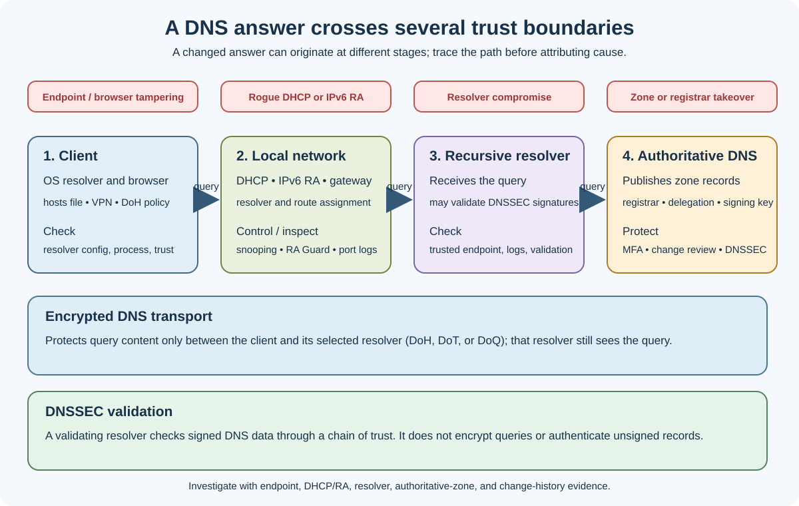
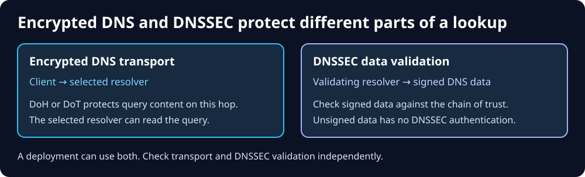

# DNS Hijacking, Secure DNS, DNSSEC, DoH, DoT & Resolver Defense

_Reviewed: 2026-11-24. Commands demonstrate observation of approved client configuration or harmless public DNS diagnostics; no DNS service was reconfigured._

> [!CAUTION]
> **Defensive use only.** Unauthorized changes to DHCP/DNS/gateway settings can redirect traffic or interrupt production. Do not intercept others' queries, provision a rogue resolver or change client trust stores. Capture files may contain sensitive domain histories. See [Legal Notice](../LEGAL.md).

## DNS Trust Boundaries & Common Threats

A DNS lookup can be manipulated at a **client**, **local network**, **recursive resolver**, **authoritative DNS**, **registrar**, **application**, or **browser** layer. "DNS hijacking" is not one exploit and cannot be repaired by changing an individual DNS setting in isolation.



*Conceptual path: controls and evidence differ at each stage. DNSSEC validates signed DNS data; encrypted DNS protects only the configured client-to-resolver transport.*

| Threat | Attacker-Controlled Surface | Evidence | Defensive Control |
|---|---|---|---|
| Rogue DHCP DNS option | DHCP server/options or compromised gateway | Unauthorized option 6/server identifier in DHCP, new client resolver | DHCP snooping, 802.1X/NAC, approved gateway configuration |
| Rogue IPv6 RA / RDNSS | Neighbor/router advertisement from untrusted LAN host | Unexpected ICMPv6 RA, DNS server via RDNSS or DHCPv6 | RA Guard, ND inspection where available, IPv6 access policy |
| Resolver/router compromise | Router config, local resolver, ISP path | Resolver endpoint unexpectedly changed; signed answer anomalies | Secure administration, firmware updates, audited upstream |
| Cache poisoning | Recursive resolver's cached answer | Response mismatch, DNSSEC validation failure for signed zones | Validating resolver, DNSSEC, up-to-date recursion software |
| Registrar or authoritative takeover | DNS record/NS/delegation control | Registry/zone history, changed DS/NS/A/AAAA/CNAME | Registry lock, MFA, change approval, DNSSEC where suitable |
| Local hosts-file / agent tamper | Endpoint resolver mappings or proxy | Unexpected hosts-file, proxy, service process | EDR, least privilege, protected configuration |
| Browser DoH bypass | Browser's independent encrypted resolver | Browser policy vs OS resolver mismatch | Managed resolver policy, browser profiles, endpoint telemetry |
| Captive portal / HTTP redirect | Wireless AP, proxy or application | HTTP/302, untrusted TLS certificate, unexpected gateway | Validated HTTPS, EAP-TLS, trusted Wi-Fi profiles |
| DNS rebinding / spoofed internal targets | Browser and service access model | Host header/origin/network path changes | Network ACLs, origin checks, private-network access controls |

**Never claim that an unexpected DNS answer alone proves hijacking.** CDNs, split-horizon DNS, load balancing, CNAMEs, geo-routing, DNS64 and caching legitimately yield different results.

## Secure DNS Protocols: What Each Protects



| Feature | Primary Security Property | Transport / Port | Limitations |
|---|---|---|---|
| Traditional DNS | Basic name resolution | UDP/TCP 53 | Usually plaintext between client and resolver |
| **DNSSEC** | Authenticated integrity and origin of **signed DNS data**, validated via chain of trust | Works with regular DNS, DoH or DoT | Does **not** encrypt names; only effective with validation and correctly signed zones |
| **DNS over TLS (DoT)** | TLS encryption of client–resolver connection | TCP 853 typically | Does **not** guarantee DNSSEC; trust resolver and certificate |
| **DNS over HTTPS (DoH)** | DNS queries/responses transported through HTTPS | HTTPS, commonly TCP 443; HTTP/3 uses QUIC/UDP | Can bypass organization DNS policies unless managed; does **not** by itself authenticate authoritative zone data |
| **DNS over QUIC (DoQ)** | Encrypted DNS over QUIC | UDP 853 by default | Encrypted transport does not itself validate authoritative DNS data; alternate ports require agreement |
| **Oblivious DoH (ODoH)** | Separates client identity from DNS question under a proxy/target model | HTTPS via proxy | Availability, key distribution and trust model differ |
| **Protective DNS (PDNS)** | Resolver-side threat filtering and policy enforcement | Any supported transport | False positives/negatives and privacy concerns; not a firewall substitute |
| **DANE / TLSA** | DNSSEC-backed service-certificate assertions where supported | DNSSEC-signed records | Application support varies; not automatic for browsers |
| **HTTPS/SVCB records** | Advertise endpoint/service binding metadata | DNS records | Do not inherently prevent DNS hijacking unless validation and HTTPS security apply |

**Encrypted DNS is not automatically trustworthy DNS.** DoH/DoT hide query content from passive observers on that client–resolver hop, but the chosen resolver still sees the questions. DNSSEC addresses forged DNS data for correctly signed zones; it does not encrypt communications or validate a website's business legitimacy.

Official standards: [DoH RFC 8484](https://www.rfc-editor.org/rfc/rfc8484), [DoT RFC 7858](https://www.rfc-editor.org/rfc/rfc7858), [DoQ RFC 9250](https://www.rfc-editor.org/rfc/rfc9250), [DNSSEC RFC 4033](https://www.rfc-editor.org/rfc/rfc4033), [ODoH RFC 9230](https://www.rfc-editor.org/rfc/rfc9230) and [Google Public DNS: Secure Transports](https://developers.google.com/speed/public-dns/docs/secure-transports).

## Choosing a DNS Architecture

| Environment | Recommended Starting Design | Caveat |
|---|---|---|
| Small home | Trusted router/OS or reputable validating resolver; update devices, browser and router | Browser-specific DoH may differ from OS configuration |
| Home lab | Local Unbound or compatible validating resolver, separate management, optional filtering | Split DNS, DHCP and IPv6 must agree |
| Small business | Redundant approved resolvers; protective DNS, endpoint/browser policy, change-logged DNS admin | DoH/DoT policy needs legitimate privacy/availability exceptions |
| Managed endpoints | Enforced DNS policy plus endpoint threat intelligence | Browser/private resolver settings can bypass weak policy |
| Zero trust / remote workforce | Trusted encrypted resolver from remote endpoints, appropriate split-DNS | VPN DNS, captive portals and roaming must be tested |
| Enterprise with internal zones | Private authoritative zones with internal resolver forwarding, DNSSEC validation upstream, robust logging | Do not expose private-zone data publicly; DNSSEC for split-horizon zones needs design review |

### Examples of DNS Platforms & Services

| Tool / Service | Primary Role | Source |
|---|---|---|
| Unbound | Validating caching recursive resolver | [NLnet Labs](https://nlnetlabs.nl/projects/unbound/about/) |
| BIND 9 | Authoritative or recursive DNS with DNSSEC features | [ISC](https://www.isc.org/bind/) |
| PowerDNS | Authoritative DNS and Recursor | [PowerDNS](https://www.powerdns.com/) |
| Technitium DNS | Self-hosted DNS, filtering and recursive features | [Technitium](https://technitium.com/dns/) |
| Pi-hole | Network-level DNS blocking and forwarding | [Pi-hole](https://pi-hole.net/) |
| AdGuard Home | Network-wide filtering DNS proxy | [Project](https://github.com/AdguardTeam/AdGuardHome) |
| Quad9 | Security-focused recursive DNS options | [Quad9](https://www.quad9.net/) |
| Cloudflare 1.1.1.1 | Public DNS with DoH/DoT options | [Cloudflare](https://developers.cloudflare.com/1.1.1.1/) |
| Google Public DNS | Public validating resolver and encrypted transports | [Google](https://developers.google.com/speed/public-dns/) |

Filtering tools need a secure upstream and clear resolver-policy design; installing Pi-hole alone does **not** provide end-to-end DNS privacy or DNSSEC on every client.

## Endpoint & Router Audit

### Safe Local Checks

```bash
# On a Linux workstation; does not change resolver settings.
resolvectl status
cat /etc/resolv.conf
ip route
ip -6 route
# On systems with dig installed:
dig example.org A +dnssec
dig example.org AAAA +dnssec
```

The DO flag (shown with `dig +dnssec`) requests DNSSEC records; it **does not prove your resolver validated the answer**. Check AD flag behavior against a trusted validating resolver, resolvers' logs and a deliberately invalid signed test domain under your control. Do not interpret `AD` in a response from an untrusted resolver as strong proof.

On Windows, review `Get-DnsClientServerAddress` and enforced browser DNS policy; on macOS, review `scutil --dns`. NetworkManager, systemd-resolved, VPN clients and browser profiles may have conflicting settings.

### Check DHCP, RA & Gateway Policies

1. Record legitimate DHCP servers, IPv4 DHCP option 6, IPv6 RDNSS/DHCPv6 options and expected default routers.
2. Verify switch DHCP snooping is enabled on intended **untrusted access ports** and trusted uplinks are documented.
3. Test RA Guard/IPv6 firewalling without disrupting legitimate IPv6 connectivity.
4. Restrict router/gateway and DNS console management behind MFA and management VLANs.
5. Use a controlled test client and a synthetic unauthorized offer in an isolated VLAN, not on a client network.

## Wireshark & TShark: DNS Hijack Investigation

**Wireshark display filters below are not capture BPF filters.** Start by determining **which interface actually sees the traffic**—endpoint, gateway TAP/SPAN or switch mirror—and comparing queries against endpoint settings.

| Question | Display Filter | Important Caveat |
|---|---|---|
| Classic DNS | `dns` | DoH/DoT encrypted contents are not ordinarily dissected as DNS |
| DNS response | `dns.flags.response == 1` | DNS error or alternate answer is not necessarily malicious |
| Suspected DNS server | `ip.addr == 192.0.2.53 && dns` | Replace placeholder with approved resolver IP |
| DHCP server/options | `dhcp || bootp` | Determine offered vs accepted configuration, client and relay |
| IPv6 RA | `icmpv6.type == 134` | RA Guard visibility depends on where packet captured |
| ARP | `arp` | Gateway MAC changes require comparison with switch/AP logs |
| DoT/DoQ candidate endpoint | `tcp.port == 853 || udp.port == 853` | Port use alone does not prove DNS protocol or intent |
| HTTPS/DoH candidate transport | `tls || quic` | Port 443 is general web traffic; do not infer DoH from this alone |
| TLS certificate errors | Review TLS handshake & client/OS logs | Failure may happen above capture visibility |

### Offline, Reproducible PCAP Review

```bash
# Synthetic authorized packet capture supplied separately.
tshark -r ./owned-dns-lab.pcapng -Y 'dns' \
  -T fields -e frame.time -e ip.src -e ip.dst -e dns.qry.name
tshark -r ./owned-dns-lab.pcapng -Y 'dhcp || bootp || icmpv6.type == 134'
```

Do not publish a customer DNS query history; domain names can reveal medical, business or personal activities. For other capture/dissector fields, use [Wireshark Master Filters](./wireshark-master-filters.md), [Advanced Capture](./wireshark.md) and [DNS Display Filter Reference](https://www.wireshark.org/docs/dfref/d/dns.html).

## Detection Playbook

| Signal | Corroborate With | Suggested Severity |
|---|---|---|
| Unauthorized DHCP server offer | Trusted switch port and DHCP snooping logs | High when client accepts it |
| New DNS server via RA or DHCP | Config change ticket and endpoint inventory | High if unexplained |
| DNSSEC bogus validation for important signed zone | Zone operator status, resolver logs, upstream outage | High, not automatic malicious attribution |
| Browser uses unapproved DoH | Managed policy, process/endpoint network telemetry | Policy variance; assess impact |
| DNS answer drift | TTL, CDN/split DNS, DNS64 and resolver cache | Investigate, often benign |
| Resolver suddenly queried via unusual host | Endpoint process and firewall logs | Risk-dependent |

## Defense-in-Depth Checklist

- Default-deny unauthorized DHCP server/RA paths at access ports; protect DNS/admin management services.
- Secure DNS registrar and authoritative zone with MFA, change approval, registry lock and DNSSEC where appropriate.
- Provide reliable internal recursive resolvers with documented fallback and validation.
- Enforce encrypted client-to-resolver transport for roaming managed endpoints, with exceptions for captive portals where required.
- Prevent silent DoH/DoT policy bypass through management profiles and monitored egress **without assuming blocking TCP 853 also blocks all encrypted DNS**.
- Harden TLS certificate validation and prohibit click-through of unexpected errors.
- Monitor resolver logs with privacy minimization, incident retention and SIEM correlation.

## Lab Acceptance & Troubleshooting

| Test | Expected Result |
|---|---|
| Known good signed zone | Approved validating resolver obtains expected result |
| Deliberately bad DNSSEC test zone | Validator rejects invalid data; tool's AD/servfail behavior interpreted correctly |
| Alternate DHCP DNS in isolated test VLAN | Detection identifies server, source port, offered options |
| Browser managed DNS policy | OS/browser resolver alignment documented |
| DoH vs DoT run against approved resolver | Packet trace hides DNS contents; endpoint logs prove actual resolver |
| Synthetic DNS redirect case | Endpoint TLS and answer validation catch wrong host; no production user impacted |

**DoH/TLS does not stop a malicious endpoint or user-installed root CA**, and DNSSEC does not stop a compromised authoritative signing key or signed but unwanted record.

## Related Guides & Sources

- [MITM Detection & Prevention](./mitm-detection-prevention.md)
- [Network Segmentation, VLAN, ACL & DMZ](./network-segmentation-dmz-acl-vlan.md)
- [Counter-Surveillance & Wireless Threats](./counter-surveillance-wireless-threats.md)
- [LAN TAPs & Packet Visibility](./network-taps-and-packet-visibility.md)
- [Wireshark Master Filter Reference](./wireshark-master-filters.md)
- [DNSSEC Validation Fundamentals](https://www.icann.org/resources/pages/dnssec-what-is-it-why-important-2019-03-05-en)
- [DoH RFC 8484](https://www.rfc-editor.org/rfc/rfc8484) | [DoT RFC 7858](https://www.rfc-editor.org/rfc/rfc7858)

---

[Documentation Index](./README.md) | [Network Detection](../Tradecraft/network-detection.md) | [Legal Notice](../LEGAL.md)
