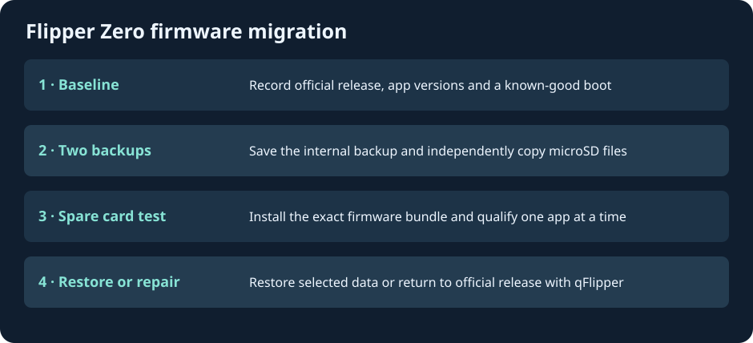

# Flipper Zero Firmware & App Compatibility

[Flipper Zero Field Guide](flipper_zero_guide.md) · [Device Firmware Catalog](device-firmware-list.md) · [SD Card Data & Resources](portable-device-sd-data.md)

## Compare The Firmware Families

| Family | What changes | Choose and verify |
| --- | --- | --- |
| Official Flipper Devices | Vendor-supported firmware, bundled databases and documented qFlipper recovery. Official catalog covers downloadable apps. | Start with the Release channel for a known baseline. Record the device version and test the catalog build of your app. [Source and releases](https://github.com/flipperdevices/flipperzero-firmware/releases) · [qFlipper](https://docs.flipper.net/zero/qflipper) · [App Catalog](https://lab.flipper.net/apps) |
| Unleashed | Independent fork of official firmware with distinct release packages and app bundles. Upstream documents base, extra-app and minimal variants in its changelog. | Pick by exact release and required apps. Compare API and revision even when an app targets official firmware. [Project releases](https://github.com/DarkFlippers/unleashed-firmware/releases) · [Official project wiki](https://wiki.unleashedflip.com/) |
| Momentum | Independent firmware with customizable desktop elements, asset packs and its own release packages. | Record mainline or development version and qualify the chosen asset pack separately. [Releases](https://github.com/Next-Flip/Momentum-Firmware/releases) · [Installation and backup wiki](https://github.com/Next-Flip/Momentum-Firmware/wiki/Installation) · [Asset-pack resources](https://github.com/Next-Flip/Momentum-Firmware/wiki/Community-Asset-Packs) |
| RogueMaster | Community distribution with its own app and asset bundles. Public and supporter release artifacts may differ. | Compare the build manifest and firmware API. Try the project build on a spare card because bundled files may replace prior versions. [Project and install notes](https://github.com/RogueMaster/flipperzero-firmware-wPlugins) · [Public releases](https://github.com/RogueMaster/flipperzero-firmware-wPlugins/releases) |
| Xtreme | Archived upstream with historical releases and app bundles. | Identify legacy cards or reproduce historical UI behavior on a separate bench unit. Prefer supported software for field use. [Archived source](https://github.com/Flipper-XFW/Xtreme-Firmware) · [Historical wiki](https://github.com/Flipper-XFW/Xtreme-Firmware/wiki) |

**Three versions matter.** Flipper system firmware runs on the handheld, a `.fap` is a compiled app that targets an API/build, and supported GPIO boards may run firmware of their own. An app update does not update an ESP32 companion. Keep the handset version, app build and peripheral firmware in the same record. Verify each addon against its own documentation.

## Back Up, Test And Restore

1. Start on a working official release. Record its version, SD format and known-good app versions. Save the qFlipper internal backup and independently copy the entire SD card, including hidden files. Check that both backups can be opened.
2. Format a spare card in the device using the official storage workflow. Download the candidate from the maintainer and verify its checksum if provided. Use the documented updater type for that release. A source archive, SDK, update bundle and recovery image have different roles.
3. Connect with a known USB data cable and close other tools that might claim it. After the update, verify the reported version, cold boot, open a benign app such as a calculator, and test access to a synthetic file. Install one matching app build at a time.
4. If an app fails while firmware boots, compare API and build, then retry with a clean card and the maintainer's compatible app. Restore personal files in small groups after the baseline succeeds. Avoid replacing the new install's entire app or database directory with an older snapshot.
5. If the device fails to boot with a clean card, follow the official DFU and qFlipper repair procedure. Return to official Release, verify firmware and card mounting, then restore personal files across a second test cycle.

[Official qFlipper guide](https://docs.flipper.net/zero/qflipper) · [Official microSD setup](https://docs.flipper.net/zero/basics/sd-card) · [Flipper support and DFU recovery](https://support.flipper.net/hc/en-us/articles/14114283967005-Troubleshooting)
