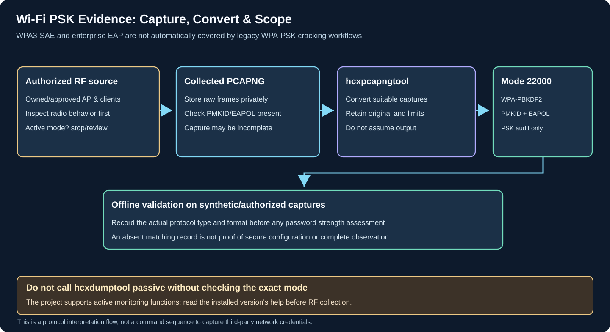

# HCXTools & Hashcat Cheat Sheet ⚡

## 🎯 Purpose
Practical reference for properly authorized WPA-PSK capture evidence, offline PMKID/EAPOL conversion and bounded password-strength validation with Hashcat. Capture behavior must be independently verified; this is not a passive-only hcxdumptool recipe.

## ⚙️ Function
Organized around authorization/mode review, preserved packet evidence, supported offline conversion and applicable PBKDF2 audit cases. The **hcxtools** utilities have different purposes: `hcxdumptool` operates a radio and may use active behavior, whereas `hcxpcapngtool` reads an existing capture offline.

See [Aircrack-ng_Commands.md](Aircrack-ng_Commands.md) for the traditional active-deauth workflow, WEP attacks, and WPS attacks.

## 🏆 Goal
Validate captured PSK-derived PMKID/EAPOL records from approved test systems and, where authorized, assess the resilience of known lab passphrases. Explicitly document cases where protocol, packet coverage or key-derivation assumptions prevent a meaningful test.

## 📋 When to Use
- For an authorized PSK lab capture that includes an applicable PMKID record; availability depends on the AP and protocol
- When comparing truly receive-only packet observation to active wireless testing, after confirming the chosen program's behavior
- When integrating with a Pwnagotchi or similar automated passive capture rig (see [pwnagotchi_cheatsheet.md](pwnagotchi_cheatsheet.md))
- When you have a `.pcapng` from any source and need to convert it to Hashcat format

---

## Basic Workflow: PMKID & Handshake Capture



*Conceptual format and authorization boundaries, not a live RF capture.* The upstream [hcxdumptool project](https://github.com/ZerBea/hcxdumptool) supports active monitoring and modes/settings change across releases. **Never assume a command is passive merely because it does not explicitly request deauthentication.** The [Hashcat 22000 source module](https://github.com/hashcat/hashcat/blob/master/src/modules/module_22000.c) handles WPA-PBKDF2-PMKID/EAPOL material; it does not automatically crack WPA3-SAE-only handshakes or enterprise EAP credentials.


**1. Confirm capture policy and installed versions**

Before operating a wireless receiver, check the exact adapter/driver, RF permissions, monitor capability, capture scope and installed program options. `hcxdumptool` is **not a passive-only tool**: some modes transmit or interact actively. Command-line switches in old blog posts have changed across releases; do not copy outdated `--filtermode`, `--bssid`, `--enable_status` or other RF options without validating `hcxdumptool --help` on the installed version.

For a strictly passive lab observation, use a receive-only configuration verified against known owned equipment; capture may be produced separately by TShark or another appropriately configured packet receiver. Never use this guide to interfere with third-party clients.

**2. Preserve and examine an existing, authorized capture**

Save the raw PCAP/PCAPNG with source, device, UTC time, channel coverage, adapter mode and file checksum. Use Wireshark or TShark to check which frames were actually captured and whether the observation is relevant to the intended PSK network. Missing data cannot be interpreted as proof of strong security.

**3. Convert eligible WPA-PSK material offline**

```bash
# Read an existing, authorized PCAPNG only; do not operate a radio.
# Confirm current syntax against hcxpcapngtool --help.
hcxpcapngtool -o hash.hc22000 capture.pcapng
```

An output file or a conversion success status does **not** establish that a valid, auditable PMKID/EAPOL exchange was present. Review tool warnings, protocol type and candidate suitability. On a WPA3-only SAE network, do **not** assume a WPA-PBKDF2 PMKID/EAPOL workflow applies. On mixed transition deployments, scope the PSK mode separately.

### Capture Mode & Version Compatibility

| Scenario | Required check |
|---|---|
| Receive-only radio survey | Confirm the exact firmware/program version does not transmit in the selected mode |
| hcxdumptool use | Inspect current project README/help; default behavior and options may include active interactions |
| PMKID / EAPOL | Verify relevant exchange and PSK/PBKDF2 applicability before attempting an offline audit |
| WPA3-SAE-only | Do not label it crackable by Hashcat WPA-PBKDF2 mode 22000 without a separate documented applicability proof |
| Conversion/reporting | Preserve original capture, tool version, output warnings and authorization |


---

# Hashcat Cracking (Mode 22000)

Mode 22000 is identified by Hashcat as **WPA-PBKDF2-PMKID+EAPOL**. It consolidates legacy PBKDF2 PMKID and EAPOL formats (formerly 16800 and 2500); it is **not a generic WPA3-SAE password-recovery method**. Check the installed Hashcat release and the actual capture's key-derivation type.

**Authorized WPA/WPA2 PSK/PBKDF2 Offline Password Check**
```bash
hashcat -m 22000 hash.hc22000 /path/to/wordlist.txt
```

**Using Rules for Advanced Cracking**
```bash
# Apply a rule file to transform the wordlist (e.g., append numbers, capitalization)
hashcat -m 22000 hash.hc22000 wordlist.txt -r rules/best64.rule
```

> [!TIP]
> For leetspeak passphrases, chain a leet rule file such as `rules/unix-ninja-leetspeak.rule`. See [leet in passwords](../Cryptography/Classical/security.md#leet-in-passwords).

**Hybrid Attack: Wordlist + Brute-Force Mask**
```bash
# Append 4 digits to each wordlist entry
hashcat -m 22000 hash.hc22000 wordlist.txt -a 6 ?d?d?d?d
```

**Session Management**
```bash
# Resume a previous cracking session
hashcat -m 22000 hash.hc22000 /path/to/wordlist.txt --session=mysession --restore

# Show cracked passwords
hashcat -m 22000 hash.hc22000 --show
```

---

# HCXTools for File Analysis

**File Conversion & Cleaning**
```bash
# Convert a legacy .cap file to pcapng for hcxpcapngtool input
editcap -F pcapng capture.cap output.pcapng

# Merge multiple pcapng files before conversion
mergecap -w merged.pcapng file1.pcapng file2.pcapng

# Clean up handshake files (remove unneeded data)
wpaclean cleaned.cap capture-01.cap
```

**Inspecting and Filtering Captured Data**
```bash
# View unique BSSIDs/ESSIDs found in a capture file (use hcxpcapngtool for .pcapng)
hcxpcapngtool --info=stdout capture.pcapng

# Deduplicate and filter hashes before cracking
hcxhashtool -i hash.hc22000 -o unique.hc22000
```

---

## Related wireless assessment projects

[AngryOxide](https://github.com/Ragnt/AngryOxide) is an actively developed Rust 802.11 assessment tool that can combine surveying with **active Wi-Fi attack/capture features**. It is a distinct toolchain, not part of the `hcxdumptool`/`hcxtools` command examples above. Use a deliberately isolated, authorized RF lab, confirm adapter support and firmware before testing, and avoid active interference during ordinary [wardriving](../Wardriving/README.md).

## Security and Ethical Considerations ⚠️

**IMPORTANT**: These tools are for **authorized security testing only**. Unauthorized use is illegal.

- Get **written permission** before testing any network. Only test networks you own or have explicit authorization to test.
- All cracking attempts must be done in an **isolated lab environment** against hashes you are authorized to possess.
- Strictly comply with all local laws and regulations.

**Legal Use Cases:**
- Penetration testing with client authorization
- Testing your own home or lab network security
- Security research in isolated lab environments

---

## Related Files
- [hashcat-guide.md](hashcat-guide.md) - Canonical general-purpose Hashcat setup, devices and synthetic offline audit
- [wordlists-password-auditing.md](wordlists-password-auditing.md) - Wordlists, rules, candidate provenance and hygiene
- [rainbow-tables-guide.md](rainbow-tables-guide.md) - Precomputed lookups vs salts and password KDFs
- [wifi-adapter-selection-guide.md](wifi-adapter-selection-guide.md) - Verified USB chipset, monitor mode and capture compatibility
- [README.md](README.md) - Documentation section index: all guides and cheat sheets in this directory
- [Aircrack-ng_Commands.md](Aircrack-ng_Commands.md) - Traditional active-deauth workflow, WEP, WPS attacks
- [pwnagotchi_cheatsheet.md](pwnagotchi_cheatsheet.md) - Automated passive PMKID/handshake capture using hcxtools output
- [WifiMarauder_CheatSheet.md](WifiMarauder_CheatSheet.md) - ESP32-based WiFi attacks (different hardware path)
- [../Cryptography/Classical/security.md](../Cryptography/Classical/security.md) - Leet substitutions and hashcat leet rule files

---

[Section Index](README.md) | [Master Index](../README.md) | [Legal Notice](../LEGAL.md)
