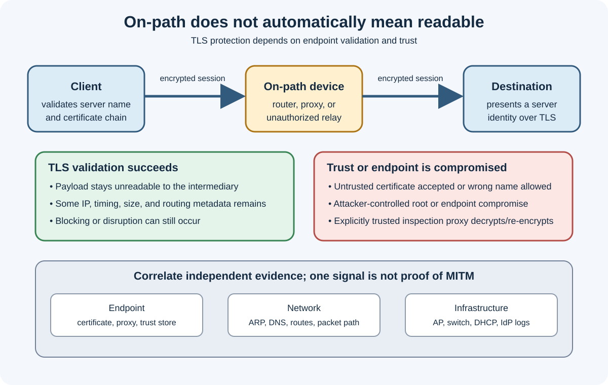

# Man-in-the-Middle Detection, Prevention & Packet-Analysis Playbook

_Reviewed: 2026-11-24. All exercises use authorized, synthetic evidence or configuration reviews, not interception of production sessions._

> [!CAUTION]
> **Defensive scope only.** MITM simulations can intercept credentials, sessions and private content or disable connectivity. Do not install rogue certificates, poison ARP, run evil-twin APs or redirect third-party traffic. Scope every capture and minimize sensitive PCAP retention. See [Legal Notice](../LEGAL.md).

## What "MITM" Means

A man-in-the-middle (MITM) attack places an unauthorized intermediary in a communications path, often through local-network redirection, rogue Wi-Fi, malicious DNS, a proxy, route manipulation or compromise of a trusted middlebox. **An intermediary may be on-path yet unable to read well-authenticated encrypted application payloads**.

| Layer / Technique | Possible Indicator | Best Defensive Controls |
|---|---|---|
| ARP spoofing or gateway impersonation | Gateway IP resolves to unexpected MAC, unsolicited/conflicting ARP replies | Dynamic ARP Inspection (DAI) with DHCP snooping, managed access ports, 802.1X |
| Rogue DHCP / IPv6 RA | Alternate DNS/default router offered to endpoints | DHCP snooping, RA Guard, NAC, allowed-router inventory |
| DNS hijack | Resolver or answer changes, DNSSEC failures | Secure resolvers, DNSSEC validation, administrative hardening and TLS validation |
| Rogue Wi-Fi / evil twin | Same SSID with an unexpected BSSID/security profile; client misassociation; invalid EAP server identity | Use managed profiles and safe autojoin settings; WPA3-Personal where supported; for enterprise 802.1X/EAP, validate the expected server name and trusted CA; PMF and WIDS add defenses but do not prove AP identity |
| Transparent/explicit proxy | Unapproved system proxy, PAC/WPAD, newly trusted CA | Managed proxy and root stores, disable unsafe auto-discovery, endpoint integrity |
| Switch/router compromise | Unauthorized route/ACL config, new SPAN or forwarding policy | Management isolation, MFA, config audit, change control |
| TLS interception | Certificate subject/issuer/root differs from expected, client errors | Correct hostname/certificate validation, pinning where applicable, inspect root CA policy |
| Session theft / cookie exposure | Suspicious authenticated requests, unusual endpoint or replay | HTTPS everywhere, Secure/HttpOnly/SameSite cookies, short sessions, MFA |
| LAN port aggregation/tap misuse | Unauthorized inline device or mirror destination | Physical security, managed port inventory and change logs |

## Data Integrity & Encryption Boundaries



*Conceptual diagram: a network intermediary can observe path-level metadata and affect availability while correctly validated TLS protects application payloads. It is not a measured capture.*

- HTTPS authenticates a server **when** hostname and certificate-chain validation are correctly enforced and the local trust store has not been subverted. TLS protects payloads on that connection; it cannot verify the **business legitimacy** of a phishing domain with a valid certificate.
- DNS over HTTPS (DoH) / DNS over TLS (DoT) protect DNS messages on the client-to-resolver hop, not the rest of the connection. DNSSEC authenticates DNS data only when validation succeeds.
- Protected Management Frames (PMF) mitigate forged robust Wi-Fi management frames after association; they do not stop generic 2.4/5 GHz radio interference or all evil-twin scenarios.
- A VPN encrypts some or all traffic from the endpoint to a tunnel terminator; DNS leaks, split tunnels and malicious endpoints still require policy validation.
- VLANs separate broadcast domains; inter-VLAN access depends on Layer-3 firewall/ACL enforcement. VLAN tagging by itself is not a complete MITM defense.

## Wireshark Investigation: Where to Capture

| Capture Location | Strength | Visibility Gap |
|---|---|---|
| Affected endpoint | ARP, DNS, TCP/TLS from that host | Other clients' flows unless delivered to the NIC |
| Managed switch SPAN | Selected ports/VLANs/directions | Possible packet drops, tag stripping and missing unmirrored paths |
| Correctly rated LAN TAP | Both directions of the **tapped link**, with suitable breakout/aggregation | Traffic that never crosses tapped link |
| Dedicated wireless monitor | 802.11 beacons/probes/deauth on tuned channels | Other channels and decrypted payloads |
| AP/controller/DHCP/IdP/EDR logs | Independent configuration, auth and policy evidence | Does not replace packet proof |

See [LAN TAP & SPAN Hardware](./network-taps-and-packet-visibility.md), [Wi-Fi Adapter Selection](./wifi-adapter-selection-guide.md) and [Wireshark Capture Guide](./wireshark.md). **Promiscuous mode is not a substitute for a capture feed.**

### Wireshark Display Filters

| Hypothesis | Display Filter | Check Before Concluding |
|---|---|---|
| ARP gateway conflict | `arp` | Distinct claiming MACs, actual gateway config and lease history |
| ARP replies | `arp.opcode == 2` | Normal replies are common; inspect repetition/source |
| DHCP service | `dhcp || bootp` | Legitimate relays and redundant DHCP servers |
| IPv6 RAs | `icmpv6.type == 134` | Authorized IPv6 routers and RA Guard |
| DNS exchange | `dns` | Resolver IP, TTL, DNSSEC and CDN/split-horizon context |
| DNS answer from suspect IP | `ip.src == 192.0.2.53 && dns` | Replace TEST-NET placeholder with scoped IP |
| TCP resets | `tcp.flags.reset == 1` | Normal failure/teardown not automatically tampering |
| TLS handshakes | `tls.handshake` | Compare observed certificates and endpoint trust logs |
| AP beacons | `wlan.fc.type_subtype == 0x08` | SSID/security suites and legitimate multi-AP deployments |
| Deauthentication | `wlan.fc.type_subtype == 0x0c` | PMF state, legitimate roaming and AP logs |
| VLAN-tagged frame | `vlan` | Hardware offloads and mirror configuration may strip tags |

These are **display filters**, not BPF capture filters. Use [Wireshark's master filter list](./wireshark-master-filters.md) and the [Wireshark ARP](https://www.wireshark.org/docs/dfref/a/arp.html), [WLAN](https://www.wireshark.org/docs/dfref/w/wlan.html) and [TLS](https://www.wireshark.org/docs/dfref/t/tls.html) field references for version-dependent details.

### Read an Existing PCAP with TShark

```bash
# Offline only: the sample file must come from an authorized lab.
tshark -r ./owned-mitm-lab.pcapng -Y 'arp || dhcp || bootp' \
  -T fields -e frame.time -e eth.src -e eth.dst -e arp.opcode
tshark -r ./owned-mitm-lab.pcapng -Y 'dns || tls.handshake'
sha256sum ./owned-mitm-lab.pcapng
```

**Do not commit** PCAPs containing tokens, cookies, client hostnames, DNS histories or decrypted payloads to a public repo.

## Defensive Validation: Five Harmless Exercises

| Exercise | Setup | What Passes |
|---|---|---|
| Gateway identity review | Two owned clients and managed switch | MAC-to-port/gateway mapping matches inventory |
| DNS baseline | Controlled host and approved resolver | No unexpected DHCP/RA resolver assignment |
| TLS trust test | Owned HTTPS test service with known certificate | Client rejects an **untrusted test certificate**; do not install a fake root CA |
| Wireless profile review | Owned Wi-Fi AP and managed device | WPA3/PMF or EAP-TLS policy as required, no blind autojoin |
| VLAN traversal review | Test clients in two VLANs, only benign TCP/ICMP | Default-deny paths blocked; allowed DNS/NTP/services work |

The tests should be conducted through regular clients and administrative review, not by redirecting sessions or introducing a malicious intermediary.

## Detection & Prevention Hardening

| Layer | Prevention | Detection |
|---|---|---|
| Access switch | 802.1X/NAC, disable unused ports, DHCP snooping, DAI, port security | MAC moves, unexpected DHCP, port config diff |
| IPv6 | RA Guard, approved routers, IPv6 ACLs | Unexpected RAs, neighbor anomalies |
| Wi-Fi | Managed profiles and safe autojoin; WPA3-Personal where supported; for enterprise 802.1X/EAP validate the expected RADIUS server name and CA; PMF and client isolation where appropriate | Kismet/nzyme/AP anomalies, new BSSID/security changes, EAP certificate warnings |
| DNS | Validating resolvers, DoH/DoT policy, DNSSEC where appropriate | Resolver config change, SERVFAIL/DNSSEC alerts |
| Endpoint | Trusted root store, EDR, secure browser, proxy profile | New proxy/root CA, credential theft attempts |
| Network | Default-deny inter-VLAN ACLs, protected management | Zeek/Suricata flows and configuration drift |
| Identity | Phishing-resistant MFA, short token lifetimes | Unusual IdP sessions and account changes |

## Incident Response Runbook

1. **Preserve** timestamped endpoint configuration, routing/ARP cache, DNS settings, certificate observations and AP/switch logs.
2. **Confirm** the capture source and clock; distinguish true on-path alteration from normal DHCP renewal, AP roaming, CDN variation or approved proxying.
3. **Contain** under change control: isolate unauthorized switch ports/hosts, restore router/DHCP settings, revoke compromised sessions if indicated.
4. **Recover** trusted CA/proxy/DNS profiles, firmware, Wi-Fi profile, credentials, passwords and identity tokens as appropriate.
5. **Retest** the exact suspected flow and legitimate services; check DAI/RA Guard/ACL/PMF alerts against controlled fixtures.
6. **Report** observed facts, inference confidence, affected scope, exposure/secret handling and residual uncertainty.

## Troubleshooting & False Positives

| Symptom | Benign Alternatives |
|---|---|
| Gateway MAC changed | Gateway HA/VRRP failover, NIC replacement, network redesign |
| Duplicate ARP | Proxy ARP, HA cluster, IP conflict, virtualization |
| Unexpected DNS answers | CDN, resolver policy, DNS64, split-horizon |
| Different TLS issuer | Authorized enterprise inspection gateway or middlebox |
| Duplicate SSID | Legitimate multi-AP ESS deployment |
| Frequent disconnects | RF interference, roaming, DFS, AP maintenance |
| New Bluetooth MAC | BLE privacy address rotation |

## Related Guides & Sources

- [DNS Hijacking & Secure DNS](./dns-hijacking-secure-dns.md)
- [Counter-Surveillance & Wireless Threats](./counter-surveillance-wireless-threats.md)
- [Network Segmentation, DMZ, ACLs & VLAN](./network-segmentation-dmz-acl-vlan.md)
- [Wi-Fi Deauth Detection](./wifi-deauthentication-detection.md)
- [LAN TAPs & Packet Visibility](./network-taps-and-packet-visibility.md)
- [Wireshark Advanced Reference](./wireshark.md)
- [OWASP Transport Layer Protection](https://cheatsheetseries.owasp.org/cheatsheets/Transport_Layer_Security_Cheat_Sheet.html)
- [IETF RFC 9190: EAP-TLS 1.3](https://www.rfc-editor.org/rfc/rfc9190.html) and [RFC 9525: Service Identity in TLS](https://www.rfc-editor.org/rfc/rfc9525.html) for validating expected server identities
- [CISA Network Hardening & Segmentation](https://www.cisa.gov/sites/default/files/2025-01/joint-guidance-enhanced-visibility-hardening-guide-for-comms-infrastructure-508c_0.pdf)

---

[Documentation Index](./README.md) | [Incident Response](../IncidentResponse/README.md) | [Legal Notice](../LEGAL.md)
