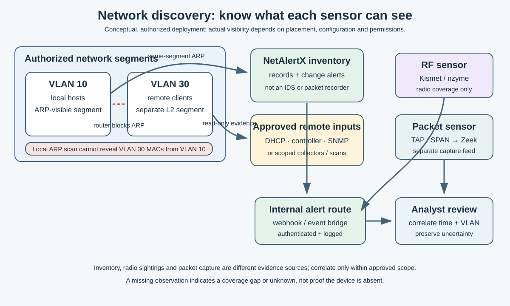

# NetAlertX: Network Device Discovery, Inventory & Change Monitoring

_Last source review: 2026-11-24. Official NetAlertX documentation was consulted; no container was installed, subnet scanned, or alert delivered._

> [!CAUTION]
> **Authorized networks only.** Device monitoring can reveal device ownership, routines and presence. Obtain permission, keep discovery scoped to assigned interfaces and VLANs, protect the dashboard and limit retention. "Device present" does **not** establish a person's location or identity. See [Legal Notice](../LEGAL.md).

## Purpose & Position in the Security Stack

[NetAlertX](https://netalertx.com/) is a self-hosted **asset visibility, device-discovery and change-alerting** platform. It can use ARP, DHCP, SNMP/controller integrations, network scans and plugins to maintain historical device records and notify operators when devices appear, disappear or change. It is **not** a Wi-Fi frame sniffer, an EDR, an IPS, a vulnerability scanner replacement or a NAC enforcement point.

| Question | NetAlertX | Complement |
|---|---|---|
| Did a previously unknown device appear? | Discovery, device states & notifications | Switch port/NAC/DHCP/controller evidence |
| Which device changed IP or MAC? | Observation and historical records | DHCP leases, ARP tables, 802.1X identity |
| Is a managed switch unavailable? | Status changes if configured | LibreNMS/Zabbix SNMP metrics |
| Did a client send deauth frames? | **No raw 802.11 evidence by default** | Kismet/nzyme + Wi-Fi monitor receiver |
| Did a flow match an IDS signature? | **No** | Snort/Suricata/Zeek |
| Did a host's files/accounts change? | **Not its core role** | Wazuh FIM, endpoint logs & EDR |
| Who or what is the device? | Candidate vendor/name, tags & evidence | Independent switch/DHCP/MDM/asset inventory |

## Architecture: One VLAN vs Many



*Conceptual diagram: NetAlertX inventory inputs and packet/RF sensors are separate. ARP discovery is limited to the local broadcast domain; routed imports provide different evidence.*

**ARP is local broadcast-domain discovery.** A single container on VLAN 10 will not learn a remote VLAN 30's real MAC addresses just by ARP-scanning from VLAN 10. For remote segments use authorized DHCP/controller/SNMP imports, deployed collectors/sync instances where supported, or carefully scoped routed scans. Routed Nmap results may give IP/host/service information **without the actual remote MAC**. Never present a fabricated MAC as verified identity.

Official guidance: [NetAlertX Remote Networks](https://docs.netalertx.com/REMOTE_NETWORKS/) & [Plugins](https://docs.netalertx.com/PLUGINS/).

## Features & Data Sources

| Collector / Method | Typical Data | Network Requirements | Caveat |
|---|---|---|---|
| ARP scan | IP ↔ observed MAC, vendor hints | Same Layer-2 segment, suitable raw-socket access | Silent/offline clients and private MACs can be missed |
| Approved Nmap plugin | Reachability, service clues | Routed scoped IPs | Active probes; remote MAC often unavailable |
| DHCP lease import | IP, MAC, hostname, lease time | Read-only DHCP source access | Leases may outlive connected devices |
| Pi-hole / AdGuard integrations | DNS/DHCP-linked devices | Supported plugin/API/version | DNS activity does not prove current presence |
| UniFi/controller integration | Client/AP/switch association metadata | Read-only scoped API | Vendor/controller ID may be more durable than MAC |
| SNMP router/switch import | Interfaces, neighbors, device metadata | SNMPv3 or protected read-only credentials | SNMPv2c community strings require extra protection |
| NetAlertX sync node | Aggregated sightings across sites/VLANs | Authenticated collector-to-server transport | Clock, naming, duplicate and access-control issues |
| Notification publisher / webhook | Appearance, disappearance, changes | Approved internal destination | Cannot assume guaranteed delivery or SIEM parsing |

**MAC randomization** can cause duplicate apparent identities and misleading arrival/departure events; moving between APs/VLANs, sleep schedules and DHCP renewal can have similar effects. Preserve uncertainty instead of profiling people.

## Hardware, Placement & Deployment Choices

| Platform | Suitability | Qualification |
|---|---|---|
| Linux VM / Proxmox LXC or VM | Excellent management host | Host networking or VLAN-scoped route/capture access; avoid privileged cross-zone discovery |
| Raspberry Pi 4/5 | Small lab/home monitoring | 64-bit OS, storage, stable power, Docker support and LAN reachability |
| x86/ARM64 mini PC | Multiple integrations and sites | CPU/RAM depend on scan schedule, history and integrations |
| Synology/QNAP Docker host | Conditional | Container network model, host privileges and NAS firewall policy |
| Unmanaged switch | Limited local L2 observations | No SPAN, no managed MAC table, no cross-VLAN inventory |
| Managed switch / UniFi gateway | Useful authoritative source | Prefer read-only API/SNMP/lease imports over blind probing |
| uConsole/Cyberdeck | Portable short surveys, not ideal always-on | Battery/power, scan permission and management security |

NetAlertX is **not a packet TAP** and installing it on a Proxmox host does not automatically grant visibility into all clients behind an unmanaged switch. See [LAN TAPs & SPAN](./network-taps-and-packet-visibility.md).

## Install & Harden With Official Docker Compose

The upstream project maintains its [official Docker Compose example](https://github.com/netalertx/NetAlertX/blob/main/docker-compose.yml) and [Docker installation instructions](https://docs.netalertx.com/DOCKER_INSTALLATION/). Use the upstream Compose file as a reference, then review the exact release and its security notes before deployment. The commands below clone the moving default branch for inspection only; select a reviewed release tag and pin the container image by digest before deploying. Do not treat a `latest` tag as a version pin.

```bash
# On an authorized non-production Linux lab host with Docker Compose installed:
git clone https://github.com/netalertx/NetAlertX.git
cd NetAlertX
git log -1 --oneline
# Inspect the official compose configuration before running anything:
docker compose config
# Review capabilities, network_mode, volumes, port exposure and image tags:
grep -E 'image:|network_mode:|cap_add:|ports:|volumes:' docker-compose.yml
```

Review the exact release's compose file, security documentation and scanner scope before starting. The official host-network configuration supports L2/ARP discovery but shares the host network namespace. Depending on enabled features, current upstream guidance lists `NET_RAW` and `NET_ADMIN` for raw/ARP discovery and `NET_BIND_SERVICE` for functions that bind privileged ports; verify the minimum needed for the selected release. **Avoid `privileged: true` as a casual shortcut**. Do not publish the dashboard directly to the Internet.

After configuring **only owned subnets** and confirming credentials, persistence and least-privilege network access, start and inspect with:

```bash
docker compose up -d
docker compose ps
docker compose logs --tail=100
```

The upstream application commonly uses HTTP port `20211` for the UI and `20212` for its GraphQL/API interface; **confirm current defaults in your pinned Compose release** and bind/filter access at the host firewall or management reverse proxy. Secure authentication, TLS termination where appropriate, backups, container update cadence and administrative MFA/SSO where supported should be in the deployment plan. Restrict exposed APIs and webhook receivers to management networks.

## First-Run Checklist

1. Verify platform/CPU architecture, container image provenance, volume mapping and admin account.
2. Define authorized `SCAN_SUBNETS` / plugin scope using current upstream settings; exclude customer/neighbor networks and dangerous embedded targets.
3. Start with **one** lab VLAN and a small scan frequency. Active network probing is not automatically harmless.
4. Classify owned known devices by stable inventory asset ID, not only current randomized MAC address.
5. Identify trusted data sources: gateway DHCP, switch LLDP/SNMPv3, AP/controller APIs, Pi-hole.
6. Configure event/notification channels per-device to avoid repeated sleep/wake noise.
7. Set a retention/deletion policy for historic MAC addresses, hostnames, DHCP leases and alert payloads.
8. Expand to other VLANs using read-only controller data or physically/logically deployed collectors, with documented coverage gaps.
9. Generate a benign owned test-device arrival and departure, verify event timestamp, device classification and delivery.

## Device Classification & Alert Triage

| Condition | Suggested Priority | Verify Before Escalation |
|---|---|---|
| New device on management VLAN | High | Switch port, 802.1X auth, change ticket, DHCP lease |
| New device on guest Wi-Fi | Informational/medium | Guest onboarding, private MAC and time |
| Critical server disappearance | High if persistent | Host/switch health, power, routing and maintenance |
| IP address changed | Usually informational | DHCP lease renewal, alternate interface, VPN |
| One MAC appears on multiple ports | Investigate | HA, shared virtual MAC, switch timing, bridge loops |
| Vendor OUI looks unfamiliar | Low without other evidence | Locally administered/random MAC may have no useful OUI |
| Apparent "unknown surveillance device" | **Not confirmed** | Configuration & independent evidence; no person tracking |

A "new MAC" is not proof of unauthorized physical presence. Focus on network policy violations and authenticated device identity.

## Alert Pipeline to Wazuh, Snort & nzyme

| Source | Event Type | How to Correlate |
|---|---|---|
| NetAlertX | Device appearance/disappearance, IP/name/vendor change | Join device/port/VLAN/time to 802.1X, DHCP and controller records |
| Snort 3 | Signature-matched packet or flow evidence | Join on IP/port/time and alert signature; no MAC identity guarantee |
| nzyme | Wi-Fi radio/rogue-AP/disconnection events | Compare BSSID/channel/time; do not attribute to a seen LAN MAC automatically |
| Kismet | Captured 802.11/BLE sightings and alerts | RF coverage and MAC randomization caveats |
| Wazuh | Endpoint/FIM/IdP/custom JSON events | Normalize timestamps/device IDs, retain original source log |

Use [NetAlertX's official webhook notification plugin](https://docs.netalertx.com/PLUGINS/) or another supported publisher to an **authenticated internal** event bridge. This repository does **not** claim a native NetAlertX→Wazuh connector is preinstalled. A secure integration normalizes a small JSON event with source/time/severity/device key/VLAN/context, appends to a local protected log file and lets an approved Wazuh agent read it.

### Synthetic Event Contract (No Webhook Server)

```json
{"integration":"netalertx","event_type":"device_seen","timestamp":"2026-11-24T12:00:00Z","device_id":"synthetic-lab-device-01","vlan":"30","site":"lab","confidence":"observed","source":"approved-dhcp-import"}
```

For **Wazuh 4.x compatible agent configurations**, a local monitored file may be declared in the agent's `ossec.conf`; validate actual version-specific syntax:

```xml
<localfile>
  <log_format>json</log_format>
  <location>/var/log/netalertx-events.jsonl</location>
</localfile>
```

Restrict file ownership, ensure a newline per event, enforce rotation and validate ingestion with `wazuh-logtest` **on a test manager**. Do not silently invent Wazuh rule IDs or assume a JSON event automatically generates a high-severity alert. Wazuh 5 prerelease agent/manager behavior should be reviewed independently from this 4.x example.

## Wireshark & Network-Evidence Correlation

| Question | Display Filter | Additional Evidence |
|---|---|---|
| Device's ARP traffic | `arp` | MAC/IP/port mapping, DHCP lease and VLAN |
| DHCP request/offer | `dhcp` | Approved DHCP server + snooping table |
| DNS traffic | `dns` | DNS resolver logs, device process |
| IPv6 RA | `icmpv6.type == 134` | Router config / RA Guard |
| VLAN 30 | `vlan.id == 30` | Switch and NIC tag retention |
| Endpoint TLS | `tls` | Certificate validation and endpoint identity |

**The packet must first reach the capture interface.** NetAlertX's ARP scan is not a promiscuous packet recorder; mirror/TAP traffic is separate. Match observations to [Wireshark Defensive Investigations](./wireshark-defensive-investigations.md) and [Network Segmentation](./network-segmentation-dmz-acl-vlan.md).

## Common Failure Modes

| Symptom | Root Cause to Check |
|---|---|
| No discovered local devices | Docker host vs bridge network, raw capabilities, wrong interface or subnet |
| Remote VLAN empty | ARP cannot cross L3 routers; use approved per-VLAN collector or imports |
| Device toggles online/offline | Sleep, Wi-Fi powersave, privacy MAC, scanner schedule and false negatives |
| Duplicate devices | Randomized MACs, multi-NIC asset, controller merge strategy |
| Notifications never arrive | Plugin publishing config, per-device muting, credentials, destination TLS and logs |
| Dashboard unreachable | Firewall, container process, UI binding/port, reverse proxy, auth |
| Wazuh log events absent | Missing localfile, inaccessible JSONL, file rotation, unsupported 5.x configuration |
| High CPU / disruptive scans | Reduce scope/frequency and rely on passive management-plane imports |

## Related Programs & Sources

- [Other Network Inventory & Monitoring Platforms](./network-device-discovery-comparison.md)
- [Wireshark / Packet Investigations](./wireshark-defensive-investigations.md)
- [DMZ, VLAN, ACL & SPAN Design](./network-segmentation-dmz-acl-vlan.md)
- [Wazuh Deployment](../IncidentResponse/SIEM/wazuh.md), [Snort IDS/IPS](../IncidentResponse/IDS%26IPS/snort.md), [nzyme WIDS](../IncidentResponse/IDS%26IPS/nzyme_wids.md)
- [Official NetAlertX Site](https://netalertx.com/), [Documentation](https://docs.netalertx.com/), [GitHub](https://github.com/netalertx/NetAlertX)
- [NetAlertX Docker Guide](https://docs.netalertx.com/DOCKER_INSTALLATION/), [Docker Compose security guidance](https://github.com/netalertx/NetAlertX/blob/main/docs/DOCKER_COMPOSE.md), and [missing-capabilities guidance](https://github.com/netalertx/NetAlertX/blob/main/docs/docker-troubleshooting/missing-capabilities.md)
- [Remote Networks](https://docs.netalertx.com/REMOTE_NETWORKS/), [subnet configuration](https://docs.netalertx.com/SUBNETS/), and [web UI/API ports](https://docs.netalertx.com/WEB_UI_PORT_DEBUG/)

---

[Documentation Index](./README.md) | [IDS/IPS Index](../IncidentResponse/IDS%26IPS/readme.md) | [Legal Notice](../LEGAL.md)
