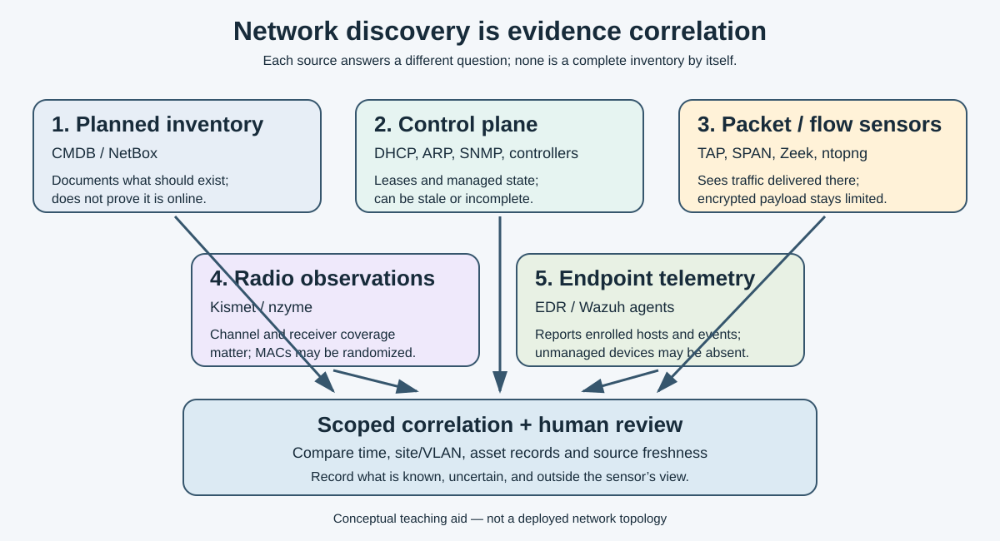

# Network Device Discovery, Asset Tracking & Visibility Platform Comparison

_Last source review: 2026-11-24. Feature descriptions follow official project material; specific releases, licenses and integrations must be validated before deployment._

> [!CAUTION]
> **Privacy & authorization.** Device presence, IP/MAC association, wireless client sightings and traffic history can reveal sensitive behavior. Inventory systems should monitor **authorized assets and network segments**, not track people. Require read-only credentials where feasible and apply access controls/retention. See [Legal Notice](../LEGAL.md).

## What Problem Are You Trying to Solve?

| Primary Question | Start With | Complement |
|---|---|---|
| What appeared or disappeared on my local network? | [NetAlertX](./netalertx-device-discovery-monitoring.md) | DHCP/switch/controller inventories |
| Is a router/switch/interface healthy? | [LibreNMS](https://www.librenms.org/) or [Zabbix](https://www.zabbix.com/) | SNMPv3, interface alerting, logs |
| Which network flows or traffic volume were visible at a sensor? | [ntopng](https://github.com/ntop/ntopng) or Zeek | NetFlow/sFlow/IPFIX or TAP/SPAN data |
| What assets, racks, ports and VLANs are **supposed** to exist? | [NetBox](https://netbox.dev/) | Change controls and actual discovery imports |
| Which Wi-Fi radio devices/SSIDs exist in range? | [Kismet](../Wardriving/kismet.md) or [nzyme](../IncidentResponse/IDS%26IPS/nzyme_wids.md) | Fixed-channel monitor adapter |
| Did a host produce a security incident? | [Wazuh](../IncidentResponse/SIEM/wazuh.md) or EDR | Endpoint event collection |
| Does a packet pattern match a threat signature? | [Snort 3](../IncidentResponse/IDS%26IPS/snort.md) / Suricata | Proper capture feed, tuning & corroboration |

## Reading Discovery Evidence

This conceptual map separates planned inventory, control-plane records, packet observations, radio sightings and endpoint events. Correlate them only within an authorized scope, and record source, time, location/segment and confidence. A blank source is a visibility gap, not proof that an asset is absent.

*Conceptual diagram: each source reports a different slice of activity. Sensor placement, retention, permissions and device privacy features affect what can be concluded.*

## Device & Network Tool Comparison

| Tool | Discovery / Evidence Type | VLAN/Site Scope | Strength | Limitation / Integration |
|---|---|---|---|---|
| [NetAlertX](https://netalertx.com/) | ARP, DHCP, Nmap, SNMP/API plugins, state changes | Same-L2 ARP; distributed nodes/imports for other networks | Low-friction new-device notices and inventory history | Not packet IDS; random MACs and sleepy clients |
| [LibreNMS](https://www.librenms.org/) | SNMP, LLDP/CDP, ARP/FDB, interfaces and services | Routed management reachability | Strong network gear health, topology and metrics | Device discovery depends on SNMP/management access |
| [Zabbix](https://www.zabbix.com/) | Agent, SNMP, API, ICMP, service monitors | Proxy nodes can monitor remote sites | Broad observability, triggering, automation | Heavier setup; not raw RF/WLAN sniffing |
| [NetBox](https://netbox.dev/) | Planned/managed inventory (IPAM/DCIM) & plugin/API integrations | Multiple sites and tenants | Source of truth for assets, VLANs, circuits and cables | **Not** inherently a live discovery sensor |
| [ntopng](https://github.com/ntop/ntopng) | Live flows, packets and traffic-analysis metadata | TAP/SPAN, NetFlow/sFlow/IPFIX per exporter | Actual activity/bandwidth and application insight | Only sees traffic supplied to it; feature editions differ |
| [arpwatch](https://ee.lbl.gov/) | Observes ARP address-pair changes on an interface | Only local visible L2 traffic | Lightweight ARP change alerting | No reliable Wi-Fi presence or inter-VLAN view |
| [WatchYourLAN](https://github.com/aceberg/WatchYourLAN) | Local network discovery/device history | Deployment/host network dependent | Simple self-hosted device inventory | Feature/version and multi-network handling vary |
| [Nmap](https://nmap.org/) | Explicitly targeted network discovery & services | Routed authorized IP ranges | Bounded one-off audits, scripting | Active probes; not continuous presence tracking alone |
| [Fing](https://www.fing.com/) | Consumer/small-business device discovery | Product/network environment dependent | Convenience and ease of use | Cloud/plan/device features vary |
| [UniFi Network](https://ui.com/) | Managed AP/switch/router client and port history | UniFi-managed network topology | Real association, DHCP and port context | Only infrastructure under supported controller |
| [Kismet](https://www.kismetwireless.net/) | 802.11/BLE sightings, radio alerts | Receiver location/channels | Wireless inventory and WIDS | Not an authorized device identity database |
| [nzyme](https://www.nzyme.org/) | Sensor-based Wi-Fi/radio monitoring | Node + distributed radio taps | Rogue AP/fingerprint/disconnection monitoring | Requires compatible capture interfaces and careful coverage |
| [Snort/Suricata](https://snort.org/) | IDS alerts from copied packet feed | TAP/SPAN/inline link | Rules, signature-based detections | Not independent asset identity authority |
| [Wazuh](https://wazuh.com/) | Endpoint/security logs, rules, FIM & agent data | Agents and log integrations | Centralized events and response workflow | No raw Wi-Fi frames without an RF collector |

### Device "Tracking" Means Asset Presence, Not Tracking People

- A current MAC address may be randomized or locally administered; **one physical device may appear as several records**.
- A DHCP lease is not a guarantee the device is currently online; ARP/ping silence is not proof it left.
- A Wi-Fi BSSID/SSID identifies **advertised network metadata**, not a person or the precise location of a transmitter.
- For accountable asset identification, prefer **managed enrollment / 802.1X identity**, DHCP reservations, switch-port records, controller APIs and asset serials under access control.
- Protect historical observations and sanitize anything shared publicly.

## Picking a Stack for Your Environment

| Environment | Suggested Combination | Why |
|---|---|---|
| Home network | NetAlertX + router DHCP source; optional Pi-hole | Simple arrivals/departures and DNS correlation |
| Small IT business | NetAlertX + UniFi/controller + Wazuh endpoints | Device changes, authenticated network context and endpoint alerts |
| Network-focused homelab | LibreNMS + NetBox + ntopng + TAP/SPAN | Health, documented topology, actual traffic |
| Wi-Fi WIDS | nzyme or Kismet + managed AP/controller + Wazuh | Separate RF evidence and central timeline |
| Multi-VLAN office | NetAlertX collectors/imports + switch/NAC + firewall policy | Routed view cannot magically see remote ARP MACs |
| Proxmox/IDS training | Snort/Suricata/Zeek + Wireshark on mirror/TAP + inventory | Separate evidence for packets, signatures and identities |

## Discovery Mode & Network Impact

| Mode | Mechanism | Relative Operational Risk |
|---|---|---|
| Passive packet observation | Existing frames delivered to receiver | Lower transmission impact; still privacy-sensitive |
| Read-only controller/DHCP import | Existing inventory, leases, associations | Low network impact; requires secure API credentials |
| SNMP polling | Query managed devices | Active but usually low volume; protect SNMPv3 credentials |
| ICMP/TCP discovery | Probe target endpoints | Active; ensure rate/target/maintenance scope |
| ARP scan | Local L2 requests | Active on scanned VLAN; can be noisy at scale |
| Remote vulnerability probing | Service-specific tests | Higher risk; not necessary for routine device discovery |

Use small subnets and a known scan window, measure load and stop for fragile IoT/industrial devices. More scanning is not always more accurate.

## Wazuh Event Normalization & Change Response

Recommended minimal event fields: `source`, `timestamp_utc`, `site`, `vlan`, `observed_asset_key`, `device_state`, `ip`, `source_confidence` and `corroboration`. Never send real client serials, identifying MACs or user names to a public example. Webhook/agent integration must be designed per tool's supported plugin/API version and tested as a separate workflow.

| Signal | Required Corroboration Before Remediation |
|---|---|
| Unknown new device | NAC/802.1X admission, switch port, client-owner record |
| MAC address moved | AP roam, dock, hypervisor, redundancy/HA |
| Rogue DHCP seen | DHCP snooping, actual offered/accepted gateway/DNS |
| Unauthorized service | Approved service inventory, host/firewall logs |
| RF anomaly | Kismet/nzyme capture channel, AP/controller and Wireshark evidence |

## Wireshark & Packet Source Reference

| Question | Display Filter | Caveat |
|---|---|---|
| Local ARP changes | `arp` | Only traffic delivered to capture NIC |
| DHCP client/server | `dhcp` | Lease alone does not prove presence |
| VLAN 30 | `vlan.id == 30` | Tags may be stripped/offloaded |
| DNS source | `dns` | DoH/DoT encrypt questions |
| Unusual management-frame burst | `wlan.fc.type_subtype == 0x0c` | Requires monitor-mode 802.11 RF capture |
| TCP service inventory | `tcp.flags.syn == 1 && tcp.flags.ack == 0` | Ordinary connections also match |

See [Wireshark Defensive Investigations](./wireshark-defensive-investigations.md), [LAN TAPs & SPAN](./network-taps-and-packet-visibility.md), and [VLAN/DMZ/ACL Segmentation](./network-segmentation-dmz-acl-vlan.md).

## Implementation Acceptance Checklist

1. Inventory network gateways, L2 VLANs, IP prefixes, DHCP authorities, controllers and management zones.
2. Choose scan versus read-only import per segment; ensure consent and data minimization.
3. Test one known asset appearing, changing IP, sleeping and disconnecting; record false positives.
4. Test a *synthetic* unauthorized-device event and confirm alert delivery and de-duplication.
5. Correlate one event with switch/DHCP logs and a bounded lab Wireshark capture.
6. Set update, backup, least-privilege secret, privacy, retention and restore policies.
7. Document blind spots: VPN clients, IPv6-only devices, random MACs, unmanaged switches and off-subnet ARP.

## Primary References

- [NetAlertX Documentation](https://docs.netalertx.com/) & [Remote Networks](https://docs.netalertx.com/REMOTE_NETWORKS/)
- [LibreNMS Documentation](https://docs.librenms.org/) & [Network Map](https://docs.librenms.org/Extensions/Network-Map/)
- [ntopng Guides](https://www.ntop.org/guides/ntopng/) & [NetBox Documentation](https://netboxlabs.com/docs/netbox/en/stable/)
- [Zabbix Documentation](https://www.zabbix.com/documentation/current/en/manual)
- [Official Nmap Reference](https://nmap.org/book/man.html)
- [Zeek connection log reference](https://docs.zeek.org/en/current/reference/logs/conn.html) — connection metadata, not a complete record of every application action.
- [Kismet randomized MAC documentation](https://www.kismetwireless.net/docs/readme/configuring/randomized_macs/) — randomized addresses affect long-term device correlation.

---

[Documentation Index](./README.md) | [IDS/IPS Index](../IncidentResponse/IDS%26IPS/readme.md) | [Legal Notice](../LEGAL.md)
