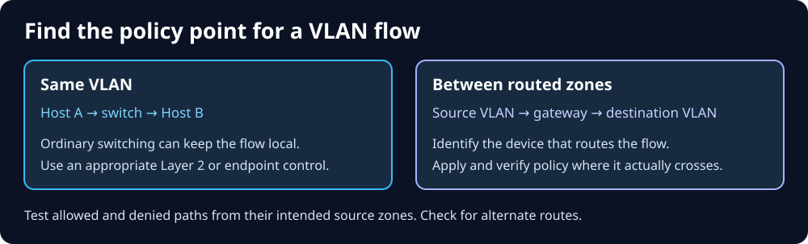

# Network DMZs, VLANs, ACLs, 802.1Q Tagging, Port Mirroring & Segmentation

_Reviewed: 2026-11-21. The configurations below are vendor-neutral illustrations, **not** production-ready switch/firewall commands._

> [!CAUTION]
> **Configuration-change safety.** Switching an access port to a trunk, changing a native VLAN or firewall rule, or enabling a SPAN session can interrupt service and expose traffic. Use configuration backups, an out-of-band management path, change control, staged tests and an explicit rollback plan. See [Legal Notice](../LEGAL.md).

## Purpose & Architecture

**Segmentation is the separation of assets into security zones with explicit allowed paths.** A VLAN creates a Layer-2 broadcast-domain boundary; a routed interface, firewall or ACL determines **who may communicate between VLANs**. Simply tagging devices does **not** guarantee that users or malware cannot reach another subnet.

```text
                        INTERNET
                           │
                   Firewall / Router
              ┌────────────┼─────────────┐
              │            │             │
      [DMZ VLAN 40]   [Trusted VLAN 10] [Guest VLAN 30]
       public proxy     staff devices     untrusted/IoT
              │            │             │
              │         [Server VLAN 20] │
              │            │             │
              └────────[Mgmt VLAN 99]────┘
                        restricted
                   ┌───────────────┐
                   │ SPAN / LAN TAP │
                   └──────┬────────┘
                    Zeek/Suricata
                    Wireshark/SIEM
```

This is a **logical diagram**, not a suggestion to directly connect all zones to each other. Policy must restrict each allowed route.

## Foundational Terms

| Term | Purpose | Critical Limitation |
|---|---|---|
| **VLAN** | Separate Layer-2 broadcast domains, typically by IEEE 802.1Q | Without L3 policy, inter-VLAN routing may still allow access |
| **Access/untagged port** | Assign endpoint traffic to one VLAN via switch PVID | Untagged host traffic ordinarily does not carry a VLAN ID |
| **Trunk/tagged port** | Carry multiple VLANs between switch, router, AP or hypervisor | Must explicitly allow VLANs and agree on native/untagged behavior |
| **PVID / native VLAN** | Classify untagged ingress on a port/trunk | Mismatches and uncontrolled untagged traffic cause leakage |
| **Inter-VLAN routing** | L3 gateway between VLANs | Firewall/routed ACLs must enforce zone boundaries |
| **ACL** | Permit/deny traffic by IP, protocol, port and direction | Stateless ACLs lack connection state; deployment point matters |
| **Stateful firewall** | Track established flows and apply zone policy | Cannot automatically protect intra-VLAN peer communication |
| **DMZ** | Isolated zone for services exposed to less trusted networks | Not simply a port-forward rule into the internal LAN |
| **PVLAN / client isolation** | Separate peers sharing an L2 segment | Vendor-specific behavior, not replacement for L3 segmentation |
| **NAC / 802.1X** | Authorize wired/wireless access and sometimes assign VLAN dynamically | MAB fallback is weaker and MAC addresses are spoofable |
| **SPAN / port mirror** | Copy specified switch traffic to a tool port | Mirror output may drop packets or remove VLAN tags |
| **RSPAN / ERSPAN** | Forward mirrored traffic remotely | MTU/encapsulation, clock and resource limitations |
| **Network TAP** | Copy in-line physical link traffic | Speed, power, bypass and observation-point constraints |

## Example Small-Business VLAN & DMZ Plan

The following is a **fictional, RFC1918 example**. Use a complete real network inventory and change plan before adapting it.

| VLAN ID | Example Subnet | Zone | Default Trust | Typical Allowed Service |
|---|---|---|---|---|
| 10 | 10.10.10.0/24 | Staff | Managed endpoints | Approved internal apps, DNS/NTP, outbound web |
| 20 | 10.10.20.0/24 | Servers | Restricted | Only specific staff/admin app ports |
| 30 | 10.10.30.0/24 | Guest & IoT | Untrusted | Internet DNS/NTP/HTTPS via approved gateways; no staff/server access |
| 40 | 10.10.40.0/24 | DMZ | Public exposure | Inbound HTTPS to reverse proxy only; constrained backend service |
| 50 | 10.10.50.0/24 | Monitoring | Sensitive telemetry | Sensor→SIEM/log collector; no general workstation access |
| 99 | 10.10.99.0/24 | Management | Highest restricted | Admin VPN/jump host to approved switch/firewall services |
| 999 | No routed subnet | Parking/unused | None | Unused ports / unused native VLAN if supported |

Avoid routing a VLAN directly between customer and internal services without explicit policy. **IoT and guests are usually distinct zones** where device needs differ. A dedicated voice, printer, building-automation or camera VLAN may deserve its own policy.

### Example Zone Policy Matrix

| Source → Destination | Staff (10) | Servers (20) | Guest (30) | DMZ (40) | Mgmt (99) | Internet |
|---|---|---|---|---|---|---|
| Staff (10) | Same VLAN policy | Specific approved app ports | Deny | HTTPS where needed | Deny | Controlled outbound |
| Servers (20) | Deny unsolicited | Role-specific | Deny | Specific backend routes | Deny | Updates/backup only |
| Guest (30) | Deny | Deny | Client isolation | Deny | Deny | DNS/NTP/web only |
| DMZ (40) | Deny | Strictly scoped reverse-proxy backend | Deny | Deny by default | Deny | Updates/services only |
| Monitoring (50) | Passive feed or authorized management only | Collector destinations | None | Packet copies where authorized | Restricted collector mgmt | Approved update endpoints |
| Mgmt (99) | Explicitly authorized admin protocols | Explicitly authorized admin protocols | Deny | Admin only | Restricted | Approved admin tools only |

The matrix is a **policy sketch**, not a complete firewall ruleset. Stateful rules, return traffic, IPv6, DHCP relays, multicast, mDNS, printers, VoIP, backups, VPN, monitoring, DNS and emergency access all require explicit design. Management VLAN 99 is not inherently more secure because of its numeric ID.

## 802.1Q Tagging: Switch, AP, Router & Hypervisor

| Link | Common Mode | Expected Tags |
|---|---|---|
| Laptop/desktop → access switch | Untagged access port with PVID | Endpoint normally sends untagged Ethernet |
| Switch → switch | Trunk | Explicitly allowed VLAN tags; one consistent native/untagged policy |
| Switch → VLAN-aware AP | Trunk | SSID-associated VLANs tagged; management VLAN defined |
| Switch → router/firewall | Tagged trunk to VLAN subinterfaces | L3/firewall interface per intended VLAN |
| Switch → Proxmox host | Trunk into VLAN-aware Linux bridge or dedicated VLAN NIC | Tag path depends on vmbr and VM NIC configuration |
| Switch → SPAN/monitor NIC | Monitor destination | Tags may be retained, stripped or synthesized depending on vendor |
| Pi or Linux host with VLAN subinterface | `eth0.20` type interface in supported Linux setup | Frames egress tagged if physical port/NIC and switch agree |

**802.1ad/Q-in-Q** adds stacked service/customer VLAN tags, primarily in provider/complex networks. A single `vlan.id` filter may not tell the whole story; verify tag layers in the capture. Never place untrusted endpoints on arbitrary trunks; restrict allowed VLAN lists and unused/native VLAN handling. Test for misconfigured double-tagging, mismatched native VLANs and unexpected negotiation without enabling disruptive attack traffic.

### Proxmox Specifics

- A VLAN-aware `vmbr` and VM NIC VLAN tag are not equivalent to a switch SPAN or hardware TAP.
- Make explicit which physical uplink trunk carries which VLAN IDs, where the gateway L3 interface lives and whether the sensor can reach the management plane.
- Preserve a separate, reliable management interface/path before experimenting with host bridges or VLAN filters.
- A passive sensor VM needs a **mirrored feed, permitted TAP feed or actual virtual mirror**. A normal guest `eth0` does not observe unrelated LAN unicast.
- Verify ingress and egress separately, not just ping between two VMs.

## ACL Strategy & Secure Defaults



Map the forwarding path before choosing a firewall or ACL. A routed policy applies
to traffic that traverses its enforcement point. Review same-VLAN traffic and
alternate gateways separately. [OPNsense firewall processing](https://docs.opnsense.org/manual/firewall.html)

Prefer **default deny inter-zone** with documented exceptions. Rules should state source zone, destination zone, direction, state, protocol, port, logging, owner, reason, expiration and retest procedure.

Example **policy data**, **not** executable syntax:

```text
POLICY guest_to_staff:
  from: VLAN30_GUEST
  to:   VLAN10_STAFF
  action: DENY
  log:  sampled / risk-based

POLICY staff_to_inventory_app:
  from: VLAN10_STAFF
  to:   10.10.20.15
  protocol: TCP
  destination_port: 443
  action: ALLOW
  justification: inventory web app
  owner: IT

POLICY remote_admin:
  from: managed_jump_host_over_vpn
  to:   approved_firewall_switch_admin_ips
  protocol: HTTPS_SSH
  action: ALLOW
  require: MFA + device policy
```

**Avoid large any-to-any rules**, indiscriminate inter-VLAN traffic, exposed router management, inbound SMB/RDP from Internet and permitting all DMZ-to-LAN connections.

## DMZ Service Design

A DMZ commonly contains a reverse proxy, hardened public web server, mail edge or another externally accessible gateway. The backend database and domain controllers should live in restricted internal zones with **only required app-specific flows** from the DMZ. Separate administrative access over VPN/jump hosts; use TLS, WAF/rate limits where appropriate, secret management and isolated logs. A firewall's consumer "DMZ host" setting that forwards unsolicited ports to one machine is **not** equivalent to a properly isolated network DMZ.

## Switch Hardening & Layer-2 Defenses

| Feature | Where Applied | What It Mitigates |
|---|---|---|
| DHCP snooping | Untrusted access ports, trusted DHCP uplinks | Rogue DHCP offers; also builds binding table used by DAI |
| Dynamic ARP Inspection | VLANs/ports using trusted snooping bindings | Unauthorized ARP gateway claims |
| IP Source Guard | Access switch ports | Source IP/MAC inconsistencies subject to binding accuracy |
| RA Guard | IPv6 access ports | Unauthorized IPv6 router advertisements |
| BPDU Guard / Root Guard | Proper switch access/uplink topology | Unexpected STP bridge activity |
| Storm control | L2 switch ports | Broadcast/multicast/unknown-unicast floods |
| Port security | Controlled access interfaces | Limits unknown MACs but vulnerable to spoofing |
| 802.1X / NAC | Wired and WPA-Enterprise endpoints | Authentication and dynamic group/VLAN policy |
| Management plane ACL | Router/switch management interfaces | Limits admin reachability |
| Private VLAN / client isolation | Shared guest/IoT networks | Peer-to-peer exposure within same VLAN |

**Test fail-safe behavior.** DHCP snooping misconfigurations can disrupt all clients. RA Guard may fail under some extension-header/fragmentation conditions depending on implementation; verify actual enforcement on supported software.

## SPAN, RSPAN, ERSPAN, TAP & Packet Broker

| Source | Best For | Caveat |
|---|---|---|
| Local SPAN | Copy traffic from known switch ports/VLANs | Oversubscribed output/dropped frames, stripped tags |
| RSPAN | L2 transport of mirrored frames | Trunk/VLAN availability and forwarding context |
| ERSPAN | Encapsulated remote monitoring over IP | GRE encapsulation, MTU and endpoint support |
| Physical TAP | High-integrity capture of one **installed physical link** | Insertion outage, speed/duplex, bypass |
| Virtual mirror | VM east–west traffic on supported vSwitch | Off-host traffic not automatically visible |
| Network packet broker | Aggregate/filter/deduplicate/distribute feeds | More capacity planning and tooling needed |

See [LAN TAPs, Throwing Star & Packet Visibility](./network-taps-and-packet-visibility.md) for full media and speed details. Great Scott Gadgets' Throwing Star is a **passive 10/100 Mbps lab TAP**, not a no-impact gigabit device.

## Wireshark & TShark: Verify Segmentation

The following are **display filters** only. Offload, mirroring or a capture NIC may strip VLAN tags; their absence in a PCAP is **not proof** that no tags exist.

| Check | Wireshark Display Filter | Interpretation |
|---|---|---|
| Any VLAN tags | `vlan` | Shows decoded 802.1Q tags that reached capture |
| VLAN 20 tagged traffic | `vlan.id == 20` | Not guaranteed with NIC offload or stripped mirror tags |
| DHCP | `dhcp || bootp` | Compare authorized server/option with approved VLAN |
| ARP | `arp` | L2-local broadcast; absence depends on capture source |
| IPv6 router advert | `icmpv6.type == 134` | RA Guard and legitimate routers matter |
| DNS | `dns` | Approved resolver policy, not a sole isolation test |
| HTTP/TLS to scoped server | `ip.addr == 10.10.20.15 && tcp.port == 443` | Packet visibility is distinct from policy allow |
| Misplaced IPv4 range | `ip.addr == 10.10.30.0/24` | Seeing packet copy **does not imply forwarding into other zones** |

### Safe Offline Review

```bash
tshark -r ./lab-vlan-capture.pcapng -Y 'vlan || arp || dhcp || bootp'
tshark -r ./lab-vlan-capture.pcapng -Y 'vlan.id == 20' \
  -T fields -e frame.time -e vlan.id -e eth.src -e eth.dst
```

The example capture is not included. Use benign test flows between **two owned endpoints**, inspect both sides' firewall logs, and confirm **deny rules with failed connection attempts**, not only by sniffing. For actual syntax and field names, see [Wireshark VLAN Reference](https://www.wireshark.org/docs/dfref/v/vlan.html) and [Master Filter List](./wireshark-master-filters.md).

## Rollout & Acceptance Plan

1. **Inventory:** devices, switches, SSIDs, ports, subnets, VLANs, routes, DHCP/DNS servers, firewalls, static-IP devices and owners.
2. **Threat model:** identify guest/IoT, exposed services, management, PCI/health data, wireless and remote endpoints.
3. **Draw the matrix:** allow specific needed flows, default-deny everything else, define IPv6 and multicast exceptions.
4. **Preflight hardware:** verify switch firmware, VLAN capabilities, PoE, 802.1X, port mirror resources and backup/rollback path.
5. **Pilot:** one isolated VLAN with a test device, confirmed DHCP/DNS and NTP and no unauthorized inter-zone access.
6. **Expand:** migrate groups in maintenance windows, monitor blocked flows, minimize rules and log safely.
7. **Verify:** use benign positive and negative connectivity tests from each zone, Wireshark/TAP/SPAN evidence and firewall counters.
8. **Operate:** change review, rule owners/expiration, unused-port cleanup, config backups and periodic retest.

| Acceptance Criterion | Evidence |
|---|---|
| Guest cannot reach staff/server/mgmt | Test matrix from owned guest, firewall deny log |
| Staff allowed web app still works | HTTPS success and allow log |
| DMZ backend access narrow | Specific allowed backend port, all other paths denied |
| Unauthorized DHCP/RA blocked | Switch security logs + owned test |
| Mirror sees intended source | Correct direction & VLAN, measured drops |
| Management remains available | OOB access and rollback tested |
| Tagged frames behave correctly | Switch config, endpoint test and captured tag where present |

## Related Guides & Sources

- [MITM Detection & Prevention](./mitm-detection-prevention.md)
- [DNS Hijacking & Secure DNS](./dns-hijacking-secure-dns.md)
- [Counter-Surveillance & Wireless Detection](./counter-surveillance-wireless-threats.md)
- [Wireshark Master Filters](./wireshark-master-filters.md)
- [LAN TAPs, SPAN & Visibility](./network-taps-and-packet-visibility.md)
- [Proxmox Security Monitoring Visibility](../Homelab/proxmox-security-monitoring-visibility.md)
- [Cisco 802.1Q & VLAN Overview](https://www.cisco.com/c/en/us/solutions/small-business/resource-center/networking/how-to-set-up-vlan.html)
- [Wireshark VLAN Field Reference](https://www.wireshark.org/docs/dfref/v/vlan.html)
- [CISA Segmentation & Hardening Guide](https://www.cisa.gov/sites/default/files/2025-01/joint-guidance-enhanced-visibility-hardening-guide-for-comms-infrastructure-508c_0.pdf)

---

[Documentation Index](./README.md) | [Homelab](../Homelab/README.md) | [Legal Notice](../LEGAL.md)
