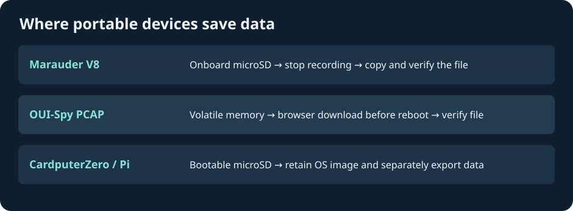
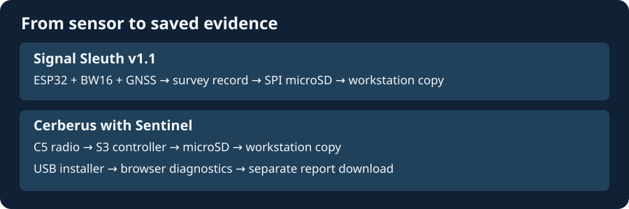

# Portable Security Device Field Checkouts

[Main README](../README.md) · [Cyberdeck](../Cyberdeck/README.md) · [Firmware Catalog](device-firmware-list.md) · [SD Card Reference](portable-device-sd-data.md) · [Counter-Surveillance](counter-surveillance-wireless-threats.md)

Use these procedures to qualify hardware, confirm its observation limits and generate repeatable evidence with known lab fixtures. Keep the device revision, firmware tag, storage destination and a known-good baseline together in the bench record.

## OUI-Spy Unified Blue

**Bench setup.** Confirm the board revision and ESP32-S3 target against the upstream project. Unified Blue and the older standalone Detector have separate instructions. Use the upstream board-matched release or installer with a data cable, record the tag, and confirm the mode labels after boot. Its configuration/dashboard AP is a transmitter even when the selected observation mode listens passively. Keep management access on the bench and change the mode's default credentials where supported.

**Detector acceptance.** Use an owned BLE development beacon with a known test identity. Add one exact lab selector that the installed release supports. Take a baseline with the beacon off, turn it on and verify the local alert, then repeat with an unrelated beacon. Repeat from the same position and note the results. A vendor prefix, name, UUID or RSSI alone cannot establish device identity or location. Randomized addresses and shared radio modules can create misses and false matches.

**PCAP export.** In a controlled RF lab, open the installed build's PCAP dashboard, use a fixed channel shared with your test AP and download a short session before reboot. Upstream describes a rolling 2 MB PSRAM capture and a browser Save PCAP action. On a workstation, open the file in Wireshark, confirm the radiotap/802.11 link type and compare frame times to your lab event. Document channel and test window. A reboot or buffer rollover can discard earlier frames. If a menu differs across releases, consult the release README before using older mode numbers.

[OUI-Spy upstream and board resources](https://github.com/colonelpanichacks/oui-spy) · [Unified Blue source and mode documentation](https://github.com/colonelpanichacks/oui-spy-unified-blue) · [Legacy Detector](https://github.com/colonelpanichacks/ouispy-detector) · [Wireshark filter reference](wireshark-master-filters.md)

## Marauder V8

**Identify and update.** The full-size V8 uses ESP32-C5, a 2.8-inch touchscreen, dual-band Wi-Fi, microSD and GPS. Record the installed version and back up the card before updating. Select the exact V8 target in the upstream installer and use its protected `_v8.bin` release. Upstream calls for a complete target installation when partition history is unknown. The Mini V3, legacy full-size boards and generic C5 boards have separate images.

**Lab verification.** Confirm touch, SD detection and GPS status if using location tagging. Use two owned AP radios on separately documented 2.4 and 5 GHz channels with a short observation window. Compare the SSIDs and channels reported by the installed build to your AP console. If you use the upstream passive frame capture feature with your lab fixtures, stop collection before extracting the media, then open the resulting file on a workstation and verify frame count and channel metadata where present. Round-trip a fresh file before relying on the card. Record the observation channel and note any periods when the receiver was elsewhere.

**Troubleshooting.** If the display or SD fails immediately after flashing, recheck the exact catalog target and partition history. For poor reception, confirm the fitted Wi-Fi antenna supports the selected band and compare with a nearby reference AP. For missing coordinates, check GPS fix separately from radio reception.

[Official V8 wiki](https://github.com/justcallmekoko/ESP32Marauder/wiki/Marauder-v8) · [Supported targets](https://github.com/justcallmekoko/ESP32Marauder/wiki/supported-hardware) · [Upstream SD update](https://github.com/justcallmekoko/ESP32Marauder/wiki/sd-update) · [Repository Marauder guide](WiFiMarauder_Guide.md) · [Standalone survey guide](../Wardriving/esp32-marauder.md)

## RaspyJack (Raspijack)

**Choose the platform.** Upstream documents Raspberry Pi Zero 2 W, 3B+ and 4B configurations and a CardputerZero app. For a Pi build, confirm the required display and Ethernet arrangement against the upstream hardware table. Prefer a spare OS card and review the package, services and privileges before using the image. For CardputerZero, keep the vendor base OS and a separate test card. Record the app build independently of the OS version.

**Read-only acceptance.** Boot on an isolated bench network without a production uplink. Open the app's Network info screen and compare the interface and address with the local Linux command `ip -br address`. On CardputerZero, use the directional controls and Enter. Upstream maps Esc to exit. If Ethernet is absent on the CardputerZero, verify host USB mode and link before replacing the image. For integration, compare the route to a single approved lab endpoint with `ip route get` and keep the result with the asset record.

**Storage and recovery.** Treat the card as an OS disk containing package state, configuration and potentially sensitive logs. Export only the needed review file to encrypted workstation storage. During app evaluation, note any additional listening services against a clean OS baseline with `ss -lntu`. Preserve the original card and verify recovery from a clean spare before reusing the device.

[Official RaspyJack project and hardware matrix](https://github.com/7h30th3r0n3/Raspyjack) · [Project installation wiki](https://github.com/7h30th3r0n3/Raspyjack/wiki/Installation) · [CardputerZero Field Guide](../Cyberdeck/docs/CARDPUTERZERO.md) · [Repository RaspyJack notes](../Homelab/workflows/self-hosted_network_attacks.md#raspyjack--raspberry-pi-portable-assessment-workflow)

## Signal Sleuth

463N7's Signal Sleuth v1.1 is a revision of Joseph Hewitt's Wardriver. The v1.1 PCB parts list calls for two ESP32-DevKitC V4 boards with ESP32-WROOM-32U modules, a BW16 for 5 GHz, an ATGM336H GNSS module and an SPI microSD reader. The I²C display is optional. Check the actual kit revision and populated parts before using the v1.1 list.

1. With power removed, compare each module, header orientation, and antenna connection against the exact board revision. Mark the two ESP32s so they can be matched to their firmware roles during troubleshooting. Keep the original firmware and configuration record. Verify any replacement image against 463N7's revision-specific instructions before flashing. Joseph Hewitt's Rev3 documentation describes the A/B design, but the pin map and BW16 build need confirmation for Signal Sleuth.
2. Use a spare card for first boot. 463N7 recommends 16 GB or less for this PCB, and the inherited Rev3 firmware expects FAT32. Confirm the installed build's card requirements before formatting. Check that the card is recognized and, if you fitted the display, confirm scan and GNSS status. Keep network uploads disabled for the bench run.
3. In an RF lab, use one owned AP with documented 2.4 and 5 GHz channels. Start with the 2.4 GHz test fixture, then compare with a 5 GHz fixture supported by the installed BW16 build. Open the saved survey file locally, compare its observations to the AP console, and check timestamps and coordinate fields. Mark missing GNSS fixes as missing and keep raw location records private.
4. If no file appears, check the card and SPI reader before changing firmware. If 2.4 GHz works but 5 GHz is absent, check the BW16 board, antenna and release profile separately. If observations appear with blank coordinates, check the GNSS antenna and fix status separately from Wi-Fi reception.

[463N7 project](https://github.com/463N7/SignalSleuth) · [v1.1 parts list and case resources](https://463n7.io/products/signal-sleuth-pcb) · [Joseph Hewitt Rev3 source and linked wiki](https://github.com/JosephHewitt/wardriver_rev3/) · [SD storage and recovery](portable-device-sd-data.md)

## Cerberus And Sentinel

The Cerberus Dev Board is the hardware. Its ESP32-S3 manages the touchscreen and storage, while the onboard ESP32-C5 provides wireless capability. Sentinel is 463N7's published firmware for the production board. The hardware reference describes optional add-ons separately and marks them as under test. Confirm each peripheral against the reference for your board.

1. Record the board revision and installed firmware before changing either processor's image. Back up the microSD and note any settings needed for restoration. Use a USB data cable and the official Sentinel installer in desktop Chrome or Edge. Select the matched package for your production board.
2. Follow the installer's staged prompts. It uses a temporary USB bridge to program the C5, then returns to the S3 loader for the main firmware and the startup check. The browser may ask you to choose the USB device again when its identity changes. Follow the official BOOT/RESET recovery instructions if the loader does not reappear.
3. On first boot, check touchscreen response, the C5 startup diagnostic and microSD detection individually. Use an isolated lab and a single known 2.4 GHz or 5 GHz AP for a short read-only observation with Sentinel. Compare frequency and channel with the AP's own management screen. Confirm any export can be reopened on the workstation and record format, firmware version and vantage point.
4. If touch works but the radio test fails, inspect the C5 startup result before replacing the S3 image. If display and radio work but export fails, check the card using a known-good spare and the matching firmware's storage instructions. The installer report is a separate workstation download that can contain board MAC addresses. The Sentinel dashboard uses local HTTP and the documented SD data is unencrypted, so keep diagnostics and exports within the bench scope.

[463N7 hardware and pinout reference](https://github.com/463N7/Cerberus-Dev-Board) · [Developer guide](https://463n7.github.io/Cerberus-Dev-Board/) · [Official Sentinel installer](https://463n7.github.io/Cerberus-Flasher/) · [Installer documentation and release history](https://github.com/463N7/Cerberus-Flasher) · [SD storage and recovery](portable-device-sd-data.md)

## Other Listed Platforms

| Platform | Repeatable bench test | Existing procedure and upstream reference |
| --- | --- | --- |
| Flipper Zero with CC1101, nRF24, Wi-Fi/BW16 or other GPIO board | Record host and accessory revisions, verify pinout and power, and confirm enumeration one board at a time with the vendor's benign demo. Remove power before changing hardware. | [Flipper field guide](flipper_zero_guide.md) · [Official GPIO docs](https://docs.flipper.net/zero/gpio-and-modules) |
| M5StickC Plus2, Cardputer ADV and T-Embed family | Match the printed SKU and build, then confirm display, controls, storage and idle radio behavior on the bench. | [Bruce guide](bruce_firmware.md) · [Bruce upstream](https://github.com/pr3y/Bruce) · [M5Stack product documentation](https://docs.m5stack.com/en/products) |
| Evil-M5 and LAB5 C5 Monster | Record controller and radio firmware separately. Confirm the display and local UART/companion status with the correct profile before checking a known lab AP. | [Evil-M5 guide](evil_m5.md) · [Evil-M5 upstream](https://github.com/7h30th3r0n3/Evil-M5Project) · [LAB5 hardware and companion](https://github.com/C5Lab/M5MonsterC5-CardputerADV) |
| Biscuit and AWOK Dual C5 | Identify the physical MCU and firmware role, then compare one owned AP observation with the dashboard and export. | [Biscuit](../Wardriving/biscuit.md) · [AWOK Dual C5](../Wardriving/awok-dual-c5-biscuit.md) |
| Piglet, Pwnagotchi/FancyGotchi and Bjorn | On a dedicated lab segment, verify the selected interface and expected local logs. Use offline review and synthetic or owned-device data. | [Piglet](../Wardriving/piglet.md) · [FancyGotchi/Pwnagotchi](fancygotchi-pwnagotchi.md) · [Bjorn](bjorn_pi.md) |
| Hak5 Pineapple MK VII and Pager | Verify device revision, management access and the destination of a benign lab export before field use. | [Repository platform guides](../Wardriving/README.md) · [Hak5 documentation](https://docs.hak5.org/) |
| Hak5 USB devices and Raspberry Pi Pico | Confirm device revision and inspect a harmless local test file on a disposable workstation before deploying to a managed bench. | [Hardware Hacking index](../HardwareHacking/README.md) · [Hak5 documentation](https://docs.hak5.org/) · [Official Raspberry Pi Pico docs](https://www.raspberrypi.com/documentation/microcontrollers/) |

The [SD card reference](portable-device-sd-data.md) maps which media or exports belong to each platform. Record any missing artifact as a failed or unverified checkout in the [Cyberdeck evidence workflow](../Cyberdeck/docs/EVIDENCE_AND_PRIVACY.md).
