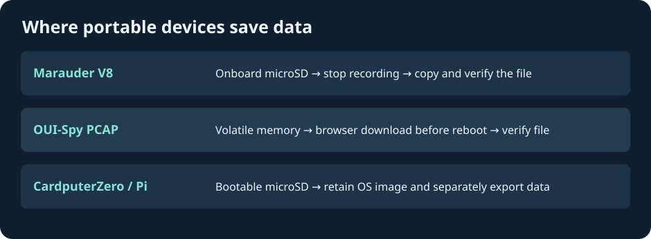

# Portable Device SD Card Data & Resources

[Portable Device Checkouts](portable-device-checkouts.md) · [Flipper Firmware Comparison](flipper-firmware-comparison.md) · [Cyberdeck Evidence & Privacy](../Cyberdeck/docs/EVIDENCE_AND_PRIVACY.md)

## Match Storage To The Device

| Device or project | What belongs where | Documentation and resources |
| --- | --- | --- |
| Flipper Zero | Removable data and resources. Inspect `apps/` for FAPs and the relevant app-created folders such as `infrared/`, `nfc/` and `lfrfid/`. Keep saved identifiers private. Internal qFlipper backup is separate. Vendor supports FAT-family and exFAT cards up to 256 GB and recommends 16–32 GB for typical use. | [Official SD setup](https://docs.flipper.net/zero/basics/sd-card) · [App Catalog](https://lab.flipper.net/apps) · [Official firmware resources](https://github.com/flipperdevices/flipperzero-firmware) · [Momentum asset packs](https://github.com/Next-Flip/Momentum-Firmware/wiki/Community-Asset-Packs) |
| Marauder V8 and standalone/companion variants | The capture belongs to whichever device actually saved it. A module with its own slot and a Flipper SD are independent destinations. Board-target update data follows the exact firmware instructions. | [V8 wiki](https://github.com/justcallmekoko/ESP32Marauder/wiki/Marauder-v8) · [Supported hardware](https://github.com/justcallmekoko/ESP32Marauder/wiki/supported-hardware) · [SD update](https://github.com/justcallmekoko/ESP32Marauder/wiki/sd-update) |
| OUI-Spy Unified Blue | Its documented PCAP mode is a volatile rolling buffer. Save PCAP from the dashboard before power-off and back up the resulting workstation file. | [Unified Blue mode docs](https://github.com/colonelpanichacks/oui-spy-unified-blue) |
| CardputerZero and RaspyJack on Pi | Bootable OS media with partitions, system files and app data. For replacement, use the matching vendor or Pi OS image plus separately backed-up data. | [CardputerZero image guide](https://docs.m5stack.com/en/compute/cardputerzero/image) · [Raspberry Pi Imager](https://www.raspberrypi.com/software/) · [RaspyJack upstream wiki](https://github.com/7h30th3r0n3/Raspyjack/wiki) |
| Bruce, Evil-M5, LAB5 and ESP32 radio boards | Storage may be flash, onboard SD, an add-on or a separate controller. Verify per board and firmware. Back up only documented configuration and authorized files. | [Bruce wiki](https://github.com/pr3y/Bruce/wiki) · [Evil-M5 wiki](https://github.com/7h30th3r0n3/Evil-M5Project/wiki) · [LAB5 companion](https://github.com/C5Lab/M5MonsterC5-CardputerADV) · [Firmware catalog](device-firmware-list.md) |
| Biscuit, Dual C5 and Piglet | Review whether the project exports through its interface, phone or local media. Physically separate controller storage from any collection node. | [Biscuit Wiki](https://codehedge.github.io/Biscuit-Wiki/) · [AWOK Dual C5 hardware](https://awokdynamics.com/products/dual-c5-mini) · [Piglet upstream](https://github.com/Hamspiced/piglet) |
| Pwnagotchi, FancyGotchi and Bjorn | Pi boot media and app-specific configuration/logs. Preserve the OS card separately from authorized cleared derivatives. | [FancyGotchi Wiki](https://github.com/V0r-T3x/Fancygotchi/wiki) · [Pwnagotchi fork](https://github.com/jayofelony/pwnagotchi) · [Bjorn upstream](https://github.com/infinition/Bjorn) |
| Pineapple MK VII and Pager | Hak5 lists 2 GB onboard eMMC for MK VII and 4 GB for Pager, with USB host on both. Confirm the export destination on your release before collecting. | [MK VII specs](https://shop.hak5.org/products/wifi-pineapple) · [Pager specs](https://shop.hak5.org/products/pager) · [MK VII settings](https://documentation.hak5.org/wifi-pineapple/ui-overview/settings) · [Pager documentation](https://documentation.hak5.org/wifi-pineapple-pager/) · [Repository Pineapple guides](../Wardriving/README.md) |
| Rubber Ducky, Bash Bunny, Shark Jack and Pico | Current USB Rubber Ducky uses microSD. Bash Bunny Mark II has onboard storage and optional microSDXC. Keep Shark Jack and Pico backups specific to the hardware and installed image. Inspect executable files before reuse. | [Hak5 Ducky and Bash Bunny storage specs](https://shop.hak5.org/pages/usb-rubber-ducky-vs-bash-bunny) · [Hak5 documentation](https://docs.hak5.org/) · [Raspberry Pi Pico docs](https://www.raspberrypi.com/documentation/microcontrollers/) · [Repository hardware guides](../HardwareHacking/README.md) |

## Build A Verified Spare

1. Record device and board revision, firmware/app versions, card format and which device owns the files. Use the platform's supported filesystem. Formatting overwrites the selected media.
2. Stop recording and safely unmount or shut down. Copy user files to approved encrypted storage. Preserve original directory structure and hidden files. Use the vendor image to rebuild boot media. A drag-and-drop copy of a boot partition will not recreate a bootable Linux card.
3. For a known sample, run `sha256sum -- sample.pcapng > SHA256SUMS` from its directory and `sha256sum -c SHA256SUMS` after transferring it. On PowerShell use `Get-FileHash -Algorithm SHA256 ./sample.pcapng` and compare the source and destination digests. For a multi-file backup, include a manifest and confirm a restore with the intended application.
4. Test the spare independently. Verify mount, reboot, app loading and one harmless file read/write. Preserve the original as a rollback until the spare passes.
5. If a card stops reading, preserve it and test a known-good spare to isolate the slot or firmware. If the original data matters, avoid in-place formatting and filesystem repair before acquisition. Consult the [evidence-handling guide](../Cyberdeck/docs/EVIDENCE_AND_PRIVACY.md).

## Choose Resources By Type

- **App binaries and databases.** Prefer the vendor catalog or exact maintainer release. Compare the version and install path against the core firmware or app ABI.
- **Themes and assets.** Use the firmware project's own pack specification and review the archive first. Test on a spare and keep the package's source and license.
- **Analysis fixtures.** Use a small synthetic capture or an approved lab export. The [Wireshark reference](wireshark-master-filters.md) shows how to inspect saved data. Keep client captures and live identifiers out of public archives.
- **Configuration.** Use upstream examples with placeholder values. Export only the necessary settings and keep live credentials, pairing material and keys in protected storage.
