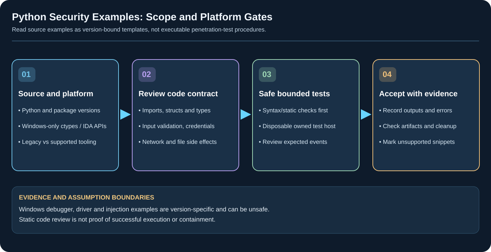

# Python Pen Testing Cheat Sheet

**Related references:** [Curated Python and API documentation](./curated-technical-docs.md) (FastAPI, Django) · [Proxy trust / Froxy Python library](../OPSEC/proxy-reference-froxy.md) (lab-only public-list research; never route client credentials through unknown proxies).

> [!WARNING]
> **Historical snippets and examples, not an execution-validated toolkit.** This page combines current Python syntax with Windows-only native APIs, legacy Python 2 debugger frameworks, IDA-version-dependent symbols and **incomplete Windows process-manipulation sketches**. Syntax review cannot establish runtime compatibility. Never paste the debug, driver, or injection portions into a workstation or a third-party system. Use owned disposable test systems and verify exact native function contracts first.



*Conceptual review process.* See [Python ctypes](https://docs.python.org/3/library/ctypes.html), the [subprocess reference](https://docs.python.org/3/library/subprocess.html) and [Hex-Rays IDAPython reference](https://python.docs.hex-rays.com/). Examples marked historical are **not** certified to work on current Windows, Python 3, IDA or the named tooling.

## 🎯 Purpose
Quick-reference for Python scripting in security contexts - covering socket programming, packet crafting with Scapy, web automation, subprocess use for tool integration, ctypes/WinAPI bindings, and reverse engineering automation.

## ⚙️ Function
Organized by security use case: basic execution and environment setup, network sockets (TCP/UDP), raw packet crafting (Scapy), HTTP requests and web scraping, subprocess for tool orchestration, ctypes for low-level system access and WinAPI calls, and debugging/fuzzing patterns for malware analysis.

## 🏆 Goal
Enable security professionals to write or adapt Python scripts for pen testing automation, exploit development, packet analysis, and Windows API interaction without needing to look up basic patterns.

## 📋 When to Use
- Writing custom network scanners, listeners, or protocol fuzzers
- Automating pen testing tool chains (subprocess + output parsing)
- Crafting and analyzing raw packets with Scapy
- Windows exploitation and post-exploitation (ctypes/WinAPI)
- Malware analysis automation with PyDbg or IDAPython

## Basic Execution

```bash
python3 script.py                    # Execute script
chmod +x script.py                   # Make executable
./script.py                          # Run standalone
```

**Typical POSIX shebang:** `#!/usr/bin/env python3` when the environment's `PATH` is trusted; alternatively use the chosen venv interpreter. The original `/bin/python3` path is not portable.

---

## ctypes - Windows API Access

### Loading DLLs

This WinAPI example requires **Windows**; other operating systems do not provide these DLLs. Prefer explicit imports and declared argument and return types rather than relying on implicit conversion.

```python
import ctypes
import os
from ctypes import wintypes

if os.name != "nt":
    raise OSError("This example requires Windows")

kernel32 = ctypes.WinDLL("kernel32", use_last_error=True)
user32 = ctypes.WinDLL("user32", use_last_error=True)
```

### Common C Datatypes
| C Type | ctypes Type |
|--------|-------------|
| char | c_char |
| int | c_int |
| long | c_long |
| void * | c_void_p |
| char * | c_char_p |

### Example API Call

Run this only on an approved interactive **Windows desktop**; the following example needs the preceding DLL-loading block.

```python
MessageBox = user32.MessageBoxW
MessageBox.argtypes = [wintypes.HWND, ctypes.c_wchar_p, ctypes.c_wchar_p, wintypes.UINT]
MessageBox.restype = ctypes.c_int
result = MessageBox(None, "Hello", "Title", 0)
if result == 0:
    raise ctypes.WinError(ctypes.get_last_error())
```

---

## Debugging - Manual Debugger

**Legacy, non-runnable sketches:** The sample code below omits essential `ctypes.Structure` definitions, Windows union layouts, `argtypes`/`restype`, checked native handles, error handling and architecture-specific thread registers. `EIP` is an x86 register and must not be assumed for x64; `CREATE_PROCESS_DEBUG_EVENT` and `DEBUG_EVENT` structures also need correct ABI layouts. These blocks are references to API *names*, **not** a working debugger. Consult [Windows debugging functions](https://learn.microsoft.com/en-us/windows/win32/debug/debugging-functions) before designing any controlled harness.

### Create Debug Process
```python
from ctypes import *

startupinfo = STARTUPINFO()
processinfo = PROCESS_INFORMATION()

kernel32.CreateProcessA(
    None, "C:\\Windows\\System32\\calc.exe",
    None, None, False, DEBUG_PROCESS,
    None, None, byref(startupinfo), byref(processinfo)
)
```

### Wait for Debug Events
```python
debug_event = DEBUG_EVENT()
kernel32.WaitForDebugEvent(byref(debug_event), INFINITE)

if debug_event.dwDebugEventCode == EXCEPTION_DEBUG_EVENT:
    exception = debug_event.u.Exception.ExceptionRecord.ExceptionCode
```

### Get/Set Thread Context
```python
context = CONTEXT()
context.ContextFlags = CONTEXT_FULL
kernel32.GetThreadContext(h_thread, byref(context))
print("EIP: 0x%08x" % context.Eip)
```

### Continue Debug Event
```python
kernel32.ContinueDebugEvent(pid, tid, DBG_CONTINUE)
```

### Software Breakpoint
```python
# Read original byte
original_byte = c_char()
kernel32.ReadProcessMemory(h_process, address, byref(original_byte), 1, byref(c_ulong()))

# Write INT3 (0xCC)
kernel32.WriteProcessMemory(h_process, address, b"\xCC", 1, byref(c_ulong()))

# Restore
kernel32.WriteProcessMemory(h_process, address, original_byte, 1, byref(c_ulong()))
```

---

## PyDbg - Advanced Debugging

**Legacy compatibility boundary:** The original PyDbg/PaiMei examples refer to Python 2-era interfaces and 32-bit examples. A current Python installation or modern Windows build does not establish their compatibility. For new work, evaluate actively supported tools independently instead of treating a fork as a drop-in replacement.

> **Status note:** The original OpenRCE `PyDbg`/PaiMei examples require a legacy compatible environment. New Python 3 users should independently verify any alternative debugger library, its maintenance status, supported Windows versions, bitness and event handling; do not assume a fork preserves an unmaintained API.

### Basic Setup
```python
from pydbg import *
from pydbg.defines import *

dbg = pydbg()
dbg.load("C:\\Windows\\system32\\calc.exe")
```

### Access Violation Handler
```python
def av_handler(dbg):
    print("[*] Access violation at: 0x%08x" % dbg.exception_address)
    return DBG_CONTINUE

dbg.set_callback(EXCEPTION_ACCESS_VIOLATION, av_handler)
dbg.run()
```

### Breakpoints
```python
dbg.bp_set(0x401000)                     # Set breakpoint
dbg.bp_set(0x401000, handler=my_func)    # With handler
```

### Memory Operations
```python
data = dbg.read_process_memory(address, length)
dbg.write_process_memory(address, data, length)
```

---

## Immunity Debugger (PyCommands)

**Historical-only examples:** `immlib` and these PyCommands require a supported Immunity Debugger environment; they are not standalone Python 3 programs or guaranteed to support modern 64-bit Windows targets.

### Basic PyCommand
```python
from immlib import *

def main(args):
    imm = Debugger()
    pid = imm.getDebuggedPid()
    imm.log("[*] PID: %d" % pid)
    return "[+] Done"
```

### Memory Operations
```python
data = imm.readMemory(0x401000, 16)
imm.search("A1B2C3D4")                   # Search bytes
```

### PyHook
```python
class MyHook(LogBpHook):
    def run(self, regs):
        imm = Debugger()
        imm.log("[HOOK] EAX: 0x%08x" % regs['EAX'])

def main(args):
    imm = Debugger()
    hook = MyHook()
    hook.add("HOOK1", 0x401000)
    imm.addHook(hook)
```

---

## Windows Remote-Process API Review (Defensive)

Windows APIs such as `OpenProcess`, `VirtualAllocEx`, `WriteProcessMemory` and `CreateRemoteThread` have legitimate debugger and instrumentation uses, but their combination can also indicate process injection. The earlier snippets were **incomplete and unreliable**: they used hard-coded process identifiers, omitted native prototypes and error checks, confused Python strings/bytes with native buffer lengths, used overbroad access rights, and ignored architecture and handle lifetime.

For defensive reverse engineering, correlate **the actual originating process and target identity**, requested access rights, remote allocation/protection changes and thread start addresses with EDR or ETW telemetry. These are **investigative leads**, not automatic proof of malicious intent. Reproduce behavioral detections only with an approved, harmless laboratory demonstration. See [MITRE ATT&CK T1055](https://attack.mitre.org/techniques/T1055/) and the [Microsoft process security reference](https://learn.microsoft.com/en-us/windows/win32/procthread/process-security-and-access-rights).

No working process-injection or shellcode launcher is supplied in this general Python cheat sheet. Consult the vendor ABI and architecture-specific debugger documentation for authorized low-level research.

---

## Fuzzing

### Simple File Fuzzer
```python
import random

def fuzz(data):
    if not data:
        return data  # Empty input has no offset to mutate.
    fuzzed = bytearray(data)
    for _ in range(random.randint(1, 10)):
        offset = random.randint(0, len(fuzzed) - 1)
        fuzzed[offset] = random.randint(0, 255)
    return bytes(fuzzed)

# Generate fuzzed files
with open("template.jpg", "rb") as f:
    original = f.read()

for i in range(100):
    with open(f"fuzzed_{i}.jpg", "wb") as out:
        out.write(fuzz(original))
```

### Driver Fuzzing (IOCTL)
```python
device = "\\\\.\\HackSysExtremeVulnerableDriver"
ioctl = 0x222003

handle = kernel32.CreateFileA(device.encode(), 0xC0000000, 0, None, 3, 0, None)

for size in range(1, 256):
    buf = create_string_buffer(b"A" * size)
    out_buf = create_string_buffer(64)
    kernel32.DeviceIoControl(handle, ioctl, buf, len(buf), out_buf, 64, byref(c_ulong()), None)
```

---

## Sulley Framework

**Legacy-only examples:** Sulley is no longer the recommended Python 3 starting point. [Boofuzz](https://boofuzz.readthedocs.io/en/latest/) is the successor, **not a promise of API drop-in compatibility**. The following Sulley calls are historical and have not been tested with boofuzz; port requests and sessions using the selected version's own documentation.

> **Status note:** Sulley is a legacy Python 2-era framework. **[boofuzz](https://boofuzz.readthedocs.io/en/latest/)** is its successor for new Python 3 work; interfaces and import paths must be checked against its actual installed release. Do not treat a Sulley snippet as drop-in compatible.

### Basic Request
```python
from sulley import *

s_initialize("ftp_user")
if s_block_start("user_cmd"):
    s_string("USER", fuzzable=False)
    s_delim(" ", fuzzable=False)
    s_string("anonymous")
    s_static("\r\n")
s_block_end()
```

### Session Setup
```python
sess = sessions.session(session_filename="ftp_session")
target = sessions.target("127.0.0.1", 21)
sess.add_target(target)
sess.connect(s_get("ftp_user"))
sess.fuzz()
```

---

## IDAPython

The simple function and cross-reference snippets below originally used legacy global helpers. Check the [current Hex-Rays IDAPython API reference](https://python.docs.hex-rays.com/) and the [IDA 9 getting-started examples](https://docs.hex-rays.com/9.0/developer-guide/idapython/idapython-getting-started); use module names and return contracts for the exact IDA release. The remaining snippets in this section are historical references, not current tested scripts.

### List Functions (current-style IDAPython example)

Run **inside an authorized IDA database**, not as standalone system Python. This example reads names only.

```python
import idautils
import ida_funcs

for function_ea in idautils.Functions():
    name = ida_funcs.get_func_name(function_ea)
    print(f"[*] {name} at 0x{function_ea:x}")
```

### Find Dangerous Functions
```python
bad_funcs = ["strcpy", "sprintf", "gets", "strcat"]

for func in bad_funcs:
    addr = LocByName(func)
    if addr != BADADDR:
        for ref in XrefsTo(addr):
            print("[>] %s called at: 0x%x" % (func, ref.frm))
```

### Rename Functions
```python
for function_ea in Functions():
    name = GetFunctionName(function_ea)
    if "sub_" in name:
        MakeName(function_ea, "func_%x" % function_ea)
```

### Extract Strings
```python
for i in range(StringQty()):
    s = GetString(StringIndex(i))
    print("[+] String: %s" % s)
```

---

## PyEMU - x86 Emulation

**Historical-only API:** This code references a legacy `Pemu` interface, 32-bit `EIP`, and constants not imported in the example. It is not validated against any current maintained emulator and must not be presented as an executable Python 3 recipe. Consult the selected emulator's versioned API for approved research.

### Setup & Execute
```python
from pyemu import *

emu = Pemu()
emu.set_memory_area(0x1000, 0x1000, PAGE_READWRITE)

shellcode = b"\x90" * 10 + b"\xcc"
emu.set_memory(0x1000, shellcode)
emu.set_register("EIP", 0x1000)

for i in range(10):
    emu.execute()
    print("[*] EIP: 0x%x" % emu.get_register("EIP"))
```

### Instruction Hook
```python
def log_inst(emu):
    eip = emu.get_register("EIP")
    opcode = emu.disasm(eip)
    print("[*] 0x%x: %s" % (eip, opcode))

emu.add_instruction_hook(log_inst)
```

---

## Common Patterns

### Network Socket
```python
import socket

# Requires an HTTP test service listening on owned loopback port 8080.
with socket.create_connection(("127.0.0.1", 8080), timeout=3) as sock:
    sock.sendall(b"GET / HTTP/1.1\r\nHost: localhost\r\nConnection: close\r\n\r\n")
    data = sock.recv(1024)  # One read, not necessarily the complete response.
```

### HTTP Request
```python
import requests

r = requests.get("https://example.invalid/api", timeout=10)
print(r.status_code, r.text)
```

### Subprocess Execution
```python
import subprocess

import sys

# Harmless local subprocess. Validate return code; no shell interpolation.
subprocess.run([sys.executable, "-c", "print('local test')"], check=True, timeout=10)
```

---

## Key Windows API Functions

| Function | Purpose |
|----------|---------|
| `CreateProcessA` | Start new process |
| `OpenProcess` | Get process handle |
| `VirtualAllocEx` | Allocate memory in remote process |
| `WriteProcessMemory` | Write to remote process |
| `CreateRemoteThread` | Execute code in remote process |
| `WaitForDebugEvent` | Monitor debug events |
| `GetThreadContext` | Read thread registers |
| `SetThreadContext` | Modify thread registers |
| `DeviceIoControl` | Communicate with drivers |

---

## Development Tools

- **IDE:** Sublime, Eclipse + PyDev, VS Code
- **Debuggers:** PyDbg, Immunity Debugger
- **Disassemblers:** IDA Pro (IDAPython)
- **Emulators:** PyEMU
- **Fuzzing:** Sulley, custom fuzzers

---

## Quick Tips

- Use `byref()` to pass pointers to ctypes
- Always check return values from WinAPI calls
- Use VMs for fuzzing and malware analysis
- Log everything for post-analysis
- Restore original bytes after breakpoints
- Handle exceptions gracefully in hooks

---

## Related Files
- [README.md](README.md) - Documentation section index: all guides and cheat sheets in this directory
- [LinuxCheatSheet.md](LinuxCheatSheet.md) - Linux commands for running Python scripts and managing virtual environments
- [wireshark.md](wireshark.md) - Wireshark filters for inspecting traffic generated by your Python network scripts
- [hcxtoolshashcat.md](hcxtoolshashcat.md) - Workflow that Python scripts can automate (hcxpcapngtool + hashcat)
