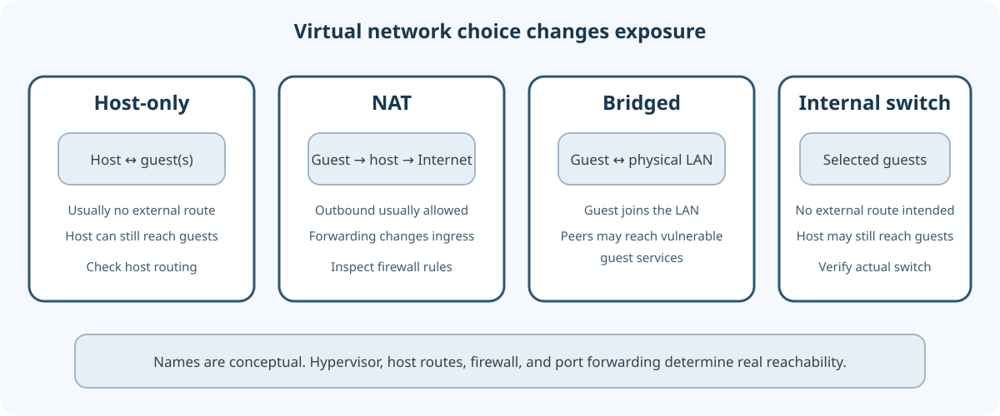
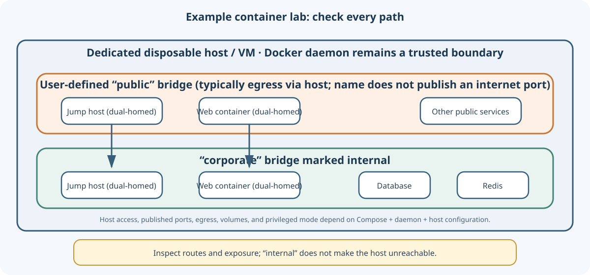

# Cybersecurity Virtual Machines and Lab Environments

_Last reviewed: 2026-11-18_

A security distribution is a tool set, not a security boundary. Choose the guest, hypervisor, storage, and network together. A VM shares a host and hypervisor; it does not make untrusted malware safe to run on a personal computer.

**Related:** [Docker operations and diagnostics](../ContainerSecurity/docker-cli-operations-reference.md) · [Container security](../ContainerSecurity/containers.md) · [Whonix and Kicksecure setup notes](../OPSEC/whonix-kicksecure-usb-guide.md)

## Purpose and selection

This catalog groups project-maintained operating systems and lab environments by task. The links identify upstream project sources; they do not imply that every release was tested here or is currently maintained. Before downloading, check the release date, supported architecture, integrity-verification method, licensing, minimum hardware, and official installation notes.

### Select by task

| Need | Possible starting point | Key limitation to plan for |
|---|---|---|
| Compartmentalized desktop work | [Qubes OS](https://www.qubes-os.org/doc/) | Requires compatible hardware and a trusted host/hypervisor; a compromise within one domain can still affect that domain. |
| Tor-routed workstation | [Whonix](https://www.whonix.org/wiki/Whonix) | Uses a Gateway and Workstation pair; changing the Workstation's network can bypass the design. |
| Amnesic live environment | [Tails](https://tails.net/) | Running in a VM changes its hardware and host trust assumptions; “amnesic” does not mean no possible trace or guaranteed anonymity. |
| OSINT training | [Trace Labs OSINT VM](https://github.com/tracelabs/tlosint-live), [Tsurugi Linux](https://tsurugi-linux.org/downloads.php) | Tool bundles can become stale; independently confirm sources, permissions, and current release status. |
| Penetration-test lab | [Kali](https://www.kali.org/get-kali/), [Parrot](https://parrotsec.org/download/) | Tools do not grant authorization; isolate vulnerable targets and keep target egress scoped. |
| Forensics | [SIFT Workstation](https://www.sans.org/tools/sift-workstation/), [CAINE](https://www.caine-live.net/), [CSI Linux](https://csilinux.com/) | Preserve originals and use write-blocking/acquisition procedures appropriate to the evidence. |
| Malware analysis | [REMnux](https://remnux.org/), [FLARE-VM](https://github.com/mandiant/flare-vm) | An analysis guest can still reach the host, LAN, or internet unless networking and shared features are controlled. |
| Network monitoring | [Security Onion](https://docs.securityonion.net/en/2.4/) | A sensor needs an intentional traffic feed; a VM on an ordinary virtual switch may see only its own traffic. |

Other projects such as BlackArch, BackBox, Commando VM, CAINE, and other community images may be useful in a specific workflow. Check each project’s current release and provenance before use. Older catalog entries such as Buscador, RedHunt-OS, and ThreatPursuit VM should be treated as historical or availability-unverified until their upstream release and maintenance status are confirmed. Do not use old download instructions that embed credentials in URLs.

---

## VM network modes and isolation



*Conceptual comparison. Hypervisor labels and behavior vary; inspect the actual virtual switch, firewall, host routes, and port-forwarding rules.*

- **Host-only:** guest networking is usually limited to the host and guests on that virtual network. The host can still reach the guest, and host routing can change the boundary.
- **NAT:** guests can usually initiate outbound connections through the host. Port forwarding and hypervisor settings may permit inbound access.
- **Bridged:** the guest joins the physical LAN as another device. It may be reachable by LAN peers and can expose vulnerable lab services.
- **Internal/isolated switch:** can limit paths to selected guests, but the hypervisor host may still reach the guests. Verify that no host route or adapter supplies egress.

Use the narrowest network needed. Do not bridge a vulnerable target VM to a home, office, or client LAN. Disable shared folders, clipboard, drag-and-drop, USB passthrough, and guest additions when the sample or target warrants stronger separation. Take snapshots before analysis, but remember a snapshot is rollback convenience, not a backup or a security control.

Qubes OS, Whonix, and Tails have different designs and assumptions; use their own security documentation rather than applying generic hypervisor advice. See [Qubes security design goals](https://doc.qubes-os.org/en/latest/developer/system/security-design-goals.html), [Whonix architecture](https://www.whonix.org/wiki/Whonix), and [Tails virtualization documentation](https://tails.net/doc/advanced_topics/virtualization/).

---

## Download and prepare an image

1. Navigate from the project's official site to the download or release page. Avoid third-party mirrors unless the project explicitly documents them.
2. Verify signatures or checksums using the project's current instructions and a trusted key obtained independently from the image.
3. Confirm the guest architecture and hypervisor format before importing.
4. Create a clean baseline snapshot. Keep evidence, credentials, and personal accounts out of the analysis guest unless required.
5. Set networking deliberately before first boot. A powered-off guest can still have configured bridge, shared-folder, and host-integration paths.
6. Update the guest from its documented channel, then snapshot again if a repeatable lab baseline is needed.
7. Record the source URL, release identifier, checksum, date, hypervisor, virtual network mode, and any configuration changes.

For forensic acquisition, do not boot or update the evidence image unless the collection plan explicitly allows it. Work from verified copies and preserve the original evidence.

---

## Project notes

### Privacy and compartmentalization

- **Tails** is a live operating system designed around amnesia and Tor routing. Persistence is optional; host, firmware, network, and user behavior remain part of the threat model. Virtualizing Tails adds the host and hypervisor to the trusted computing base.
- **Whonix** pairs a Whonix-Gateway with a Whonix-Workstation on a designed network. Keep the Workstation attached only to the intended internal network and follow the current [download guidance](https://www.whonix.org/wiki/Download).
- **Qubes OS** uses security domains to separate activities. Isolation is not absolute: the host, hypervisor, shared clipboard/file-transfer paths, and activity within one domain still matter. Check hardware compatibility in the [official documentation](https://www.qubes-os.org/doc/).

### OSINT and security distributions

- **Trace Labs OSINT VM** was built for OSINT training and Search Party events. Trace Labs publishes the [build configuration](https://github.com/tracelabs/tlosint-live). Confirm the age of any image and the event rules directly with the organizer.
- **Tsurugi Linux** combines digital-forensics and OSINT tooling; use its [official downloads](https://tsurugi-linux.org/downloads.php) and current project guidance.
- **Kali Linux**, **Parrot OS**, and **BlackArch** are general security distributions. Select by workflow and package support, then verify the source image and isolate lab targets.
- **Buscador** is referenced in older materials but should not be treated as a current maintained image without an upstream release to confirm. Do not use the historical authenticated URL or script shown in older copies of this guide.

### Forensics, malware analysis, and defense

- **SIFT Workstation**, **CAINE**, and **CSI Linux** are candidate forensic environments. Confirm version, acquisition support, and evidence-handling procedures from each project before use.
- **REMnux** and **FLARE-VM** provide malware-analysis tooling. For live samples, disable shared folders and clipboard as appropriate, snapshot the environment, and use a controlled network with explicit DNS, egress, and sinkhole behavior.
- **Security Onion** is a monitoring platform, not a generic desktop VM. Follow its current [installation and verification documentation](https://docs.securityonion.net/en/2.4/).

---

## Container lab: Black Hat Bash

[Black Hat Bash](https://github.com/dolevf/Black-Hat-Bash) is a Docker-based training lab, not a VM image. This guide no longer republishes its privileged installation and cleanup scripts. Those scripts can modify the host, install third-party tools, remove Docker volumes or images, and build or run vulnerable containers; review the current upstream source before using it.



*Conceptual reconstruction of the network roles described by the upstream Compose example. It is not a verified current deployment. Docker bridges, host access, port publishing, and egress depend on the host and daemon configuration.*

The example Compose topology uses a user-defined `public` bridge and a `corporate` bridge marked internal. A jump host and one web container attach to both networks. The name `public` does not itself publish a port to the internet: Docker bridge containers commonly have outbound connectivity through the host, while inbound access depends on published ports, host routing, and firewall rules. Docker documents that the host can communicate with containers on bridge networks, including internal networks.

Before deployment:

- Use a disposable, dedicated host or a disposable Linux VM that contains no personal or client data.
- Inspect Compose files, Dockerfiles, scripts, image tags, bind mounts, networks, and port mappings. Pin and verify dependencies when the project supports it.
- Do not run unknown install scripts as root on a daily-use host. Avoid privileged containers and host-network mode unless the lab explicitly requires them and the isolated host is disposable.
- Remove unrelated credentials, SSH keys, browser profiles, shared folders, and Docker socket access from the lab host.
- Confirm the vulnerable target network cannot route to production, client, or other household devices. Test egress and published ports from outside the lab.
- Do not reuse any demo passwords or accounts outside the lab. Values in examples and source repositories are public.
- Prefer the upstream project's documented per-lab shutdown. Inspect what it will remove before cleanup; global prune commands with `--volumes` can destroy data belonging to other Docker projects.

See the [Docker bridge network documentation](https://docs.docker.com/engine/network/drivers/bridge/), [internal network behavior](https://docs.docker.com/reference/cli/docker/network/create/), and [port publishing](https://docs.docker.com/engine/network/port-publishing/).

For routine inspection, begin with read-only commands from the project directory:

```bash
docker compose config
docker compose ps
docker network ls
docker volume ls
```

Review the rendered Compose configuration for unintended exposed ports, host mounts, secrets, and egress. Treat output as sensitive if it contains interpolated credentials. Use the current project instructions to start or remove containers; avoid copying root scripts or global Docker cleanup commands from an old guide.

---

## Third-party setup scripts

An old Buscador install command embedded a username and password in the URL. That method is removed: URL credentials can be recorded in shell history, logs, and process listings. Do not use that old command or run a replacement installer unless the upstream project currently publishes it and its source, integrity, and effects have been reviewed.

[Pimp My Kali](https://github.com/Dewalt-arch/pimpmykali) is an independent, privileged maintenance script. Its repository documents operations that can change system settings, including boot mitigations and root-login behavior. It is not required for a fresh Kali VM and is not a universal hardening tool. Review the exact menu choice and code, take a snapshot, and confirm the effect is acceptable before running any function with elevated privileges. Do not use automated mode on a system you need to preserve.

---

## Requirements and management

There is no reliable universal RAM, disk, or CPU minimum for “a cybersecurity VM.” Check current requirements from the selected distribution and hypervisor, then leave capacity for the host operating system, snapshots, memory analysis, and packet capture.

- Use a dedicated lab network or virtual switch and document its allowed paths.
- Keep snapshots and backups separate; snapshots can be lost with the host disk.
- Update guest additions and hypervisor software from their official sources.
- Avoid bridged networking for vulnerable machines. Use port forwarding only when needed and bind to a restricted host interface where possible.
- For Docker labs, remember the Docker daemon and host remain trusted boundaries. Root-equivalent Docker access can affect the host.
- Shut down using the project's per-lab procedure. Inspect volume removal before deleting data.
- For evidence, follow the case's chain-of-custody and write-protection plan; do not snapshot or modify the original as a substitute.

## Authorization and safety

Use security tools only against systems you own or have explicit written authorization to test. A prebuilt toolkit does not authorize targets. Keep lab traffic inside the defined environment, do not scan public systems from Tor or a shared VPN exit, and do not upload client or forensic data to third-party services without approval.

## Further reading

- [Qubes OS documentation](https://www.qubes-os.org/doc/)
- [Whonix overview and security documentation](https://www.whonix.org/wiki/Whonix)
- [Tails downloads and documentation](https://tails.net/)
- [Trace Labs OSINT VM](https://github.com/tracelabs/tlosint-live)
- [Kali downloads and verification](https://www.kali.org/get-kali/)
- [Security Onion installation](https://docs.securityonion.net/en/2.4/)
- [Docker bridge networking](https://docs.docker.com/engine/network/drivers/bridge/)
- [Docker container security](https://docs.docker.com/engine/security/)

## Related files

- [Documentation index](README.md)
- [Tor Browser guide](TOR.md)
- [VPN guide](VPN.md)
- [Whonix and Kicksecure setup notes](../OPSEC/whonix-kicksecure-usb-guide.md)
- [Docker operations and diagnostics](../ContainerSecurity/docker-cli-operations-reference.md)
- [Homelab virtualization](../Homelab/README.md)

---

_Maintained by: Pacific Northwest Computers (PNWC)_
