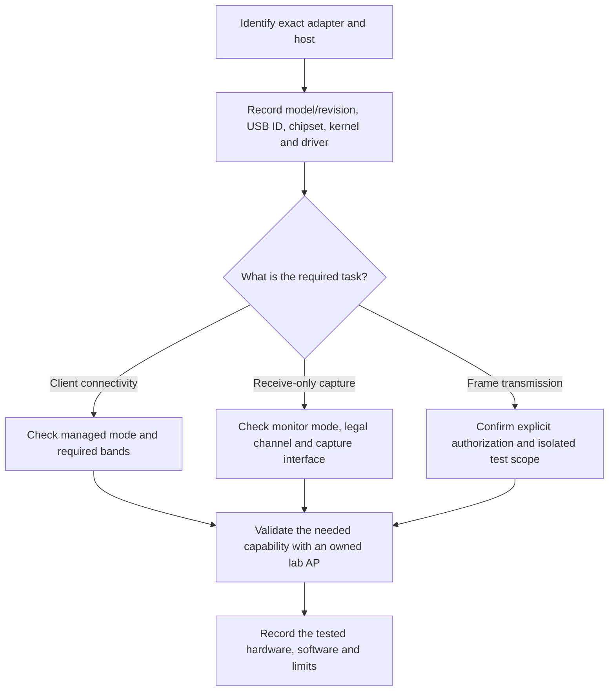

# Wi-Fi Adapters: Chipsets, Drivers, Monitor Mode & Compatibility

_Reference research: 2026-11-24. This matrix is a **documentation-based comparison**, not a hands-on certification of every adapter and firmware revision._

> [!CAUTION]
> **Authorized use only.** Passive capture, monitor mode, packet injection, WPS tests and channel operations have different effects and legal constraints. Do not transmit test frames outside an approved RF lab. Do not change the regulatory domain to evade local rules. See [Legal Notice](../LEGAL.md).

## Purpose & Scope

Select appropriate **802.11 Wi-Fi** interfaces for Linux/Kali, Raspberry Pi, NetHunter, a VM, Kismet or Wireshark. **Model branding is not a reliable proxy for chipset**: confirm the exact hardware revision, USB IDs, driver version, Linux kernel and capture behavior.

This guide is separate from [Bluetooth/BLE & Radio Adapter Comparison](./bluetooth-radio-adapter-guide.md). **Ubertooth One, YARD Stick One and ATtiny are not replacements for an 802.11 Wi-Fi interface.**

## Capabilities Explained

| Capability | What It Means | What It Does Not Guarantee |
|---|---|---|
| Managed / client mode | Associate to a Wi-Fi AP as an ordinary client | Raw 802.11 capture capability |
| Monitor mode | Receive 802.11 frames via a supported driver | Transmit injection or all channels simultaneously |
| Frame injection | Driver/firmware transmits explicitly crafted management/data frames | Good timing, reliable replay or permission to transmit |
| AP mode | Serve an access point using compatible driver/hostapd | Simultaneous AP+monitor operation |
| 2.4 / 5 / 6 GHz | Radio hardware and regulatory operating bands | Ability to tune **every** channel in that band |
| Channel hopping | Receiver retunes among channels | Complete capture of every transmission |
| Concurrent interfaces | Virtual interfaces from one physical radio | Independent radios or simultaneous capture on different channels |
| Passive capture | Observation of received traffic | Full network visibility, payload decryption or absence of other RF activity |

**A single-channel sniffer cannot prove an entire network was quiet.** For complete observations, use multiple radios or a documented coverage methodology. WPA3/PMF and PHY behavior also change what can be observed or transmitted.



*Qualification flow: a mode advertised by a driver is a starting point; local test results apply only to the recorded adapter, revision, kernel, driver and channel.*

## Adapter Comparison Matrix

**Symbols:** **Candidate** means suitable for evaluation after a local test; **Conditional** means specific kernel/driver/firmware tests are required; **No** means not supported by the identified radio. These are not universal success guarantees.

| Adapter / Source | Chipset | Bands | Linux Driver | Monitor | Injection | Practical Notes |
|---|---|---|---|---|---|---|
| [ALFA AWUS036NHA](https://docs.alfa.com.tw/Support/Linux/AR9271/) | Atheros AR9271 | 2.4 GHz | `ath9k_htc` + firmware | Candidate | Candidate | Good legacy baseline; **no 5 or 6 GHz** |
| [ALFA AWUS036ACM](https://docs.alfa.com.tw/Support/Linux/MT7612U/) | MediaTek MT7612U | 2.4 / 5 GHz | `mt76x2u` | Candidate | Conditional | In-kernel Linux support; verify exact antenna/channel/firmware |
| [ALFA AWUS036ACHM](https://www.alfa.com.tw/products/awus036achm) | MediaTek MT7610U | 2.4 / 5 GHz | `mt76x0u` | Candidate | Conditional | **ACHM is not ACH**; 1×1 vs other models |
| [ALFA AWUS036ACH](https://doc.yupitek.com/alfa-network/drivers/rtl8812au/) | Realtek RTL8812AU | 2.4 / 5 GHz | `rtw88_8812au` on newer kernels or driver-specific alternatives | Conditional | Conditional | Kernel support has evolved; test the **actual** driver |
| [ALFA AWUS036AXM](https://www.alfa.com.tw/products/awus036axm) | MediaTek MT7921AUN | 2.4 / 5 / 6 GHz Wi-Fi 6E | Kernel/firmware-dependent `mt7921u` family | Conditional | Conditional / may fail | Also integrates Bluetooth on some variants; 6 GHz depends on region, firmware & kernel |
| [ALFA AWUS036AXML](https://www.alfa.com.tw/products/awus036axml) | MediaTek MT7921AUN | 2.4 / 5 / 6 GHz Wi-Fi 6E | `mt7921u` family | Conditional | Conditional / may fail | Verify USB model, BT side, firmware & regulatory availability |
| [Panda PAU09](https://deviwiki.com/wiki/Panda_Wireless_PAU09) | Ralink RT5572 | 2.4 / 5 GHz 802.11n | `rt2800usb` | Candidate | Conditional | Older chipset; check capture stability |
| [TP-Link TL-WN722N **v1**](https://wireless.docs.kernel.org/en/latest/en/users/drivers/ath9k_htc/devices.html) | Atheros AR9271 | 2.4 GHz | `ath9k_htc` | Candidate | Candidate | **v2/v3 differ** and must not inherit v1 claims |
| Generic RTL8812AU dongle | Realtek RTL8812AU | 2.4 / 5 GHz | Depends on chipset ID and kernel | Conditional | Conditional | Rebrands and driver forks can behave differently |

**Important:** No "supports injection" field should be interpreted as permission to disrupt clients. Some modern `mt7921` adapter combinations support monitor mode yet fail particular injection tests. A dated, model+kernel+driver+test-method record is more reliable than a marketing claim. A recent distributor [ARM64 comparison](https://yupitek.com/en/blog/alfa-9-cards-arm64-gx10-ubuntu-matrix/) found that some 6E models did **not** pass its injection checks on its tested setup; results are not universal.

## Usage & Platform Matrix

| Platform | Client Connectivity | 802.11 Monitor / Injection | Special Considerations |
|---|---|---|---|
| Kali / Debian / Ubuntu Linux | Usually via supported driver | **Per driver, firmware & kernel** | Prefer in-kernel mac80211/mt76/ath9k; confirm `iw list` |
| Raspberry Pi (ARM Linux) | Usually, power permitting | Same driver criteria, ARM compatibility matters | USB power, thermal load, voltage, hub, OTG |
| Kali NetHunter on Android | Hardware-dependent | Kernel USB host/OTG/driver build required | A Linux USB-compatible card **does not imply** stock Android support |
| Linux host with Kali VM | Host often has connectivity | Use USB passthrough for actual radio access | Bridged/NAT virtual Ethernet does **not** expose 802.11 monitor frames |
| Windows | Vendor driver dependent | Npcap/adapter feature limits; injection not assumed | Native Wi-Fi capture != Linux behavior |
| macOS | Current OS/driver restrictions | External adapter support limited and changes | Do not promise a Kali workflow |
| Proxmox VM | Through USB or PCI passthrough | Requires guest-visible real radio | Do not assume a virtual NIC can hop channels |
| Cyberdeck/uConsole | Depends on USB/PCIe architecture | Confirm kernel, power & device visibility | Avoid taking down the sole management link |

## Model & Driver Identification

Check **before** installing community drivers or purchasing a specific revision:

```bash
uname -r
lsusb -nn
ip -brief link
iw dev
iw list | sed -n '/Supported interface modes:/,/Band 1:/p'
rfkill list
lsmod | grep -E 'ath9k_htc|mt76|rtw88|rtw89|rt2800usb' || true
```

The command `iw list` reports capability **advertised by the driver**, not proof of practical capture or injection. Pair it with a permitted test on **your own lab AP**; log a known beacon, channel, timestamp and capture quality. Do not copy random `curl | bash` driver installers. Prefer signed distribution packages, current kernel modules, vetted firmware and versioned source builds when truly necessary.

## Recommended Evaluation Scenarios

| Scenario | Strong First Candidate | Why | Caveat |
|---|---|---|---|
| Low-friction 2.4 GHz Wi-Fi protocol lab | AWUS036NHA / AR9271 | Established `ath9k_htc` support | Older throughput and no 5 GHz |
| Dual-band Linux capture | AWUS036ACM / MT7612U | In-kernel `mt76x2u`; widely documented | Test precise channel and frame capture |
| Compact dual-band | AWUS036ACHM / MT7610U | In-kernel `mt76x0u` | 1×1 design, not interchangeable with ACM |
| Legacy Realtek lab / high-gain | AWUS036ACH / RTL8812AU | Common 802.11ac adapter | Driver/kernel-dependent; not an effortless universal choice |
| 6 GHz observation & Wi-Fi 6E inventory | AWUS036AXM / AXML | Capable tri-band silicon | Local 6 GHz rules and device class, firmware, driver & capture caveats |
| IoT/AP survey with GPS | Compatible adapter + Kismet | Logging, GPS and capture UI | Requires reliable GNSS and careful retention |

No adapter can be identified as "best" without knowing host kernel, radio bands, antenna/physical conditions and whether receive-only capture suffices. When reliability matters, prefer a **known working in-kernel driver** over flashy throughput specifications.

**Band rules are distinct:** DFS requirements apply to specified 5 GHz U-NII channels, not as a generic label for all 5 GHz operation. 6 GHz has separate device-class and jurisdiction rules. In the United States, standard-power access points use Automated Frequency Coordination (AFC), while low-power indoor access points are restricted to indoor use; client operation depends on the associated access-point class. A radio's advertised band support does not authorize transmission. Check current local rules and host regulatory configuration before any active test. See the FCC's [6 GHz device-class summary](https://docs.fcc.gov/public/attachments/DA-24-1217A1_Rcd.pdf) and [DFS rule discussion for specified 5 GHz bands](https://docs.fcc.gov/public/attachments/FCC-03-110A3_Rcd.pdf).

## Lab Qualification & Evidence Template

| Field | Record |
|---|---|
| Adapter brand/model/revision | e.g. exact printed model and hardware revision |
| USB VID:PID | `lsusb -nn` output |
| Chipset & driver | `ethtool -i IFACE` when supported |
| Host | OS, kernel, CPU architecture, USB controller |
| Firmware | Driver firmware filename/version |
| Capability | Managed / monitor / AP / injection tested **separately** |
| Band/channel | 2.4/5/6, specific legal channel and width |
| Capture evidence | Owned AP beacons, packet counts, missing frames, RSSI |
| Stability | Disconnects, heat, power, performance |
| Result | Verified / conditional / incompatible / not tested |

### Receive-Only Validation

```bash
# Inspect without changing network modes:
ip -brief link
iw dev
# In an authorized lab, capture only with a verified monitor interface.
# Avoid airmon-ng check kill if it would interrupt your network or remote session.
```


## Troubleshooting & Constraints

| Issue | Likely Cause | Safer Response |
|---|---|---|
| No interface | Firmware, USB power, unsupported chipset | Inspect dmesg/journal and vendor support |
| Client works, no monitor | Driver lacks requested interface type | Check `iw list`, tested kernel matrix |
| Monitor works, no frames | Channel/regdomain/interface state | Set legal lab channel, verify owned AP beacon |
| Injection fails | Driver/firmware/PHY restrictions | Record limitation; do not force unapproved transmissions |
| Dual-band missing | Wrong chipset/revision/antenna | Confirm actual SKU, `iw phy`, regulatory domain |
| VM shows `eth0` only | NAT/bridge virtual NIC | Use explicit USB/PCI passthrough |
| Packet drops | USB power, CPU load, dense RF | Reduce scope, use powered hub and quantify losses |

## SBC & Portable Firmware Compatibility

USB Wi-Fi adapters can differ substantially across a Pi 4/5, uConsole CM4/CM5, Linux x86 VM and NetHunter: verify host USB access, chipset, kernel, firmware, power and driver. Basic connectivity does **not** prove monitor mode, injection or 6 GHz support. Flipper, M5StickC Plus2 and ESP32 firmware do **not** automatically support Linux USB Wi-Fi cards.

Use the [SBC, Firmware & Add-On Matrix](./sbc-radio-addon-compatibility.md) for supported hosts, CC1101, nRF24, PN532/NFC, GPS/GNSS, HATs and firmware capabilities. See [LAN TAPs & SPAN](./network-taps-and-packet-visibility.md) for a distinct wired Ethernet capture path.

## Official & Cross-Referenced Sources

- [ALFA Linux support: MT7612U](https://docs.alfa.com.tw/Support/Linux/MT7612U/), [MT7610U](https://docs.alfa.com.tw/Support/Linux/MT7610U/) & [AR9271](https://docs.alfa.com.tw/Support/Linux/AR9271/)
- [Linux Wireless documentation](https://wireless.docs.kernel.org/), [upstream Linux `rtw88_8812au` driver configuration](https://github.com/torvalds/linux/blob/master/drivers/net/wireless/realtek/rtw88/Kconfig), [Linux-compatible USB adapter list](https://github.com/morrownr/USB-WiFi) & [Kali NetHunter cards](https://www.kali.org/docs/nethunter/wireless-cards/)
- [Kismet Data Sources](https://www.kismetwireless.net/docs/readme/datasources/)
- [Aircrack-ng Guide](./Aircrack-ng_Commands.md), [Kismet Field Guide](../Wardriving/kismet.md), [Bluetooth/BLE Comparison](./bluetooth-radio-adapter-guide.md)
- [WPA/PMKID Protocol Boundaries](./hcxtoolshashcat.md), [Wi-Fi Deauthentication Detection](./wifi-deauthentication-detection.md)

---

[Documentation Index](./README.md) | [Wardriving](../Wardriving/README.md) | [Legal Notice](../LEGAL.md)
