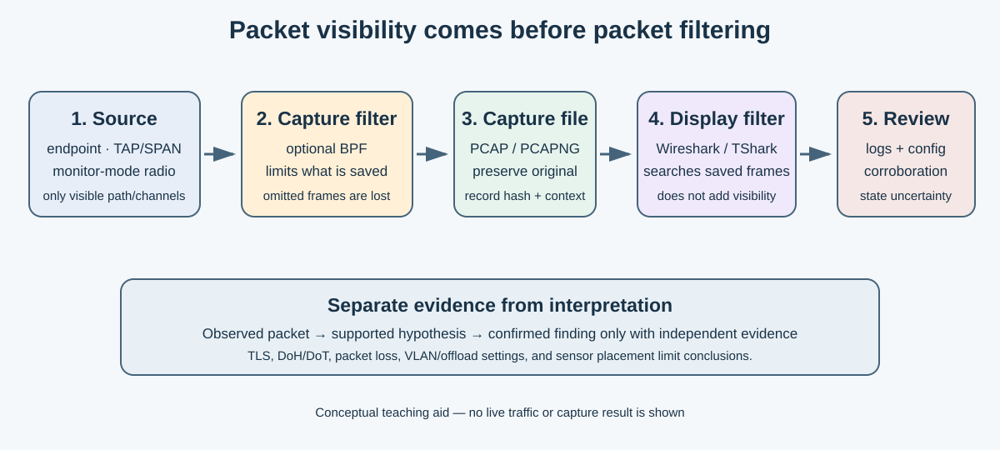

# Wireshark Defensive Investigations: Wireless, MITM, DNS, VLANs & TAPs

_Reviewed: 2026-11-24. This is a case-oriented companion to the repository's existing Wireshark master filters, not a second competing filter catalog._

> [!CAUTION]
> **Authorized captures only.** Packet captures may contain authentication material, client identifiers and DNS histories. Obtain consent, minimize content, restrict storage and verify legal scope. These workflows examine already collected synthetic PCAP/PCAPNG files or traffic from owned lab endpoints; they do **not** instruct interception or disruptive RF actions. See [Legal Notice](../LEGAL.md).

**Algorithms behind the visibility:** The [Algorithm Index](../Algorithms/README.md) explains why packet matching, event windows, hashing, graph routing and statistical anomaly detection are separate layers. See [Detection Algorithms](../Algorithms/detection-and-recommendations.md) and [TLS's cryptographic roles](../Algorithms/cryptography-parallels.md#4-cryptography-as-a-multi-algorithm-pipeline) for limits of observing encrypted payloads.

## Choose the Correct Packet Source First

The most important Wireshark troubleshooting mistake is treating **packet filtering** as a substitute for **packet visibility**.



*Conceptual workflow: a filter can only inspect frames that reached the capture source and were retained in the capture file. Encryption and missing visibility remain limits.*

| Security Question | Physical Capture Source | What Wireshark Can Show | Source Limitation |
|---|---|---|---|
| Deauthentication or rogue Wi-Fi AP | 802.11 monitor-capable NIC on the appropriate channel | Beacons, probes, deauth/disassoc and RSN fields | Ordinary Ethernet capture does **not** contain off-air management frames |
| Bluetooth/BLE advertisement | Compatible Nordic/TI/other **RF sniffer** | BLE advertising/link-layer PDUs supported by decoder | BlueZ HCI discovery is not general third-party raw air capture |
| Pwnagotchi/Evil-M5 behaviors | Wi-Fi monitor + AP/controller logs | Suspected management-frame activity | MAC addresses are spoofable; not hardware identification |
| Bjorn service activity | Endpoint capture or TAP/SPAN of relevant wired/Wi-Fi routed traffic | TCP sessions, DNS, SMB, SSH handshake patterns | Traffic outside tapped path remains unseen |
| ARP/DHCP MITM | Endpoint capture or switch SPAN/TAP | ARP replies, DHCP offers, IPv6 RA | Requires correct VLAN/port and both-direction visibility |
| DNS hijacking | Client or resolver/gateway capture + configuration | DNS questions/answers, transport endpoints, DHCP options | DoH/DoT encrypt query contents in transit |
| VLAN/DMZ/ACL validation | Tagged trunk capture, firewall logs, test endpoints | 802.1Q headers when retained, permitted/denied test flows | NIC offload/mirror configuration may remove tags |
| Proxmox Snort/Zeek/Suricata | Physical TAP/SPAN, supported vSwitch mirror or intentional gateway capture | Flows reaching the sensor | Normal virtual `eth0` cannot see an unrelated physical switch |
| LAN TAP health | Breakout ports or aggregation output with statistics | In-scope bidirectional frames | Tap can downshift speed/drop frames; SPAN oversubscription possible |

Relevant hardware: [Wi-Fi Adapter Matrix](./wifi-adapter-selection-guide.md), [BLE Sniffing](./bluetooth-passive-scanning-sniffing.md), [LAN TAPs, SPAN & Throwing Star](./network-taps-and-packet-visibility.md) and [SBC Add-On Compatibility](./sbc-radio-addon-compatibility.md).

## Filter Languages: Never Confuse Them

| Goal | Wireshark Display / TShark `-Y` | PCAP Capture / TShark `-f` |
|---|---|---|
| DNS on port 53 | `dns` | `port 53` |
| HTTPS transport | `tcp.port == 443 || udp.port == 443` | `port 443` |
| Single IPv4 test host | `ip.addr == 192.0.2.10` | `host 192.0.2.10` |
| VLAN 20 | `vlan.id == 20` | `vlan 20` (capture-link and syntax dependent) |
| ARP | `arp` | `arp` |
| Deauth | `wlan.fc.type_subtype == 0x0c` | Prefer a broad scoped 802.11 capture; `wlan` is **not** a portable BPF capture expression |

Wireshark display filters select already captured frames; capture filters constrain stored frames and can irreversibly exclude evidence. On Wireshark 3.0 and newer, BOOTP display-filter fields were renamed to `dhcp`; verify filter syntax against the version in use. Consult the existing [master filter list](./wireshark-master-filters.md), [Wireshark field reference](https://www.wireshark.org/docs/dfref/) and [official DHCP display-filter fields](https://www.wireshark.org/docs/dfref/d/dhcp.html).

## Scenario 1: Wi-Fi Deauthentication & Disassociation

1. Verify the monitor interface supports the target's legal frequency/channel and the receiver is not merely a managed client.
2. Observe the **owned** AP baseline, PMF negotiation and its controller event timeline.
3. Apply these **display filters** separately:

```text
wlan.fc.type_subtype == 0x0c
wlan.fc.type_subtype == 0x0a
wlan.fc.type_subtype == 0x08
```

4. Graph frame counts over time, note RSSI/channel/source/destination, and compare to a normal reboot/roam/DFS event.
5. Record confidence; **a burst is not proof of an attack**, and the source MAC does not authenticate a transmitter.
6. Recommend PMF on compatible equipment, careful WLAN policy, channel planning and WIDS correlation—not retaliatory deauthentication.

For exact management-frame context and what PMF cannot block, see [Deauth Detection & Mitigation](./wifi-deauthentication-detection.md).

## Scenario 2: Rogue AP, Evil Twin & Portable Wireless Tools

```text
wlan.fc.type_subtype == 0x08
wlan.fc.type_subtype == 0x04
wlan.fc.type_subtype == 0x05
```

These isolate beacon, probe-request and probe-response frame subtypes **if present in the captured radio data**. The same SSID can legitimately exist on many APs. Compare known BSSID allowlists, security suites, channel/frequency, configuration management, RADIUS certificate validation and AP logs. Correlate with the [Counter-Surveillance Guide](./counter-surveillance-wireless-threats.md). Do not identify Pwnagotchi, Evil-M5 or Flipper hardware by a radio address alone.

## Scenario 3: MITM, ARP, DHCP & IPv6 RA

```text
arp
arp.opcode == 2
dhcp
icmpv6.type == 134
```

Capture from an affected lab endpoint or authorized mirror feed. Build a timeline of address-to-MAC claims and DHCP/RA server announcements, then validate against the switch MAC table, DHCP snooping bindings, redundancy protocol (VRRP) and known router inventory. A proxy ARP, HA gateway or benign DHCP relay may explain the same packet pattern. The corrective control is often DAI, DHCP snooping, RA Guard, 802.1X and restricted switch management; consult [MITM Detection](./mitm-detection-prevention.md).

## Scenario 4: DNS Hijacking, Encrypted DNS & HTTPS

```text
dns
dns.flags.response == 1
tcp.port == 853 || udp.port == 853
tls || quic
```

Start from approved client DNS/proxy settings and what resolver the endpoint actually used. Query/response payloads may be visible in plaintext DNS but **not generally inside DoH/DoT/DoQ**. TCP/UDP 853 can be evidence of a possible secure DNS transport, but port alone is not protocol confirmation. Most encrypted HTTPS traffic is **not necessarily DoH**. Correlate endpoint/browser resolver policy, signed DNS validation, router configuration, TLS certificate errors and DNS logs. See [DNS Hijacking & Secure DNS](./dns-hijacking-secure-dns.md).

## Scenario 5: VLAN & DMZ Segmentation Validation

```text
vlan
vlan.id == 20
ip.addr == 10.10.20.15 && tcp.port == 443
```

Capture on a tagged trunk with a verified NIC and mirror configuration; compare against known VLAN ID, allowed ports and source test client. A packet appearing on a **monitoring port** does not prove a firewall forwarded it into a prohibited zone. Test positive paths (approved HTTPS) and negative paths (denied inter-VLAN connection) from **owned** clients; correlate with firewall counters and test-host logs.

Verify 802.1Q offload, mirror VLAN retention and RSPAN/ERSPAN encapsulation before interpreting missing tags. Refer to [Network Segmentation, DMZ, ACLs & VLANs](./network-segmentation-dmz-acl-vlan.md) and [LAN TAPs](./network-taps-and-packet-visibility.md).

## Scenario 6: Bluetooth LE, BlueZ HCI & Sniffer PCAPs

A standard BlueZ controller may show HCI discovery reports in `btmon` while a Nordic nRF52840 sniffer exposes actual BLE link-layer packets to Wireshark through the appropriate integration. **HCI and RF captures use different encapsulation/dissectors**; do not apply arbitrary BLE RF filters to HCI logs and declare no traffic.

| Input | Expected Data | Caution |
|---|---|---|
| BlueZ `btmon` trace | Local controller commands/events and host traffic | Scan mode may be active; this is not all nearby over-air traffic |
| Nordic nRF Sniffer PCAPNG | Raw BLE advertising frames and selected connection traffic | Frequency hopping, packet loss, PHY/firmware and encryption limitations |
| Kismet BLE source output | Inventory/sightings | May not contain the same per-packet data as a dedicated sniffer |

Use [Bluetooth Passive & Active Scanning](./bluetooth-passive-scanning-sniffing.md) for the reproducible discovery lab. Do not use randomized Bluetooth addresses as conclusive identity proof.

## Safe Offline TShark Workflow

```bash
# No live network access; input files are user-supplied lab captures.
tshark --version
tshark -r ./lab-wifi.pcapng -Y 'wlan.fc.type_subtype == 0x0c' \
  -T fields -e frame.time -e wlan.bssid -e wlan.sa -e wlan.da
tshark -r ./lab-wired.pcapng -Y 'arp || dns || dhcp'
tshark -r ./lab-wired.pcapng -Y 'vlan.id == 20'
sha256sum ./lab-wifi.pcapng ./lab-wired.pcapng
```

If a capture is missing or its link-layer type is incompatible, stop and inspect the correct input/source; do not try to "fix" missing evidence through more aggressive capture.

### Case Report Template

| Field | Required Detail |
|---|---|
| Authorization | Owner, assets, ports/channels, consent and date |
| Capture source | Radio/channel or TAP/SPAN/VM path, time sync, hardware/software versions |
| Input integrity | Original PCAP SHA-256 and evidence storage restrictions |
| Filters | Exact display/capture filters, which were applied **when** |
| Packet evidence | Frame numbers, timestamp, host/MAC as redacted, request-response relationship |
| Corroboration | AP, DHCP/DNS, firewall, IdP/EDR or application event |
| Limitations | Missing channels, dropped packets, offloads, TLS/DoH encryption, log coverage |
| Conclusion | Observation vs hypothesis vs confirmed incident |
| Response | Segmentation, PMF, DNS/TLS, patch, credential/identity policy |
| Retest | Synthetic replay/owned-host validation and remaining visibility gaps |

## Troubleshooting & Sources

- [Wireshark Advanced Capture](./wireshark.md), [Master Filter List](./wireshark-master-filters.md), [Cheat Sheet](./wireshark-cheatsheet.md)
- [Official WLAN Filter Fields](https://www.wireshark.org/docs/dfref/w/wlan.html), [DHCP Fields](https://www.wireshark.org/docs/dfref/d/dhcp.html), [ARP Fields](https://www.wireshark.org/docs/dfref/a/arp.html), [DNS Fields](https://www.wireshark.org/docs/dfref/d/dns.html), [VLAN Fields](https://www.wireshark.org/docs/dfref/v/vlan.html)
- [Wireshark Wireless Capture](https://wiki.wireshark.org/CaptureSetup/WLAN) & [Capture Filter Reference](https://www.wireshark.org/docs/man-pages/pcap-filter.html)

---

[Documentation Index](./README.md) | [Network Detection](../Tradecraft/network-detection.md) | [Legal Notice](../LEGAL.md)
