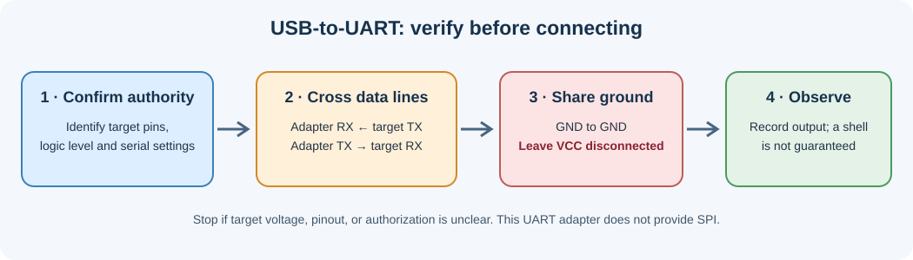

# USB-to-UART Adapter (CH340 / FT232R)

## Looking for ESP32 Bit Pirate?

Use the dedicated [ESP32 Bit Pirate firmware guide](./esp32-bit-pirate.md) for
the geo-tp project, formerly ESP32 Bus Pirate. The legacy adapter discussion below
does not identify a particular hardware product and must not be used as that
firmware's pin map, voltage specification or command reference.

## 🎯 Purpose
A USB-to-UART serial bridge for observing or communicating with an authorized target's documented UART console. Common CH340- and FT232R-based adapters provide serial/UART interfaces; they are not general-purpose SPI programmers.

## ⚙️ Function
Provides a USB serial connection to a target UART. It may expose boot messages, a diagnostic console, or no useful output. A shell and its privilege level depend on the target's configuration and are not guaranteed.

## 🏆 Goal
Identify and safely document UART output or an explicitly authorized console on a device you own or are approved to assess. Do not assume UART access bypasses authentication or grants a shell.

## 📋 When to Use
- When a device exposes a UART header on its PCB (IP cameras, routers, smart home devices)
- During physical hardware assessments when network attack surface is limited
- Testing for improperly secured boot console access

## 📖 Description
A CH340- or FT232R-based USB adapter converts USB host communication to serial UART signals. It does not provide SPI mode by itself. A separate multi-protocol instrument such as the [Bus Pirate](BusPirate.md) supports UART, SPI, I²C, and other documented modes. The ESP32 Bit Pirate firmware project is a separate product (see the section below).

## 🔗 Reference Links
* [WCH CH340](https://www.wch.cn/products/CH340.html) — USB-to-serial bridge documentation.
* [FTDI FT232R datasheet](https://ftdichip.com/wp-content/uploads/2020/08/DS_FT232R.pdf) — USB-to-UART interface.
* [Bus Pirate command reference](https://docs.buspirate.com/docs/command-reference/) — multi-protocol tool modes including UART, SPI, and I²C.

## UART Observation Workflow

Use this workflow only on hardware you own or are explicitly authorized to assess.



### 1. Identify and check levels
* Identify the adapter chipset and its documented signal voltage. Verify the target UART pins and logic level from board documentation or measurement.
* Do not connect if the voltage or pinout is uncertain. USB-to-UART adapters can expose VCC pins; the target should remain separately powered unless its documentation explicitly requires otherwise.

### 2. Connect
* Connect common ground and cross the data lines: adapter `GND` to target `GND`, adapter `RX` to target `TX`, and adapter `TX` to target `RX`.
* Leave adapter `VCC` disconnected unless both device and adapter documentation explicitly call for a power connection and the voltage/current plan is understood.

### 3. Observe
* Open a serial terminal with the documented baud rate and framing settings; do not assume one baud rate works for all targets:
   ```bash
   serial_device='/dev/ttyUSB0'  # Replace with the identified local serial device.
   baud_rate=115200              # Example only. Use the documented board baud rate.
   screen "$serial_device" "$baud_rate"
   ```
* Power on the authorized test device and record the output and settings. A boot log may appear; no output can also result from incorrect pins, voltage, baud, or an inactive UART.
* Do not attempt to bypass login controls. A prompt, if present, does not by itself establish authorization or privilege.

---

## Similar name, different platform: ESP32 Bit Pirate

The [ESP32 Bit Pirate firmware](https://github.com/geo-tp/ESP32-Bit-Pirate) is a distinct ESP32-based project. **Do not assume that its pins, firmware, command syntax or supported buses match a generic USB-UART adapter.** Start with its upstream board map and power requirements; use appropriate logic-level conversion and verify the ground reference before connecting any signals.

## Related Files
- [README.md](README.md) - HardwareHacking section index: all tools and chapter guide
- [BusPirate.md](BusPirate.md) - Multi-protocol instrument with documented SPI/I²C/UART modes
- [JTAGulator.md](JTAGulator.md) - Identifies which pins are UART/JTAG before connecting a Bit Pirate or Bus Pirate
- [HiLetgo.md](HiLetgo.md) - Logic analyzer to verify TX/RX signals and identify baud rate before connecting
- [Chapter2.md](Chapter2.md) - Electrical fundamentals: UART signal levels, voltage compatibility, and baud rate concepts

---

[Section Index](README.md) | [Master Index](../README.md) | [Legal Notice](../LEGAL.md)
