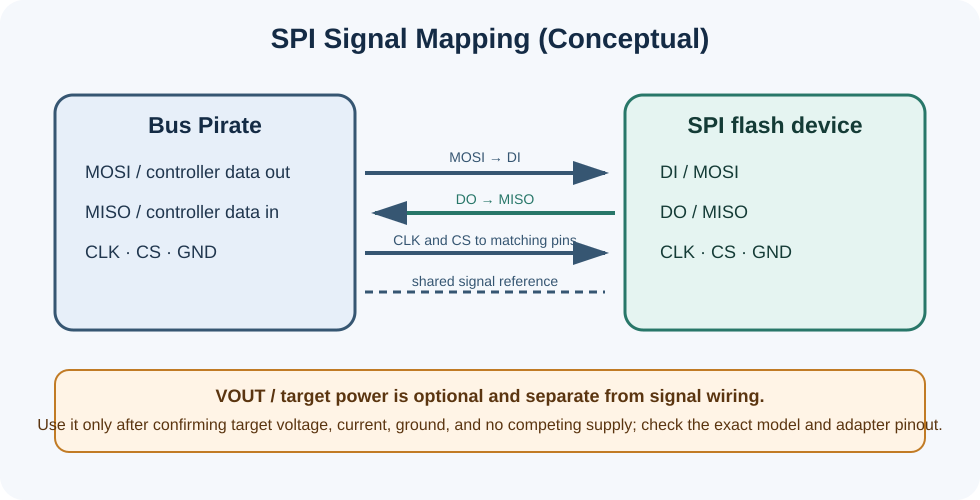

# 🏴‍☠️ Bus Pirate

_Last reviewed: 2026-11-18_

## 🎯 Purpose
The Bus Pirate is an open-source USB serial tool for interacting with supported electronic interfaces. Its available protocols and pin mappings depend on the model, firmware, and adapter. It is useful for controlled SPI, I²C, UART, and other supported bus experiments without writing microcontroller firmware.

## ⚙️ Function
The Bus Pirate provides an interactive terminal and model-specific I/O. Current Bus Pirate 5 documentation describes SPI, I²C, UART, 1-Wire, and additional features; this should not be read as a promise that every Bus Pirate revision supports every protocol, especially JTAG. The programmable VOUT supply is optional. Its voltage and current limits do not make it suitable for every target or remove the need to check the target’s power requirements.

## 🏆 Goal
Use the tool to observe or communicate with a supported interface on an owned or explicitly authorized target, while preserving the device, its data, and the surrounding system.

## 📋 When to Use
- Identify or read supported SPI flash and serial memory after checking voltage, pinout, and target state.
- Explore I²C or SPI transactions where the target’s protocol and side effects are understood.
- Debug UART with a known voltage level and baud rate.
- Perform other tasks documented for the exact hardware revision and firmware.

## 📖 Description
The Bus Pirate is a USB-connected protocol tool. It does not communicate with “any chip”: interface electrical levels, pin assignment, firmware support, bus topology, access controls, and target state all matter. Read-only commands are preferable during initial identification. An ID response is evidence that some device responded to the transaction; it does not authenticate a chip or establish that firmware access is authorized.

### Conceptual SPI wiring

The signal directions below show controller-to-flash and flash-to-controller paths. The diagram does not prescribe a connector, adapter, voltage, or board-level connection. Check the pinout for the exact Bus Pirate revision and target datasheet.



*Conceptual signal mapping. VOUT is a separate, optional power connection; connect it only after verifying the target voltage/current requirements and confirming that no other supply is driving the rail.*

## 🔗 Reference Links
- [Bus Pirate product information](https://buspirate.com/get/)
- [Current Bus Pirate documentation](https://docs.buspirate.com/)
- [SPI protocol and flash commands](https://docs.buspirate.com/docs/command-reference/spi-protocol/)
- [I/O pin descriptions](https://docs.buspirate.com/docs/overview/io-pins/)
- [Programmable power supply](https://docs.buspirate.com/docs/tutorial-basics/power-supply/)
- [Flashrom setup for Bus Pirate](https://docs.buspirate.com/docs/software/flashrom/) — uses a separate legacy binary mode, documented as experimental

## 🚀 Example: Identify and Read an SPI Flash Device

This example is for a compatible SPI flash chip in an isolated, authorized setup. It is not a universal in-circuit recipe. In-circuit connections can be affected by other components, pull-ups, protection circuits, or a host processor that continues driving the bus.

### 1. Check the setup
- Confirm the Bus Pirate model, firmware, connector/adapter pinout, target datasheet, and supported I/O voltage.
- Determine whether the target board is already powered. Do not connect VOUT to a board rail that has another supply attached.
- If powering a detached chip, confirm the required voltage and expected current first; set a suitable current limit and monitor the supply. The Bus Pirate power supply has model-specific limits.
- Use a suitable adapter or test fixture. Do not assume that wire labels or chip pin order match across revisions.
- Install and use a serial terminal supported by your operating system. Locate the Bus Pirate’s command-line serial port and use the baud rate documented for the device/firmware. On Debian-based Linux, one terminal option is:
  ```bash
  sudo apt-get install screen
  sudo screen /dev/ttyUSB0 115200
  ```
  Replace the example port and settings with the values for your system.

### 2. Connect signals
With power off and the target isolated as appropriate, connect common ground and the model-specific SPI signals:
- Bus Pirate MOSI to flash DI / SI
- Bus Pirate MISO to flash DO / SO
- Bus Pirate clock to flash CLK
- Bus Pirate chip-select to flash CS#
- Ground to ground

Check the target datasheet for additional pins such as WP# and HOLD#/RESET#. Their required inactive levels may need pull-ups; do not guess or tie pins to a voltage that exceeds their ratings. Keep VOUT disconnected unless you have deliberately verified that it is the correct and sole supply path.

### 3. Identify, then read
- Open the serial terminal and press Enter. Follow the firmware’s mode selection to enter SPI mode; defaults vary, so review the displayed voltage, speed, and pin assignments.
- A JEDEC ID transaction commonly uses command `0x9F` followed by three reads:
  ```text
  SPI> [0x9F r:3]
  ```
  Compare the returned bytes with the flash vendor’s documentation. The response may be unsupported, ambiguous, or shared by multiple parts; it is not proof of provenance.
- For supported SPI flash, the current Bus Pirate terminal includes flash commands. Use `flash probe` to identify the chip and review the reported capacity and parameters before reading. Then use:
  ```text
  SPI> flash read -f firmware_dump.bin
  ```
  Check `flash -h` for syntax supported by the installed firmware. Store the output in an access-controlled location, calculate a hash, and record the device, firmware, adapter, connection, and command used.
- Do not erase, write, or test the chip unless that action is explicitly authorized and the consequences are understood. A chip test can erase and rewrite data.

### Flashrom note
Flashrom is a separate workflow. Current Bus Pirate documentation says to enter the legacy Flashrom/AVRdude binary mode with `binmode`; it labels that mode experimental. The binary interface/port and command options differ from the interactive terminal. Follow the current official setup for the exact firmware instead of issuing a Flashrom command directly from the normal SPI prompt.

---

## Related Files
- [README.md](README.md) - HardwareHacking section index and chapter guide
- [BitPirate.md](BitPirate.md) - UART-to-USB interface comparison
- [JTAGulator.md](JTAGulator.md) - Helps identify candidate JTAG/SWD/UART pins; it does not make the Bus Pirate a JTAG debugger
- [HiLetgo.md](HiLetgo.md) - Logic-analyzer reference for observing digital signals
- [T48_TL866-3G.md](T48_TL866-3G.md) - IC programmer reference
- [Chapter2.md](Chapter2.md) - Electrical fundamentals, voltage levels, and SPI/I²C basics
