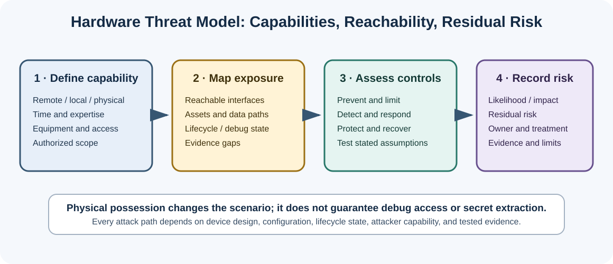

# Chapter 1: Threat Modeling for Hardware Security

## 🎯 Purpose
A framework for scoping hardware security risks by identifying assets, reachable interfaces, attacker capabilities, lifecycle conditions, controls, and residual risk.

## ⚙️ Function
Applies threat-modeling questions to embedded systems, including physical access, debug interfaces, firmware, side channels, fault injection, supply chain, and manufacturing or service states.

## 🏆 Goal
Produce a documented, evidence-based threat model that guides authorized assessment and practical design or operational controls.

## 📋 When to Use
- Scoping an authorized hardware security review
- Designing or procuring an embedded product
- Reviewing a device lifecycle, debug, update, service, or recovery process
- Prioritizing controls against a stated attacker capability

> *Part of the [Hardware Hacking Guide](./README.md) - [ULTIMATE CYBERSECURITY MASTER GUIDE](../README.md)*

---

### Why Hardware Threat Modeling Differs

Hardware threat models include device-specific physical access, manufacturing, service, firmware, electrical, and side-channel conditions alongside ordinary software and network threats. Physical possession can create additional opportunities, but it does not by itself provide memory access, debug privileges, key extraction, or a successful bypass. Those outcomes depend on the design, lifecycle state, configuration, attacker capability, and evidence.

Treat interfaces such as JTAG, SWD, UART, boot ROM, and external flash as possible exposure points to verify. Their presence does not establish that they are enabled, reachable, unauthenticated, or able to access protected assets.



### Attacker Profiles

Describe capabilities directly instead of assigning universal cost or skill bands. Two useful scenarios for the same device may differ in access time, tools, expertise, allowed teardown, supply-chain access, and ability to retain or replace a device.

| Capability dimension | Questions to document |
|----------------------|-----------------------|
| Access | Remote, local, brief physical possession, prolonged possession, service access, or supply-chain access? |
| Resources | What equipment, facilities, budget, and replacement devices are available? |
| Expertise | Which hardware, firmware, cryptographic, or manufacturing skills are in scope? |
| Time and scale | One device or a fleet? How much access time, repetition, and preparation? |
| Constraints | Can the attacker open, modify, damage, or return the device? What detection or legal limits apply? |
| Objective | Data access, service disruption, cloning, unauthorized updates, or compromise of a specific trust boundary? |

Use named profiles only as shorthand for an explicit set of assumptions. Do not infer a device's required defense level solely from broad labels such as hobbyist or nation-state.

### Assets

Hardware assets differ from software assets because they are often **physical objects** whose compromise has physical consequences.

#### Asset Categories

| Category | Examples | Sensitivity |
|----------|---------|------------|
| **Cryptographic keys** | Root keys, device identity keys, session keys | Critical - disclosure often irrecoverable |
| **Firmware / IP** | Proprietary algorithms, product firmware | High - enables cloning, piracy, vulnerability research |
| **Configuration / fuses** | Security state bits, feature enables, calibration | High - manipulation enables bypass |
| **Runtime data** | PINs, passwords, intermediate crypto values | High - transient but frequently targeted |
| **Physical device** | PCB, chips, interfaces | Medium - extraction enables all other attacks |
| **Manufacturing data** | Test modes, debug interfaces, factory keys | High - often left active in production |

#### Asset-Attack Surface Mapping

Map each asset to its location, uses, trust boundaries, and potential observations or modification paths. A path is a hypothesis to validate, not a claim that the asset is practically extractable.

| Asset example | Questions to investigate |
|----------------|--------------------------|
| Cryptographic key | Where is it generated, stored, used, backed up, and erased? Which components can access it? What documented debug or side-channel controls apply? |
| Firmware or configuration | Which boot, update, recovery, and service paths can read or modify it? How are authorization and integrity checked? |
| Runtime secret | Is it exposed in logs, memory, peripheral buses, crash dumps, or physical observables? For how long? |
| Manufacturing or service data | Which factory modes, test interfaces, credentials, and lifecycle transitions exist, and how are they disabled or restricted in production? |

For example, a device may store a key in a secure element and use it through a cryptographic API. A power side channel, debug interface, or fault path is in scope only if the relevant access and device behavior are established for that target.

### Objectives

Translate each objective into a testable scenario with a defined precondition, asset, interface, security property, and observable success criterion.

| Objective | Candidate paths to assess | Conditions and evidence |
|-----------|---------------------------|-------------------------|
| Firmware confidentiality or integrity | Debug, boot, update, recovery, or external storage paths | Verify interface state, authorization, signature checks, and whether altered firmware is accepted |
| Key protection | Key-management API, debug state, power/EM leakage, backup or zeroization path | Establish key location, permitted operations, threat model, and independently verified leakage or exposure |
| Authentication integrity | Protocol, firmware, debug, or fault-resilience paths | Test only a scoped development target; a fault or unexpected output alone is not proof of an authentication bypass |
| Service availability | Power, clock, update, or physical tamper paths | Define recovery behavior, safe limits, and authorized disruption conditions |
| Supply-chain assurance | Manufacturing access, component substitution, signing and provisioning systems | Identify trust anchors, custody steps, and available verification evidence |

Avoid writing an attack path as a guaranteed result. For instance, a debug port or fault-injection method does not imply that a security fuse can be bypassed.

### Countermeasures

Hardware countermeasures operate at multiple levels - silicon, firmware, and physical:

#### Silicon / Chip Level

| Countermeasure | Attacks Mitigated | Notes |
|----------------|------------------|-------|
| Active shield mesh | Microprobing, laser FI | Top-metal layer that triggers tamper on probe contact |
| Glitch detectors (voltage/clock) | Voltage and clock FI | On-die sensors; trigger zeroization or reset |
| PLL with frequency limits | Clock glitching | Reject CLK outside valid range |
| True Random Number Generator | Fault injection timing, DPA | Randomizes operation timing; adds noise to power trace |
| Redundant logic / dual-rail | Fault injection | Executing critical ops twice; comparison before acting |
| Memory encryption | Cold boot, bus probing | Transparent encryption of SRAM/Flash |

#### Firmware Level

| Countermeasure | Attacks Mitigated | Implementation |
|----------------|------------------|---------------|
| Secure boot chain | Firmware tampering | Cryptographic signature verification at each stage |
| Debug lock | JTAG/SWD extraction | Burn fuses; disable SWD in firmware; JTAG authentication |
| Key diversification | Key extraction | Derive device-unique keys from root + UID; limit blast radius |
| Anti-timing (constant-time ops) | Timing side-channel | Avoid data-dependent branches and memory access patterns |
| Masking | DPA | XOR sensitive intermediate values with random masks |
| Instruction shuffling | SPA, DPA | Randomize non-dependent operation order |
| Integrity checks | Fault injection | Verify results of critical operations; detect glitch artifacts |

#### Physical Level

| Countermeasure | Attacks Mitigated |
|----------------|------------------|
| Epoxy potting | Decapping, probing |
| Tamper-evident seals | Physical access detection |
| Enclosure intrusion detect | Fault injection rigs |
| PCB layer count increase | Bus probing complexity |
| BGA packaging (no exposed pads) | Test point probing |

---

### Threat Model Template

For each target device, document:

```
TARGET: [Device name / model]
ATTACKER PROFILE: [Relevant profiles and assumed capabilities]

ASSETS:
  - [Asset 1]: [Location] [Sensitivity]
  - [Asset 2]: [Location] [Sensitivity]

ATTACK SURFACE:
  - External interfaces: [UART, SPI, I2C, JTAG, USB, RF, etc.]
  - Power input: [Accessible? Filtering present?]
  - Clock input: [External crystal / internal RC / PLL]
  - Physical access: [Enclosure protection level]

THREAT SCENARIOS:
  [ID] [Threat] [Asset] [Attack Path] [Likelihood] [Impact]

COUNTERMEASURES:
  [ID] [Control] [Threats Mitigated] [Implementation Status]

RESIDUAL RISK:
  [Threats not fully mitigated and accepted rationale]
```

---

## Related Files
- [Hardware Security Case Studies](../CaseStudies/README.md) - Onity, Unsaflok, Tesla key-fob and EUCLEAK research to inform physical-access threat models
- [Chapter2.md](Chapter2.md) - Electrical fundamentals: the physical layer knowledge underlying every threat in this model
- [JTAGulator.md](JTAGulator.md) - Primary tool for exploiting the JTAG/UART debug-interface threat identified in threat models
- [T48_TL866-3G.md](T48_TL866-3G.md) - IC programmer for the firmware extraction threat vector
- [Chapter3.md](Chapter3.md) - Fault injection: one of the key hardware attacks this chapter helps scope
- [Chapter4.md](Chapter4.md) - Side-channel: the passive observation threat class this chapter introduces

---

<div align="center">

**Next:** [Chapter 2 - Electrical Fundamentals →](./Chapter2.md)

[← Back to Hardware Hacking README](./README.md)

</div>
