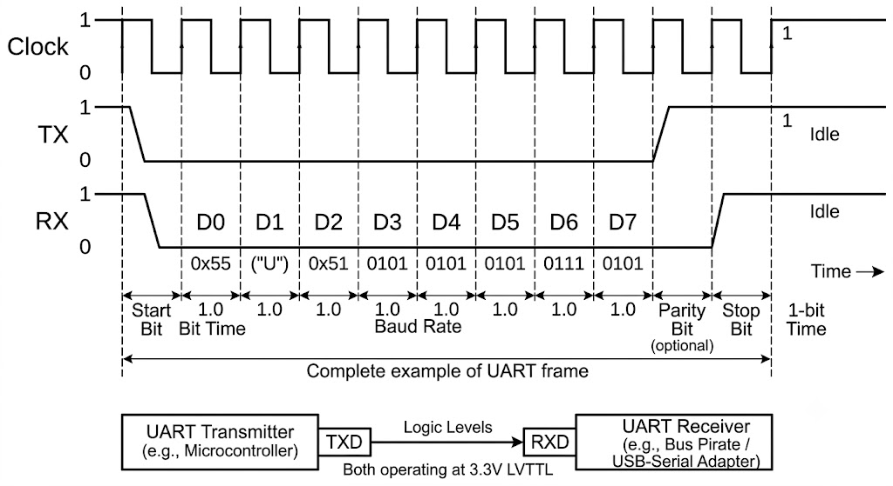
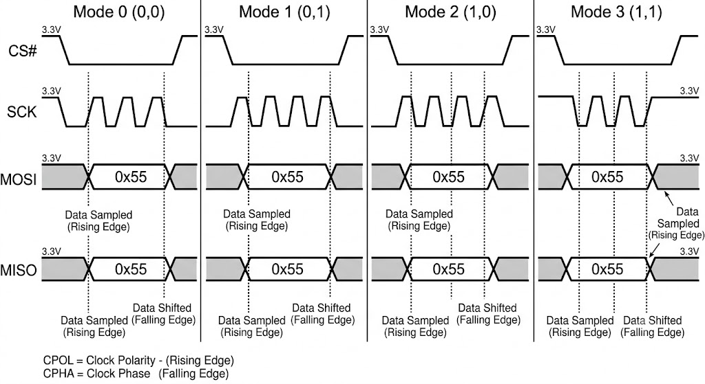
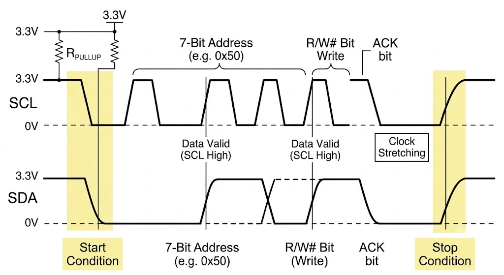
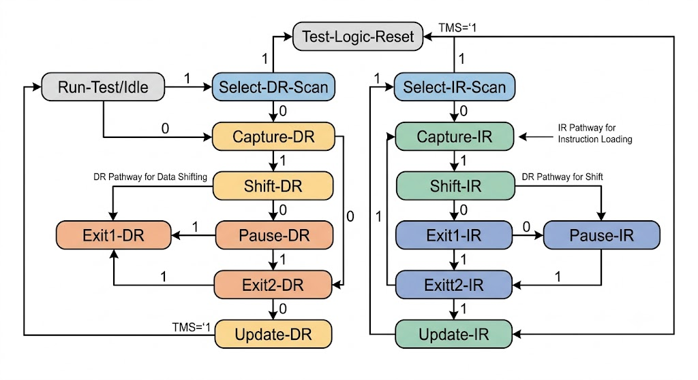
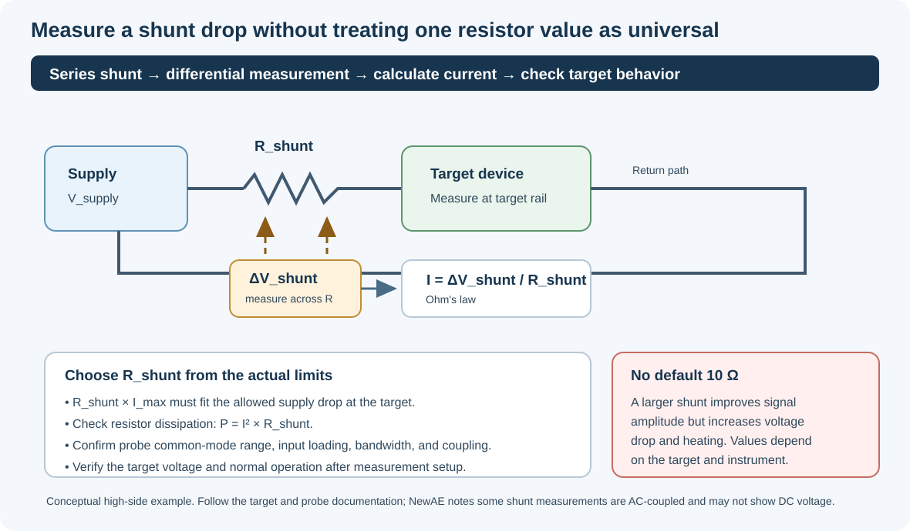

# Chapter 2: Electrical Fundamentals

## 🎯 Purpose
Reference for the electrical concepts underlying hardware hacking - covering voltage/current/power, digital logic levels, bus protocols (UART, SPI, I2C, JTAG), oscilloscope/logic-analyzer measurement, and signal integrity issues that affect hardware security work.

## ⚙️ Function
Covers: V/I/R/P relationships, digital logic levels (CMOS vs TTL, 1.8/3.3/5V), Ohm's law for shunt measurement, UART framing, SPI modes, I2C addressing, JTAG TAP state machine, oscilloscope setup, logic analyzer configuration, and practical probe tips for hardware analysis.

## 🏆 Goal
Provide the minimum electrical knowledge needed to safely connect to, measure, and communicate with an embedded target without damaging it or the test equipment.

## 📋 When to Use
- Before connecting any hardware tool (Bus Pirate, logic analyzer, oscilloscope) to an unknown target
- Reference during fault injection or power analysis setup (shunt calculation, probe loading)
- When interpreting logic analyzer captures and troubleshooting protocol issues

> *Part of the [Hardware Hacking Guide](./README.md) - [ULTIMATE CYBERSECURITY MASTER GUIDE](../README.md)*

---

### Voltage, Current, and Power

Understanding the relationships between electrical quantities is foundational for measurement, probing, and side-channel work.

| Quantity | Symbol | Unit | Relevance to Hardware Hacking |
|----------|--------|------|-------------------------------|
| Voltage | V | Volt (V) | Supply manipulation; signal levels; logic thresholds |
| Current | I | Ampere (A) | Power analysis; shunt resistor measurement |
| Power | P | Watt (W) | P = V × I; target of power analysis attacks |
| Resistance | R | Ohm (Ω) | V = I × R (Ohm's Law); shunt selection |
| Capacitance | C | Farad (F) | Decoupling caps; affects glitch shape propagation |
| Impedance | Z | Ohm (Ω) | AC equivalent of resistance; critical for RF/probing |

**Ohm's Law and Power:**

```
V = I × R        (voltage = current × resistance)
P = V × I        (power = voltage × current)
P = I² × R       (power through a resistor)
P = V²/R         (power across a resistor)
```

**Why it matters:** In power analysis, a shunt is selected for the target's expected current, allowed supply drop, resistor dissipation, and measurement circuit. Current can be estimated from the measured drop using I = ΔV_shunt / R_shunt; signal coupling and probe loading affect what the instrument displays. There is no universal shunt value. See [NewAE's measurement note](https://chipwhisperer.readthedocs.io/en/sca101/cw_tips_tricks/common_questions/power_measurement_units.html) and the target/instrument documentation.

---

### Logic Levels and Signaling

A logic-level mismatch can produce invalid captures; a voltage beyond an input's absolute-maximum rating can damage hardware. Check the target and instrument specifications before connecting or driving a signal.

| Example I/O standard | Supply | VIH (minimum) | VIL (maximum) | Notes |
|-------------|-----|-----------------|----------------|-------|
| 5V TTL | 5V | 2.0V | 0.8V | Check the receiving device's own specification |
| 3.3V LVTTL | 3.3V | 2.0V | 0.8V | Example standard; not every 3.3V pin uses LVTTL thresholds |
| 1.8V CMOS | 1.8V | 1.17V | 0.63V | Representative thresholds from the TI logic guide |
| 1.2V CMOS | 1.2V | 0.78V | 0.42V | Representative thresholds from the TI logic guide |

These are examples of named I/O standards, not universal voltage rules. Use the target and instrument datasheets for guaranteed VIH/VIL levels and absolute-maximum ratings. See [TI's Logic Guide](https://www.ti.com/lit/sg/sdyu001ac/sdyu001ac.pdf).

**Level compatibility:** A 1.8V output may not meet a receiver's required high-level threshold, while an output above the probe's absolute-maximum rating may damage the probe. Check both sides before connecting; use a level translator when required.

---

### Communication Interfaces

<p align="center">
  
</p>

#### UART (Universal Asynchronous Receiver/Transmitter)

A serial interface found on some embedded boards for logs or maintenance. Whether a usable console is exposed depends on the device design and security configuration.

```
Signal lines: TX, RX, and a shared ground reference; a header may also expose VCC
Voltage: Common logic levels include 1.8V, 3.3V, and 5V; confirm the exact target before connecting
Framing: Start bit | 8 data bits | [Parity] | Stop bit(s)
Common baud rates: 9600, 38400, 57600, 115200, 230400, 921600
```

**Identification:**
- Look for 3–4 pin headers (VCC, GND, TX, RX) - often unpopulated in production
- Measure with oscilloscope or logic analyzer for periodic activity at boot
- Estimate candidate baud rates from captured bit timing, then verify them against a valid frame
- TX on the device = RX on your adapter (cross the connections)
- Do not connect a header's VCC unless the documented setup requires it; avoid powering the target from two sources

**Possible exposure:** Boot logs or a console may be available. Privilege, bootloader commands, and firmware access are device-specific; the presence of UART pins alone does not imply a shell.

---

<p align="center">
  
</p>

#### SPI (Serial Peripheral Interface)

Synchronous full-duplex bus. Dominant interface for external flash memory (firmware storage), EEPROMs, DACs, ADCs.

```
Signal lines: SCLK, MOSI (Master Out Slave In), MISO (Master In Slave Out), CS (Chip Select, active low)
Modes: CPOL/CPHA (0,0), (0,1), (1,0), (1,1) - set clock polarity and phase
Speed: Up to tens of MHz; typically 1–25 MHz for flash
```

**Flash chip targeting:** Use only a supported flash part and adapter at the documented voltage. In-circuit reads may fail or disturb a powered board; isolate power and follow the board/programmer documentation.

```bash
# Read SPI flash with flashrom (in-circuit or removed)
flashrom -p ch341a_spi -r firmware_dump.bin

# Read with Bus Pirate
# Set SPI mode, correct speed and CPOL/CPHA for target chip
# Use flashrom or manual JEDEC commands (0x9F = Read ID, 0x03 = Read Data)

# Identify chip on board: check silkscreen, use JEDEC ID
# Common chips: W25Q series (Winbond), MX25L series (Macronix), GD25Q (GigaDevice)
```

---

<p align="center">
  
</p>

#### I²C (Inter-Integrated Circuit)

Two-wire synchronous bus. Common for configuration EEPROMs, sensors, real-time clocks, PMICs.

```
Signal lines: SDA (data), SCL (clock) - both open-drain with pull-up resistors
Addressing: 7-bit or 10-bit device address; a 7-bit field has 128 encodings, including reserved values
Speed: Standard (100 kHz), Fast (400 kHz), Fast-Plus (1 MHz), High-Speed (3.4 MHz)
```

**Discovery and access:** Start with the board documentation and nonintrusive voltage or logic observation. Bus scans and register reads can have device-specific side effects; writes can alter configuration or disrupt operation. Use bus tools only on an owned or explicitly authorized isolated target, with the exact controller and device documentation.

Some I²C EEPROM families use addresses in the 0x50–0x57 range, but address maps and stored data are board-specific; do not infer contents from the address alone. PMICs may expose writable power controls on some designs, but changing them can disrupt or damage a device and requires target-specific documentation and authorization.

---

<p align="center">
  
</p>

#### JTAG (Joint Test Action Group)

IEEE 1149.1 test interface that may also connect to a processor's debug architecture. Available operations depend on the target, debug configuration, authentication, and device lifecycle state; interface presence does not guarantee memory access or breakpoints.

```
Signal lines: TCK (clock), TMS (mode select), TDI (data in), TDO (data out), TRST (reset, optional)
Protocol: State machine driven by TMS; TAP (Test Access Port) controller
```

**Identification techniques:**
- `JTAGulator` hardware tool - brute-forces JTAG pinout across candidate pins
- Some boards route multiple debug signals to a shared or adjacent header; verify the pinout from target documentation before connecting
- `OpenOCD` with a supported probe and matching interface, TAP, and target configuration; see the [OpenOCD configuration guide](https://openocd.org/doc/html/Debug-Adapter-Configuration.html)

```bash
# TEMPLATE ONLY: use only with an owned/authorized target and its verified adapter/target configuration.
# Debug commands can change target state or expose protected data.
openocd -f interface/jlink.cfg -f target/stm32f4x.cfg
# In the OpenOCD session, only if permitted and supported by this exact target:
halt
dump_image authorized_lab_dump.bin 0x08000000 0x100000   # Example address/length; verify the target memory map

# JTAG boundary scan for hardware testing
# Can toggle GPIO pins, read logic levels without CPU involvement
```

Debug-lock enforcement and recovery behavior are device-specific. Do not assume a debug lock can be bypassed; use vendor documentation and authorized research scoped to the exact target.

---

#### SWD (Serial Wire Debug)

ARM's two-wire debug protocol (SWDCLK and SWDIO, plus a ground reference). It is distinct from JTAG; available CoreSight features and access depend on the exact Cortex-M device, board, and debug-security configuration. See [Arm's SWD documentation](https://developer.arm.com/documentation/101416/0100/Debug-ports/Serial-Wire-Debug).

```bash
# TEMPLATE ONLY: use an owned/authorized target and its verified adapter/target configuration.
openocd -f interface/cmsis-dap.cfg -f target/nrf52.cfg
# Halt or read memory only where permitted and supported by the exact target.
```

---

### Measurement Equipment

#### Oscilloscope Selection for Hardware Hacking

| Parameter | Minimum | Recommended | Notes |
|-----------|---------|-------------|-------|
| Bandwidth | 100 MHz | 200–500 MHz | Must exceed target clock × 5 for clean edges |
| Sample rate | 1 GSa/s | 2–5 GSa/s | Nyquist: 2× bandwidth minimum |
| Memory depth | 1M pts | 10M–1G pts | Deep memory essential for long glitch captures |
| Channels | 2 | 4 | Trigger on one channel, measure on others |
| Vertical resolution | 8-bit | 12–14 bit | Critical for power analysis - 8-bit often insufficient |
| Triggering | Edge | Advanced (pattern, pulse width, serial decode) | Complex trigger conditions needed for glitch work |

**Recommended affordable options:**
- **Rigol DS1054Z** (~$350) - 4-channel, 50 MHz (hackable to 100 MHz), good memory depth. Baseline bench scope.
- **Rigol DS1104Z-S** - adds signal gen; useful for clock injection testing
- **Siglent SDS1204X-E** (~$400) - 200 MHz, 14 Mpts; better for RF work
- **PicoScope 6000E** - 12-bit ADC; excellent for power analysis



*The figure shows the measurement relationship, not a fixed resistor value or tested circuit. Use the target and instrument documentation to select a safe topology and operating limits.*


#### Shunt Resistors for Power Measurement

Place the shunt **in series** with the target supply and measure the voltage across it with an instrument/probe configuration suitable for the common-mode voltage and bandwidth. Estimate current using Ohm's law:

**I = ΔV_shunt / R_shunt**

The resistor value must be chosen for the target and measurement setup. A larger value increases signal amplitude but also increases the target's supply drop and resistor heating. Check both **V_drop = I_max × R_shunt** and **P = I_max² × R_shunt**, including the resistor's rating and the device's supply margin.

| Example R_shunt | Voltage drop at 50 mA | Interpretation |
|------------|------------------------|----------------|
| 1 Ω | 50 mV | Smaller drop and signal |
| 10 Ω | 500 mV | Larger drop; may disturb target operation |
| 100 Ω | 5 V | Exceeds a 3.3 V supply |

These are arithmetic examples, not recommendations for a particular target. As an illustration, if a 3.3 V target draws at most 100 mA and a 10% supply-drop budget is selected, the drop rule gives **R_shunt ≤ 3.3 Ω** before accounting for other rail losses. Measure the voltage at the target under its expected load.

Some instruments AC-couple shunt measurements: NewAE documents that its ChipWhisperer measure port shows voltage drop across a board shunt and does not measure DC voltage. Check the instrument's coupling, input loading, and range before interpreting a trace ([ChipWhisperer power measurement notes](https://chipwhisperer.readthedocs.io/en/sca101/cw_tips_tricks/common_questions/power_measurement_units.html)).

#### Logic Analyzers

| Tool | Channels | Speed | Notes |
|------|----------|-------|-------|
| Saleae Logic 8 | 8 | 100 MHz | Best software ecosystem; protocol decoders |
| Saleae Logic Pro 16 | 16 | 500 MHz analog | Analog + digital; excellent for mixed-signal |
| DreamSourceLab DSLogic | 16 | 400 MHz | Lower cost; sigrok compatible |
| Bus Pirate 5 | Multi | ~1 MHz | Protocol bridge with basic capture; not a standalone logic analyzer — use a dedicated tool for high-speed or multi-channel captures |
| Glasgow Interface Explorer | Multi | ~100 MHz | FPGA-based; highly scriptable |

---

### Signal Integrity Basics

Poor signal integrity is the most common cause of failed hardware hacking attempts (bad captures, missed glitches, corrupted data).

- **Ground loops:** Always connect probe ground to the target ground at the nearest point. Long ground leads act as antennas and inject noise.
- **Probe loading:** A ×10 scope probe has 10 MΩ input impedance - fine for most digital work. Active probes (1 MΩ or 50 Ω matched) needed for high-frequency or sensitive measurements.
- **Decoupling capacitors:** Target boards place decoupling caps (100nF ceramic) on power pins to suppress noise. For power analysis, you often **remove** the decoupling cap nearest the target IC to improve signal fidelity - the cap averages out the current transients you're trying to measure.
- **50 Ω termination:** For signals above ~100 MHz, use 50 Ω terminated probing to prevent reflections. Scope inputs should be set to 50 Ω mode.

---

## Related Files
- [Onity Locks (2012) — Service Interface Case Study](../CaseStudies/hardware/onity-locks-2012.md) - Service-port trust boundaries and fleet remediation
- [BusPirate.md](BusPirate.md) - Implements the UART/SPI/I2C protocols described in this chapter
- [HiLetgo.md](HiLetgo.md) - Logic analyzer for capturing the digital signals described in this chapter
- [LA1010.md](LA1010.md) - Higher-speed logic analyzer for protocols requiring >24MHz capture rate
- [Chapter3.md](Chapter3.md) - Fault injection: applies the power/voltage concepts from this chapter to attack scenarios
- [Chapter4.md](Chapter4.md) - Power analysis: extends the shunt measurement and oscilloscope techniques introduced here

---

<div align="center">

**Next:** [Chapter 3 - Fault Injection Attacks →](./Chapter3.md)

[← Chapter 1: Threat Modeling](./Chapter1.md) · [Back to Hardware Hacking README](./README.md)

</div>
