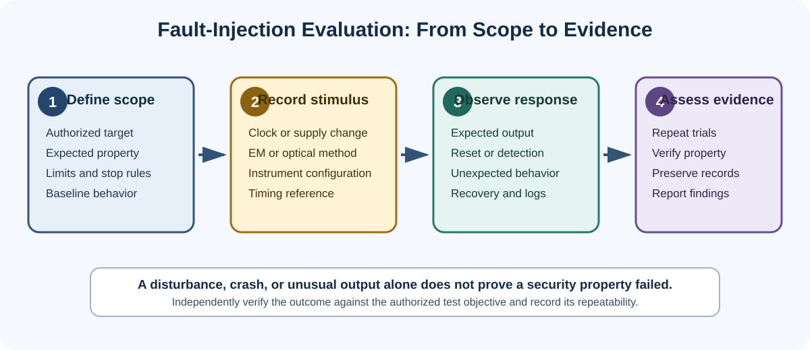
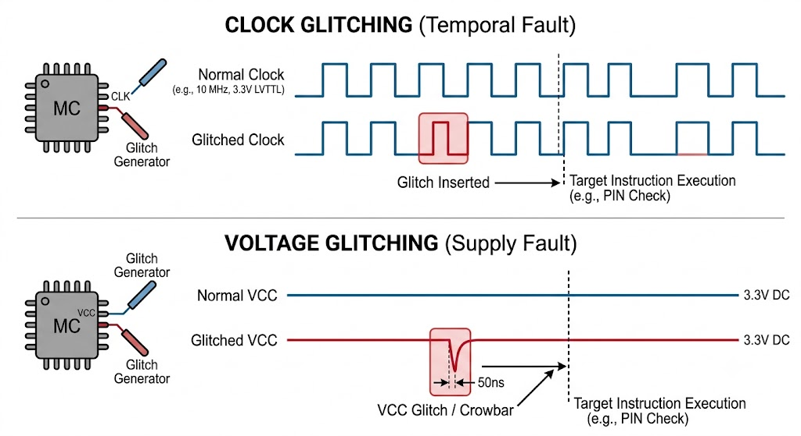
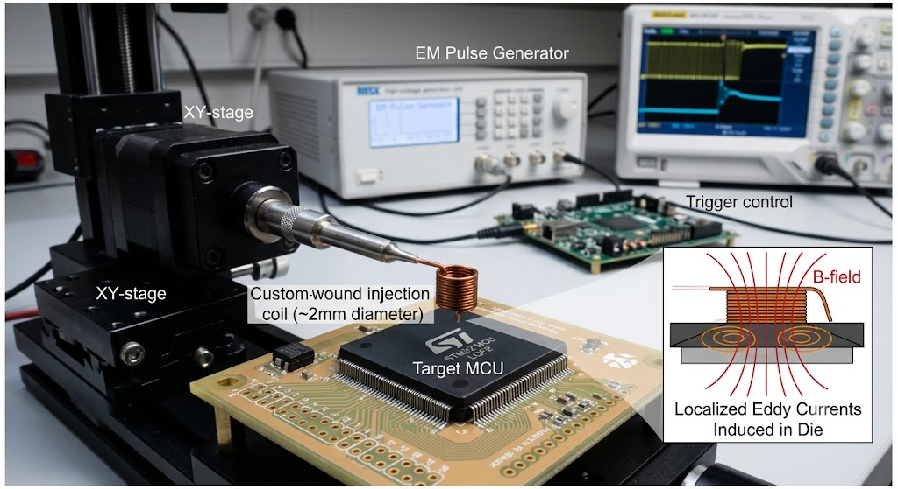
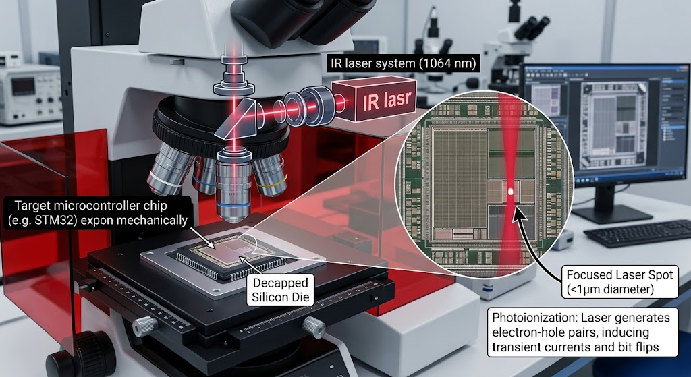

# Chapter 3: Fault Injection Attacks

## 🎯 Purpose
Explain how transient hardware disturbances can affect device behavior, how to evaluate fault-injection resilience on authorized development targets, and how to interpret results without treating a single outcome as proof of exploitability.

## ⚙️ Function
Covers clock, supply-voltage, electromagnetic, and optical fault-injection concepts; target-dependent timing and coupling; controlled evaluation; outcome classification; and defensive validation.

## 🏆 Goal
Assess whether a device detects, tolerates, or mishandles faults under a documented and authorized test scope, and produce repeatable evidence for remediation.

## 📋 When to Use
- Evaluating a device or development board you own or are explicitly authorized to test
- Reviewing secure-boot, authentication, or cryptographic fault countermeasures
- Planning a specialist laboratory assessment and defining measurable outcomes
- Documenting reset, detection, recovery, and unexpected-output behavior

> *Part of the [Hardware Hacking Guide](./README.md) - [ULTIMATE CYBERSECURITY MASTER GUIDE](../README.md)*

---

### Concept

Fault injection (FI) deliberately perturbs a device's operating conditions to study whether the resulting behavior is detected, safely contained, or incorrect. Faults can cause resets, corrupted data, timing errors, or security-relevant failures; the result depends on the target, disturbance, and countermeasures.

A useful evaluation records the complete chain: the intended property, the observed disturbance, the device response, and independently checked evidence. A crash or unexpected output alone does not prove that a security boundary was bypassed. The diagram below summarizes this evidence flow; it is conceptual and does not represent a tested circuit.



---

### Fault Injection Methods

<p align="center">
  
</p>

#### Clock Glitching

A clock disturbance can violate timing margins or alter clock edges. Depending on the device and injection path, outcomes range from no observable effect to reset, detected fault, or incorrect computation; it does not simply make an instruction execute faster.

Evaluation requires a target-specific, documented test fixture and instruments appropriate to the clock interface and electrical limits. A repeatable trigger and capture method are useful, but achievable timing resolution, pulse shape, and relation to the target clock depend on the hardware and clocking configuration.

Some instruments expose controls such as `offset`, `width`, and `repeat`. Their units, ranges, resolution, and effect are instrument- and target-specific. Record actual settings and observed behavior rather than assuming a parameter maps directly to a target clock cycle.

See [ChipWhisperer's notes on glitch timing controls](https://chipwhisperer.readthedocs.io/en/sca101/cw_tips_tricks/advanced_usage/improving_glitch_precision.html).

#### Voltage Glitching

Supply-voltage fault injection perturbs a target rail. The transient that reaches the silicon depends on the power-distribution network, regulator, package, board layout, load, and measurement point; no generic amplitude or duration predicts the effect. Test only on a current-limited, replaceable development target using documented limits and suitable equipment.

**Keep decoupling capacitors in place by default.** Capacitors can shape or attenuate transients, but removing or bypassing them changes the target and can cause instability or damage. Only make a board modification when the exact target documentation specifies it for the measurement path. For example, NewAE's [CW305 documentation](https://rtfm.newae.com/Targets/CW305%20Artix%20FPGA/) describes particular optional capacitors associated with its shunt measurement design; this is not a general instruction for other boards.

<p align="center">
  
</p>

#### Electromagnetic Fault Injection (EMFI)

EM fault injection applies a transient electromagnetic disturbance that can couple into a circuit without a direct electrical connection. The coupling path, affected region, repeatability, and resulting fault depend strongly on the target package, board, probe, and setup. Do not infer spatial precision or penetration through packaging from an illustrative image. Specialized equipment and controlled laboratory methods are typically required; prices and capabilities vary by current model.

<p align="center">
  
</p>

#### Laser Fault Injection (LFI)

Optical fault injection uses focused light to perturb semiconductor behavior. Access to a suitable die surface, wavelength, and device construction are target-specific; achievable spatial resolution and effects must be established experimentally. Package opening, delayering, laser use, and chemical processing are specialist failure-analysis activities with serious equipment, eye, chemical, and device hazards. This guide does not provide a decapsulation procedure. Treat the supplied figure as illustrative, not as proof that a device must be opened or that a particular wavelength will work.

#### Body Biasing Injection (BBI)

Body-bias fault injection is a specialized research technique that perturbs substrate or body bias where a device process and physical access make this possible. Its feasibility, coupling, and effects depend strongly on the semiconductor process and package. It is not a general board-level technique; avoid assuming that a commercial device exposes a usable body contact.

### Injection Point Identification

Finding which operating conditions reveal a weakness is difficult, and observed effects may be intermittent. Treat the methods below as categories for authorized lab evaluation; do not assume a trigger aligns with a particular instruction.

#### Temporal Targeting

| Strategy | Method | When to Use |
|----------|--------|------------|
| **Fixed offset from trigger** | UART TX start bit, GPIO toggle, power-on reset | Deterministic code paths |
| **Side-channel correlation** | Compare a separately captured power/EM trace with observed behavior | Requires an instrumented, authorized target and careful interpretation |
| **Incremental sweep** | Automated sweep of offset in fine steps | Unknown target offset |
| **Loop amplification** | Fault inside a repeated loop - each iteration is another attempt | Crypto operations |

**Possible synchronization references** include a documented GPIO marker, a protocol event, a reset event, or a measured power transition. These are timing references, not proof of internal instruction timing. Validate them against the exact device and record uncertainty.

#### Spatial Effects (EMFI / Optical)

Physical coupling can vary across a package or board, but visible layout alone does not identify functional blocks or establish a fault location. Spatial mapping requires a specialist lab, defined authorization, suitable safety controls, and repeatable observations.

---

### Practical Injection Tips

**Plan a bounded, repeatable evaluation** on an owned or explicitly authorized development target. Set operating limits, stop conditions, a finite test plan, and an independent way to verify the security property. Do not apply generic voltage, clock, optical, or EM settings to an unknown or production device.

Automate capture and classification only within documented instrument and target limits. Log the target revision, environment, instrument configuration, timing reference, every trial, and any resets or anomalies.

**Classify results carefully:**

| Result | Meaning | Action |
|--------|---------|--------|
| **Expected output** | No observed deviation in this trial | Record as a negative observation; it does not prove immunity |
| **Reset / detected fault / safe shutdown** | Device reacted to the disturbance | Record detection and recovery behavior |
| **Unexpected output or state** | Behavior differs from baseline | Preserve evidence and investigate with the system owner |
| **Security property violated** | Independent verification confirms a scoped property failure | Stop, preserve evidence, and follow the assessment reporting process |

**Visualize trial outcomes:** A parameter heatmap can show where observed outcomes cluster, but it only summarizes recorded trials. It does not establish causality, repeatability, or exploitability; report trial counts and consistency alongside it.

```python
import numpy as np
import matplotlib.pyplot as plt

# Illustrative only: fault_results is a rectangular array of documented trial classes.
# Example labels: 0=expected output, 1=reset/detected, 2=unexpected output,
# 3=independently verified scoped property failure.
fault_map = np.array(fault_results)
plt.imshow(fault_map, cmap='RdYlGn', aspect='auto')
plt.xlabel('Glitch Width (ns)')
plt.ylabel('Glitch Offset (cycles)')
plt.title('Observed Fault-Injection Outcomes (Illustrative)')
plt.colorbar(label='Trial class (see labels above)')
plt.show()
```

---

**References:** [ChipWhisperer's notes on glitch timing controls](https://chipwhisperer.readthedocs.io/en/sca101/cw_tips_tricks/advanced_usage/improving_glitch_precision.html) explain that timing controls depend on the glitch module clock. For a broader overview of fault methods and countermeasures, see the peer-reviewed [review of processor fault-injection countermeasures](https://www.mdpi.com/2078-2489/16/4/293).

## Related Files
- [Chapter2.md](Chapter2.md) - Electrical fundamentals: voltage supply manipulation and oscilloscope setup required for fault injection
- [Chapter4.md](Chapter4.md) - Power analysis: passive counterpart to active fault injection; complementary techniques
- [Chapter1.md](Chapter1.md) - Threat modeling: fault injection is one of the key attack classes to model in scope

---

<div align="center">

**Next:** [Chapter 4 - Timing and Power Analysis Attacks →](./Chapter4.md)

[← Chapter 2: Electrical Fundamentals](./Chapter2.md) · [Back to Hardware Hacking README](./README.md)

</div>
