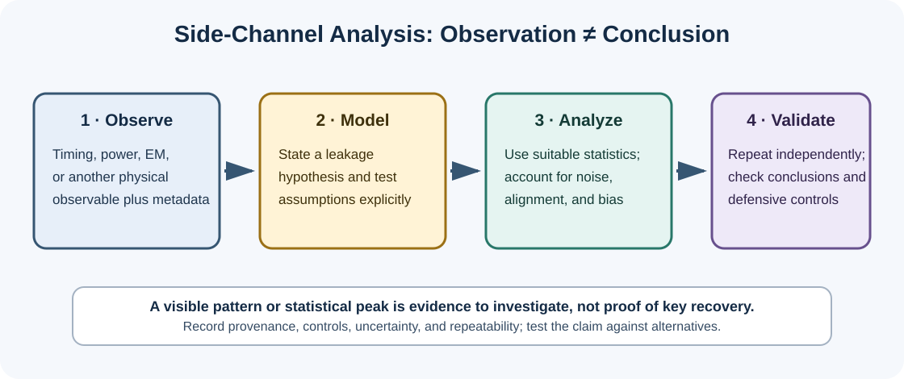
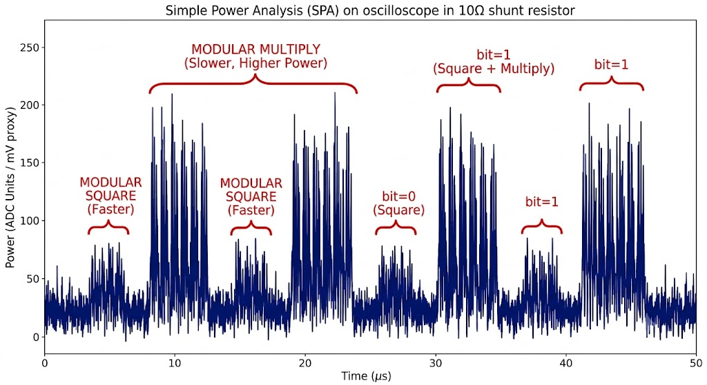

# Chapter 4: Timing and Power Analysis Attacks

## 🎯 Purpose
Explain how timing, power, electromagnetic, and other physical observations can reveal information about device behavior, and how to evaluate leakage claims carefully.

## ⚙️ Function
Introduces timing side channels, simple power analysis, differential power analysis (DPA), correlation power analysis (CPA), common measurement limits, and defensive review.

## 🏆 Goal
Help assess whether an authorized implementation leaks sensitive information and produce evidence that supports practical remediation.

## 📋 When to Use
- Reviewing cryptographic implementations on owned or explicitly authorized development hardware
- Learning how physical leakage differs from functional output
- Assessing the limits of timing and power-analysis claims
- Planning defensive validation of constant-time code and side-channel countermeasures

> *Part of the [Hardware Hacking Guide](./README.md) - [ULTIMATE CYBERSECURITY MASTER GUIDE](../README.md)*

---

### Introduction to Side-Channel Analysis

Side-channel analysis studies unintended information in physical or microarchitectural observations such as execution time, power consumption, electromagnetic emissions, or acoustic signals. These observations can depend on secret data, but measurement noise, device design, software, and available inputs affect whether a useful inference is possible.

Unlike fault injection, side-channel analysis observes behavior rather than deliberately changing it. Some evaluations use chosen inputs or repeated cryptographic operations, so the target is not necessarily an ordinary passive-only scenario.

A secret-dependent computation can produce ordinary functional output and, separately, possible physical or microarchitectural leakage such as timing, power, EM emissions, or acoustic effects.

### Timing Attacks

#### Concept

If execution time depends on secret data, repeated measurements may reveal information about that data. A comparison that returns at the first mismatch is one possible source of timing variation, but a single slow request does not identify a correct character. Runtime noise, caching, network jitter, input length, scheduling, rate limits, and server behavior all confound measurements.

For software under review, use a local test harness and a documented, authorized target. Do not send guesses to a live service; assess the implementation, threat model, measurement quality, and mitigations instead.

**Mitigation:** Use vetted cryptographic libraries and constant-time comparison primitives for secret values. Python's hmac.compare_digest() is designed to avoid content-based short-circuiting; its documentation notes that type and length differences may still be observable. Constant-time behavior must be evaluated in the full implementation and environment.

#### RSA Timing Attacks

An exponentiation implementation that performs different work depending on private-exponent bits can create timing variation. This is an implementation-level leakage risk, not a universal property of RSA. Real attacks depend on the implementation, observable timing precision, attacker queries, noise, and countermeasures.

Common defensive techniques include constant-time implementations and blinding where appropriate. No single algorithm name guarantees constant-time behavior; use a vetted cryptographic implementation and review its documented threat model. See Kocher's original [timing attacks paper](https://cr.yp.to/bib/1996/kocher.pdf).

#### Cache Timing (Software Side-Channel)

| Attack | Description | Example |
|--------|-------------|---------|
| **Flush+Reload** | Measure access time to a shared cache line after an operation | Can reveal whether victim code accessed a line |
| **Prime+Probe** | Measure cache-set contention after victim activity | Can infer activity without shared memory |
| **Transient execution** | Speculative or out-of-order effects leave measurable microarchitectural state | Cache timing is one common observation channel |

Spectre and Meltdown refer to distinct vulnerability classes and should not be treated as synonyms for cache attacks. Cache behavior is one possible channel used to observe microarchitectural effects.

---

### Simple Power Analysis (SPA)

SPA examines one or a small number of traces for visible structure associated with a computation. The trace is an observation; interpretation depends on the implementation and measurement setup.

#### Concept

Power measurements can reflect circuit activity, but there is no universal proportionality between trace amplitude and the number of 1 bits in a value. Hamming-weight and Hamming-distance models are hypotheses used in particular analyses; actual leakage depends on the implementation, transitions, measurement path, and noise.

  

#### SPA on RSA

Some modular exponentiation implementations perform distinguishable operations depending on exponent bits. A sufficiently informative trace may reveal operation structure, but the waveform must be interpreted against the exact implementation and acquisition setup. It does not automatically expose key bits.

A CSV plot is a visualization of exported samples, not a calibrated power measurement unless the probe, shunt, gain, and acquisition path are calibrated. Label the axis in the actual exported unit, such as ADC counts or volts, and record its provenance.

### Differential and Correlation Power Analysis

Differential power analysis (DPA) and correlation power analysis (CPA) are related statistical side-channel methods, but they are not interchangeable names for one algorithm.

- **DPA** groups traces according to a predicted bit or intermediate-value property, then compares group statistics, classically with a difference of means.
- **CPA** assigns a predicted leakage value to each trace, often using a Hamming-weight or Hamming-distance model, then computes correlation with measured samples.

The previous AES example used Pearson correlation against a Hamming-weight prediction, which is CPA. In either approach, the analysis depends on the leakage model, input data, trace alignment, acquisition quality, implementation, and countermeasures. A high peak alone is not proof of a correct key guess; confirm against known test vectors or an independent validation path on an authorized target.

#### Trace Counts and Evidence

There is no reliable universal minimum trace count for AES, RSA, or a particular masking order. Requirements vary with the device, implementation, leakage strength, signal-to-noise ratio, measurement setup, alignment, chosen inputs, statistical method, and countermeasures. Published results for one device should not be presented as a general threshold.

For an evaluation report, document the number and source of traces, acquisition conditions, preprocessing, analysis model, controls, key-guess ranking or confidence measure, repeatability, and independent verification. Treat trace count as an experimental result, not as a fixed property of an algorithm.

**References:** [Kocher's timing-attack paper](https://cr.yp.to/bib/1996/kocher.pdf); Kocher, Jaffe, and Jun, [Differential Power Analysis](https://doi.org/10.1007/3-540-48405-1_25); Python's [hmac.compare_digest() documentation](https://docs.python.org/3/library/hmac.html#hmac.compare_digest).

## Related Files
- [EUCLEAK / YubiKey 2024 Case Study](../CaseStudies/hardware/eucleak-yubikey-2024.md) - Real-world EM leakage and affected-implementation boundaries
- [Chapter5.md](Chapter5.md) - Practical power analysis: hands-on measurement setup, trace acquisition, and TVLA analysis
- [Chapter2.md](Chapter2.md) - Electrical fundamentals: shunt resistor measurement and oscilloscope techniques for trace collection
- [Chapter3.md](Chapter3.md) - Fault injection: active attack complement to passive side-channel analysis

---

**Next:** [Chapter 5 - Power Analysis Practicals →](./Chapter5.md)

[← Chapter 3: Fault Injection](./Chapter3.md) · [Back to Hardware Hacking README](./README.md)

