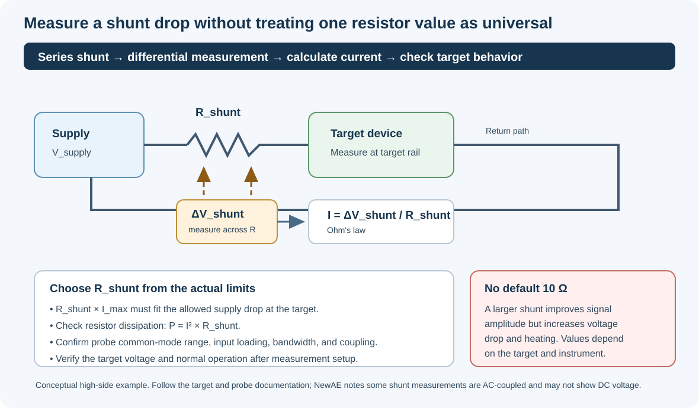
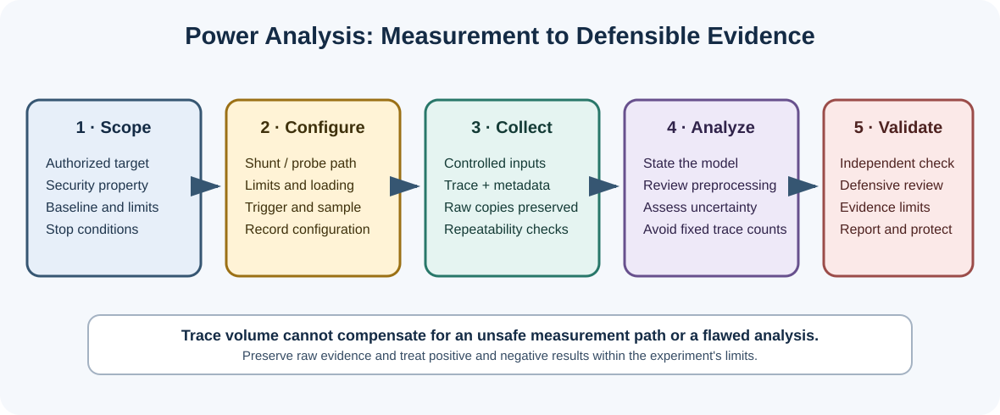

# Chapter 5: Power Analysis - Practical Techniques

## 🎯 Purpose
A practical overview of authorized power-analysis evaluation, including safe measurement setup, trace provenance, preprocessing limits, CPA interpretation, and leakage testing.

## ⚙️ Function
Covers target-dependent shunt and probe selection, controlled trace collection, signal-processing cautions, correlation power analysis (CPA), visualization, and Test Vector Leakage Assessment (TVLA).

## 🏆 Goal
Determine whether a documented implementation leaks information under a defined lab setup, preserve enough evidence to reproduce the result, and report both findings and limits.

## 📋 When to Use
- Evaluating a cryptographic implementation on owned or explicitly authorized development hardware
- Planning measurement setup after reviewing the fundamentals in Chapter 2
- Learning how collection and preprocessing choices affect leakage analysis
- Checking countermeasures with documented statistical methods

> *Part of the [Hardware Hacking Guide](./README.md) - [ULTIMATE CYBERSECURITY MASTER GUIDE](../README.md)*

---

### Measurement Setup

A measurement should preserve the target's normal operating conditions closely enough for the stated experiment. Choose a documented, current-limited development target and follow its board and instrument manuals.

#### Hardware Configuration

The shunt value and placement depend on the target's current, allowable supply drop, resistor dissipation, power-distribution path, and measurement bandwidth. There is no universal value. Keep decoupling capacitors in place unless the exact target documentation specifies a topology-specific change.

Use the shunt calculation and conceptual figure in [Chapter 2](./Chapter2.md#shunt-resistors-for-power-measurement). That chapter explains why probe common-mode limits, scope grounding, loading, and 50 Ω termination must be checked before connecting instruments.

The trace workflow below separates safe setup, data collection, analysis, and independent validation.

Select a differential or single-ended measurement only after confirming the target reference, scope/probe grounding, common-mode range, and safe input limits. A ×1 probe is not automatically more suitable: attenuation, bandwidth, capacitance, input resistance, and voltage limits vary by probe and scope.

Amplification is optional and target-dependent. Check amplifier noise, bandwidth, gain, input range, common-mode range, and risk of saturation. A larger displayed waveform is not necessarily a more faithful measurement.

#### ChipWhisperer Setup

ChipWhisperer hardware and API defaults vary by capture platform, firmware, target board, and software release. Do not copy fixed gain, sample count, clock, trigger, or serial settings into an unrelated target configuration. Start with the current [ChipWhisperer documentation and tutorials](https://chipwhisperer.readthedocs.io/en/latest/) for the exact capture hardware and target; record software versions and configuration in the experiment notes.

### Trace Acquisition

#### Collection Best Practices

- **Define the experiment first:** Specify the security property, controlled inputs, expected operation, target revision, and stop conditions.
- **Choose inputs to fit the test:** Fixed-versus-random TVLA and known-plaintext CPA use different input designs. Follow the method's documented requirements and preserve input/response metadata.
- **Check trigger and capture behavior:** Confirm that captures contain the intended operation and that the trigger is stable enough for the planned analysis. Timing jitter and misalignment can weaken or distort results.
- **Preserve raw traces:** Keep an unmodified copy with instrument settings, sample rate, target/environment details, trigger configuration, input data, output data, and software versions.
- **Use repeatable conditions:** Record temperature, supply, clock, board state, and any changes during acquisition. Do not assume a fixed warm-up interval or trace count applies to all setups.
- **Set collection size from evidence:** Start with a bounded pilot collection, examine quality and convergence, then justify any larger collection from the target and analysis rather than a universal number.

For an end-to-end example, use the [current ChipWhisperer SCA101 capture notebooks](https://chipwhisperer.readthedocs.io/en/sca101/). Their examples are tied to specified target and capture hardware; adapt only after checking the exact configuration.

### Filtering and Signal Processing

Preprocessing can make traces easier to compare, but it can also remove leakage, introduce artifacts, or create misleading correlations. Preserve raw data and record every transformation so results can be reproduced.

- Select filters from the measurement bandwidth, sample rate, probe response, and experiment question. A cutoff based only on the target clock is not sufficient.
- Check that digital filtering parameters are valid for the actual sample rate and that filtering does not distort edges or points of interest.
- Align traces only when the offset model is justified. Cross-correlation or sum-of-absolute-differences alignment can align unrelated features or leak selection bias into the analysis.
- Apply the same documented preprocessing to comparison groups. Keep a raw-versus-processed comparison and report the transformation.
- PCA and other dimensionality-reduction methods are exploratory; they can mix or discard leakage and should not be treated as proof of security or insecurity.

Use documented, maintained routines that match the exact data format and setup. Check edge cases and compare processed results with the preserved raw traces.

### Correlation Power Analysis (CPA)

CPA compares measured traces with a predicted leakage model for candidate intermediate values. For an authorized lab exercise, use a documented, owned development target or a provided simulation dataset and verify results with known test vectors.

ChipWhisperer's maintained analyzer supports CPA for compatible projects. Its documented flow is to open the project, select a leakage model, run the analyzer, and inspect the key guess and convergence plots. See the [Analyzer API documentation](https://chipwhisperer.readthedocs.io/en/latest/analyzer-api.html) and the [SCA101 CPA tutorial](https://github.com/newaetech/chipwhisperer-tutorials/blob/master/courses_sca101_SOLN_Lab%204_2%20-%20CPA%20on%20Firmware%20Implementation%20of%20AES-CWNANO-CWNANO.rst).

A Pearson-correlation peak is a candidate, not standalone confirmation. Review the leakage model, sampling/alignment choices, candidate ranking over traces, controls, and whether the guessed key correctly predicts outputs on independent test vectors. Report the target, software version, analysis settings, and limits. Follow the official analyzer workflow for the installed release because project formats, leakage models, and target configurations vary.

### Visualization

Useful review plots include raw trace overlays, candidate correlation over sample position, candidate rank or guessing entropy as traces accumulate, and fixed-versus-random TVLA statistics. Label axes with the actual instrument units and analysis settings. High variance, a large correlation peak, or visual similarity to a published trace does not by itself establish secret leakage.

### Higher-Order Analysis, Profiling, and TVLA

#### Higher-Order Analysis

Masking can redistribute information across multiple leakage points. Higher-order analysis requires a justified model of how observations combine, suitable preprocessing, and enough evidence to validate the method. Multiplying two centered sample columns is only a possible intermediate transformation; by itself it is not a complete second-order attack and does not establish that masking was defeated.

#### Profiling Attacks

Profiling methods build statistical models from a profiling device or dataset, then evaluate traces from a target. Results depend on how representative the profiling material is of the target, the leakage model, the measurement setup, and the attack traces. No profiling method guarantees key recovery from one trace.

#### Leakage Assessment: TVLA

Test Vector Leakage Assessment (TVLA) commonly compares measurements from defined input classes, such as fixed and random test vectors, using Welch's t-test at each sample. Follow a published protocol for the target and test order; document the number of observations, grouping, preprocessing, and statistical assumptions.

Some protocols use an absolute t-statistic threshold of 4.5 as a screening heuristic. The threshold is not a universal boundary between secure and insecure behavior. Exceeding it indicates a leakage signal worth investigating, not proof of key recovery; failing to exceed it does not prove the absence of leakage. A first-order fixed-versus-random test can also miss leakage detectable by other test vectors or higher-order methods.

TVLA assesses a statistical difference under a specific test. It does not directly measure key-recovery success or the effectiveness of every countermeasure. See the [NIST workshop listing](https://csrc.nist.gov/events/2011/non-invasive-attack-testing-workshop) and the [TVLA methodology paper](https://www.rambus.com/wp-content/uploads/2015/08/a-testing-methodology-for-side-channel-resistance-validation.pdf), plus the specialist discussion of [applying TVLA to public-key cryptography](https://eprint.iacr.org/2016/513.pdf).

## Related Files
- [Chapter4.md](Chapter4.md) - Theory foundation: timing, DPA, CPA, and EM side-channel concepts used in this chapter
- [Chapter2.md](Chapter2.md) - Electrical fundamentals: target-dependent shunt selection, probe loading, and safe measurement setup
- [Chapter3.md](Chapter3.md) - Fault injection: a distinct active technique with different measurement and evaluation requirements

---

**End of Hardware Hacking Guide**

[← Chapter 4: Timing & Power Analysis](./Chapter4.md) · [Back to Hardware Hacking README](./README.md)

