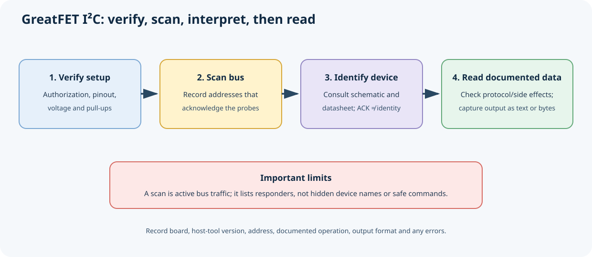

# 🦡 GreatFET One (with Add-On Boards)

## 🎯 Purpose
Extensible open-source hardware tool from Great Scott Gadgets for I2C/SPI bus scanning and manipulation, JTAG debugging, logic analysis, and advanced USB protocol reverse engineering - using Python scripting on the host.

## ⚙️ Function
Python-based host toolchain (`greatfet` pip package) communicates with the GreatFET One board. Add-on boards (Neighbor boards) extend functionality. Primary commands: `greatfet_info` (device check), `greatfet_i2c -z` (I2C bus scan), `greatfet_i2c -a <addr> -r <bytes>` (read device registers).

## 🏆 Goal
Programmatically interact with target hardware over I2C, SPI, JTAG, and USB from a Python script - enabling scripted, automated protocol reverse engineering without writing firmware.

## 📋 When to Use
- Scanning an authorized I2C bus to identify addresses that acknowledge the scan
- Scripting repeatable read/write sequences to a chip under test
- USB protocol reverse engineering (using the GreatFET's Facedancer capability)
- When Bus Pirate's interactive mode isn't enough and scripted automation is needed

## 📖 Description
The GreatFET One is the next-generation GoodFET, designed by Great Scott Gadgets. It is an extensible, open-source hardware tool tailored for hardware hackers. With its add-on boards, it can be used for logic analysis, I2C/SPI manipulation, JTAG debugging, and advanced USB reverse engineering.



*An address response is not device identification. Confirm electrical conditions and device behavior before reading or writing.*

## 🔗 Reference Links
* **Product Link:** [GreatFET One (Great Scott Gadgets)](https://greatscottgadgets.com/greatfet/one/)
* **Reference Material:** [GreatFET Wiki & Documentation](https://github.com/greatscottgadgets/greatfet/wiki)

## 🚀 Step-by-Step Example: Setup, Connect, and Use
**Scenario: Inspecting an authorized I2C target whose electrical requirements and datasheet are known.**

### 1. Setup
* **Prerequisites:** Ensure you have Python 3 and `pip` installed on your host machine.
* **Install Software:** Install the GreatFET host tools via your terminal:
   ```bash
   pip3 install --upgrade greatfet
   ```
* **Firmware Update:** Plug in the GreatFET One and flash the latest firmware:
   ```bash
   greatfet_update
   ```

### 2. Connect
* **USB:** Plug the GreatFET One into your PC.
* **Wiring to Target:** Confirm target ownership/authorization, board pinout, target I/O voltage, pull-up arrangement and whether the target can safely share the GreatFET's bus before connecting. Consult the board documentation and target datasheet. Then connect:
  * GreatFET `GND` ➡️ Target `GND`
  * GreatFET `I2C SDA` (Pin J2_P11) ➡️ Target `SDA`
  * GreatFET `I2C SCL` (Pin J2_P13) ➡️ Target `SCL`

### 3. Use
* Power on your target IoT device.
* Verify the GreatFET is recognized by your host PC:
   ```bash
   greatfet_info
   ```
* The I2C scan command reports addresses that acknowledge its probes; it does **not** identify devices or prove that an address is safe to access. Scanning generates bus traffic, so check the target datasheet and use only on an authorized bus:
   ```bash
   greatfet_i2c -z
   ```
* After confirming the address and read behavior in the target datasheet, the current `greatfet_i2c` CLI accepts `-a/--address` and `-r/--read`; it has no `-f` output-file option. A CLI read prints a Python bytes representation to standard output:
   ```bash
   greatfet_i2c -a 0x50 -r 256 > i2c-read.txt
   ```
  This captures text, not a raw binary dump, and the bytes read depend on the device's current protocol/state. Do not assume this is a memory dump or harmless on every device. See the [upstream CLI source](https://github.com/greatscottgadgets/greatfet/blob/main/host/greatfet/commands/greatfet_i2c.py) for supported options and behavior.

---

## Related Files
- [README.md](README.md) - HardwareHacking section index: all tools and chapter guide
- [BusPirate.md](BusPirate.md) - Similar multi-protocol tool; Bus Pirate is interactive, GreatFET is script-driven
- [JTAGulator.md](JTAGulator.md) - Discovers pin assignments; GreatFET then interfaces via the identified JTAG/I2C pins
- [LA1010.md](LA1010.md) - Logic analyzer to verify GreatFET's I2C/SPI transactions on the wire
- [Chapter2.md](Chapter2.md) - Electrical fundamentals: I2C addressing, SPI modes, and bus topology explained
