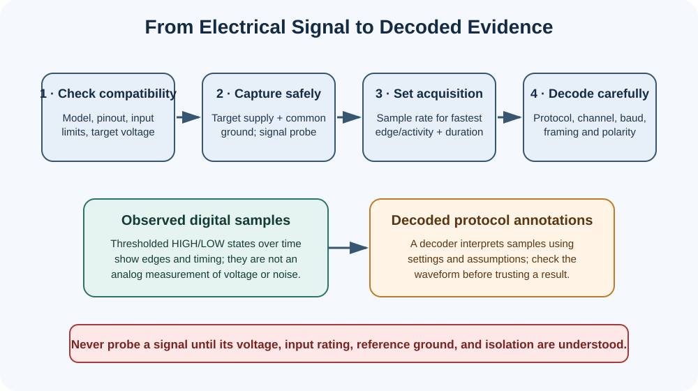

# 🔎 HiLetgo USB Logic Analyzer (Model-Dependent)

_Last reviewed: 2026-11-18_

## 🎯 Purpose
A low-cost digital logic analyzer sold under the HiLetgo name can be useful for observing digital signals and testing protocol-decoder workflows. Treat the name and “Saleae clone” label as insufficient to establish the exact circuit, channel count, sample rate, voltage limits, or driver compatibility. Check the unit’s markings, USB identifiers, vendor material, and the relevant sigrok device entry.

## ⚙️ Function
A logic analyzer samples input voltages and classifies them as digital HIGH or LOW according to its input thresholds. Compatible devices can work with PulseView through sigrok drivers such as `fx2lafw`, but support depends on the unit’s actual chipset and USB ID. Some commonly sold FX2-based analyzers are listed by sigrok as 8-channel devices with a nominal maximum sample rate of 24 MHz; that specification does not apply automatically to every HiLetgo-branded unit.

The analyzer is not an oscilloscope: it does not show analog voltage quality, ringing, overshoot, or noise. Protocol decoders interpret captured samples according to settings such as baud rate, polarity, clock edge, and framing. A plausible decode can still be wrong.

## 🏆 Goal
Capture a short, relevant digital signal safely, then validate any decoded result against the waveform and the target’s documented interface.

## 📋 When to Use
- Observe UART output on an authorized, powered target.
- Check digital SPI or I²C timing when the device and target voltage are compatible.
- Learn PulseView capture and decoder settings with a known low-voltage test circuit.
- Use another instrument when analog signal quality, isolation, or out-of-range voltage is in question.

## 📖 Description

### Capture and interpretation boundaries

*Conceptual workflow. The analyzer shows thresholded digital states; protocol annotations depend on decoder settings and do not establish the meaning or security impact of traffic.*

## 🔗 Reference Links
- [sigrok FX2-based device support list](https://sigrok.org/wiki/Fx2lafw) — device compatibility varies by chipset and USB identifiers
- [PulseView and sigrok downloads](https://sigrok.org/wiki/Downloads)
- [sigrok Windows driver guidance](https://sigrok.org/wiki/Windows) — install the driver appropriate to the actual device; Zadig/WinUSB is not a universal one-click fix
- [sigrok logic-analyzer getting started guide](https://sigrok.org/wiki/Getting_started_with_a_logic_analyzer)
- [PulseView user manual](https://sigrok.org/doc/pulseview/0.4.2/manual.html) — acquisition and decoder troubleshooting

## 🚀 Example: Capture a UART Transmit Signal

This read-only example is for an owned or explicitly authorized, low-voltage target. The target is powered separately; the logic analyzer is not a target power supply.

### 1. Identify and prepare the device
- Confirm the analyzer’s channel labels, input voltage limits, threshold behavior, and supported driver from its documentation or a known compatible-device entry.
- Install PulseView from the sigrok download page. On Windows, follow sigrok’s device-specific driver steps only after identifying the analyzer’s USB device; changing a driver can affect other software that uses the same interface.
- In PulseView, scan for supported devices and select the driver reported for the actual hardware. Choose `fx2lafw` only if the unit is an FX2-compatible analyzer; do not select a genuine Saleae driver merely because a listing calls the unit a clone.

### 2. Connect safely
- Power the target through its normal supply and identify ground and the UART transmit pin from documentation or measurements.
- Connect analyzer ground to target ground, then connect CH0 to the target’s TX signal. Do not connect the analyzer to a voltage outside the verified input range or to mains/high-energy circuits. If the PC/analyzer ground could create an unsafe connection, stop and use a properly rated isolated measurement setup.
- Do not connect analyzer VCC or use a signal clip as a power lead. Keep wires short and avoid disturbing the target’s normal operation.

### 3. Capture and decode
- Select the channels needed and choose a supported sample rate based on the fastest signal activity and the device’s actual limits. The PulseView manual gives 4–5 samples per fastest protocol activity as a typical minimum for decoding; this is a starting point, not a guarantee. Longer captures and higher rates may reduce available capture duration.
- Run a capture around a known, authorized startup or test event. Use an available trigger or a shorter capture window when the event is brief.
- Add the UART decoder and assign RX to CH0. Set baud rate, data bits, parity, stop bits, and inversion to match the target. Derive a baud-rate estimate from measured bit timing when needed; do not rely on 115200 as a universal default.
- Compare decoder annotations with the raw waveform. If results look inconsistent, check sample rate, threshold compatibility, signal polarity, baud rate, and framing. Readable text is evidence of a decoded byte stream, not proof that a shell is accessible or privileged.

---

## Related Files
- [README.md](README.md) - HardwareHacking section index and chapter guide
- [LA1010.md](LA1010.md) - Another digital analyzer with model-specific specifications and software
- [BitPirate.md](BitPirate.md) - UART adapter guidance for a separately confirmed serial interface
- [BusPirate.md](BusPirate.md) - Supported protocol tool for authorized SPI/I²C experiments
- [Chapter2.md](Chapter2.md) - Electrical fundamentals, UART framing, and logic-level compatibility
