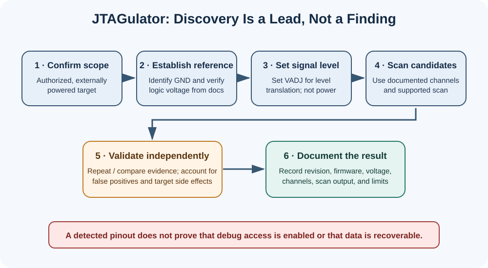

# 🕷️ JTAGulator

_Last reviewed: 2026-11-18_

## 🎯 Purpose
JTAGulator is an open-source tool that assists in identifying candidate on-chip debug interfaces on a target board. Current official materials describe scans for JTAG/IEEE 1149.1, ARM SWD, and UART. It automates pin-permutation checks; it does not guarantee a valid pinout, enable a locked interface, or extract firmware by itself.

## ⚙️ Function
The tool connects selected target test points, vias, pads, or header pins to its channels and uses target-appropriate signal levels to test supported interface patterns. A scan result is a candidate that needs independent validation. Unknown pins may have other functions, and scan activity can alter target behavior or produce false positives.

JTAGulator's VADJ configures I/O level translation. It is **not a target power output**: power the target through its normal, verified supply. Share ground and set VADJ to the target's documented/measured logic voltage. Hardware revisions differ; check the current documentation for supported range, pinout, and channel limits.

## 🏆 Goal
Help an authorized assessor narrow down candidate debug-interface pins and record evidence carefully before using a separate, compatible debugger or serial tool.

## 📋 When to Use
- Investigating documented or owner-approved test points and debug headers.
- Finding candidate JTAG, SWD, or UART pin assignments before confirming them with compatible equipment.
- Learning interface discovery on a known, dedicated lab board.

## 📖 Description
Designed by Joe Grand, JTAGulator is now manufactured and maintained by EXPLIoT. Current official product information lists 24 channels and an adjustable I/O range of 1.4–3.3 V; confirm the exact hardware revision and its documentation before use. Input protection does not make unknown connections risk-free. The project documentation notes that channel circuitry can affect signal levels, and a candidate scan match can be a false positive.

### Discovery and validation flow

*Conceptual workflow. VADJ sets signal translation levels; the target is powered separately. A scan hit is a lead to verify, not proof that debug access is enabled.*

## 🔗 Reference Links
- [JTAGulator project information and documentation links](https://grandideastudio.com/portfolio/security/jtagulator/) — design and original project information
- [EXPLIoT JTAGulator product and support page](https://expliot.io/jtagulator/) — current manufacturer, revision, feature, and documentation information
- [Official quick start guide](https://github.com/grandideastudio/jtagulator/wiki/Quick-Start) — serial settings, VADJ, ground, channel connection, and cautions
- [Official command reference](https://github.com/grandideastudio/jtagulator/wiki/Commands)
- [Official firmware repository](https://github.com/grandideastudio/jtagulator)

## 🚀 Step-by-Step Example: Candidate JTAG Pin Discovery

Use only on a target you own or have written authorization to assess. This example discovers candidate pins; it does not attempt to bypass protections or read target contents.

### 1. Prepare the bench
- Identify the target model and revision. Review its board documentation and component datasheets for ground, test-point functions, and logic voltage.
- Power the target from its normal supply. JTAGulator does not power the target.
- Measure or verify target I/O voltage before connecting signals. Use JTAGulator's `V` command to set VADJ to the appropriate documented value for level translation; VADJ should not be connected to the target board.
- Connect a shared ground. Confirm the target is stable and that the selected test points are appropriate. Do not probe power rails or pins whose functions and voltage are unknown.
- Connect the selected candidate signal points to sequential JTAGulator channels, starting at CH0, following the current model's connector documentation.

### 2. Run a documented scan
- Connect JTAGulator to the host and open a serial terminal at **115200 baud, 8 data bits, no parity, 1 stop bit** (8N1), as specified by the official quick start.
- Follow the prompt to the JTAG functions. An IDCODE scan tests candidate signal combinations; the exact menu and command flow can vary with firmware. Use `H` for the unit's command menu, then follow the current official guide. For firmware that uses the documented JTAG submenu, `I` runs an IDCODE scan; `J` combines scan functions.
- Restrict the scan to the channels actually connected. Stop if the target behaves unexpectedly, heats, resets repeatedly, or shows other signs of electrical stress.

### 3. Validate and report
- Treat every detected mapping as provisional. Repeat the scan and compare with board or chip documentation. False positives and nonstandard or disabled debug implementations are possible.
- Before attaching a debugger, verify the candidate pinout, voltage compatibility, reset requirements, and tool configuration. Debug access can remain locked or restricted even when pins are identified.
- Record the hardware revision, firmware version, target state, measured voltage, channels used, command, and scan output. Report only what the evidence supports.

---

## Related Files
- [README.md](README.md) - HardwareHacking section index and chapter guide
- [BusPirate.md](BusPirate.md) - USB serial protocol tool; not a JTAG debugger
- [BitPirate.md](BitPirate.md) - UART adapter guidance for a separately confirmed serial console
- [HiLetgo.md](HiLetgo.md) - Logic analyzer reference for observing digital signals
- [Chapter1.md](Chapter1.md) - Threat modeling for physical and debug-interface access
- [Chapter2.md](Chapter2.md) - Electrical fundamentals, logic levels, and interface basics
