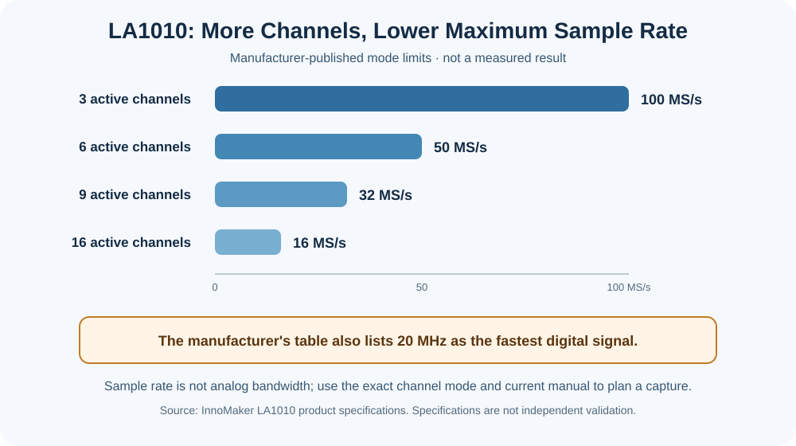

# 🔍 InnoMaker LA1010 USB Logic Analyzer

_Last reviewed: 2026-11-18_

## 🎯 Purpose
The InnoMaker LA1010 is a 16-input-channel USB digital logic analyzer for capturing and decoding supported digital protocols. Its maximum sample rate depends on how many channels are active. Use the detailed per-channel specifications, not a headline “100 MHz/16 channel” description.

## ⚙️ Function
The manufacturer's LA1010 specification table lists maximum rates of 100 MS/s at 3 active channels, 50 MS/s at 6, 32 MS/s at 9, and 16 MS/s at 16 channels. The same table lists 20 MHz as the fastest digital signal. A sample rate is not analog bandwidth: this instrument classifies input levels as digital states and cannot show ringing, overshoot, or other analog signal quality.

### Active-channel tradeoff

*Specification summary from the manufacturer's detailed table; not a measured or independently validated capture. Consult the current manual and software for exact operating limits.*

## 🏆 Goal
Capture a bounded, authorized digital transaction with the appropriate channel mode, sample rate, threshold, and trigger, then compare protocol annotations against the raw waveform.

## 📋 When to Use
- Capture up to 16 digital lines when the required per-channel sampling rate fits the documented mode.
- Observe SPI, I²C, UART, and other protocols supported by the installed Kingst software.
- Compare a controller/peripheral exchange during a known, owner-approved test event.
- Use an oscilloscope or a properly rated differential/isolated instrument when analog quality or unsafe ground connections are a concern.

## 📖 Description
The LA1010 is supplied for use with Kingst software. Check the model and its current documentation before connecting it: advertised input ranges, thresholds, sample rates, and capture depth are instrument-specific. Do not treat an input-voltage rating as permission to clip onto an unknown or hazardous circuit. The analyzer is not an isolated probe or a power source for the target.

## 🔗 Reference Links
- [InnoMaker LA1010 product specifications](https://www.inno-maker.com/product/la1010/) — detailed table separates the rate by active-channel count
- [InnoMaker Kingst logic-analyzer software repository](https://github.com/INNO-MAKER/Logic-Analyzer-KS)
- [Kingst download page](https://www.qdkingst.com/en/download)
- [PulseView manual: sampling and decoder troubleshooting](https://sigrok.org/doc/pulseview/0.4.2/manual.html) — general digital-capture principles, not LA1010-specific specifications

## 🚀 Example: Capture a Short SPI Transaction

This passive example is for an owned or explicitly authorized, low-voltage target. The target is powered through its normal supply; the LA1010 only observes.

### 1. Prepare
- Verify the exact analyzer model, cable/channel labels, input limits, threshold settings, supported software, and channel-dependent rate limits in the current manufacturer documentation.
- Install the manufacturer-supported Kingst software for your operating system. Do not assume that sigrok/PulseView supports this model just because another analyzer works with it.
- Identify the target ground and SPI signals from documentation or prior measurements. Confirm the circuit and analyzer/host ground relationship before attaching the clips.

### 2. Connect without changing the target
- Connect analyzer ground to the target's signal ground only when that connection is safe for the target and host.
- Connect CH0 to CS#, CH1 to clock, CH2 to MOSI, and CH3 to MISO. These channel choices are arbitrary; record the mapping used.
- Do not connect power-output pins or use the analyzer to power the target. Stop if a signal voltage, ground reference, or isolation condition is unknown.

### 3. Capture and review
- Enable only the channels needed for this transaction. Select a sample-rate mode that supports the active-channel count and has enough samples per fastest signal activity for the question being measured. The manufacturer's detailed LA1010 table lists 100 MS/s for 3 active channels but only 16 MS/s for all 16; it also lists a 20 MHz fastest digital signal. If the capture requires more, choose a suitable instrument.
- Select a short record window or trigger around a known transaction. The supported depth and useful duration depend on software settings and acquisition mode; do not assume a fixed “10M samples” setup.
- Add the SPI decoder and assign CS#, clock, MOSI, MISO, clock polarity, and clock phase according to the target documentation or observed waveform.
- Check each decoded frame against the underlying edges and levels. A decoder annotation is an interpretation of digital samples; it does not prove what a value means to the device or whether a security control is effective.

---

## Related Files
- [README.md](README.md) - HardwareHacking section index and chapter guide
- [HiLetgo.md](HiLetgo.md) - Model-dependent low-cost digital-analyzer guidance
- [BusPirate.md](BusPirate.md) - Supported protocol tool for authorized SPI/I²C experiments
- [Chapter2.md](Chapter2.md) - Electrical fundamentals, interface timing, and measurement limits
