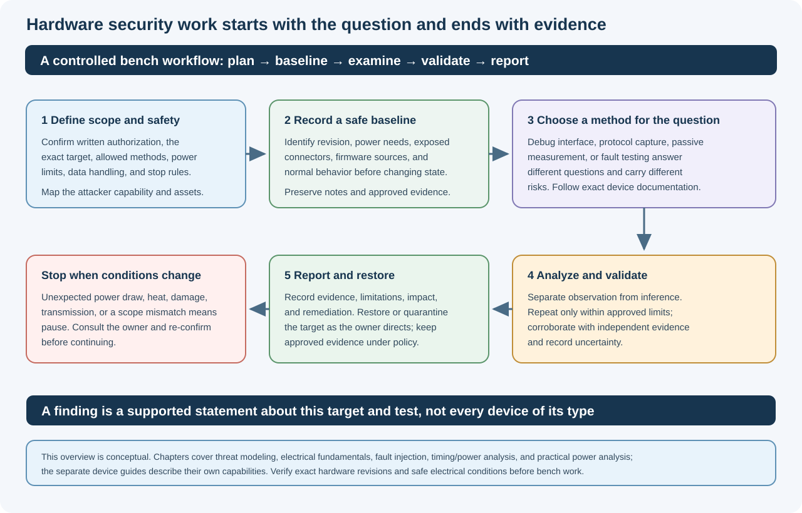
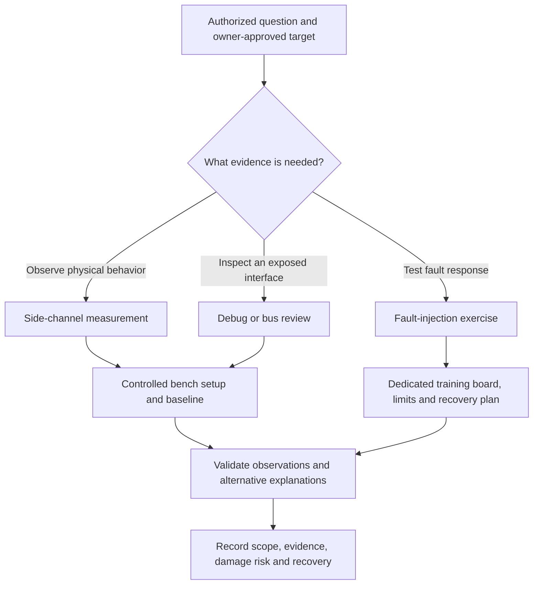

# 🔧 Hardware Hacking

<div align="center">

**Physical and electronic attack techniques against embedded systems, microcontrollers, SoCs, and cryptographic hardware**

*Part of the [ULTIMATE CYBERSECURITY MASTER GUIDE](../README.md)*


</div>

---

**Adjacent embedded-security research:** [Awesome Embedded and IoT](https://github.com/fkie-cad/awesome-embedded-and-iot-security), [h4cker hardware](https://github.com/The-Art-of-Hacking/h4cker/tree/master/cybersecurity-domains/hardware-embedded-security) and [project routing](../Documentation/awesome-hacking-collections-integration.md).

## Expanded Device & Firmware Coverage

| Resource | Description / Boundary |
|---|---|
| [Device Firmware List](../Documentation/device-firmware-list.md) | Board-first choices and target limitations. |
| [The Black Wire Maker's Technical Reference Guide](https://valleytech-black-wire-guide.pages.dev/) | Board pinouts, GPIO diagrams, wiring references and manufacturer documentation for Raspberry Pi, ESP32, Arduino and related embedded boards. |
| [ESP Terminator](../Documentation/esp-terminator.md) | General catalog/uploader selection and recovery checks. |

## Dedicated Firmware Labs

| Resource | Role & Compatibility Boundary |
|---|---|
| [ESP32 Bit Pirate](./esp32-bit-pirate.md) | S3 firmware install and a read-only UART bench baseline; distinct from Bus Pirate hardware. |
| [Pico-Ducky Lab](./pico-ducky-lab.md) | Pico setup mode and a fixed-text offline HID demonstration. |
| [Flipper Expansion Board Labs](../Documentation/flipper_zero_guide.md#flipper-zero-expansion-boards-selection-setup--field-assessment-labs) | CC1101, nRF24/Si24R1, AWOK Dual C5, Realtek BW16, Poltergeist, RF-safe wiring & eight validation labs. |
| [Evil-M5 Field Labs](../Documentation/evil_m5.md#evil-m5-firmware-qualification--authorized-deployment-labs) | Cardputer/ADV and other M5Stack target setup, eight safe RF/BLE/HID and defensive lab exercises. |
| [LAB5 MonsterC5 / JanOS](../Documentation/microcontroller_wifi_testing.md#lab5-c5-monster--projectzero-janos-field-assessment) | Distinct C5 radio, Cardputer/Tab5/Flipper apps, verified update path and eight tests. |

## Firmware Catalog & Installers

| Resource | Description |
|---|---|
| [ESP32 & Related Firmware Catalog](../Documentation/esp32-security-firmware-catalog.md) | Primary upstream projects, supported targets, use-cases & dated activity notes |
| [Firmware Web Flashers](../Documentation/firmware-web-flashers.md) | Dedicated installers plus a separate multi-device/multi-firmware reference |

## 🎯 Purpose
Index and navigation hub for the Hardware Hacking section - covering physical and electronic attack techniques against embedded systems: JTAG/SWD/UART debug access, fault injection (voltage, clock, EM, laser), side-channel analysis (SPA, DPA, CPA), firmware extraction, and the hardware tools used in each category.

## ⚙️ Function
Links to five chapter guides (threat modeling, electrical fundamentals, fault injection, power analysis theory, power analysis practicals) and seven device guides (Bus Pirate, Bit Pirate, GreatFET One, JTAGulator, LA1010 logic analyzer, HiLetgo logic analyzer, T48 IC programmer). Includes attack category taxonomy, bench equipment reference, and tool ecosystem overview.

## 🏆 Goal
Serve as the entry point for hardware security work - helping practitioners find the right chapter or tool guide for their current task without reading the full guide linearly.

## 📋 When To Use
- Starting a hardware security assessment: choose the right chapter and tool for your target
- Identifying which hardware tool to use for a given protocol or attack type
- Onboarding to hardware hacking: read chapters in order, then reference tool files for specific devices

---

## 📋 Table Of Contents

- [Overview](#-overview)
- [Hardware Security Case Studies](#high-profile-hardware-security-case-studies)
- [Chapter Guides](#-chapter-guides)
- [Device Setup & Usage Guides](#-device-setup--usage-guides)
- [Attack Categories](#-attack-categories)
- [Bench Equipment Reference](#-bench-equipment-reference)
- [Tool Ecosystem](#️-tool-ecosystem)
- [Security & Legal Disclaimer](#️-security--legal-disclaimer)
- [Resources](#-resources)

---

## 🎯 Overview

Hardware security assessment includes physical access, debug interfaces, firmware, power traces, timing, and electromagnetic emissions. Physical access may create opportunities that are unavailable through a remote network path, but actual risk depends on the target design, exposed interfaces, attacker resources, and existing controls.

This section organizes study from threat modeling and electrical fundamentals through fault injection and side-channel analysis. Use the chapter and device-specific guides for detailed material, and check it against the exact target and documentation.



*Conceptual overview: define scope and safety limits first, establish a non-destructive baseline, choose a method for the question, separate observation from inference, then report and restore under the owner's direction.*

**What You'll Find Here:**
- 🎯 Hardware threat modeling: Attacker profiles, asset mapping, countermeasure frameworks
- ⚡ Electrical fundamentals: Logic levels, communication interfaces (UART, SPI, I²C, JTAG/SWD), measurement equipment
- 💥 Fault injection attacks: Voltage glitching, clock glitching, EMFI, laser fault injection, body biasing
- 📊 Side-channel analysis: Timing attacks, Simple Power Analysis (SPA), Differential Power Analysis (DPA)
- 🔬 Power analysis practicals: Measurement setup, trace acquisition, filtering, CPA implementation, visualization
- 🛡️ Countermeasures: Silicon-level, firmware-level, and physical protections
- 📟 **Device-specific guides**: Setup, connection, and usage tutorials for common hardware hacking tools.

---

## High-Profile Hardware Security Case Studies

The [Case Studies Index](../CaseStudies/README.md) gives sourced reports with research timelines, practical limitations and **defensive** responses. Use it alongside the bench guides; a disclosed flaw must not be treated as proof that the particular equipment in front of you is affected.

| Case Study | Relevant Hardware Boundary | Complementary Guide |
|---|---|---|
| [Unsaflok — Three Million Hotel Locks](../CaseStudies/hardware/unsaflok-3m-hotel-locks.md) | RFID credential trust & room authorization | [RFID/NFC](../SDR/rfid.md) |
| [Onity Locks, 2012](../CaseStudies/hardware/onity-locks-2012.md) | Accessible service ports & firmware authorization | [Electrical Interfaces](Chapter2.md) |
| [Tesla Model S Key Fobs, 2018](../CaseStudies/hardware/tesla-model-s-key-fob-2018.md) | RF protocol and key lifecycle | [SDR & RF](../SDR/README.md) |
| [EUCLEAK / YubiKey, 2024](../CaseStudies/hardware/eucleak-yubikey-2024.md) | EM side-channel cryptographic leakage | [Timing & Power Analysis](Chapter4.md) |
| [DirecTV DSS Cards & Black Sunday](../CaseStudies/hardware/directv-dss-smart-card-black-sunday.md) | Smart-card authorization & countermeasure recovery | [Threat Modeling](Chapter1.md) |
| [Xerox DocuColor Tracking Dots](../CaseStudies/hardware/xerox-docucolor-machine-identification-code.md) | Hidden physical-output metadata & privacy | [OPSEC](../OPSEC/README.md) |

---

## 📂 Chapter Guides

| Chapter | Topic | Description |
|---------|-------|-------------|
| **[Chapter1.md](./Chapter1.md)** | Threat Modeling | Attacker profiles, asset categories, objective-to-attack mapping, countermeasure frameworks (silicon/firmware/physical), threat model template |
| **[Chapter2.md](./Chapter2.md)** | Electrical Fundamentals | Ohm's Law, logic levels, communication interfaces (UART, SPI, I²C, JTAG, SWD), oscilloscopes, logic analyzers, shunt resistors, signal integrity |
| **[Chapter3.md](./Chapter3.md)** | Fault Injection Attacks | Voltage glitching, clock glitching, EMFI, laser fault injection, body biasing, injection point identification, parameter sweeping, fault mapping |
| **[Chapter4.md](./Chapter4.md)** | Timing & Power Analysis | Side-channel concepts, timing attacks (string comparison, RSA, cache), Simple Power Analysis (SPA), Differential Power Analysis (DPA) with working code |
| **[Chapter5.md](./Chapter5.md)** | Power Analysis Practicals | Measurement setup, trace acquisition, filtering (low-pass, band-pass), trace alignment (SAD, cross-correlation), CPA implementation, visualization, TVLA, template attacks |

### Reading Order

New to hardware security?
  └─> Start with Chapter 1 (Threat Modeling), then Chapter 2 (Electrical Fundamentals)
  └─> Use Chapters 4–5 to learn measurement concepts and evidence limits
  └─> Treat Chapter 3 fault injection as a potentially destructive specialist exercise;
      begin only with an owner-approved training board and documented electrical limits

Experienced practitioner?
  └─> Select the relevant chapter for the authorized question
  └─> Review scope, target compatibility, safety controls and recovery before bench work

### Choosing a Method



*Conceptual method-selection diagram. Side-channel measurements may reveal sensitive data; interface access may change device state; fault injection intentionally perturbs operation and may permanently damage hardware.*

---

## Hak5 USB & Wireless Assessment Workflows

The existing [Bash Bunny payload guide](../Scripts/Bash/BashBunny/README.md#authorized-field-assessment-labs--deployment-examples), [USB Rubber Ducky compilation guide](../Scripts/Ducky/README.md#authorized-hid-injection-field-exercises), and [WiFi Pineapple Mark VII section](../Wardriving/README.md#wifi-pineapple-mark-vii--authorized-wireless-security-assessment) now include authorized deployment labs, detection, troubleshooting and reporting. They remain in their established sections to avoid duplicating instructions. [Pico-Ducky](./pico-ducky-lab.md) is distinct from Hak5 hardware.

### Hak5 Payload Ecosystem: Official & Side-Loaded Code

**Device formats are not interchangeable.** The [WiFi Pineapple Pager](../Wardriving/README.md#wifi-pineapple-pager--payloads-sideloading--defensive-labs) uses `payload.sh` and Pager-specific UI/events. The [Mark VII](../Wardriving/README.md#optimized-mark-vii-setup--campaign-configuration) uses Campaigns and Modules. [Bash Bunny](../Scripts/Bash/BashBunny/README.md) and [Rubber Ducky](../Scripts/Ducky/README.md) have different USB runtimes. Other Hak5 devices have separate official payload repositories and firmware; a matching command name is not sufficient for compatibility.

| Platform | Official source / format | Safe first-use and sideload boundary |
|---|---|---|
| **WiFi Pineapple Pager** | [Official User/Recon/Alert payload library](https://github.com/hak5/wifipineapplepager-payloads); on-device `payload.sh` | Copy a single reviewed local script to the correct **Pager** payload type, start with a no-radio message; do not use Mark VII campaigns |
| **WiFi Pineapple Mark VII** | [Campaigns](https://documentation.hak5.org/wifi-pineapple/ui-overview/campaigns) / [Modules](https://documentation.hak5.org/wifi-pineapple/ui-overview/modules) | Prefer built-in monitor-only campaign; validate module code, API version, package and UI support before third-party installs |
| **Bash Bunny / Mark II** | [Hak5 Bash Bunny payload library](https://github.com/hak5/bashbunny-payloads); Bash `payload.txt` with `ATTACKMODE`, `QUACK` | Review full source/dependencies, copy a benign HID marker into a single staged switch; match device generation and firmware |
| **USB Rubber Ducky (modern/legacy)** | [Official source library](https://github.com/hak5/usbrubberducky-payloads); source `payload.txt` compiled to `inject.bin` | Compile for the **actual** hardware/DuckyScript version and keyboard layout; verify a marker in a blank editor |
| **Shark Jack** | [Official Shark Jack library](https://github.com/hak5/sharkjack-payloads); model-specific Bash/DuckyScript source | Use a spare isolated Ethernet test bench, not a client's switch; review DHCP, routing and any scan/transmit behavior |
| **Shark Jack Display** | [Official Display library](https://github.com/hak5/sharkjackdisplay-payloads); `payload.txt` | Distinct display/menu and payload flow; check exact product revision and `NETMODE` handling before copying sources |
| **Packet Squirrel** | [Official Packet Squirrel library](https://github.com/hak5/packetsquirrel-payloads); `payload.txt` | Inline Ethernet changes the traffic path; test with dedicated two-port lab link and rollback, **not** real production traffic |
| **Key Croc** | [Official Key Croc library](https://github.com/hak5/keycroc-payloads); `payload.txt` | In-line keyboard hardware can capture sensitive input; baseline test only with a synthetic user and approved marker |
| **LAN Turtle** | [Hak5 LAN Turtle documentation](https://docs.hak5.org/) and firmware modules (check exact model) | Separate USB-Ethernet remote administration tooling; no assumption that Shark Jack payload scripts run here |
| **Signal Owl / Screen Crab / Plunder Bug** | [Hak5 documentation index](https://documentation.hak5.org/) | Separate hardware and capture/runtime requirements. Not every Hak5 device has a community `payload.txt` library |

**Popular GitHub collections (curated, not automatically runnable):** [Rubber Ducky projects ranked by relevance, stars & compatibility](../Scripts/Ducky/README.md#curated-github-payload-projects--popularity-compatibility--trust) and [Bash Bunny payload collections & maintenance review](../Scripts/Bash/BashBunny/README.md#curated-github-bash-bunny-payload-collections--compatibility). The guides identify original/archived repositories, distinguish Flipper/O.MG/Arduino references from Hak5 firmware, and explain pinning, code inspection, benign lab acceptance and rollback.

**Important:** the upstream sample collections may include interception, credential harvesting, command-and-control, persistence or disruptive network activity. **Do not bulk-install, automatically run or endorse** all samples. Prefer a fixed-text HID marker, an owned test AP inventory, or an isolated dummy Ethernet link, and only approve more intrusive testing under a separate signed plan.

#### Common Side-Load Review & Rollback Workflow

1. **Select exact platform/firmware and model.** Record payload interpreter, USB/network modes, switch position and the official source repository or versioned download.
2. **Pin a commit/hash**, inspect the source (including bundled shell/PowerShell/Python executables and compressed archives), and verify license, external connections, credentials, dependencies, package installation, persistence, scheduled tasks and elevated operations.
3. **Decide authorization class:** local benign, receive-only survey, active association/network traffic, credential/packet interception, persistent modification. Only benign exercises are default-approved.
4. **Isolate on a known-good bench:** offline disposable workstation with blank editor for HID; lab AP/phone for Wi-Fi; two-device synthetic VLAN/link for network appliances. Snapshot or document rollback before execution.
5. **Stage one payload** using the **device's verified deployment directory**. Do not assume a common root directory or file extension across Hak5 models. On USB devices, safely eject in arming/storage mode; avoid flashing the payload onto firmware partitions.
6. **Observe once:** record USB enumeration, network/routes, emitted RF, local output, log timestamps, and intended versus actual destination. Stop on unexpected transmission, third-party interaction or changes to default route/DNS.
7. **Corroborate:** use host endpoint events/EDR, AP-controller records, Kismet/Wazuh, test switch logs or known USB interface properties. A script exiting zero does not prove any vulnerability.
8. **Rollback, inventory and redact:** stop payloads, disconnect, restore firmware/network configuration, rotate synthetic credentials, hash and securely store allowed artifacts, remove unnecessary copies from the device.

#### Practical Safe Evaluation Examples For Other Hak5 Devices

| Device | Controlled exercise | Expected evidence |
|---|---|---|
| Shark Jack / Shark Jack Display | Connect only to **your lab switch** and validate port link, DHCP address and local interface status without scanning other addresses | Port VLAN/link state, assigned lab IP, switch/host logs and restore |
| Packet Squirrel | Place between two **owned** lab Ethernet endpoints; verify links work in pass-through mode and observe what a deliberate disconnect does | End-to-end link checks, physical link indicators, clean bypass/rollback |
| Key Croc | Connect a **disposable keyboard** and test computer with a synthetic local-only username/marker; keep capture/matches disabled unless essential and approved | Host recognized keyboard, synthetic text, source review and no retained secrets |
| Bunny / Ducky | Type a fixed harmless phrase into a focused blank editor with no terminal or browser open | USB class enumeration, marker, no privilege changes or network transfer |
| Mark VII / Pager | Observe a single owned synthetic AP, then independently verify WIDS controller alert behavior without active impersonation | Correct BSSID/channel/security, actual source events and sanitized result |

#### Model-Specific Troubleshooting

| Symptom | Investigate |
|---|---|
| Payload ignored | Wrong hardware format, firmware interpreter, file path/case, permissions or wrong switch/category |
| Payload appears but errors | Missing device helper functions, incompatible DuckyScript generation, OS/tool dependency or bad CRLF endings |
| OS sees new keyboard unexpectedly | Wrong USB class / `ATTACKMODE` selected; disconnect and restore known-good switch |
| LAN traffic changes | `NETMODE`/routing/bridge behaviour and link negotiation; stop inline device and restore direct cable |
| Unexpected AP or upload | Disable PineAP/alert or event action, disconnect management uplink and audit all scripts |
| Data not saved | Incorrect storage partition, missing media, no completed flush or script path assumption |
| Firmware update breaks payload | Firmware/API changed, packages removed, library helpers changed; restore pinned compatible version |

**Primary sources:** [Hak5 official payload repositories](https://github.com/hak5) · [Pager source](https://github.com/hak5/wifipineapplepager-payloads) · [Shark Jack](https://github.com/hak5/sharkjack-payloads) · [Packet Squirrel](https://github.com/hak5/packetsquirrel-payloads) · [Key Croc](https://github.com/hak5/keycroc-payloads). Do not confuse a source repository's approved pull request with a complete firmware or security certification.

## 📟 Device Setup & Usage Guides

**M5StickC Plus2:** [HackStarterPack integration and safe lab](./m5stickc-plus2-hackstarterpack.md) covers the exact board, CC1101 pinout, benign IR/BLE/HID tests and source review.


For ESP32/Flipper radio accessories used specifically for authorized mapping, see the [Wardriving platform index](../Wardriving/README.md), [Scout Lite + SigRoam](../Wardriving/sigroam-scout-lite.md), [Marauder](../Wardriving/esp32-marauder.md), and [AWOK Dual C5 + Biscuit](../Wardriving/awok-dual-c5-biscuit.md). These cover board revisions, firmware roles and GPS/log locations.


Detailed documentation, reference links, and step-by-step usage tutorials for specific hardware hacking tools on your bench:

| Device Guide | Description |
|--------------|-------------|
| **[BusPirate.md](./BusPirate.md)** | Open-source hacker multi-tool for interfacing with I2C, SPI, UART, and JTAG. |
| **[GreatFETone.md](./GreatFETone.md)** | Extensible open-source hardware tool for logic analysis, I2C/SPI manipulation, and USB RE. |
| **[JTAGulator.md](./JTAGulator.md)** | Tool for systematic pinout discovery on authorized hardware; possible results depend on target design and enabled interfaces. |
| **[BitPirate.md](./BitPirate.md)** | Serial interface bridge for embedded systems recon, fuzzing, and debugging. |
| **[LA1010.md](./LA1010.md)** | Setup and usage for the Innomaker LA1010 100MHz 16-channel USB Logic Analyzer. |
| **[HiLetgo.md](./HiLetgo.md)** | Setup and usage for the HiLetgo 24MHz 8-channel USB Logic Analyzer (Saleae clone). |
| **[T48_TL866-3G.md](./T48_TL866-3G.md)** | Programmer guide; supported parts, packages, voltages, and adapters depend on the exact [manufacturer device-list entry](https://www.xgecu.com/MiniPro/T48_List.txt). |

---

## ⚡ Attack Categories

### Fault Injection (Active)

Fault injection intentionally perturbs a device. Results and equipment needs depend on the design and process; a training-board result does not establish a vulnerability in another product. Use a dedicated, owner-approved target, document electrical and optical limits, and plan for device loss and recovery.

| Method | Typical equipment category | Main limitations and safety boundary |
|--------|----------------------------|--------------------------------------|
| **[Voltage Glitching](https://chipwhisperer.readthedocs.io/en/latest/)** | Purpose-built training board or fault-injection platform | Target-specific timing and voltage; may reset or permanently damage the device |
| **[Clock Glitching](https://chipwhisperer.readthedocs.io/en/latest/)** | Supported clock/fault-injection platform | Requires target-specific clock access and measurement; behavior is implementation-dependent |
| **[EMFI](https://chipwhisperer.readthedocs.io/en/latest/ChipSHOUTER/ChipSHOUTER.html)** | Dedicated, controlled electromagnetic fault-injection equipment | Specialized setup; may damage equipment and affect nearby electronics |
| **[Laser fault injection](https://www.keysight.com/us/en/cmp/device-security.html)** | Specialist optical laboratory equipment | Eye and electrical hazards; requires qualified supervision and model-specific laser protection |
| **Body biasing** | Specialized device/process equipment | Not a general-purpose bench method; feasibility depends on target process and access |


### Side-channel Analysis (Measurement-Based)

Side-channel methods study physical or timing observations correlated with device behavior. Trace requirements are target- and test-dependent; the values below are not universal.

| Method | Typical observation | What affects the evidence |
|-----------|------------|---------------|
| **[SPA](https://en.wikipedia.org/wiki/Power_analysis#Simple_power_analysis)** | Power or EM patterns in one or more operations | Algorithm, implementation, signal quality, and whether data-dependent steps are visible |
| **[DPA](https://en.wikipedia.org/wiki/Power_analysis#Differential_power_analysis) / [CPA](https://chipwhisperer.readthedocs.io/en/latest/)** | Statistical relationship between a leakage hypothesis and repeated measurements | Leakage model, alignment, noise, input variation, and target implementation |
| **[Timing](https://en.wikipedia.org/wiki/Timing_attack)** | Runtime differences across controlled operations | Input design, system noise, implementation, and measurement setup |
| **SEMA / DEMA** | Single-trace or differential electromagnetic observations | Probe position, coupling, bandwidth, signal quality, and target implementation |
| **[Template](https://chipwhisperer.readthedocs.io/en/latest/)** | Classification using a profiling set and attack observations | Quality and representativeness of profiling data, feature selection, and target similarity |
| **[TVLA](https://chipwhisperer.readthedocs.io/en/latest/)** | Statistical evidence of data-dependent leakage | Test design, sample quality, group selection, and statistical analysis; a non-detection does not prove resistance |

For ChipWhisperer examples, see the [capture API](https://chipwhisperer.readthedocs.io/en/latest/capture-api.html) and [analyzer API](https://chipwhisperer.readthedocs.io/en/latest/analyzer-api.html). Neither defines a universal number of traces required for a successful assessment.

### Interface Exploitation (Physical Access)

| Interface | Wires | Attack Value | Common Tools |
|-----------|-------|-------------|-------------|
| **[UART](https://learn.sparkfun.com/tutorials/serial-communication/all)** | TX, RX, GND | Boot logs or console only if exposed and enabled; console access does not itself imply a shell | USB-UART adapter and logic analyzer |
| **[JTAG](https://en.wikipedia.org/wiki/JTAG)** | TCK, TMS, TDI, TDO, TRST | Debug access only where exposed, enabled and authorized; attachment may alter target state | Supported J-Link, OpenOCD, or [JTAGulator](./JTAGulator.md) |
| **[SWD](https://developer.arm.com/documentation/101416/0100/Debug-ports/Serial-Wire-Debug)** | SWDCLK, SWDIO | ARM two-wire debug; distinct from JTAG and subject to target access controls | Supported probe and CMSIS-DAP/OpenOCD tooling |
| **[SPI](https://learn.sparkfun.com/tutorials/serial-peripheral-interface-spi/all)** | SCLK, MOSI, MISO, CS | Access depends on the connected peripheral, protection state and electrical compatibility | flashrom, [Bus Pirate](./BusPirate.md), supported programmer |
| **[I²C](https://learn.sparkfun.com/tutorials/i2c/all)** | SDA, SCL | Access depends on attached device, bus topology, voltage and authorization | i2ctools, [Bus Pirate](./BusPirate.md) |

---

## 🔬 Bench Equipment Reference

Select instruments by target voltage, signal bandwidth, probe loading, isolation, connector, support status, and manufacturer safety limits. Product names below are examples to research, not recommendations; included adapters, capabilities and pricing change by model and region.

### Essential Equipment

| Equipment | Example reference | Selection and safety checks |
|-----------|------------------|----------------------------|
| **Oscilloscope** | A currently supported bench scope | Confirm bandwidth, probes, grounding and isolation requirements for the measured circuit |
| **Logic analyzer** | [Innomaker LA1010](./LA1010.md), [HiLetgo](./HiLetgo.md), or another supported device | Verify actual sample rate, voltage tolerance, input protection, software support and target signal speed |
| **Multimeter** | Manufacturer-supported digital multimeter | Check voltage category, probe condition, measurement range and circuit energy before connection |
| **USB-UART adapter** | FTDI, CP210x, or another verified bridge | Confirm target I/O voltage and pinout; do not connect adapter VCC unless the target power design permits it |
| **JTAG/SWD probe** | [J-Link EDU](https://www.segger.com/products/debug-probes/j-link/models/j-link-edu/) or a supported probe | Check target voltage, connector, firmware and read/write effects before attachment |
| **SPI/IC programmer** | [T48 TL866-3G](./T48_TL866-3G.md) or a supported programmer | Verify exact chip, package, voltage and required adapter against the manufacturer's support list |
| **Soldering station** | Properly grounded, temperature-controlled equipment | Use ventilation and ESD controls appropriate to the task |
| **Hot-air rework** | Temperature-controlled rework equipment | Use board-specific temperature limits, fume extraction and eye/skin protection |


### Power Analysis & Fault Injection

| Equipment | Example reference | Purpose and boundary |
|-----------|------------------|---------------------|
| **[ChipWhisperer](https://www.newae.com/chipwhisperer)** | [NewAE documentation](https://chipwhisperer.readthedocs.io/) | Supported training hardware/software for selected side-channel or fault-injection exercises; confirm target compatibility and current product support |
| **[ChipSHOUTER](https://www.newae.com/chipshouter)** | [NewAE documentation](https://chipwhisperer.readthedocs.io/en/latest/ChipSHOUTER/ChipSHOUTER.html) | Specialized EMFI equipment; use only under a documented, owner-approved bench procedure |
| **[JTAGulator](https://grandideastudio.com/portfolio/security/jtagulator/)** | [Device guide](./JTAGulator.md) | Identify candidate debug signals on supported, owner-approved boards; not a guarantee of access |
| **[Glasgow](https://github.com/GlasgowEmbedded/glasgow)** | [Project documentation](https://github.com/GlasgowEmbedded/glasgow) | Scriptable interface exploration; check current hardware, software and voltage support |
| **[GreatFET One](https://greatscottgadgets.com/greatfet/one/)** | [Device guide](./GreatFETone.md) | Multi-purpose USB and logic interface; confirm installed firmware supports the required feature |


## 🛠️ Tool Ecosystem

### Hardware Tools

| Tool | Purpose | Reference Guide |
|------|---------|-----------------|
| [**ChipWhisperer**](https://www.newae.com/chipwhisperer) | Supported training platform for selected glitching and power-analysis exercises | Check current target compatibility |
| [**ChipSHOUTER**](https://www.newae.com/chipshouter) | Specialized EMFI equipment | Follow manufacturer safety and target guidance |
| [**JTAGulator**](https://grandideastudio.com/portfolio/security/jtagulator/) | Candidate debug-signal identification on supported boards | [JTAGulator.md](./JTAGulator.md) |
| [**Glasgow**](https://github.com/GlasgowEmbedded/glasgow) | Scriptable interface exploration | Review project support and voltage limits |
| [**Bus Pirate**](https://buspirate.com/) | Interactive multi-protocol interface | [BusPirate.md](./BusPirate.md) |
| [**GreatFET One**](https://greatscottgadgets.com/greatfet/one/) | USB, logic and interface exploration | [GreatFETone.md](./GreatFETone.md) |
| [**T48 TL866-3G support list**](https://www.xgecu.com/MiniPro/T48_List.txt) | Programmer support reference; verify exact package, voltage and adapter | [T48_TL866-3G.md](./T48_TL866-3G.md) |
| [**LA1010 / HiLetgo**](./LA1010.md) | USB logic-analyzer guides | [LA1010.md](./LA1010.md) & [HiLetgo.md](./HiLetgo.md) |


### Software Tools

| Tool | Purpose | Reference |
|------|---------|-----------|
| [**OpenOCD**](https://openocd.org/) | JTAG/SWD debug support | Check target interface, adapter, supported release and license |
| [**flashrom**](https://www.flashrom.org/) | Supported flash-device operations | Verify exact chip, programmer and operation before write access |
| [**Ghidra**](../ReverseEngineering/README.md) | Firmware reverse engineering; [local guide](../ReverseEngineering/ghidra-guide-index.md) and [upstream project](https://github.com/NationalSecurityAgency/ghidra) | Check current release and license |
| [**IDA Pro**](https://hex-rays.com/ida-pro) | Firmware reverse engineering | Check current license and supported formats |
| [**Binwalk**](https://github.com/ReFirmLabs/binwalk) | Firmware extraction and analysis | Verify maintained source, release and license |
| [**Sigrok / PulseView**](https://sigrok.org/) | Logic-analyzer frontend | Verify supported hardware and release |
| [**ChipWhisperer Software**](https://chipwhisperer.readthedocs.io/) | Side-channel and fault-injection tutorials | Follow current compatibility documentation |


### Python Libraries For Side-channel Analysis

| Library | Purpose | URL |
|---------|---------|-----|
| [**scared**](https://github.com/eshard/scared) | Side-channel analysis framework | Free/OSS |
| [**lascar**](https://github.com/Ledger-Donjon/lascar) | Flexible SCA framework (Ledger) | Free/OSS |
| [**SCARR**](https://github.com/decryptofy/scarr) | Side-channel analysis framework (Oregon State) | Free/OSS |
| **NumPy / SciPy / Matplotlib** | Trace processing, filtering, visualization | Free/OSS |

---

## ⚠️ Security & Legal Disclaimer

### 🔴 Critical: Authorized Use Only

```
⚠️ LEGAL AND ETHICAL USE ONLY ⚠️

This section contains hardware attack techniques and methodologies for:

✅ AUTHORIZED USES:
   • Security assessments with explicit written authorization from device owners
   • Red team operations with organizational approval
   • Academic research on owned or authorized hardware
   • Product security evaluation by manufacturers
   • CTF competitions and authorized challenges
   • Personal research on your own hardware
   • Educational purposes with proper supervision

🚫 STRICTLY PROHIBITED:
   • Attacking hardware you do not own or have authorization to test
   • Bypassing DRM or copy protection in violation of DMCA
   • Extracting proprietary firmware or trade secrets without authorization
   • Cloning, counterfeiting, or pirating commercial products
   • Tampering with safety-critical systems (medical, automotive, aviation)
   • Any activity violating CFAA, DMCA, or equivalent laws
   • Any illegal or unethical activities
```

### Potentially Relevant Legal Frameworks

The entries below are pointers, not legal advice or an exhaustive analysis. Application depends on jurisdiction, authorization, conduct, system, item classification and other facts. Written permission from a device owner does not by itself settle every contractual, safety, export-control or statutory question.

| Reference | Context |
|-----------|---------|
| [CFAA, 18 U.S.C. § 1030](https://uscode.house.gov/us/usc/119-134/t18/s1030/) | The statute defines covered computers and offenses with specific elements; whether it applies depends on the system, conduct, authorization and facts. Do not infer a legal conclusion from this index. |
| [DMCA, 17 U.S.C. § 1201](https://uscode.house.gov/us/usc/119-134/t17/s1201/) | Includes provisions concerning circumvention and security testing. The security-testing provision has conditions and does not excuse violations of other applicable law. |
| [EU Directive 2013/40/EU](https://eur-lex.europa.eu/legal-content/EN/TXT/?uri=CELEX%3A32013L0040) | Sets minimum rules for offenses and sanctions in EU member-state law; national implementation and case facts matter. |
| Export controls | Classification and destination-specific analysis may be required for some items, software, or technical data. Check current [EAR](https://www.ecfr.gov/current/title-15/subtitle-B/chapter-VII/subchapter-C) and [ITAR](https://www.ecfr.gov/current/title-22/chapter-I/subchapter-M) materials for the actual item and transaction. |
| Trade-secret law | Proprietary firmware or information can raise contractual and trade-secret questions; applicable law and the facts matter. |


### Warranty Disclaimer

```
These materials are provided "AS IS" without warranty of any kind.

THE AUTHORS AND CONTRIBUTORS:
• Make no guarantees about technique effectiveness or accuracy
• Are not responsible for damage to hardware during testing
• Are not liable for legal consequences of misuse
• Disclaim all liability for injury from high-voltage equipment
• May update content without notice

USERS EXPLICITLY ACKNOWLEDGE:
• Hardware hacking involves electrical hazards (high voltage, laser, EM pulses)
• Fault injection can permanently damage target devices
• They accept all risks including equipment damage and personal injury
• Authorization must be explicit and from the device owner
```

### ⚡ Safety Warning

```
🔴 ELECTRICAL SAFETY:

Hardware hacking involves potentially dangerous equipment:
   • High-voltage pulse generators (EMFI, LFI)
   • Laser sources (Class 3B/4: eye damage risk)
   • Soldering and hot air rework (burn risk)
   • Chemical decapping agents (fuming acids: fume hood required)

ALWAYS:
   ✓ Wear appropriate PPE (safety glasses, gloves, lab coat)
   ✓ Work in a ventilated area for chemical decapping
   ✓ Use laser safety goggles rated for the correct wavelength
   ✓ Follow your institution's EHS guidelines
   ✓ Never work alone with high-voltage equipment
```

---

## 🤝 Contributing

To contribute to the Hardware Hacking section:

1. Fork the repository
2. Follow the 4-header standard: `## 🎯 Purpose`, `## ⚙️ Function`, `## 🏆 Goal`, `## 📋 When to Use` after every H1
3. Include written authorization reminders for any offensive technique
4. Add electrical and physical safety warnings for hands-on procedures
5. Note the exact tool model, firmware version, and OS environment tested
6. Submit a pull request with a description of the contribution

---

## 📚 Resources

### Books

| Title | Author(s) | Focus |
|-------|-----------|-------|
| *The Hardware Hacker* | Andrew "bunnie" Huang | Hardware hacking philosophy and techniques |
| *Hardware Security: A Hands-on Learning Approach* | Bhunia, Tehranipoor | Academic hardware security |
| *Power Analysis Attacks* | Mangard, Oswald, Popp | DPA/SPA theory and practice |
| *Fault Analysis in Cryptography* | Joye, Tunstall (eds.) | Fault injection theory |

### Online Resources

| Resource | URL |
|----------|-----|
| ChipWhisperer Documentation & Tutorials | [https://chipwhisperer.readthedocs.io/](https://chipwhisperer.readthedocs.io/) |
| Microcorruption CTF (MSP430 exploitation) | [https://microcorruption.com/](https://microcorruption.com/) |
| CHES Conference Proceedings | [https://ches.iacr.org/](https://ches.iacr.org/) |
| Riscure / Keysight Device Security Tools | [https://www.riscure.com/security-tools/](https://www.riscure.com/security-tools/) |
| DEF CON Hardware Hacking Village | [https://dchhv.org/](https://dchhv.org/) |
| Wrong Baud (hardware RE blog) | [https://wrongbaud.github.io/](https://wrongbaud.github.io/) |

<a id="conferences-and-communities"></a>
### Conferences & Communities

| Conference | Focus |
|-----------|-------|
| **CHES** | Cryptographic Hardware and Embedded Systems: leading SCA/FI venue |
| **DEF CON HHV** | Hardware Hacking Village: hands-on workshops and talks |
| **Hardwear.io** | Dedicated hardware security conference |
| **REcon** | Reverse engineering: significant hardware content |
| **USENIX Security** | Academic security: regular hardware security papers |

---

## 🔗 Quick Links

### Internal Links
- [🏠 Main Repository](../README.md)
- [🎯 START HERE Guide](../START_HERE.md)
- [💻 Cybersecurity Master Guide](../ultimate_cybersecurity_master_guide.md)
- [✅ Security Checklists](../Checklists/README.md)
- [🛰️ Space Security](../SpaceSecurity/README.md)
- [🔍 OSINT Resources](../OSINT/README.md)
- [📚 Documentation](../Documentation/README.md)
- [🔒 OPSEC Guidelines](../OPSEC/README.md)

---

## 📊 Repository Statistics

```
📁 Chapters: 5
📖 Covers: Threat modeling, electrical fundamentals, fault injection, side-channel analysis, power analysis
Reviewed: November 2026
👥 Maintained by: Pacific Northwest Computers (PNWC)
📝 Status: Active & Growing
```

---

<div align="center">

## Related Files
- [../Documentation/Locksport.md](../Documentation/Locksport.md) - Physical lock bypass: complements hardware debug access in full red-team physical assessments
- [../Documentation/bruce_firmware.md](../Documentation/bruce_firmware.md) - Bruce firmware: NFC/RFID and sub-GHz attacks on the wireless protocols used by embedded targets
- [../Documentation/flipper_zero_guide.md](../Documentation/flipper_zero_guide.md) - Flipper Zero: RFID/NFC/sub-GHz tool for the RF-adjacent attack surface of embedded devices
- [../SDR/](../SDR/) - SDR guides: RF analysis of wireless-enabled embedded targets
- [../IncidentResponse/](../IncidentResponse/) - Incident response: detecting hardware-level attacks and evidence collection from embedded devices
- [../Cryptography/phantomdrive-guide.md](../Cryptography/phantomdrive-guide.md) - experimental CH569W hidden encrypted USB firmware research; not audited for client data
- [../Cryptography/solokeys-guide.md](../Cryptography/solokeys-guide.md) - Solo 2 Secure/Hacker firmware-security boundary and authentication use
- [../Mobile/README.md](../Mobile/README.md) - Mobile security section (HID/BadUSB via NetHunter is a mobile hardware attack vector)
- [../CAD/README.md](../CAD/README.md) - CAD & 3D printing: design printed probe holders, test fixtures, PCB carriers and device enclosures; [mock up boards and connectors](../CAD/OpenSCAD/03-mockups-and-fit-checks.md) before printing
- [../Mobile/mobile_pentest_sop.md](../Mobile/mobile_pentest_sop.md) - Mobile pentest SOP (HID and BadUSB attack procedures)

---

**📖 Use These Techniques Responsibly: Authorization is MANDATORY**

*Physical access changes everything: test only what you own or are authorized to assess.*

**Repository**: [ULTIMATE CYBERSECURITY MASTER GUIDE](https://github.com/Pnwcomputers/ULTIMATE-CYBERSECURITY-MASTER-GUIDE)

**Maintained by**: [Pacific Northwest Computers](https://github.com/Pnwcomputers)

---

⚠️ **CRITICAL: These are ATTACK TECHNIQUES - Written authorization is REQUIRED** ⚠️

⚠️ **Unauthorized activity may violate law, contract, or policy depending on conduct, authorization, and jurisdiction. Obtain the authorization required for your activity and follow the agreed scope.** ⚠️

⚠️ **ALWAYS obtain explicit written authorization before using any technique** ⚠️

⭐ **Star this repo if you find it useful!** ⭐

</div>
