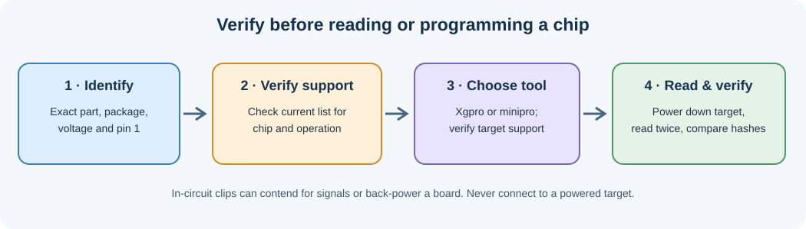

# 💾 T48 TL866-3G IC Programmer

## 🎯 Purpose
A programmable IC tool for supported chips and operations. Check the current manufacturer device list for the exact part number, package, adapter, and required read/write operation before planning a dump.

## ⚙️ Function
Xgpro is the manufacturer software for Windows. The open-source `minipro` project also lists T48 compatibility and runs on Linux, BSD, and macOS, but exact chip and feature support can differ. Confirm the part number and specific operation in the current Xgpro or minipro support list before connecting or programming.

## 🏆 Goal
Extract the raw firmware binary from a chip that can't be dumped in-circuit, enabling offline analysis with `binwalk`, Ghidra, or hex editors without needing the original board powered on.

## 📋 When to Use
- When in-circuit SPI flash dumping (via Bus Pirate or flashrom) fails due to bus contention or power constraints
- Physically removing a chip from a target device for off-board analysis
- Writing a modified firmware back to a chip after reverse engineering
- Dumping and backing up BIOS/EC firmware from laptops and embedded devices

## 📖 Description
The T48 (TL866-3G) is a device programmer with a manufacturer-maintained supported-device list. Compatibility is part- and operation-specific; “universal” should not be read as support for every IC or programming mode.

## 🔗 Reference Links
* **Manufacturer product and support list:** [XGecu T48 product page](https://xgecu.myshopify.com/products/v12-55-xgecu-tl866-3g-t48-usb-programmer-support-34000-ic-spi-flash-nand-eeprom-mcu-replace-tl866a-tl866cs-25-parts) — check the linked `T48_List.txt` for the exact chip.
* **Xgpro:** use the manufacturer's current [XGecu website](https://www.xgecu.com/EN/) and vendor-provided downloads. Verify signatures or checksums when available.
* **Cross-platform option:** [minipro upstream documentation](https://davidgriffith.gitlab.io/minipro/) lists T48 support; verify exact device and operation support before use.

## 🚀 Step-by-Step Example: Setup, Connect, and Use

Use read/write functions only on chips you own or are explicitly authorized to assess. Writing firmware can permanently change or disable a device.

**Scenario:** Read a Winbond 25Q64 SPI flash chip that appears on the current supported-device list.

### 1. Setup
* **Software:** On Windows, use the manufacturer’s current `Xgpro` release. On Linux/BSD/macOS, `minipro` is a community option that lists T48 support; first confirm that it supports the exact chip and operation.

### 2. Connect
* **USB:** Connect the T48 to your Windows PC.
* **Before handling:** Disconnect all board power sources and accessories, including batteries; allow stored charge to dissipate. Identify the exact package, voltage, pinout, and adapter. If any of these are uncertain, stop and use the board/chip documentation.
* *Off-board read:* For a removable, supported chip, use the correctly keyed adapter and align Pin 1 with the programmer's orientation marks. Use ESD precautions.
* *In-circuit read:* Only use a clip if the chip, adapter, and programmer documentation support that exact setup. Other board components can contend for the bus or back-power the target; do not connect the programmer to a powered board. Prefer an off-board read when the in-circuit electrical conditions are unclear.

### 3. Read and verify
* Launch Xgpro or the supported `minipro` version.
* Select the exact chip model and package shown on the part, then confirm the supported voltage and operation in the current device list. A similar family name is not sufficient.
* Click the **Read** button (a green arrow pointing to a computer chip).
* A dialog box will appear; click **Read** again. A progress bar will fill up.
* Once successful, the main window will populate with Hexadecimal data.
* Save the read as a new file without altering the source chip. For important work, make a second read and compare the two files' hashes before analysis. Preserve the original image and record chip marking, programmer/software version, adapter, voltage settings, and read conditions.

---

## Related Files
- [README.md](README.md) - HardwareHacking section index: all tools and chapter guide
- [BusPirate.md](BusPirate.md) - In-circuit SPI flash dumping alternative (no desoldering required); use T48 when in-circuit fails
- [LA1010.md](LA1010.md) - Logic analyzer to verify SPI signals when using in-circuit test clips before committing to desoldering
- [Chapter1.md](Chapter1.md) - Threat modeling: chip-level firmware extraction is a primary physical security concern
- [Chapter2.md](Chapter2.md) - Electrical fundamentals: SPI flash chip types, VCC levels, and pin orientation (Pin 1 identification)
