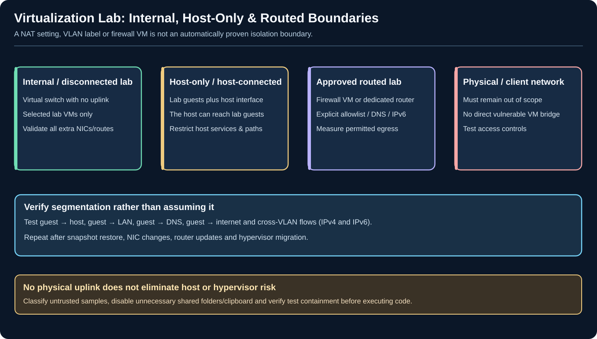
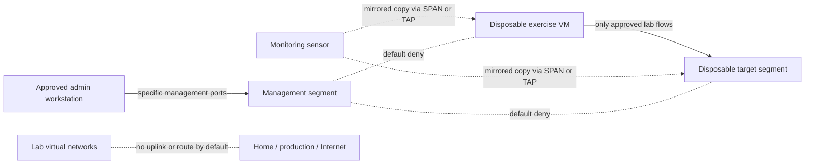
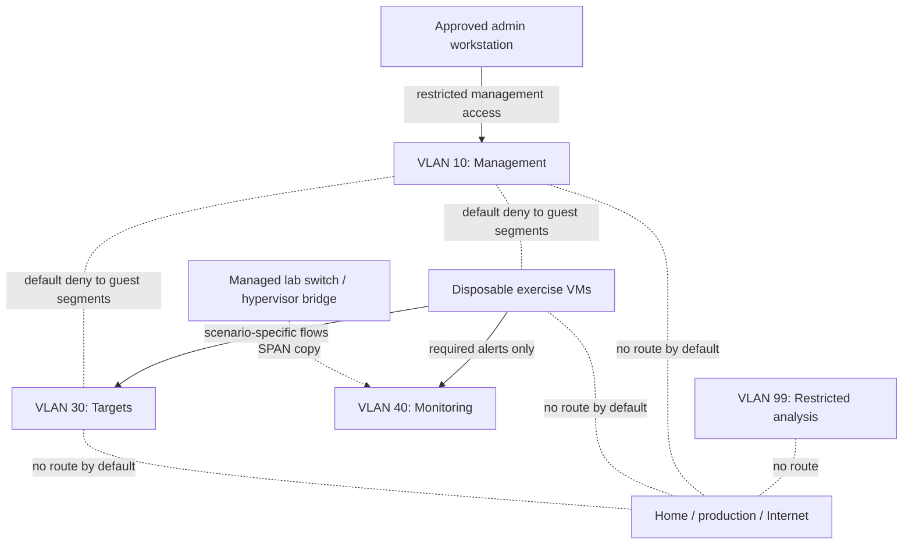
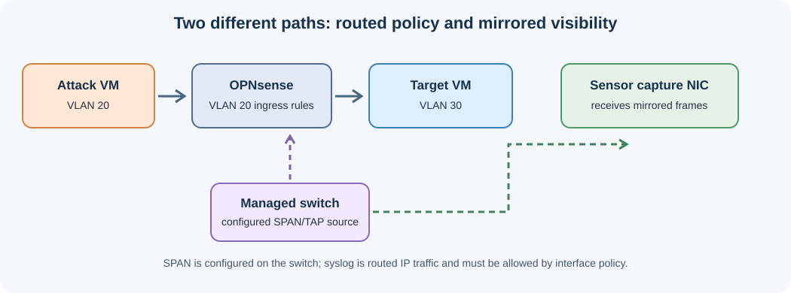
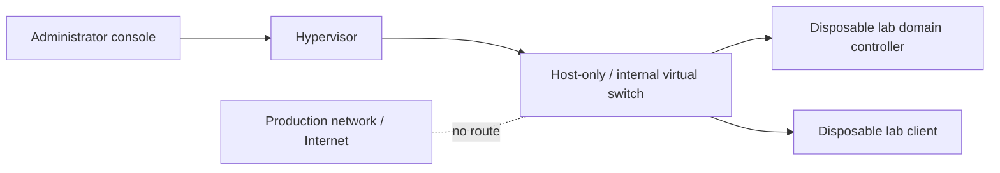
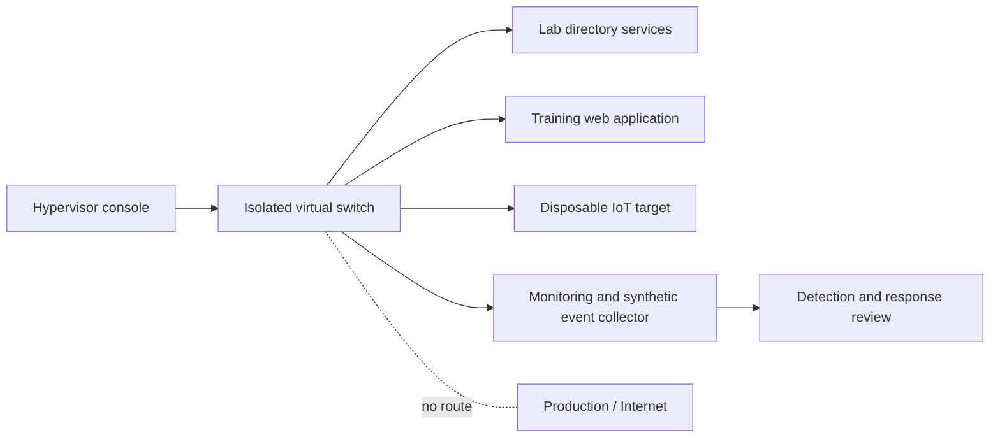

# Penetration Testing Home Lab Guide

## 🎯 Purpose
Reference build guide for an explicitly scoped cybersecurity training lab - covering hardware selection, network architecture (VLANs, isolated subnets), hypervisor setup (Proxmox, VMware, VirtualBox), vulnerable VM deployment (Metasploitable, DVWA, VulnHub), and ongoing lab maintenance.

## ⚙️ Function
Organized as a progressive build from beginner (single-machine VirtualBox) to advanced (dedicated bare-metal Proxmox cluster with VLAN isolation). Covers: hardware planning, network topology design, hypervisor installation, security tool VM deployment, target VM catalog, and lab hardening to prevent accidental internet exposure.

## 🏆 Goal
Design and verify an isolated, explicitly authorized lab that reduces risk to production and external systems; no VM or network control guarantees the absence of escape, operator error, or legal exposure.

## 📋 When to Use
- Setting up a new lab environment for security training or research
- Adding a new vulnerable target VM (Metasploitable3, DVWA, VulnHub) to an existing lab
- Designing network isolation (VLANs, firewall rules) to prevent lab escape to the internet
- Choosing hardware for a Proxmox homelab build

## Isolated Cybersecurity Training Lab

> **For:** Security professionals, students, researchers, and enthusiasts  
> **Reviewed:** November 20, 2026  
> **Scope:** Isolation, network examples, software references, and safety guidance reviewed; verify release-specific installation steps against current vendor documentation.

---

## Table of Contents

1. [Executive Overview](#executive-overview)
2. [Hardware Options & Planning](#hardware-options--planning)
3. [Network Architecture & Topology](#network-architecture--topology)
4. [Security Segmentation Strategy](#security-segmentation-strategy)
5. [Virtualization Platform Configuration](#virtualization-platform-configuration)
6. [Attack & Target VM Deployment](#attack--target-vm-deployment)
7. [Advanced Lab Scenarios](#advanced-lab-scenarios)
8. [Tool Arsenal Integration](#tool-arsenal-integration)
9. [Automation & Infrastructure as Code](#automation--infrastructure-as-code)
10. [Monitoring & Blue Team Integration](#monitoring--blue-team-integration)
11. [Hardware Integration Strategies](#hardware-integration-strategies)
12. [Practice Scenarios & Certifications](#practice-scenarios--certifications)
13. [OPSEC & Safety Protocols](#opsec--safety-protocols)
14. [Continuous Learning Path](#continuous-learning-path)

---

## Executive Overview

### Why Build a Penetration Testing Lab?

A carefully scoped lab can support repeatable learning and defensive research when its systems, routes, and recovery steps are reviewed. It does not guarantee safety or legal authorization. Possible uses include:

- 🎯 Hands-on learning in authorized simulators and disposable targets
- 🏆 Supplemental study alongside current certification-provider materials; this guide does not establish exam readiness
- 🔬 Reviewing tools and configurations before approved work
- 🛡️ Detection, response, and recovery exercises using synthetic events
- 📊 Reproducing security behavior in controlled, documented conditions
- 💼 Building practical skills through reviewed exercises

### What This Guide Covers

This comprehensive guide takes you from initial hardware selection through advanced purple teaming exercises. Whether you're building on:

- **A laptop** with 16GB RAM and VirtualBox
- **A workstation** with 32GB+ RAM and VMware
- **A dedicated server** with enterprise features
- **A full rack setup** with clustering and GPU acceleration

...you'll find practical guidance tailored to your resources.

### Lab Design Philosophy

**Capacity-based approach**:

1. **Small lab:** One host and a few VMs; use hardware already available.
2. **Growing lab:** Add memory, storage, a managed switch, or a dedicated host only when the workload requires it.
3. **Multi-host lab:** Plan for power, cooling, noise, lifecycle, backups, and network failure domains before buying enterprise equipment.

Treat prices, model availability, and performance as time- and region-dependent. Size the lab from the actual guest memory, storage, and monitoring workload rather than a fixed spend tier.

**Core Principles**:
- **Isolation first:** reduce exposure and verify paths; no virtual or network control eliminates all risk.
- **Repeatability:** use documented configuration, backups, and snapshots where appropriate.
- **Defensive learning:** pair each exercise with telemetry, review, remediation, and recovery.
- **Capacity and lifecycle:** add complexity only when the workload and maintenance needs justify it.
- **Authorization:** keep activity within systems and methods you own or are explicitly authorized to use.

### Key Objectives

1. Design lab networks with explicit boundaries and verify routes and policies.
2. Build repeatable scenarios with reviewed configuration and recovery steps.
3. Integrate monitoring and response exercises using synthetic or authorized events.
4. Practice scoped security reviews and controlled scenarios on disposable targets.
5. Use lab exercises as supplemental study; check providers for current certification objectives and rules.
6. Review custom tools and scripts before use, and keep them within the exercise scope.
7. Study hardware security with simulators or dedicated, owner-controlled devices.

---

## Hardware Options & Planning

### Minimum vs. Recommended Specifications

#### Small Lab (Existing Computer)

Choose resources based on host capacity and the guests you intend to run. Leave headroom for the host OS and avoid running more guests than memory permits.

- Use a currently supported host OS and hypervisor version.
- For a first exercise, run one disposable attacker VM and one intentionally vulnerable target VM on an **internal virtual network with no physical uplink or route**.
- Do not attach vulnerable guests to bridged, NAT, or production networks. Host-only networking grants the host access and must not be treated as internal-only.
- Broadcom currently offers VMware Workstation Pro without charge under its published terms; verify current [licensing and download guidance](https://knowledge.broadcom.com/external/article/368667/download-and-license-vmware-desktop-hyper.html) before use.

#### Growing Lab

Add memory and storage for the guest operating systems, monitoring stack, and snapshots you plan to keep. A managed switch and a dedicated firewall can help teach VLAN and policy concepts, but neither makes a lab isolated by itself. Test actual routes and firewall behavior.

#### Multi-host Lab

Multiple hosts, shared storage, and high-speed networking add operational complexity. Validate hardware support, storage redundancy, cluster quorum, backup and restore, power, cooling, noise, and lifecycle before purchase. Do not assume a particular host count, VM count, or budget guarantees capacity.

### Hardware Selection Decision Guide

Start with the learning objective and host capacity already available:

- **One or two guests:** use a supported desktop hypervisor and an internal-only virtual network.
- **Several concurrent systems:** estimate RAM, storage, and CPU needs for the guest operating systems and monitoring tools, then leave capacity for the host.
- **VLAN or multi-host practice:** add a managed switch and dedicated lab host only if the exercise needs them. Keep the lab trunk off the home or production network unless a separately reviewed, default-deny design requires a controlled connection.
- **GPU benchmarking:** optional; select hardware for compatibility and cooling, then benchmark locally. Published hash rates are not performance guarantees.

### Networking Hardware

A dedicated lab switch or software bridge can support segmentation. Keep any physical lab switch disconnected from home, work, and Internet uplinks unless a separately reviewed architecture explicitly requires an approved update path. Select equipment by current support, VLAN features, throughput, and management needs; model availability and prices change.

### Storage Options

Local SSD/NVMe storage is usually simplest for a small lab. A NAS can centralize VM templates and backups, but shared storage also creates a path for data exposure. Separate immutable backups from writable exercise data, restrict NFS/iSCSI clients and permissions, and do not mount credential, capture, or report directories in attacker VMs.

### GPU Benchmarking (Optional)

A supported GPU can accelerate some hash modes, but throughput varies by hash mode, device, driver, runtime, temperature, power limit, and Hashcat version. Avoid fixed hash-rate and price tables.

For a compatibility check and local benchmark, use the current [Hashcat documentation](https://hashcat.net/wiki/) and run:

```bash
hashcat -I
hashcat -b
```

Use synthetic training hashes or hashes you are authorized to possess. Keep inputs on the disposable lab system, restrict access to result files, and follow the engagement's data-retention rules.

### Edge Computing & IoT Devices (Optional)

Small computers can host monitoring, network services, or disposable firmware targets. Use them only on lab networks with known ownership and documented routing.

- **SBCs and mini PCs:** choose based on supported OS images, NIC count, storage, and power needs; confirm board-specific specifications with the manufacturer.
- **Monitoring sensor:** use a dedicated capture interface receiving traffic from a documented SPAN session or properly placed network TAP. A device connected to an ordinary switch port does not automatically see other clients' unicast traffic.
- **Wireless practice:** prefer a simulator or an isolated, clearly identified test SSID with owner-controlled clients and no upstream bridge. Do not impersonate a third-party network or capture bystanders' traffic.
- **Device-detection exercise:** register the test device, define a test window, generate benign approved telemetry, and verify that inventory/alerting detects it. Do not hide or deploy covert devices on networks.

### Example Lab Shapes

These examples are starting points, not product recommendations or performance guarantees. Adjust resources for the operating systems and tools used, and check current vendor support and licensing.

#### Single-host exercise

- One supported host with sufficient free memory and storage
- One disposable attacker VM and one target VM
- An internal virtual switch with no physical uplink, NAT, or default route
- Transfer verified updates through a separate approved path; disconnect it before vulnerable-target or malware-analysis exercises

#### VLAN learning setup

- A hypervisor and VLAN-capable switch or virtual bridges
- Separate management, exercise, target, and monitoring segments
- A firewall with documented default-deny inter-segment rules
- A dedicated management host or jump point allowed only to specific management endpoints

#### Multi-host lab

- Multiple hypervisor/storage nodes only when required by the exercise
- Documented backup, restore, quorum, power, cooling, and lifecycle plans
- Keep vulnerable targets and malware-analysis segments disconnected from production and upstream networks

### Infrastructure Assessment Checklist

Before building your lab, assess what you have:

**Compute**:
- [ ] Total RAM available: _______
- [ ] Total CPU cores: _______
- [ ] Virtualization support (VT-x/AMD-V): Yes/No
- [ ] Storage capacity: _______

**Network**:
- [ ] Managed switch for VLANs: Yes/No
- [ ] Dedicated network for lab: Yes/No
- [ ] Internet bandwidth: _______

**Optional**:
- [ ] GPU for password cracking: Model _______
- [ ] NAS/shared storage: Yes/No
- [ ] Edge devices (Pi, mini PC): Yes/No
- [ ] Wireless adapters: Yes/No

**Software Licenses**:
- [ ] Virtualization platform: _______
- [ ] Windows Server licenses: _______
- [ ] Burp Suite Pro: Yes/No
- [ ] Cobalt Strike: Yes/No

Based on your assessment, choose the appropriate tier and begin planning your build!

---

## Network Architecture & Topology



*Conceptual virtualization traffic boundaries.* Internal networks and host-only networks are **not equivalent**: for example, [VirtualBox internal networking](https://docs.oracle.com/en/virtualization/virtualbox/7.2/user/networkingdetails.html) can connect selected guests without a host interface, whereas its host-only mode provides a host-connected virtual interface. The meaning of a bridge, port group, VLAN or firewall route is hypervisor-specific. Verify IPv4/IPv6 egress, guest-to-host traffic and any extra NIC rather than assuming the name of a network mode guarantees isolation.


### Network Design Principles

A well-architected penetration testing lab requires **network segmentation** to:

1. **Isolate attack traffic** from production networks
2. **Simulate realistic environments** (DMZ, internal networks, management)
3. **Enable blue team monitoring** without interference
4. **Prevent accidental exposure** of vulnerable systems
5. **Support multiple concurrent scenarios** (different engagement types)

### Standard Lab Network Topology

#### Basic 3-Network Design (Starter/Intermediate)

For vulnerable targets, use a virtual switch with **no physical uplink or default route**. If a firewall VM is used to teach inter-segment policy, connect it only to the lab's internal virtual networks. Keep any upstream/update interface disconnected by default.



**Network Descriptions**:

1. **Management Network** (example: 10.10.0.0/24)
   - Expose only hypervisor and firewall management services to approved admin hosts.
   - Deny guest-initiated access to management. Do not block the admin path needed to manage the lab.

2. **Exercise Network** (example: 10.20.0.0/24)
   - Disposable exercise VMs. Allow only the flows needed for the written lab scenario.
   - No Internet route by default. Obtain packages on a separate approved system and transfer verified files through a controlled process.

3. **Target Network** (example: 10.30.0.0/24)
   - Vulnerable, disposable systems; no upstream route by default.
   - Permit only documented exercise traffic. Stateful replies to allowed sessions are different from new target-initiated connections.

#### Advanced Segmented Lab Design

The example addresses below are documentation-only RFC 1918 ranges. Choose ranges that do not overlap with home, work, or VPN networks.



| Segment | Example range | Default policy |
|---|---|---|
| Management (VLAN 10) | 10.10.10.0/24 | Admin hosts to named management endpoints only; deny guest-initiated access |
| Exercise (VLAN 20) | 10.20.20.0/24 | Disposable tools; only scenario-required flows to targets; no upstream route by default |
| Target (VLAN 30) | 10.30.30.0/24 | No upstream route; allow only exercise-specific traffic and stateful replies |
| Monitoring (VLAN 40) | 10.40.40.0/24 | Receive documented mirrored traffic and required logs; restrict management and egress |
| Restricted analysis (VLAN 99) | 10.99.99.0/24 | No routed or bridged paths to other networks; VLAN alone is not an air gap |

A SPAN feed is a Layer 2 copy to a sensor capture interface, not a routed firewall path. Verify the source ports/VLANs, direction, sensor interface, and capture loss.

### VLAN Segmentation Strategy

#### Why VLANs?

**Benefits**:
- Logical separation without physical hardware
- Firewall rules between networks
- Realistic enterprise simulation
- Easy to reconfigure
- Cost-effective

**Requirements**:
- Managed switch supporting 802.1Q (VLAN tagging)
- Firewall/router with VLAN support
- OR: Software firewall (OPNsense/pfSense) with VLAN-aware bridge

#### VLAN Configuration Approaches

**Approach 1: Physical Switch + Software Firewall** (Recommended)

```
Hardware:
- Managed switch (TP-Link, Netgear, Cisco)
- Hypervisor server connects to switch
- Software firewall VM (OPNsense/pfSense)

Configuration:
1. Create VLANs on physical switch
2. Tag switch ports appropriately
3. Create VLAN-aware bridge in hypervisor
4. Assign VM network interfaces to specific VLANs
5. Configure firewall rules in OPNsense/pfSense
```

**Approach 2: Hypervisor-Only VLANs** (Simple)

```
Hardware:
- Hypervisor with multiple NICs OR single NIC

Configuration:
1. Create multiple virtual bridges (vmbr0, vmbr1, vmbr2)
2. Assign VMs to specific bridges
3. Use firewall VM to route between bridges
4. No managed switch required (but less realistic)
```

**Approach 3: Nested VLANs** (Advanced)

```
Hardware:
- Managed switch with 802.1Q support
- Multiple hypervisor nodes

Configuration:
1. Trunk port between switch and hypervisor
2. VLAN tagging at hypervisor level
3. VMs inherit VLAN tags
4. Supports clustering across physical hosts
```

### IP Addressing Schemes

#### RFC 1918 Private Networks

Use these for all lab networks:
- **10.0.0.0/8**: Large networks (preferred for labs)
- **172.16.0.0/12**: Medium networks
- **192.168.0.0/16**: Small networks (avoid if conflicts with home network)

#### Recommended Subnets

| Network | VLAN | Subnet | Hosts | Purpose |
|---------|------|--------|-------|---------|
| Management | 10 | 10.10.10.0/24 | 254 | Hypervisor, admin tools |
| Attack | 20 | 10.20.20.0/24 | 254 | Attacker VMs |
| Target | 30 | 10.30.30.0/24 | 254 | Vulnerable systems |
| Blue Team | 40 | 10.40.40.0/24 | 254 | Monitoring, SIEM |
| Isolated | 99 | 10.99.99.0/24 | 254 | Malware testing |

#### IP Assignment Strategy

**Static IPs** (Recommended for lab):
- Management: 10.10.10.5-50
- Attacker VMs: 10.20.20.10-50
- Target DCs: 10.30.30.10
- Target Servers: 10.30.30.11-30
- Target Workstations: 10.30.30.50-100
- Target Linux: 10.30.30.101-200
- Blue Team: 10.40.40.10-50

**DHCP** (Optional):
- Can use DHCP server on firewall
- Reserve static leases for important hosts
- Easier for rapid deployment

### Firewall Platform Selection

#### Software Firewalls (Recommended)

**OPNsense** (Recommended for most labs):
- ✅ Free and open source
- ✅ Modern web UI
- ✅ Built-in Suricata IDS/IPS
- ✅ Easy VLAN configuration
- ✅ Regular updates
- ✅ Active community

**pfSense**:
- ✅ Mature, stable
- ✅ Large community
- ✅ Extensive documentation
- ⚠️ Some features require Netgate hardware
- ⚠️ Commercial pressure affecting open source

**VyOS**:
- ✅ CLI-driven (like Cisco/Juniper)
- ✅ Good for learning network operations
- ⚠️ Steeper learning curve
- ⚠️ Less user-friendly web UI

#### Hardware Firewalls (Optional)

**Protectli Vault**:
- Pre-built for pfSense/OPNsense
- Multiple NIC ports
- $200-400
- Good for dedicated firewall

**Used Enterprise**:
- Cisco ASA 5505/5506
- Fortinet FortiGate
- $50-200 on eBay
- ⚠️ May need licensing for updates

### Example Implementation: Proxmox + OPNsense

**Step-by-Step Network Setup** (Generalized):

1. **Create VLAN-aware bridge in Proxmox**:

```bash
# Edit /etc/network/interfaces
auto vmbr1
iface vmbr1 inet manual
    bridge-ports none
    bridge-stp off
    bridge-fd 0
    bridge-vlan-aware yes
    bridge-vids 10 20 30 40 99
```

2. **Create OPNsense VM**:

```bash
# Create the firewall VM without an upstream/WAN interface for the default
# disconnected lab. Attach its tagged lab interfaces to an internal bridge.
# Do not add an uplink, NAT, or route unless a separately reviewed update path
# is required and vulnerable-target exercises are stopped.
qm create 100 --name opnsense --memory 4096 --cores 2 \
    --net0 virtio,bridge=vmbr1,tag=10
qm set 100 --net1 virtio,bridge=vmbr1,tag=20
qm set 100 --net2 virtio,bridge=vmbr1,tag=30
qm set 100 --net3 virtio,bridge=vmbr1,tag=40
qm set 100 --net4 virtio,bridge=vmbr1,tag=99
```

3. **Configure VMs on specific VLANs**:

```bash
# Kali on Attack VLAN
qm set 200 --net0 virtio,bridge=vmbr1,tag=20

# Metasploitable on Target VLAN
qm set 320 --net0 virtio,bridge=vmbr1,tag=30

# Security Onion on Blue Team VLAN
qm set 410 --net0 virtio,bridge=vmbr1,tag=40
```

4. **Configure OPNsense interfaces and rules** (see Security Segmentation section)

**Example only:** A hypervisor can attach guests to VLAN-tagged lab networks and a firewall VM can route among them under explicit rules. Keep the firewall's upstream interface absent by default. VM capacity and isolation depend on hardware, configuration, and tested policy.

---

## Security Segmentation Strategy

### Firewall Rules (OPNsense Configuration)



OPNsense rules are attached to interfaces and, by default, filter inbound traffic on the interface where packets enter. Build and review each interface's rule list separately, top to bottom. The “order” below is conceptual within each interface, not a global priority across VLANs. OPNsense is stateful by default, so replies to an allowed connection are handled by its state entry; do not add a blanket reverse-direction block that breaks those replies.

| Interface receiving traffic | Example inbound policy, top to bottom |
|---|---|
| Management (VLAN 10) | Allow approved admin hosts to specific firewall and management endpoints; allow required DNS/NTP to named services; block access to other lab networks; log and deny remaining traffic. |
| Attack (VLAN 20) | Allow only documented exercise flows to named lab targets; no upstream/DNS egress by default. Obtain and verify packages on a separate approved system, then disconnect that path before exercises. |
| Target (VLAN 30) | No upstream route by default. Allow only documented exercise traffic and any required service from a named lab-local resolver. Stateful replies to allowed sessions still work. |
| Blue Team (VLAN 40) | Allow syslog from known source addresses to the collector on the required transport/port; allow admin access from approved Management hosts to sensor management; allow only required sensor egress. |
| Restricted Lab (VLAN 99) | Deny routed access to the Internet and other VLANs, then default deny. This is logical segmentation, not an air gap. For a true air gap, remove routed/bridged paths and external links, and verify that no alternate interface provides connectivity. |

**Traffic visibility is a separate setup:** configure a managed switch or network TAP to mirror selected source ports/VLANs to a dedicated sensor capture NIC. Mirrored packets are copied at Layer 2 and delivered directly to the sensor; a firewall rule cannot create or enable SPAN. By contrast, syslog sent over IP is routed traffic and needs an allow rule on the source/receiving interface and an accessible collector.

### OPNsense IDS/IPS Configuration

**Suricata Integration**:
- Enable inspection only on interfaces whose traffic is in scope; a sensor can only inspect traffic delivered to its interface.
- Select supported rulesets in the installed OPNsense release and review their update source, licensing, HOME_NET, and false-positive impact before enabling them.
- Detection coverage depends on protocol visibility, encryption, sensor placement, ruleset version, and configuration. An alert is a lead for investigation, not proof that a tool or compromise was identified.
- Forward selected alerts to the monitoring system over an explicitly permitted lab flow; keep WAN monitoring and upstream ruleset updates disabled unless separately approved.

**Local-rule workflow**:
Use the OPNsense IDS/IPS interface and the installed Suricata version's documentation to manage rules. The examples previously shown here relied on brittle payload strings, incomplete protocol matching, and generic signatures that could not reliably identify Nmap, Metasploit, SQLMap, or credential-dumping tools. For a training rule, define the observable behavior and expected false positives, validate syntax against the installed engine, replay a known benign test capture, and confirm the resulting alert in logs before enabling prevention. OPNsense documents IDS/IPS modes, interface selection, rulesets, and alert handling in its [Intrusion Prevention System manual](https://docs.opnsense.org/manual/ips.html).

---

## Virtualization Platform Configuration

### Proxmox VE Cluster Setup

#### Initial Configuration

**Node Setup** (if multiple R630s available):
```bash
# On first R630 (already installed)
pvecm create pnw-pentest-cluster

# On additional R630s
pvecm add <first-r630-ip>
```

**Shared Storage Configuration** (TrueNAS Integration):
```bash
# Add NFS storage from TrueNAS to Proxmox
pvesm add nfs truenas-nfs --server <truenas-ip> --export /mnt/tank/proxmox --content iso,vztmpl,backup,images
```

**High Availability** (Optional for lab):
```bash
# Create HA group for critical VMs (OPNsense, monitoring)
ha-manager add <vmid> --group <groupname> --max_restart 3
```

#### Network Configuration in Proxmox

In this example, `vmbr1` is an internal virtual bridge with no physical port. The `vmbr0` management and `vmbr2` storage links shown below must use separate, restricted networks without an Internet gateway. If using a physical lab switch, dedicate it to the lab and verify that it has no router, wireless bridge, or cable to production or upstream networks.

```
auto lo
iface lo inet loopback

# Dedicated management interface. Restrict the connected network to approved admins.
auto eno1
iface eno1 inet manual

auto vmbr0
iface vmbr0 inet static
    address 192.168.50.5/24
    # No default gateway in the disconnected example.
    bridge-ports eno1
    bridge-stp off
    bridge-fd 0

# Internal VLAN-aware lab bridge; no physical uplink and no host IP.
auto vmbr1
iface vmbr1 inet manual
    bridge-ports none
    bridge-stp off
    bridge-fd 0
    bridge-vlan-aware yes
    bridge-vids 10 20 30 40 99

# Optional dedicated storage link. Do not bridge it to guest or upstream networks.
auto eno3
iface eno3 inet manual
auto vmbr2
iface vmbr2 inet static
    address 10.50.50.5/24
    bridge-ports eno3
    bridge-stp off
    bridge-fd 0
```

**VLAN Tagging for VMs**:
- When creating VMs, set network device to `vmbr1` and specify VLAN tag
- Example: Kali VM → vmbr1, VLAN tag 20
- Example: Windows DC → vmbr1, VLAN tag 30

#### Resource Allocation Strategy

**Resource planning:** Size each VM from its current vendor requirements, intended workload, and measured use. Add vCPU and peak memory allocations for the planned guests, leave host and storage headroom, then validate under representative monitoring load. Do not copy a fixed server model or allocation table as a capacity guarantee.

### TrueNAS Storage Configuration

**Dataset Structure**:
```
tank/
├── proxmox/
│   ├── isos/              # OS ISOs
│   ├── templates/         # VM templates
│   ├── backups/           # Automated backups
│   └── snapshots/         # ZFS snapshots
├── pentest-data/
│   ├── tools/             # Custom tools repository
│   ├── wordlists/         # SecLists, rockyou.txt, etc.
│   ├── exploits/          # Custom exploits, PoCs
│   ├── loot/              # Captured credentials, data
│   └── reports/           # Pentest reports, screenshots
└── shares/
    ├── kali-share/        # Shared folder for attacker VMs
    └── blue-team-logs/    # Centralized log storage
```

**NFS Shares for Proxmox (restrict clients and permissions):**

Use the current TrueNAS interface and documentation for the installed release to create exports. Restrict each share to named hypervisor clients, prefer read-only access for ISO/template datasets, and review root mapping and dataset ACLs. Do not mount a broad writable share into an attacker VM; use a separate disposable working dataset only when writes are required. TrueNAS release and UI details can change, so verify the resulting export from both the NAS and client.

**iSCSI Target for High-Performance VM Storage** (Optional):
```bash
# Create iSCSI extent for Proxmox VM storage
# Configure via TrueNAS web UI: Sharing → Block Shares (iSCSI)
# Add initiator: iqn.proxmox-host
# Create target, associate extent
# Mount in Proxmox as iSCSI storage
```

**Snapshot schedule:** Set frequency and retention from recovery objectives and available storage. Snapshots do not replace independent, tested backups; document when snapshots expire and how restores are verified.

---

## Attack & Target VM Deployment

### Attack VMs

#### Kali Linux (Primary Attacker)

**Deployment Method**:
```bash
# Download the current QEMU image from Kali's official downloads page:
# https://www.kali.org/get-kali/#kali-virtual-machines
# Verify its published checksum/signature before extracting it. The URL above
# is a landing page, not a direct image URL.
cd /var/lib/vz/template/iso/
KALI_ARCHIVE='kali-linux-REPLACE-WITH-VERIFIED-RELEASE-qemu-amd64.7z'
test -f "$KALI_ARCHIVE" || { echo "Set KALI_ARCHIVE to the verified local download"; exit 1; }
7z x "$KALI_ARCHIVE"

# Set this to the qcow2 file extracted from the verified archive.
KALI_DISK='kali-linux-REPLACE-WITH-VERIFIED-RELEASE-qemu-amd64.qcow2'
test -f "$KALI_DISK" || { echo "Set KALI_DISK to the extracted qcow2 image"; exit 1; }

# Create VM from the verified image.
qm create 200 --name kali-primary --memory 16384 --cores 6 --net0 virtio,bridge=vmbr1,tag=20
qm importdisk 200 "$KALI_DISK" local-lvm
qm set 200 --scsihw virtio-scsi-pci --scsi0 local-lvm:vm-200-disk-0
qm set 200 --boot order=scsi0
qm set 200 --agent enabled=1
```

**Post-Installation Configuration**:
```bash
# Update from Kali after taking a VM snapshot. Review the proposed transaction
# and package removals before accepting the full upgrade.
sudo apt update
sudo apt full-upgrade

# Install only tools needed for this lab, using their current official
# instructions. Package names differ by Kali release; distinguish
# ProjectDiscovery httpx from Python HTTPX. Avoid bulk installs on a daily-use
# workstation.

# Mount a read-only NFS view for wordlists and reference files.
# Replace the server/export and mount point with verified local values.
sudo mkdir -p /mnt/pentest-data
sudo mount -t nfs -o ro,_netdev truenas-ip:/mnt/tank/pentest-data /mnt/pentest-data
# Add one reviewed entry to /etc/fstab only after testing the mount.
# Example options: ro,_netdev,nofail; avoid appending duplicate entries.

# Configure static IP
sudo nano /etc/network/interfaces
# Add:
# auto eth0
# iface eth0 inet static
#     address 10.20.20.10/24
#     # No gateway or public DNS in the disconnected profile.
#     # Add only a lab-local resolver if one is configured and needed.
```

**Snapshot Creation**:
```bash
# Create baseline snapshot for quick resets
qm snapshot 200 baseline --vmstate 1 --description "Clean Kali install, all tools"
```

#### Parrot Security OS (Alternative Attacker)

**Deployment**:
```bash
# Download the current ISO from Parrot's official page and verify its
# published checksum/signature. The page URL is not a direct ISO URL.
cd /var/lib/vz/template/iso/
PARROT_ISO='Parrot-security-REPLACE-WITH-VERIFIED-RELEASE_amd64.iso'
test -f "$PARROT_ISO" || { echo "Set PARROT_ISO to the verified local ISO"; exit 1; }

# Create the VM using the verified local ISO.
qm create 201 --name parrot-sec --memory 8192 --cores 4 \
    --net0 virtio,bridge=vmbr1,tag=20 \
    --cdrom "local:iso/$PARROT_ISO" \
    --scsi0 local-lvm:32 --scsihw virtio-scsi-pci

# Start and install via VNC
qm start 201
```

**Configuration**: Similar to Kali, static IP 10.20.20.11

#### Windows 11 Pro (PowerShell/AD Attack Platform)

**Deployment**:
```bash
# Use a Windows release currently serviced for the selected edition.
# Windows 11 23H2 Home/Pro stopped receiving updates on 2025-11-11.
# Download the licensed/current ISO from Microsoft and verify its source.
WIN11_ISO='Win11-REPLACE-WITH-CURRENT-SUPPORTED-RELEASE.iso'
test -f "$WIN11_ISO" || { echo "Set WIN11_ISO to a verified local ISO"; exit 1; }
qm create 202 --name win11-attacker --memory 8192 --cores 4 \
    --net0 virtio,bridge=vmbr1,tag=20 \
    --cdrom "local:iso/$WIN11_ISO" \
    --scsi0 local-lvm:80 --scsihw virtio-scsi-pci \
    --ostype win11

# Add VirtIO drivers ISO
# Select and checksum-verify a currently supported VirtIO driver ISO compatible with the guest.
# Example (replace with verified local filename):
# qm set 202 --ide2 local:iso/virtio-win-REPLACE-WITH-RELEASE.iso,media=cdrom
```

**Post-Installation Tools**:
```powershell
# Install Chocolatey
# Do not weaken execution policy or execute a remote installer with iex.
# Follow the official [Chocolatey install guide](https://docs.chocolatey.org/en-us/choco/setup/)
# from a disposable lab VM, verify the installer provenance, and review its changes.

# Use only disposable Windows lab VMs.
# Do not bypass execution policy or pipe a downloaded installer into iex.
# Install only reviewed tools from official release channels and verify
# signatures/checksums; keep retired tools out of the image.
```

### Target VMs

#### Windows Active Directory Lab

**Domain Controller (DC01)**:
```bash
# Select a currently supported Windows Server evaluation image from Microsoft's
# official source; verify edition, lifecycle, and license terms before use.
# vmbr1 must be an internal bridge with no physical uplink or route.
WIN_SERVER_ISO='Windows-Server-REPLACE-WITH-VERIFIED-RELEASE.iso'
test -f "$WIN_SERVER_ISO" || { echo "Set WIN_SERVER_ISO to a verified local ISO"; exit 1; }
qm create 300 --name dc01-target --memory 16384 --cores 4 \
    --net0 virtio,bridge=vmbr1,tag=30 \
    --cdrom "local:iso/$WIN_SERVER_ISO" \
    --scsi0 local-lvm:80 --scsihw virtio-scsi-pci \
    --ostype win10

qm start 300
```

> [!CAUTION]
> This optional exercise uses intentionally weakened configuration on disposable lab VMs only. Attach them to an internal virtual switch with no physical uplink, default route, NAT, or DNS path to the Internet or production networks. Verify isolation from the hypervisor console, use synthetic identities, and never connect these VMs to a production management VLAN. Do not disable host protections or enable legacy protocols on a physical system.



**Post-Installation** (use the hypervisor console; the lab has no default gateway):
```powershell
# Set static IP
New-NetIPAddress -InterfaceAlias "Ethernet" -IPAddress 10.30.30.10 -PrefixLength 24
Set-DnsClientServerAddress -InterfaceAlias "Ethernet" -ServerAddresses 10.30.30.10

# Rename computer
Rename-Computer -NewName "DC01" -Restart

# Install AD DS role
Install-WindowsFeature -Name AD-Domain-Services -IncludeManagementTools

# Promote to domain controller
Install-ADDSForest -DomainName "pnwlab.local" -DomainNetbiosName "PNWLAB" `
    -ForestMode "WinThreshold" -DomainMode "WinThreshold" `
    -InstallDns -Force

# Keep Defender and modern protocol protections enabled. If the exercise needs
# a weak-configuration condition, use a disposable snapshot and create it
# through a reviewed lab procedure with unique synthetic credentials stored
# outside shell history. Restore the snapshot after the exercise.
# Review account policy, group membership, and audit events through the
# Windows administration console; this guide does not prescribe real passwords
# or disabling endpoint protections.
```

**SQL Server (SQL01)**:

Select a currently supported SQL Server release and evaluation media from Microsoft's official source; check its lifecycle, edition, and license before use. Install it on the disconnected target segment with unique synthetic accounts. Do not enable features such as `xp_cmdshell` or weaken authentication by default. If a specific configuration-review exercise requires a weak setting, document the change, isolate the VM, and restore a clean snapshot immediately afterward.

**Windows Workstations (WKS01-05)**:
```bash
# Create a template from the same verified, currently serviced Windows ISO.
WIN11_ISO='Win11-REPLACE-WITH-CURRENT-SUPPORTED-RELEASE.iso'
test -f "$WIN11_ISO" || { echo "Set WIN11_ISO to a verified local ISO"; exit 1; }
# Create template
qm create 310 --name wks-template --memory 4096 --cores 2 \
    --net0 virtio,bridge=vmbr1,tag=30 \
    --cdrom "local:iso/$WIN11_ISO" \
    --scsi0 local-lvm:60 --scsihw virtio-scsi-pci

# Install Windows 11, join to domain
# Clone template 5 times
qm clone 310 311 --name wks01
qm clone 310 312 --name wks02
# ... etc

# Configure different privilege levels:
# Use synthetic, least-privileged accounts for routine exercises.
# For credential-protection training, use pre-generated events or a
# separately scoped simulator rather than placing privileged credentials
# in an interactive workstation session.
```

#### Linux Vulnerable Targets

**Metasploitable 2**:
```bash
# Download and import
cd /var/lib/vz/template/iso/
wget https://sourceforge.net/projects/metasploitable/files/Metasploitable2/metasploitable-linux-2.0.0.zip
unzip metasploitable-linux-2.0.0.zip

qm create 320 --name metasploitable2 --memory 2048 --cores 1 \
    --net0 virtio,bridge=vmbr1,tag=30
qm importdisk 320 Metasploitable.vmdk local-lvm
qm set 320 --scsi0 local-lvm:vm-320-disk-0
qm set 320 --boot order=scsi0

# Configure static IP: 10.30.30.70
# Credentials: msfadmin / msfadmin
```

**Metasploitable 3**:
```bash
# Deploy using Vagrant on a Linux VM or build manually
# https://github.com/rapid7/metasploitable3
# Import resulting VM to Proxmox
# IP: 10.30.30.71
```

**DVWA (Damn Vulnerable Web Application)**:
```bash
qm create 322 --name dvwa-ubuntu --memory 4096 --cores 2 \
    --net0 virtio,bridge=vmbr1,tag=30 \
    --cdrom local:iso/ubuntu-22.04-server.iso \
    --scsi0 local-lvm:40

# Follow the current official DVWA installation guide for this supported Ubuntu
# release. Pin and verify the application revision before installing it.
# Do not add NAT or a public default route to the vulnerable target to fetch
# packages; stage and verify packages separately before the exercise.
# Keep the intentionally vulnerable configuration disposable and lab-only.
```

**OWASP Broken Web Apps VM**:
```bash
# Obtain a deliberately vulnerable image only from its current official
# project source. Verify provenance and published integrity data; old images
# may contain unsupported software. Import only after verifying the VM has no
# external adapter or default route.
OWASP_BWA_OVA='REPLACE-WITH-VERIFIED-LOCAL-FILENAME.ova'
test -f "$OWASP_BWA_OVA" || { echo "Set the verified local OVA filename"; exit 1; }
qm importovf 323 "$OWASP_BWA_OVA" local-lvm
qm set 323 --name owasp-bwa --net0 virtio,bridge=vmbr1,tag=30
# IP: 10.30.30.73
```

#### HackTheBox-Style Custom Targets

**Option 1**: Download retired HTB machines (with VIP subscription)
**Option 2**: Build custom vulnerable VMs based on CTF writeups
**Option 3**: Use VulnHub VMs

```bash
# Example: Deploy VulnHub Mr. Robot VM
cd /var/lib/vz/template/iso/
wget https://download.vulnhub.com/mrrobot/mrRobot.ova

qm importovf 330 mrRobot.ova local-lvm
qm set 330 --name htb-mrrobot --net0 virtio,bridge=vmbr1,tag=30
# IPs: 10.30.30.80-90 for custom targets
```

---

## Advanced Lab Scenarios

Use these exercises to practice detection, response, and remediation. Keep every target on the isolated virtual switch described above. Use synthetic accounts and data, restore a clean snapshot between exercises, and retain logs needed for review.

### Scenario 1: Active Directory Detection

**Objective:** Identify suspicious authentication and directory-change patterns without collecting credentials or attempting domain compromise.

- Review pre-generated, synthetic security events for repeated authentication failures, unusual service-ticket requests, privileged group changes, and directory replication alerts.
- Compare account, host, time, and service activity with the lab baseline.
- Document evidence, likely benign explanations, escalation decisions, and containment steps.
- Verify least privilege, service-account password strength, pre-authentication settings, and logging coverage through configuration review.

### Scenario 2: Web Application Security Review

**Objective:** Reduce risk in the intentionally vulnerable training application without exposing it to other networks.

- Review its security configuration and source code in a disposable snapshot.
- Use synthetic users and records; verify authorization expectations through the application's own safe test suite.
- Prioritize fixes for access control, injection prevention, secure file handling, request forgery protections, and secret management.
- Record the fix and confirm it with code review or a non-destructive staging check.

### Scenario 3: Ransomware Readiness Tabletop

**Objective:** Test backup, alerting, and response decisions without running encrypting software.

- Use a tabletop timeline and benign sample alerts to simulate suspicious file activity.
- Confirm responders know how to isolate a VM, preserve evidence, notify owners, and restore a clean snapshot.
- Verify backup integrity and recovery time using disposable test files.
- Review whether endpoint and file-server alerts reach the monitoring system.

### Scenario 4: IoT and Embedded Device Segmentation

**Objective:** Review inventory and containment controls.

- List only devices intentionally attached to the lab network.
- Review firmware versions, default-account removal, exposed services, and outbound access policy.
- Confirm IoT devices cannot reach management interfaces or unrelated lab segments.
- Document owner, business purpose, supported update path, and retirement plan for each device.

### Scenario 5: Red and Blue Team Coordination

**Objective:** Practice authorization, telemetry review, and incident communication.

- Agree on written scope, time window, permitted benign test events, contacts, and stop conditions before the exercise.
- Generate only non-destructive test events in the lab, then confirm that monitoring records and routes them correctly.
- Have the response team triage, preserve evidence, and explain containment decisions.
- Hold a debrief and track detection and process improvements.



## Tool Arsenal Integration

### Tool References and Controlled Access

#### Reconnaissance & OSINT

The following names are examples, not a verified inventory of installed software or a recommendation to run every tool. Confirm maintenance, source, license, privacy behavior, and exercise scope before use:
- theHarvester
- Recon-ng
- SpiderFoot
- Maltego
- Amass
- Subfinder
- Assetfinder
- Shodan CLI
- Censys CLI

External lookups may disclose queried domains, IPs, or organization details to providers and may generate contacts with third parties. Use only approved identifiers and review the provider's data-handling terms before sending queries.

**Shared tools and data**: Do not mount a writable NAS share across attacker VMs by default. If shared distribution is needed, create a dedicated read-only export containing reviewed tools or synthetic training data, allow only named lab hosts, and keep credentials, evidence, captures, and client data elsewhere.

**Optional OSINT workstation**: Create a disposable VM from a currently supported, verified OS image only if the exercise needs it. Install a small set of reviewed tools from official or organization-approved sources; do not bulk-install a catalog or run unreviewed repository automation.

#### Scanning & Enumeration

Use the Nmap and other scanner versions supplied by a maintained, trusted repository. Review third-party scripts and their network behavior before installation; keep custom scripts in a separate, version-controlled lab directory until they have been reviewed. Limit active checks to one explicitly authorized disposable target and a conservative profile.

**Inventory validation:** Use the lab's hypervisor inventory, switch tables, and firewall logs first. If active discovery is needed, define one owned subnet and a test window, use a conservative rate, and confirm the destination remains inside the lab before running a tool.

**Active service inventory**: Prefer hypervisor, switch, and firewall inventories. If an approved exercise requires active service discovery, test a single explicitly authorized disposable target with a conservative rate and service set. Do not copy a subnet-wide default into an environment whose scope has not been verified.

**Greenbone vulnerability management**: Use the current Greenbone Community Edition or appliance deployment documentation for a supported release; do not rely on the retired `gsm-ce-latest.iso` filename or assume fixed VM resources and URLs. Keep the manager reachable only from approved lab administration hosts, update feeds through an approved staging process, and scan one in-scope disposable target at a time using a low-impact profile.

#### Exploitation Frameworks

**Metasploit Framework**: Follow the current Kali and Metasploit documentation for installation and database setup. Review custom modules from a trusted source before use; test only against a disposable target inside the written exercise scope. Do not assume the framework or a module is present on a particular Kali image.

**Commercial simulation platforms** (licensed): Follow the vendor's current deployment guide and written exercise scope. Use synthetic credentials and disposable lab agents, keep the control server and clients on the isolated lab network, and do not place secrets directly in shell commands, scripts, or documentation.

**Sliver C2** (isolated lab only):
Use the current [official Sliver installation and release documentation](https://sliver.sh/docs).
Pin a release, verify its provenance, and inspect the installer before running it.
Do not pipe downloaded content directly into a privileged shell. Keep the server,
operator client, and disposable test agents on an isolated host-only lab network.
Generating or running an implant is an active simulation; do so only against
disposable lab VMs after verifying they have no route to production or the public
internet. This guide does not provide a live implant command.

**Empire/Starkiller**:
Use the current [Empire](https://github.com/BC-SECURITY/Empire) and
[Starkiller releases](https://github.com/BC-SECURITY/Starkiller/releases) from
their official repositories. Select and pin a release compatible with your OS,
review its installation scripts and required privileges, and verify release
artifacts before running them. The latest-release page is a browser page, not
an AppImage download URL. Do not run unreviewed setup scripts with sudo on a
daily-use or production host.

#### Web Application Testing

**Burp Suite Professional** (if licensed):
```bash
# Download and install
# Configure proxy: 127.0.0.1:8080
# Import custom extensions
```

**OWASP ZAP**:
```bash
# Already on Kali
# Launch with API enabled for automation
# Enable the API only when required. Set a random key in protected local
# configuration, restrict allowed clients to the lab, and bind to a lab-only
# interface. Do not use a sample/shared key or expose the API publicly.
```

**Web application validation:** Use the training application's safe test suite and code/configuration review first. Any active scanner must be limited to a disposable local target and written scope; avoid high-impact settings and stop if the request could affect data outside the lab.

**Active web testing tools**: Nuclei and content-discovery tools can send many requests and some templates may trigger state changes or service load. Use the application's safe test suite and configuration/code review first. If active validation is explicitly in scope, consult the installed tool's documentation, choose a single disposable local target, a small reviewed test set and a conservative rate, then monitor impact and stop if behavior is unexpected.

#### Active Directory Tools

**Directory-services graph review**:

For training, prefer provider-supplied or synthetic directory datasets. If an exercise explicitly authorizes collection from a disposable lab domain, follow the current tool and provider documentation, collect only the data needed for that objective, protect the resulting graph as sensitive identity data, and delete it under the exercise retention plan. A collector's output is not proof that every relationship or attack path is accurate.

**SMB exposure review (NetExec)**:

CrackMapExec is discontinued; Kali packages its continuation as NetExec (`netexec`). Use the current [Kali package guidance](https://www.kali.org/tools/netexec/) and current NetExec documentation. For an isolated lab, use one disposable target and a synthetic test account; avoid subnet-wide credential-dump commands.

```bash
# Install on Kali from its maintained package repository.
sudo apt install netexec

# Confirm SMB service visibility and review shares on one authorized lab target.
nxc smb 10.30.30.10 -u "$LAB_USER" -p "$LAB_PASSWORD" --shares
```

Set `LAB_USER` and `LAB_PASSWORD` to disposable lab-only credentials using a protected environment or secret store. Do not reuse real passwords or place credentials in shell history.

**Directory-security review:** Prefer configuration review and synthetic event data. Any active validation must use a disposable lab domain and synthetic identities within a written exercise scope. Do not place reusable credentials in command lines or shell history.

#### Authorized Hash-Handling Practice

Use only synthetic training data or hashes explicitly authorized for the exercise. Keep the data on a disposable lab system, restrict access to result files, and follow retention requirements. For device detection and performance planning, use local Hashcat device inventory and benchmarks documented above. Do not transfer client credential material to a shared NAS or remote cracking station by default.

#### Wireless Lab Exercises

Prefer a simulator such as [WiFiForge](https://github.com/blackhillsinfosec/WifiForge) for repeatable training. For physical RF work, use an identified lab SSID and owner-controlled test clients, document the channel and time window, keep the AP separate from production, and do not disrupt or capture third-party devices. Use the repository's wireless lab checklist for authorization and monitoring steps.

**Network visibility:** Review traffic only on interfaces and devices included in the written lab scope. Use synthetic traffic or a simulator for interception demonstrations; do not enable man-in-the-middle, downgrade, or sniffing modes on a shared or production network.

**Automated wireless tools:** Do not run automated capture, authentication disruption, or credential-testing tools against real access points. Use a purpose-built virtual training environment or an explicitly authorized, isolated wireless exercise plan.

## Automation & Infrastructure as Code

### Vagrant Lab Automation

Vagrant can create repeatable labs, but its VirtualBox provider normally adds a NAT adapter and its default `private_network` is host-only. Host-only networking gives the host access; it does not make a disconnected malware or vulnerable-target range. The [Vagrant VirtualBox networking guide](https://developer.hashicorp.com/vagrant/docs/providers/virtualbox/networking) documents an internal-network option, but verify **every** VM adapter, route, and provisioning path before use. For a disconnected target lab, prefer the Proxmox internal-bridge design above or a manually verified internal-only VirtualBox network. Do not use a default Vagrantfile as proof of containment.

For repeatable provisioning, pin box and provisioner versions, verify image provenance, and retrieve updates through a separate approved staging path. Avoid destructive Vagrant commands unless the exact workspace and disposable VM data are confirmed.

### Terraform with Proxmox Provider

**Install Terraform**:
```bash
# Select a currently supported, reviewed Terraform release and your host architecture.
# Follow HashiCorp's official release-verification instructions before installing.
TF_VERSION='REPLACE_WITH_REVIEWED_RELEASE'
curl -fSLO "https://releases.hashicorp.com/terraform/${TF_VERSION}/terraform_${TF_VERSION}_linux_amd64.zip"
curl -fSLO "https://releases.hashicorp.com/terraform/${TF_VERSION}/terraform_${TF_VERSION}_SHA256SUMS"
# Verify the signed checksum manifest against HashiCorp's published signing key,
# then run: sha256sum -c "terraform_${TF_VERSION}_SHA256SUMS" --ignore-missing
unzip "terraform_${TF_VERSION}_linux_amd64.zip"
sudo install -m 0755 terraform /usr/local/bin/terraform
```

Use HashiCorp's current [release page](https://releases.hashicorp.com/terraform/) and verification guidance; do not install an old pinned example without checking its support status.

**Terraform Configuration** (`main.tf`):
```hcl
terraform {
  required_providers {
    proxmox = {
      source  = "Telmate/proxmox"
      version = "REPLACE_WITH_CURRENT_REVIEWED_VERSION"
    }
  }
}

variable "pm_api_url" { type = string }
variable "pm_user" { type = string }
variable "pm_api_token_id" { type = string }
variable "pm_api_token_secret" { type = string, sensitive = true }

# Set TF_VAR_* values from a protected secret store. Do not commit state,
# API secrets, or root credentials. Use a dedicated least-privilege token.
provider "proxmox" {
  pm_api_url          = var.pm_api_url
  pm_user             = var.pm_user
  pm_api_token_id     = var.pm_api_token_id
  pm_api_token_secret = var.pm_api_token_secret
  pm_tls_insecure     = false
}

# Kali Linux attacker
resource "proxmox_vm_qemu" "kali" {
  name        = "kali-primary"
  target_node = "pve-node1"
  clone       = "kali-template"
  cores       = 6
  memory      = 16384
  
  network {
    bridge = "vmbr1"
    model  = "virtio"
    tag    = 20
  }
  
  disk {
    storage = "local-lvm"
    size    = "40G"
    type    = "scsi"
  }
  
  ipconfig0 = "ip=10.20.20.10/24"
}

# Metasploitable 2 target
resource "proxmox_vm_qemu" "metasploitable2" {
  name        = "metasploitable2"
  target_node = "pve-node1"
  clone       = "metasploitable2-template"
  cores       = 1
  memory      = 2048
  
  network {
    bridge = "vmbr1"
    model  = "virtio"
    tag    = 30
  }
  
  disk {
    storage = "local-lvm"
    size    = "10G"
    type    = "scsi"
  }
  
  ipconfig0 = "ip=10.30.30.70/24"
}

# Repeat for all VMs...
```

**Deploy Lab**:
```bash
terraform init
terraform plan
# Apply only after reviewing the plan and confirming the workspace, VM IDs,
# and isolated network assignments.
terraform apply

# Destruction is irreversible for unmanaged data; review a separate destroy
# plan and confirm backups and the exact workspace before proceeding.
```

### Ansible Playbooks for Configuration

**Inventory** (`inventory.ini`):
```ini
[attackers]
kali ansible_host=10.20.20.10 ansible_user=LAB_ADMIN ansible_ssh_private_key_file=~/.ssh/lab_admin_ed25519

[targets]
dvwa ansible_host=10.30.30.72 ansible_user=LAB_ADMIN ansible_ssh_private_key_file=~/.ssh/lab_admin_ed25519
metasploitable2 ansible_host=10.30.30.70 ansible_user=LAB_ADMIN ansible_ssh_private_key_file=~/.ssh/lab_admin_ed25519

[blueteam]
security-onion ansible_host=10.40.40.10 ansible_user=LAB_ADMIN ansible_ssh_private_key_file=~/.ssh/lab_admin_ed25519

# Use a dedicated lab key, restrictive file permissions, and Ansible Vault or
# another approved secret store for any required credentials. Never reuse
# default training passwords beyond the isolated target that ships with them.
```

**Playbook** (`setup-lab.yml`):
```yaml
---
- name: Configure Kali attacker
  hosts: attackers
  become: yes
  tasks:
    - name: Update system
      apt:
        update_cache: yes
        upgrade: full
    
    - name: Install additional tools
      apt:
        name:
          - bloodhound
          - netexec
          - evil-winrm
          - pipx
        state: present
    
    - name: Mount NFS share
      mount:
        path: /mnt/pentest-data
        src: "truenas-ip:/mnt/tank/pentest-data"
        fstype: nfs
        state: mounted

- name: Deploy vulnerable DVWA
  hosts: dvwa
  become: yes
  tasks:
    - name: Install LAMP stack
      apt:
        name:
          - apache2
          - mariadb-server
          - php
          - php-mysqli
          - php-gd
          - git
        state: present
    
    - name: Clone DVWA
      git:
        repo: https://github.com/digininja/DVWA.git
        dest: /var/www/html/dvwa
    
    - name: Set permissions
      file:
        path: /var/www/html/dvwa
        owner: www-data
        group: www-data
        recurse: yes
    
    - name: Configure MySQL
      mysql_db:
        name: dvwa
        state: present
      # ... additional MySQL setup

- name: Configure Blue Team monitoring
  hosts: blueteam
  become: yes
  tasks:
    - name: Configure log forwarding
      template:
        src: templates/rsyslog.conf.j2
        dest: /etc/rsyslog.d/remote.conf
      notify: restart rsyslog
  
  handlers:
    - name: restart rsyslog
      service:
        name: rsyslog
        state: restarted
```

**Run Playbook**:
```bash
ansible-playbook -i inventory.ini setup-lab.yml
```

### Manual Lab Reset and Evidence Retention

> [!CAUTION]
> Rolling a VM back to a snapshot discards changes made after that snapshot.
> Clearing SIEM or sensor data can permanently destroy investigation evidence.
> Do not run a broad reset or schedule one automatically. Export and protect
> required logs first, confirm the exact lab host and VM IDs, and use the
> hypervisor console with the lab owner present.

Before a reset:
1. Confirm the hypervisor and target VM IDs from the local inventory.
2. Export any logs, captures, and reports needed for the exercise or audit.
3. Verify the exact snapshot name for each VM and that rollback is approved.
4. Stop only the selected disposable VMs and confirm they are powered off.
5. Roll back and restart one VM at a time; verify the resulting state.

Example commands below are destructive and must be reviewed individually.
Replace the example ID and snapshot name only after the preflight above:

```bash
qm listsnapshot 200
qm shutdown 200 --timeout 120
qm status 200
# Only after confirming the correct disposable VM and saved evidence:
qm rollback 200 baseline
qm start 200
qm status 200
```

Do not truncate sensor files or invoke Splunk's destructive clean eventdata
command as part of reset automation. Preserve logs under the defined retention
policy; use a separate synthetic lab dataset when a clean dashboard is needed.

No cron or unattended reset is provided.

---

## Monitoring & Blue Team Integration

### Security Onion Deployment

**Installation**:
```bash
# Download a currently supported Security Onion release from the official
# project source and verify its published checksum before use. Do not assume
# an old ISO filename or fixed hardware allocation remains supported.
SECURITY_ONION_ISO='securityonion-REPLACE-WITH-VERIFIED-RELEASE.iso'
test -f "$SECURITY_ONION_ISO" || { echo "Set a verified local ISO filename"; exit 1; }

# Create the VM only after checking the current release's hardware requirements.
# This command creates the management NIC only; it does not create or map
# a SPAN/TAP capture interface.
qm create 410 --name security-onion --memory 16384 --cores 4 \
    --net0 virtio,bridge=vmbr1,tag=40 \
    --cdrom "local:iso/$SECURITY_ONION_ISO" \
    --scsi0 local-lvm:200 --scsihw virtio-scsi-pci
```

The example creates only the management NIC. Add a dedicated capture NIC using the selected hypervisor's current documentation and a verified SPAN/TAP feed; keep it separate from management and confirm the sensor sees the intended frames without unacceptable loss. A second ordinary VM NIC or VLAN does not itself mirror traffic.

**Post-Installation Configuration**:
Use the current Security Onion setup guide for the selected release; the following are conceptual tasks, not a substitute for its version-specific deployment steps:
1. Complete the setup from the console or documented installer.
2. Select a deployment type supported for the current release and available resources.
3. Configure management on the isolated monitoring network.
4. Enable only the network-analysis components needed for the exercise.
5. Verify capture interface mapping, logs, storage limits, and sensor health.

**SPAN / Mirror Port for Sensor Visibility**:
```
Configure SPAN on the managed switch or place a network TAP between the monitored links. Connect the mirror destination to a dedicated Security Onion capture NIC. OPNsense packet capture is useful for traffic visible to the firewall, but it does not configure a switch SPAN session. See the [OPNsense packet capture guide](https://docs.opnsense.org/manual/diagnostics_interfaces.html) and the switch manufacturer's SPAN documentation.
```

**Alert-rule workflow**:
Configure NIDS rules through Security Onion's Detections interface and follow the installed 2.4 release's documented rule workflow. Security Onion includes ET Open and provides a test utility for rules; test a candidate against a known capture on a sensor/import node before applying it. Do not edit a file path or restart a system service copied from another Suricata deployment: Security Onion manages its services and rule state. A rule match is not reliable proof of a specific tool, payload, or successful attack. Review alerts with packet context and expected false positives. See the [Security Onion Suricata documentation](https://docs.securityonion.net/en/2.4/suricata.html) and [NIDS ruleset documentation](https://docs.securityonion.net/en/2.4/nids.html).

**Kibana Dashboard Access**: https://10.40.40.10

### Splunk Free Deployment

**Installation**:
```bash
qm create 411 --name splunk --memory 8192 --cores 2 \
    --net0 virtio,bridge=vmbr1,tag=40 \
    --cdrom local:iso/ubuntu-22.04-server.iso \
    --scsi0 local-lvm:100

# Install Ubuntu, then download the exact Linux package for this VM's architecture
# from the official Splunk download portal. This portal page is not a .deb URL.
# Verify the package's published integrity data before installing it.
SPLUNK_DEB='/path/to/verified/splunk-enterprise-package.deb'
test -f "$SPLUNK_DEB" || { echo "Set SPLUNK_DEB to the verified package"; exit 1; }
sudo dpkg -i "$SPLUNK_DEB"
sudo /opt/splunk/bin/splunk start --accept-license
sudo /opt/splunk/bin/splunk enable boot-start
```

**Configure Log Forwarding**:

On Windows targets:
```powershell
# Install Splunk Universal Forwarder
# Download and install from Splunk website
# Configure outputs.conf to send to 10.40.40.11:9997

# Forward Windows Event Logs
Add-WindowsFeature -Name RSAT-AD-PowerShell
Install-WindowsFeature -Name Windows-EventCollector

# Configure Windows Event Forwarding to Splunk
```

On Linux targets:
```bash
# Download the exact Universal Forwarder package for this host from Splunk's
# official portal and verify its published integrity data; do not wget the HTML page.
SPLUNK_UF_DEB='/path/to/verified/splunk-universal-forwarder-package.deb'
test -f "$SPLUNK_UF_DEB" || { echo "Set SPLUNK_UF_DEB to the verified package"; exit 1; }
sudo dpkg -i "$SPLUNK_UF_DEB"
sudo /opt/splunkforwarder/bin/splunk start --accept-license
sudo /opt/splunkforwarder/bin/splunk add forward-server 10.40.40.11:9997
sudo /opt/splunkforwarder/bin/splunk add monitor /var/log
```

**Illustrative Splunk searches**:

Field names and indexes depend on the installed add-ons, sourcetypes, and field extractions. Validate each query against a small set of known synthetic events first. A literal tool-name match is a triage lead and can be absent or benign; it does not prove tool execution or compromise.

```spl
# Failed login attempts
index=windows EventCode=4625 | stats count by src_ip, user

# PowerShell execution
index=windows EventCode=4104 | stats count by host user

# New process creation (potential malware)
index=windows EventCode=4688 | search NewProcessName="*powershell.exe*" OR NewProcessName="*cmd.exe*"

# Network connections
index=linux sourcetype=syslog "connection" | stats count by src_ip, dest_ip, dest_port

# Example volume review only; calibrate indexes, extracted fields, and baseline
index=network_traffic | stats dc(dest_port) as port_count by src_ip | where port_count > 100
```

### Elastic Stack (Elasticsearch, Logstash, Kibana)

Use the current Elastic deployment guide for a supported, pinned release and enable authentication, TLS, and the data-volume protections provided by that release. Docker Compose publishes ports on all host interfaces by default unless a host address is specified; bind management services only to the isolated monitoring interface or loopback, and confirm host firewall rules. Do not copy the retired 8.11.0 sample. See the [Docker Compose port-publishing documentation](https://docs.docker.com/engine/network/port-publishing/) and current [Elastic installation guidance](https://www.elastic.co/guide/en/elasticsearch/reference/current/install-elasticsearch.html).

Send only approved logs from lab targets to the collector. Keep packet capture on a dedicated SPAN/TAP sensor interface. Do not put credentials, captures, or client reports on broadly writable volumes.

### Wazuh HIDS/SIEM

**Installation**:
```bash
# Deploy Wazuh manager
qm create 413 --name wazuh --memory 8192 --cores 4 \
    --net0 virtio,bridge=vmbr1,tag=40 \
    --cdrom local:iso/ubuntu-22.04-server.iso \
    --scsi0 local-lvm:100

# Install Wazuh from the current official quickstart:
# https://documentation.wazuh.com/current/quickstart.html
# Select a supported, pinned release and verify the downloaded installer
# against the published checksum/signature before running it.
# Review the script and its privileges; do not use the obsolete 4.7 URL.
```

**Deploy Agents on Target VMs**:

Linux and Windows agents:
Follow the current official [Wazuh agent deployment guide](https://documentation.wazuh.com/current/installation-guide/wazuh-agent/index.html).
Use the same supported, pinned release as the manager, verify package signatures,
and set the manager address to the lab-only Wazuh host. Before adding a Linux
repository entry, check for an existing entry rather than appending duplicates.
Do not use the obsolete 4.7.0 Windows MSI URL shown in older guides.

**Custom alert rules**:

Avoid rules that claim to identify a named offensive tool from a single string in a log. Tool names can be absent, changed, or appear in benign text, so such matches are not proof of execution or compromise. Start with the telemetry and behavior you need to detect, identify the actual decoder and fields for the installed agent/log source, and write a narrow rule with documented false positives. Test it with synthetic log lines using Wazuh's `wazuh-logtest` before applying it to alerting. Follow Wazuh's [custom rules guidance](https://documentation.wazuh.com/current/user-manual/ruleset/rules/custom.html) and [rule-testing guide](https://documentation.wazuh.com/current/user-manual/ruleset/testing.html).

### NetAlertX Integration (Optional)

NetAlertX visibility depends on the discovery method, network placement, and feeds configured for the installed release. An instance attached to one VLAN does not automatically discover devices on other routed VLANs. Configure a supported per-network discovery source or separate authorized instances, and validate what each source can actually observe; discovery is not a substitute for firewall logs or an IDS sensor.

For API integrations, use the current [NetAlertX API documentation](https://github.com/netalertx/NetAlertX/blob/main/docs/API.md). Current API requests require a Bearer API token. Store the token in a protected secret store or restricted service configuration, use a read-only path where available, set timeouts, handle non-success responses, and restrict access to the API interface. Do not copy the old unauthenticated `/api/devices` sample; the current API and available fields vary by release.

For small deployments, prefer the product's documented notifications or supported integrations before writing a custom polling script. If automation is needed, test against synthetic inventory first and avoid automatic device blocking or deletion until those actions have explicit approval and recovery steps.

---

## Hardware Integration Strategies

### ZimaBoard, ZimaBlade, ZimaBoard2 Use Cases

#### ZimaBoard #1 - Passive Sensor Host

A dual-NIC computer in bridge mode is not automatically a network TAP. An inline Linux bridge forwards traffic and can interrupt the link if misconfigured; use it only in a deliberately designed and approved inline test. For passive monitoring, connect a dedicated capture NIC to a managed-switch SPAN destination or a correctly placed TAP, and keep management on a separate interface. Confirm the sensor receives the intended traffic and measure capture loss before relying on it.

Install capture tools from the supported OS repositories after checking package provenance. Capture only approved lab traffic, write files to a restricted directory, set a retention limit, and verify any capture before preserving it. Use the current [tcpdump manual](https://man7.org/linux/man-pages/man8/tcpdump.8.html) for bounded ring-buffer behavior; do not assume a Linux bridge itself creates mirrored visibility.

#### Authorized Device-Detection Exercise

Use a registered, physically visible test device on a lab-only segment:

1. Record the device owner, identifier, test window, and permitted network.
2. Connect it only to the isolated lab switch or approved lab SSID.
3. Generate benign traffic to a designated lab service.
4. Confirm asset inventory and monitoring alerts, then disconnect and document the result.

Do not deploy hidden devices, credential-capture services, or unattended network scans.

#### Optional GPU Benchmarking

Check device availability and benchmark locally with the Hashcat version and drivers installed on the system:

```bash
hashcat -I
hashcat -b
nvidia-smi
```

Benchmarks vary by hash mode, driver/runtime, power and thermal limits. Use synthetic training material or data explicitly authorized for the engagement. Keep it on the lab host and apply the lab's retention controls; do not copy client credential material to a shared NAS or remote cracking station by default.

### Raspberry Pi Integration

#### Optional Pi #1 - NetAlertX

**Enhancements**:
- Forward alerts to Splunk
- API integration for asset management
- Configure for VLAN monitoring

#### Pi #2 - OpenWRT Reconfiguration Options

**Option 1: Authorized Wireless Lab AP**
- Use a clearly identified lab SSID and test clients you own or are authorized to administer.
- Keep the AP disconnected from production and the Internet unless the approved exercise requires otherwise.
- Prefer the virtual [WiFiForge training environment](https://github.com/blackhillsinfosec/WifiForge) when a simulated exercise is sufficient.

**Option 2: Honeypot Device**
- Deploy Cowrie (SSH honeypot)
- Monitor attacks against fake service
- Integrate logs with blue team SIEM

**Option 3: Secondary Firewall/Router**
- Use OpenWrt for a separately scoped segmentation or routing exercise.
- Remote access requires a separately reviewed management path; do not terminate a VPN into vulnerable or malware-analysis networks.
- Traffic shaping is optional and should affect only the lab.

**Recommendation**: Choose an isolated training AP or simulator based on the exercise and the radio conditions you need to study.

For an approved physical wireless exercise, document the test SSID, owner-controlled clients, location, time window, permitted traffic, and stop condition. Keep the AP on a lab-only network and verify that no bridge, guest network, or upstream route exposes it to production. Do not imitate a third-party SSID or collect bystander traffic.

---

## Practice Scenarios & Certifications

### Certification-Oriented Practice

This lab can support general skills practice, but no sample topology or target list establishes equivalence with a certification course, exam scope, or current eligibility requirements. Check the certification provider's current objectives, exam rules, and approved practice resources before planning study.

Build a learning plan around supported operating systems, intentionally vulnerable images that are documented for training, and isolated simulators. Avoid Windows XP/7 or other unsupported operating systems on any network with an uplink; if an exercise specifically requires a legacy image, use a separately reviewed, disconnected environment and retain only the minimum needed for the exercise.

**Suggested sequence**:
1. Learn host and network administration using supported systems.
2. Practice enumeration and web security on authorized training targets.
3. Add Linux, Windows, and Active Directory exercises from maintained training sources.
4. Pair each exercise with a defensive objective: define expected telemetry, collect it, and explain what the alert does and does not establish.
5. Re-check routes, IPv4/IPv6 paths, firewall logs, snapshots, and disposal steps before each scenario.

**Route-boundary review:** In a disposable topology, document the exercise-specific routes and firewall allows. Verify that management, target, and restricted-analysis segments cannot reach unrelated networks. Use the segmentation diagrams and firewall logs; do not create hidden or dual-homed targets as a shortcut.

**Practice resources**:
- Use currently maintained training boxes and provider-authored practice material; verify download provenance and license terms before importing images.
- Select an exam simulation only when its current rules allow it, and keep it separate from client or production environments.

### GPEN-Oriented Study

The following are broad subject areas for optional practice, not a statement that this guide covers current GPEN objectives or meets exam requirements. Consult SANS's current course and exam descriptions.

Use authorized simulators for network inventory, Windows/Linux security review, web application testing, and defensive reporting. Avoid treating a home-lab exercise as an external penetration test or connecting targets to an upstream network.

### PNPT-Oriented Study

This section is a learning suggestion, not a list of current PNPT requirements or a guarantee of exam readiness. Check TCM Security's current exam rules, objectives, and allowed lab resources.

For directory-services practice, use a disposable synthetic domain and focus on configuration review, approved test events, alert triage, and reporting. Keep any active exercise in its written scope and do not reuse credentials or data from other environments.

### CRTP-Oriented Study

This guide does not define CRTP prerequisites or establish course/exam equivalence. Check the provider's current curriculum and rules. If building a directory-services simulator, use synthetic identities, isolated networks, supported host versions, and a clean snapshot. Select exercises from provider-authorized materials and include a defensive telemetry and recovery objective.

---

## OPSEC & Safety Protocols

### Critical Safety Rules

**NEVER VIOLATE THESE**:

1. **Never connect Target VLAN directly to internet**
   - All vulnerable VMs must be isolated
   - No direct routing to WAN
   - For updates, use a separately approved staging and transfer path; disconnect it before vulnerable-target exercises.

2. **Keep production and lab work separate**
   - Lab is isolated for a reason.
   - Testing without authorization may violate applicable laws, contracts, or policies; the outcome depends on the conduct and jurisdiction.

3. **Verify network segmentation**

Use firewall logs, guest routes, and a known lab-local service. ICMP may be filtered; a ping result alone does not prove that a boundary works.

```bash
# Confirm that a disconnected exercise VM has no default route.
ip route

# Check only an explicitly approved service on a disposable lab target.
# Confirm denied management and upstream attempts in firewall logs.
```

From a target VM, confirm it has no default route and no new cross-segment flow except one explicitly allowed by the exercise. Review IPv4 and IPv6 paths.

4. **Snapshot before destructive testing**
   - Always create snapshot before:
     - Malware execution
     - Exploit testing
     - Privilege escalation
     - Lateral movement
   
   ```bash
   # Create snapshot
   qm snapshot <vmid> pre-exploit --description "Before testing CVE-2024-XXXX"
   
   # Rollback if needed
   qm rollback <vmid> pre-exploit
   ```

5. **Use a separately designed analysis environment for high-risk samples**
   - A VLAN is a segmentation aid, not an air gap or malware containment guarantee.
   - Do not connect vulnerable targets or malware-analysis guests to other VLANs or upstream links.
   - Prefer tabletop or synthetic-event exercises when sample execution is unnecessary.

### Client Engagement and Data Handling

1. Follow the signed scope, approved time window, client contacts, stop conditions, and rules of engagement.
2. Use only client-approved source addresses and egress paths. Do not route engagement traffic through a public hotspot, personal VPN, or other unapproved network to conceal its origin.
3. Keep client data in approved encrypted storage with least-privilege access and the agreed retention period.
4. Separate engagement environments where required by the contract, and use synthetic credentials in training labs.
5. Review tools and dependencies before use; obtain them from official or organization-approved sources and check signatures or hashes where published.
6. Preserve evidence and securely dispose of it only under the engagement's documented handling and retention rules.

### Lab Maintenance & Hygiene

**Daily**:
- Check OPNsense logs for unexpected traffic
- Review Security Onion alerts
- Verify all VMs are in correct VLANs

**Weekly**:
- Update attacker VMs (Kali, Parrot)
- Review blue team detection capabilities
- Test backup/restore procedures
- Rotate logs to prevent disk fill

**Monthly**:
- Update target VMs (security patches on non-vulnerable systems)
- Review firewall rules
- Update toolsets and wordlists
- Practice full lab rebuild from IaC

**Quarterly**:
- Test disaster recovery procedures
- Update documentation
- Review and improve detection rules
- Conduct full security audit of lab infrastructure

### Legal Reminders

**This reference can support:**
- Learning cybersecurity skills in authorized, isolated environments.
- General study alongside current certification-provider materials.
- Testing systems you own or are explicitly authorized to assess.

**This lab is NOT for:**
- ❌ Unauthorized access to any system
- ❌ Attacking systems outside your lab
- ❌ Illegal activities of any kind
- ❌ Sharing exploits publicly without disclosure process

**Authorization Template** (for legal pentests):
```
Penetration Testing Authorization

I, [Client Name], authorize [Your Name/Company] to perform penetration 
testing on the following systems:

Scope:
- IP Ranges: [list]
- Domains: [list]
- Systems: [list]

Out of Scope:
- [list]

Testing Period: [start date] to [end date]

Authorized Techniques:
- [list: e.g., port scanning, vulnerability scanning, exploitation, etc.]

Rules of Engagement:
- Testing hours: [e.g., business hours only, 24/7]
- DoS testing: [allowed/not allowed]
- Social engineering: [allowed/not allowed]
- Physical security testing: [allowed/not allowed]

Emergency Contact: [phone], [email]

Signature: _____________________ Date: _________
```

---

## Continuous Learning Path

### Recommended Progression

Use the phases below as a planning framework, not a timeline or a claim that skills have been completed. Choose activities based on current objectives and the current terms of each training provider.

**Foundations**
- Learn Linux and Windows administration on supported systems.
- Practice basic networking, service inventory, and web security in authorized simulators.
- Pair exercises with recovery steps, evidence handling, and a defensive observation.

**Intermediate**
- Build a disposable directory-services lab from maintained, licensed images.
- Practice web and host security in intentionally vulnerable training applications.
- Learn to interpret logs and distinguish an indicator from confirmed impact.

**Advanced and specialization**
- Choose a documented scope and learning goal before testing advanced scenarios.
- Use simulator or provider-supplied environments for exploit development, detection engineering, wireless concepts, or application testing.
- Treat persistence, evasion, command-and-control, and collection topics as separately scoped lab exercises with explicit safety bounds.
- Review provider rules and current certification objectives; this guide does not establish course completion or exam readiness.

**Professional development**
- Contribute to defensive tools and documentation, publish appropriately reviewed research, and participate in programs whose scope and disclosure rules you have read.

### Training Platforms Integration

**TryHackMe**:
- Use provider-maintained rooms and paths that match the current learning goal.
- Keep provider VPN sessions separate from the disconnected-by-default lab. If a specific exercise needs connectivity, use a dedicated authorized host or a separately reviewed, temporary egress path; never bridge provider VPN connectivity into vulnerable targets or other lab segments.
- Recreate lessons only with authorized local targets, then disconnect the external path and validate routes before exercising.

**HackTheBox**:
- Active and retired machines for practice
- Pro Labs for enterprise network simulation
- Consider HTB Academy for structured learning

**PortSwigger Web Security Academy**:
- Free web application security training
- Practice in your DVWA/OWASP BWA lab
- Hands-on labs with guided solutions

**VulnHub**:
- Download VMs and import to Proxmox
- Wide variety of difficulty levels
- Community-driven CTF challenges

### Books from Your ULTIMATE-CYBERSECURITY-MASTER-GUIDE

**Must-Read (Available in Your Guide)**:

1. ✅ Metasploit: The Penetration Tester's Guide (2nd Edition)
2. ✅ Penetration Testing: A Hands-On Introduction to Hacking
3. ✅ The Hacker Playbook 3
4. ✅ RTFM: Red Team Field Manual
5. ✅ Blue Team Field Manual (BTFM)
6. ✅ Linux Basics for Hackers
7. ✅ The Web Application Hacker's Handbook

**Advanced Reading**:

8. ✅ Advanced Penetration Testing: Hacking the World's Most Secure Networks
9. ✅ Practical Reverse Engineering
10. ✅ Black Hat Python

### Community & Resources

**Online Communities**:
- Reddit: r/netsec, r/AskNetsec, r/OSCP
- Discord: TryHackMe, HackTheBox, NetSec Focus
- Twitter/X: #infosec, #redteam, #blueteam

**Blogs & News**:
- Krebs on Security
- Schneier on Security
- Dark Reading
- The Hacker News

**YouTube Channels**:
- IppSec (HackTheBox walkthroughs)
- John Hammond
- NetworkChuck
- STÖK (bug bounty)
- LiveOverflow (technical deep dives)

**Conferences** (Virtual & In-Person):
- DEF CON (Las Vegas, August)
- Black Hat USA (Las Vegas, July/August)
- BSides (local chapters worldwide)
- ShmooCon (Washington DC)

---

## Conclusion

### Applying the Reference Design

This guide describes example configurations, not a record of equipment deployed or a guarantee of isolation, capacity, or professional readiness. Adapt it to supported hardware and software, then verify every route, interface, firewall rule, storage permission, and backup process in the lab before use.

### Next Steps

1. **Complete initial setup**:
   - Deploy core VMs (Kali, targets, blue team)
   - Configure VLANs and firewall rules
   - Test network segmentation

2. **Run first scenario**:
   - Start with Scenario 1: Active Directory Pentesting
   - Document your attack chain
   - Review blue team detections

3. **Iterate and improve**:
   - Add more targets as you learn
   - Refine detection rules
   - Automate repetitive tasks

4. **Practice regularly**:
   - Set aside dedicated lab time weekly
   - Follow your learning path
   - Track progress and skills gained

5. **Share knowledge**:
   - Document your labs and share on GitHub
   - Write blog posts about your learnings
   - Contribute back to the community

### Resources & Support

Use the repository's related guides as starting points. Verify each linked document, tool, and procedure is current and in scope before relying on it. Keep client details, credentials, and sensitive captures out of public issue reports and community posts.

For setup problems, compare the procedure with the current vendor documentation, record the exact version and error, and seek help using sanitized details.

---

## Appendix: Quick Reference

### VM Quick Reference

*Example identifiers and addresses only; this table is not an inventory of an actual deployment. Replace values with verified local settings before running commands.*

| VM Name | VMID | VLAN | IP | Cores | RAM | Purpose |
|---------|------|------|-----|-------|-----|---------|
| kali-primary | 200 | 20 | 10.20.20.10 | 6 | 16GB | Primary attacker |
| parrot-sec | 201 | 20 | 10.20.20.11 | 4 | 8GB | Alternative attacker |
| win11-attacker | 202 | 20 | 10.20.20.12 | 4 | 8GB | Windows attacks |
| dc01-target | 300 | 30 | 10.30.30.10 | 4 | 16GB | Domain controller |
| sql01-target | 301 | 30 | 10.30.30.11 | 4 | 16GB | SQL Server |
| wks01-05 | 310-314 | 30 | 10.30.30.20-24 | 2 | 4GB | Workstations |
| metasploitable2 | 320 | 30 | 10.30.30.70 | 1 | 2GB | Vulnerable Linux |
| dvwa-ubuntu | 322 | 30 | 10.30.30.72 | 2 | 4GB | Web app testing |
| owasp-bwa | 323 | 30 | 10.30.30.73 | 2 | 4GB | Web vulnerabilities |
| security-onion | 410 | 40 | 10.40.40.10 | 4 | 16GB | IDS/SIEM |
| splunk | 411 | 40 | 10.40.40.11 | 2 | 8GB | Log aggregation |
| elk-stack | 412 | 40 | 10.40.40.12 | 2 | 8GB | Elasticsearch/Kibana |
| wazuh | 413 | 40 | 10.40.40.13 | 4 | 8GB | HIDS/SIEM |

### Command Quick Reference

**Proxmox Management**:
```bash
# List all VMs
qm list

# Start VM
qm start <vmid>

# Stop VM
qm stop <vmid>

# Snapshot
qm snapshot <vmid> <snapshot-name>

# Rollback
qm rollback <vmid> <snapshot-name>

# Clone VM
qm clone <vmid> <new-vmid> --name <new-name>
```

**Network Testing**:

Before active validation, confirm written scope and keep probes inside the documented lab subnet. Review firewall logs and routes first; ICMP responses vary by policy and cannot alone prove isolation. If scanning is part of the exercise, select a single disposable target and a conservative profile rather than sweeping an entire segment.

**Snapshot Management**:
```bash
# List snapshots
qm listsnapshot <vmid>

# Delete snapshot
qm delsnapshot <vmid> <snapshot-name>
```

### Firewall Quick Reference

**OPNsense policy model (example only)**:
- Management: allow approved admin hosts to named management services; deny guest-initiated access.
- Exercise to target: allow only scenario-specific flows; stateful replies do not imply a new reverse connection.
- Target and exercise segments: no upstream route by default; explicitly deny other new inter-segment flows.
- Restricted analysis: no routed/bridged path; VLAN separation alone is not an air gap.

**IDS Alerts Location**:
- OPNsense: /var/log/suricata/eve.json
- Security Onion: Kibana dashboard
- Splunk: Search interface
- Wazuh: Web UI alerts

### Tool Locations

**NFS Shares**:
- Pentest data: `/mnt/pentest-data`
- Wordlists: `/mnt/pentest-data/wordlists`
- Custom tools: `/mnt/pentest-data/tools`
- Exploits: `/mnt/pentest-data/exploits`

**Key Wordlists**:
- rockyou.txt: `/mnt/pentest-data/wordlists/rockyou.txt`
- SecLists: `/mnt/pentest-data/wordlists/SecLists/`

---

## Final Thoughts

This is an illustrative reference design, not a record of a deployed lab or a guarantee of isolation, capacity, certification readiness, or professional competence. Adapt it to supported hardware and software, then verify routes, interfaces, firewall policy, storage permissions, and recovery procedures in the actual environment.

### Suggested next steps

1. Choose one learning objective and one disposable target.
2. Confirm written authorization, scope, route boundaries, and recovery steps.
3. Run a bounded exercise and collect only the telemetry needed to review it.
4. Document results, false positives, fixes, and any remaining uncertainty.
5. Re-check vendor support and licensing before repeating the setup.

Use related guides and tools only after verifying that the linked file exists, its status is current, and its scope matches the exercise.

---

*****

## Security and Ethical Considerations ⚠️

**IMPORTANT**: Use these tools only within your authority and the agreed scope. Unauthorized activity may violate laws, contracts, or policy; the outcome depends on conduct and jurisdiction.

* **Lab Testing:** Get **written permission** before testing any network. Only test networks you own or have explicit authorization to test.
* **Cracking Use:** All cracking attempts (Hashcat) must be done in an **isolated lab environment** against hashes you are authorized to possess.
* **Legal Compliance:** Strictly comply with all local laws and regulations.

**Legal Use Cases:**
* Penetration testing with client authorization.
* Testing your own home or lab network security.
* Security research in isolated lab environments.

## Related Files
- [README.md](README.md) - Homelab section index: Proxmox, TrueNAS, and lab architecture overview
- [../Documentation/virtualmachines.md](../Documentation/virtualmachines.md) - VM catalog (Kali, Metasploitable, DVWA, Tails, etc.) deployed in this lab environment
- [../IncidentResponse/log_agg.md](../IncidentResponse/log_agg.md) - Log aggregation infrastructure that runs in this homelab
- [../Documentation/bjorn_pi.md](../Documentation/bjorn_pi.md) - Bjorn Pi: a key lab tool for network assessment practice in the isolated lab environment
- [../Documentation/wireshark.md](../Documentation/wireshark.md) - Wireshark for monitoring traffic within the lab network segments

---

