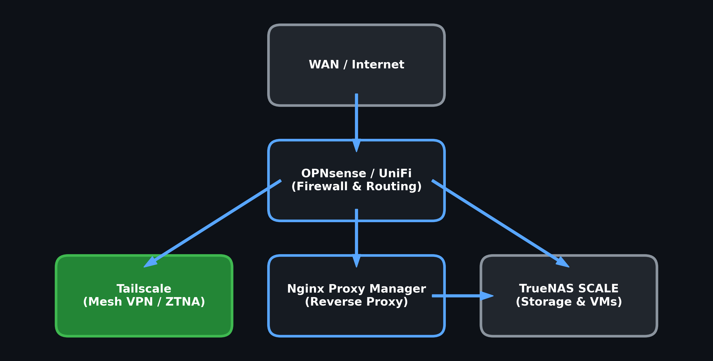
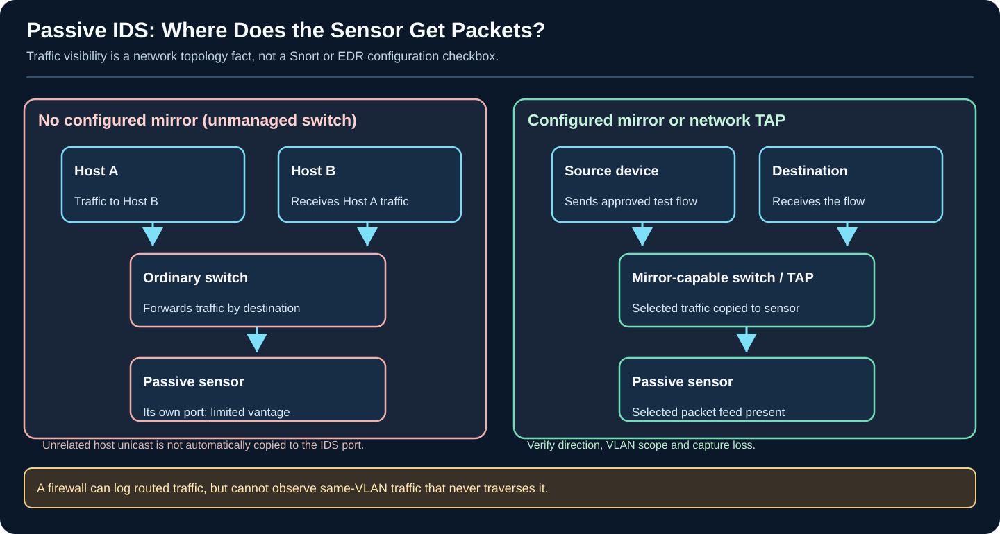

# 🏠 Cybersecurity Homelab

<div align="center">

**Building, configuring, and maintaining isolated environments for offensive and defensive research**

*Part of the [ULTIMATE CYBERSECURITY MASTER GUIDE](../README.md)*


</div>

**Additional operating references:** [Docker CLI, Compose and hardening cheat sheet](../ContainerSecurity/docker-cli-operations-reference.md) for self-hosted container labs; [curated technical documentation](../Documentation/curated-technical-docs.md) links to Packer for reproducible VM image workflows. Docker containers are not the same isolation boundary as VMs.

## 🎯 Purpose
Index and entry point for the Homelab section - covering the hardware, software, and network architecture needed to build an isolated cybersecurity lab for offensive and defensive research.

## ⚙️ Function
Links to HomeLab_Setup.md (comprehensive build guide) and provides a quick-reference overview of hardware choices, network topology, virtualization platforms (Proxmox, VMware, VirtualBox), and security considerations for lab isolation.

## 🏆 Goal
Help practitioners build a carefully segmented, recoverable lab that reduces the chance of affecting production systems. Isolation must be verified for each hypervisor, route, interface, and host configuration.

## 📋 When To Use
- Starting point for anyone building their first security homelab
- Reference for lab architecture decisions (hardware, hypervisor, VLAN isolation)
- Cross-referencing which lab tools correspond to which Documentation/ guides

---

## PNWC Cyberdeck — Portable Field Assessments

**[Open The PNWC Cyberdeck Public Reference](../Cyberdeck/README.md)** for the GL.iNet/MikroTik zone architecture, staged authorization and offline evidence workflow. The proprietary operator console and live collectors are not published.

**Proxmox IDS sensor coverage:** [Traffic visibility checklist](proxmox-security-monitoring-visibility.md) adapts the [h4cker Proxmox lab](https://github.com/The-Art-of-Hacking/h4cker/blob/master/build-your-own-lab/security-onion-proxmox.md) without assuming that an unmanaged switch can mirror packets.

## 📋 Table Of Contents

- [Overview](#-overview)
- [Infrastructure & Directory Contents](#️-infrastructure--directory-contents)
- [Guides & Standard Operating Procedures](#-guides--standard-operating-procedures-sops)
- [Getting Started: Lab Architecture](#-getting-started-lab-architecture)
- [⚠️ CRITICAL Security & Isolation Warning](#️-critical-security--isolation-warning)
- [Resources](#-resources)

---

## 🎯 Overview

A homelab can provide a repeatable environment for cybersecurity learning and defensive research. This directory covers lab architecture, deployment, and maintenance. Isolation reduces risk but does not guarantee that a host, network, or production environment cannot be affected.

**Core Objectives:**
* **Simulate Real-World Scenarios:** Deploy vulnerable machines, Active Directory domains, and attack infrastructure safely.
* **Standardize Workflows:** Develop and follow Standard Operating Procedures (SOPs) for repeatable, automated success.
* **Test Tools & Configurations:** Evaluate security tools and intentionally vulnerable systems in disposable, isolated environments. Malware analysis requires a separately designed and validated containment environment.
* **Master Infrastructure:** Gain hands-on engineering experience with Type-1 hypervisors, software-defined networking, and enterprise infrastructure.

---

## 🗂️ Infrastructure & Directory Contents

### 🖥️ Virtualization & Environments
The core computational layer of the lab.

| Category | Description | Examples / Tools |
|----------|-------------|------------------|
| **Hypervisors** | Guides for configuring bare-metal and hosted hypervisors. | Proxmox VE, ESXi, VMware Workstation, VirtualBox |
| **Attack Boxes** | Setup scripts and configurations for offensive platforms. | Kali Linux, Parrot OS, BlackArch, CommandoVM |
| **Target Machines** | Resources for deploying intentionally vulnerable endpoints. | Metasploitable, Windows AD Ranges, DVWA, Juice Shop |

### 📡 Hardware & RF
Physical tools, edge devices, and radio frequency hardware.

| Category | Description | Examples / Tools |
|----------|-------------|------------------|
| **SDR (Radio)** | Notes and guides for capturing, analyzing, and transmitting RF. | HackRF One, RTL-SDR, YardStick One |
| **Hak5 Gear** | Payloads and physical access tooling setup. | Rubber Ducky, Bash Bunny, WiFi Pineapple, LAN Turtle |
| **SBCs** | DIY pentesting rigs and embedded systems configurations. | Raspberry Pi, Pwnagotchi, ClockworkPi uConsole |

| Resource | Description |
|---|---|
| [The Black Wire Maker's Technical Reference Guide](https://valleytech-black-wire-guide.pages.dev/) | Raspberry Pi and other single-board computer (SBC) references: GPIO pinouts, connector diagrams, power data and manufacturer sources. |

### 🛡️ Network & OPSEC
The routing, switching, and boundary protection of the lab.

| Category | Description | Examples / Tools |
|----------|-------------|------------------|
| **Isolation** | Routing infrastructure to contain malware and attacks. | pfSense, OPNsense, VLAN tagging, Air-Gapping |
| **Anonymity** | Privacy-focused routing and OS integration. | Tor routing, VPN chaining, Tails, Whonix |

---

## 📚 Guides & Standard Operating Procedures (Sops)

**This is a living library.** This section contains detailed guides and SOPs covering essential lab administration tasks to ensure your environment remains stable, recoverable, and secure.

| SOP / Guide | Focus Area | Description |
|-------------|------------|-------------|
| **[PNWC Cyberdeck Public Reference](../Cyberdeck/README.md)** | Portable Field Assessment | Hardware roles, segmented topology, staged procedures and evidence handling (private portal not included). |
| **[Lab Setup & Maintenance](./HomeLab_Setup.md)** | Architecture | Core procedures for architecting, deploying, and maintaining homelab environments. |
| **[Provisioning Workflows](./workflows/)** | Automation | Step-by-step guides for deployment workflows (Ansible/Terraform) and automation playbooks. |
| **[Wireless Lab Security Assessment](./workflows/self-hosted_network_attacks.md)** | Authorized Testing | Master playbook with [RaspyJack Pi deployment & six labs](./workflows/self-hosted_network_attacks.md#raspyjack--raspberry-pi-portable-assessment-workflow), network isolation and defensive validation. |
| **Incident Response** | Blue Team | SOPs for log ingestion (ELK/Splunk) and artifact analysis within the lab environment. |
| **Hardware Prep** | Physical Assets | OS installation, firmware flashing, and setup of physical pentest tools (e.g., Proxmark3). |

---

**Portable firmware assessment companions:** [Standalone Marauder](../Documentation/WiFiMarauder_Guide.md#dedicated-standalone-marauder-deployment-playbook) · [Flipper Marauder](../Documentation/flipper_zero_guide.md#flipper-marauder-companion-deployment-labs) · [Bruce](../Documentation/bruce_firmware.md#exercise-b7--repeatable-bruce-board-qualification) · [OUI-SPY](../Documentation/microcontroller_wifi_testing.md#oui-spy-unified-blue--authorized-detection-labs) · [Biscuit](../Wardriving/biscuit.md#ecosystem-assessment-labs--deployment-examples).

### Useful Starred Projects For Isolated Lab Exercises

- [WiFiForge](https://github.com/blackhillsinfosec/WifiForge) — a **virtual, sandboxed** wireless-security training environment built on Mininet-WiFi; ideal for rehearsing wireless attack/detection concepts without transmitting on real radio channels. Do not assume its virtual behavior reproduces every physical RF condition.
- [Project NOMAD](https://github.com/Crosstalk-Solutions/project-nomad) — offline-first, self-hostable reference library and education server. Useful for isolated training networks that cannot depend on cloud lookups. Verify local content licensing, update packages before disconnecting, and keep any AI model/data stores within the lab's storage and access-control policy.
- [Reticulum](https://github.com/markqvist/Reticulum) — a cryptography-oriented networking stack for experimentation with resilient, low-bandwidth networks and transports such as LoRa or IP. Test with non-sensitive messages first; it is **not an automatic guarantee of anonymity or operational security**. Review upstream design and supported interfaces before pairing devices.
- [NetAlertX](https://github.com/netalertx/NetAlertX) — optional baseline discovery/change monitoring for your *authorized* lab subnets, complementing (rather than replacing) the [IDS/IPS guides](../IncidentResponse/IDS%26IPS/readme.md).

Keep experiments on test VLANs with clear ownership, explicit routing/firewall rules, and separate credentials. Use the [Network Audit Playbook](../PlayBooks/NetworkAuditPlayBook.md) to document scope.

## 🚀 Getting Started: Lab Architecture



*Example design for layered network protection and segmentation. This is a **reference topology**, not an inventory or validation of the reader's actual routers, firewalls, VLANs, hypervisors or storage.*

### 1. Hardware Requirements
* **Minimum:** A modern multi-core CPU (i5/i7/Ryzen), 16GB+ RAM, 500GB SSD.
* **Recommended:** Dedicated hardware (e.g., Intel NUC, Dell OptiPlex, or custom server), 64GB+ RAM, 2TB+ NVMe storage for running complex Active Directory environments alongside SIEMs.

### 2. Choose Your Hypervisor
* **Type-1 (Bare Metal):** Best for dedicated hardware. Install Proxmox VE or VMware ESXi.
* **Type-2 (Hosted):** Best for running a lab on your daily-driver laptop. Install VMware Workstation Pro or VirtualBox.

### 3. Network Segregation (Critical Step)



*Conceptual network-capture comparison.* A Snort, Zeek or Security Onion sensor cannot generally see unrelated switched unicast traffic just because its NIC is set to promiscuous mode. Use an appropriately configured [switch SPAN destination](https://www.cisco.com/c/en/us/td/docs/switches/lan/c9000/mgmt/management-configuration-guide/span.html) or a properly placed inline TAP, document the exact mirrored interfaces/VLANs and direction, and test actual capture and loss with controlled traffic. A SPAN feed can drop packets under contention. See [Security Onion's sensor requirements](https://docs.securityonion.net/en/2.4/hardware.html) and [Snort 3's passive traffic inspection description](https://docs.snort.org/start/inspection).

Before spinning up vulnerable VMs or executing malware, you must architect the network:
* **Internal / disconnected lab network:** Prefer a virtual switch with no physical uplink and explicitly verify that **no** alternate NIC, NAT, bridge or host route can reach production or the internet. **Host-only is not equivalent to internal-only**: on platforms such as VirtualBox, host-only networking also connects the host OS to the lab segment. Confirm the exact mode in the [VirtualBox network documentation](https://docs.oracle.com/en/virtualization/virtualbox/7.2/user/networkingdetails.html) or your chosen hypervisor's manual.
* **Optional egress router:** If an authorized lab specifically needs updates or external access, a separate firewall/router VM may mediate traffic between lab and upstream networks, but **two NICs do not guarantee isolation**. Set default-deny policy, check IPv4/IPv6 and management paths, verify DNS/egress allowlists, and remove the upstream connection during malware or intentionally vulnerable-host experiments unless the isolation design has been reviewed and tested.

---

## ⚠️ Critical Security & Isolation Warning

### 🔴 Lab Containment & Legal Warning

```
═══════════════════════════════════════════════════════════════
                    ⚠️ CRITICAL WARNING ⚠️
═══════════════════════════════════════════════════════════════

Building a cybersecurity lab involves handling LIVE MALWARE, inherently 
vulnerable systems, and potent offensive tools. 

1. CONTAINMENT FAILURE (BRIDGING)
   ► NEVER bridge a vulnerable VM (like Metasploitable) directly to your 
     home's physical network. If your home network is exposed to the internet, 
     an internet-reachable vulnerable VM may be discovered and attacked. Exposure and outcome depend on the services, software, and network controls; do not rely on obscurity.
   ► Malware detonated in an improperly isolated lab can escape and infect 
     your host operating system or personal home network.

2. AUTHORIZED TARGETS ONLY
   ► Having a lab does NOT give you permission to attack infrastructure 
     outside of it.
   ► If your Attack VM (e.g., Kali) has internet routing configured, ensure 
     you do not accidentally launch scans or exploits against external, 
     unauthorized IP addresses. Unauthorized computer access may violate applicable criminal or civil laws; legal consequences depend on the conduct and jurisdiction. See [18 U.S.C. §1030](https://uscode.house.gov/us/usc/119-134/t18/s1030/) and [DOJ CFAA charging policy](https://www.justice.gov/jm/jm-9-48000-computer-fraud).

3. EDUCATIONAL USE ONLY
   ► The tools, scripts, and vulnerable environments provided or referenced 
     here are for authorized security testing, defensive research, and education.
   ► Pacific Northwest Computers (PNWC) is not liable for data loss, network 
     compromise, or legal issues arising from improper lab configuration.

═══════════════════════════════════════════════════════════════
```

---

## 🔗 Quick Links

### Associated Repository Sections
- [✅ Security Checklists](../Checklists/README.md)
- [📚 Documentation](../Documentation/README.md)
- [📄 PDF Resources](../PDF/README.md)
- [📘 Playbooks](../PlayBooks/README.md)
- [💻 Scripts & Tools](../Scripts/README.md)
- [📻 Hardware & Firmware References](../firmware-hardware-compatibility.md)

### Internal Core Links
- [🏠 Main Repository](../README.md)
- [🎯 START HERE Guide](../START_HERE.md)
- [💻 Cybersecurity Master Guide](../ultimate_cybersecurity_master_guide.md)
- [🔒 OPSEC Guidelines](../OPSEC/README.md)
- [🚨 Incident Response](../IncidentResponse/README.md)

---

## 📊 Repository Statistics

```
📁 Categories: Virtualization, Hardware/RF, Network Security
💻 Focus: Infrastructure provisioning, Isolation, Active Directory simulation
⚙️ Tech Stack: Proxmox, VMware, pfSense, Linux, Windows Server
Reviewed: November 2026
👥 Maintained by: Pacific Northwest Computers (PNWC)
📝 Status: Active - Ensure strict isolation before deployment
```

---

## 🤝 Contributing

To contribute to the Homelab section:

1. Follow the 4-header standard: `## 🎯 Purpose`, `## ⚙️ Function`, `## 🏆 Goal`, `## 📋 When to Use` after every H1
2. Add a `## Related Files` section at the bottom with bidirectional links
3. Use hyphens (-) not em-dashes
4. Include network isolation requirements for any vulnerable VM or attack tool guide
5. Verify all hypervisor and OS versions before adding configuration steps
6. Add warnings whenever content involves live malware, exploit testing, or vulnerable machines

---

## 📚 Resources

### Virtualization Platforms
- **Proxmox VE**: https://www.proxmox.com/en/proxmox-ve
- **VMware Workstation Pro**: https://www.vmware.com/products/workstation-pro.html
- **VirtualBox**: https://www.virtualbox.org/

### Network Security & Isolation
- **pfSense**: https://www.pfsense.org/
- **OPNsense**: https://opnsense.org/

### Intentionally Vulnerable Machines
- **Metasploitable**: https://sourceforge.net/projects/metasploitable/
- **HackTheBox**: https://www.hackthebox.com/
- **VulnHub**: https://www.vulnhub.com/
- **TryHackMe**: https://tryhackme.com/

---

## Related Files
- [HomeLab_Setup.md](HomeLab_Setup.md) - Full build guide: hardware, network, hypervisor, and VM deployment
- [../Documentation/virtualmachines.md](../Documentation/virtualmachines.md) - VM catalog for the VMs you'll deploy in this lab
- [../IncidentResponse/](../IncidentResponse/) - IR infrastructure deployed within the homelab environment
- [../Documentation/wireshark.md](../Documentation/wireshark.md) - Wireshark for monitoring the lab's network traffic

---

<div align="center">

**📖 Use This Lab Responsibly: Authorization is MANDATORY for Pentesting**

*The best place to learn how an attacker breaches a network is on a network you built yourself.*

**Repository**: [ULTIMATE CYBERSECURITY MASTER GUIDE](https://github.com/Pnwcomputers/ULTIMATE-CYBERSECURITY-MASTER-GUIDE)

**Maintained by**: [Pacific Northwest Computers](https://github.com/Pnwcomputers)

---

⚠️ **CRITICAL: These are ATTACK TECHNIQUES - Written authorization is REQUIRED** ⚠️

⚠️ **Unauthorized activity may violate law, contract, or policy depending on conduct, authorization, and jurisdiction. Obtain the authorization required for your activity and follow the agreed scope.** ⚠️

⚠️ **ALWAYS obtain explicit written authorization before using any technique** ⚠️

⭐ **Star this repo if you find it useful!** ⭐

</div>

---

[Master Index](../README.md) | [Start Here](../START_HERE.md) | [Legal Notice](../LEGAL.md)
