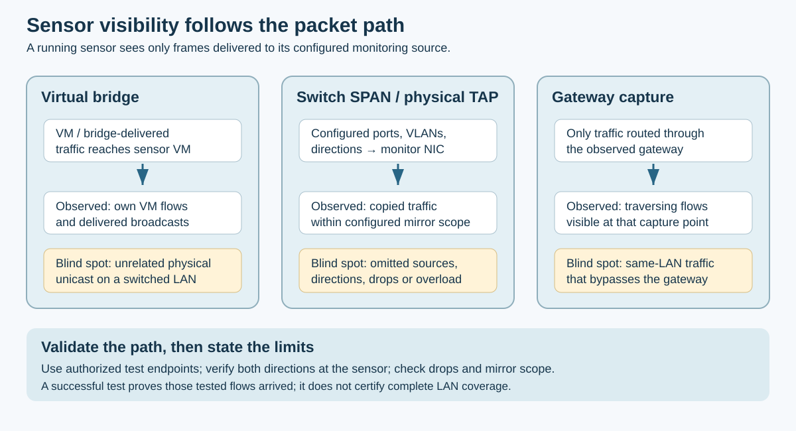

# Proxmox IDS / Security Onion: confirm packet visibility

_Original PNWC field checklist · [Homelab](README.md) · [IDS/IPS](../IncidentResponse/IDS%26IPS/readme.md) · [SIEM](../IncidentResponse/SIEM/README.md)._

This corrects a common inference when adapting [h4cker's Security Onion / Proxmox guide](https://github.com/The-Art-of-Hacking/h4cker/blob/master/build-your-own-lab/security-onion-proxmox.md): **installing a sensor on a Linux bridge or Open vSwitch does not automatically grant it visibility into all devices connected to an external unmanaged switch.** A port mirroring configuration, physical TAP, supported gateway-side capture, or deliberately mirrored *virtual* traffic is needed for the affected segment.

| Sensor source | Traffic actually available | Limitation |
| --- | --- | --- |
| Ordinary Proxmox bridge tap | VM's own flows, relevant broadcasts and explicitly delivered frames | Other ports' physical unicast normally absent |
| Managed switch SPAN | Configured source interfaces/VLANs and directions | Drops or missing segments possible |
| Physical TAP | The specific physical link crossing the TAP | No other routed/switched links |
| Gateway capture/mirror | Flows traversing the observed gateway | Same-LAN traffic bypassing the gateway may be missing |
| Fully isolated virtual test network | Defined test flows mirrored inside the hypervisor | Does not validate physical network coverage |

*Conceptual coverage map. Security Onion requires packets to reach its sniffing interface; validate the tested path and document known gaps rather than inferring full-LAN coverage.*

## Safe validation run

1. Document topology: gateway, switches, Proxmox host interfaces, vmbr/OVS bridges, target VLANs, VM management NIC and sensor NIC. Confirm physical mirror capability before modifying the host.
2. Make an isolated management path and a separate monitor interface. Backup Proxmox network configuration and record the rollback plan.
3. Using **two owned test hosts**, generate modest benign TCP, UDP and DNS traffic while the sensor captures. Confirm both request and response directions from the expected endpoints; do not rely solely on an IDS “running” status.
4. Compare the expected test flow at its endpoints with packets received by the sensor. Check mirror-source scope, sensor-interface drops, CPU load, clock synchronization and packet loss under the permitted test load.
5. Send limited synthetic/lab-originated findings to the [Wazuh/Snort/Suricata ecosystem](../IncidentResponse/IDS%26IPS/readme.md), observing classification and false positives. Do not label a detection as confirmed compromise without corroboration.
6. Archive diagram, test time UTC, capture excerpts, configuration diff, permissions, measured blind spots, data retention and restoration result.

## Acceptance criteria

- [ ] Authorized devices and captures; no accidental collection of neighbors or clients
- [ ] Explicit working mirror/TAP/gateway capture demonstrated with two endpoints
- [ ] Management interface segregated and recoverable
- [ ] Both directions of the tested flows are visible; drops and coverage gaps are documented
- [ ] Time, signatures and test evidence available for detection correlation
- [ ] No production switch/bridge changes without rollback and maintenance plan

For version-specific setup, read the [Proxmox network configuration](https://pve.proxmox.com/wiki/Network_Configuration) and Security Onion's [hardware and sniffing interface guidance](https://docs.securityonion.net/en/3/main/hardware/). Security Onion documents dedicated sniffing interfaces for TAP/SPAN traffic; traffic must be delivered to those interfaces by the network or hypervisor path. This documentation **does not** configure the network or certify that a production IDS covers the entire LAN.

[Additional curated sources](../Documentation/awesome-hacking-collections-integration.md) · [WIDS lab](../IncidentResponse/IDS%26IPS/kismet-wazuh-wireless-lab.md) · [Main README](../README.md).
