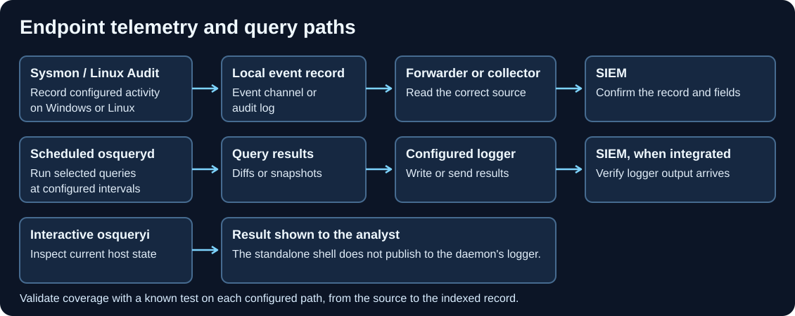

# 👁️ Endpoint Visibility (Edr / Telemetry)

<div align="center">

**Host-level instrumentation — turn endpoints into rich telemetry sources for detection and hunting**

*Part of the [ULTIMATE CYBERSECURITY MASTER GUIDE](../../README.md) · [Incident Response](../README.md) section*


</div>

---

**Collection and detection links:** [Velociraptor evidence-triage workflow](../Digital-Forensics/velociraptor-artifact-triage.md) and [Sigma/osquery/Elastic rule validation](../SIEM/detection-content-validation.md) complement Sysmon, auditd and osquery. Agent telemetry alone is not evidence of full detection coverage.

## 🎯 Purpose
Index for the Endpoint Visibility sub-section — deployment and configuration guides for the host-level instrumentation that feeds a SIEM: Windows Sysmon, Linux auditd/syslog, and cross-platform Osquery.

## ⚙️ Function
Links to a guide per instrumentation source — installation, configuration, the key events/queries that matter for detection, and how to forward the resulting telemetry into a SIEM.

## 🏆 Goal
Help defenders select and validate the Windows and Linux telemetry needed for their detection and investigation requirements.

## 📋 When To Use
- Standing up endpoint telemetry before (or alongside) a [SIEM](../SIEM/README.md)
- Deciding what to log on Windows (Sysmon) vs Linux (auditd) hosts
- Adding SQL-based, on-demand host inspection with Osquery for threat hunting
- Tuning event volume so detections fire without drowning the SIEM in noise

---

## 📋 Table Of Contents

- [Overview](#-overview)
- [Instrumentation Sources](#️-instrumentation-sources)
- [Deployment Guides](#-deployment-guides)
- [Deployment Workflow](#-deployment-workflow)
- [⚠️ Monitoring, Consent & Legal Warning](#️-monitoring-consent--legal-warning)
- [Contributing](#-contributing)
- [Resources](#-resources)

---

## 🎯 Overview

A SIEM is only as good as the telemetry it ingests. **Endpoint visibility** is the practice of instrumenting hosts so that security-relevant activity — process creation, network connections, file writes, image loads, logons — is recorded in a form you can search and alert on.



Sysmon and Linux Audit record activity selected by their configurations. Sysmon's network connection and image load events (IDs 3 and 7) are disabled by default. `osqueryi` is a standalone interactive shell. `osqueryd` can schedule queries and write differential or snapshot results through a configured logger. Confirm that each source you rely on reaches the SIEM with the expected fields. [Sysmon event documentation](https://learn.microsoft.com/en-us/sysinternals/downloads/sysmon) · [Linux Audit userspace](https://github.com/linux-audit/audit-userspace) · [osquery logging](https://osquery.readthedocs.io/en/stable/deployment/logging/) · [Interactive osquery shell](https://osquery.readthedocs.io/en/stable/introduction/using-osqueryi/)

> [!TIP]
> Deploy an event stream first (Sysmon on Windows, auditd on Linux), forward it
> to your [SIEM](../SIEM/README.md), then layer Osquery on top for interactive
> hunting.

---

## 🗂️ Instrumentation Sources

| Source | Guide | Platform | Model | Best For |
|--------|-------|----------|-------|----------|
| 🪟 **Sysmon** | **[Windows/sysmon.md](./Windows/sysmon.md)** | Windows | Configured Windows event types | Process, DNS, network, and file telemetry |
| 🐧 **Auditd / Syslog** | **[Linux/auditd_syslog.md](./Linux/auditd_syslog.md)** | Linux | Audit records and separately configured syslog forwarding | Syscall, file-access, and session auditing |
| 🔎 **osquery** | **[Linux/osquery.md](./Linux/osquery.md)** | Cross-platform | Interactive queries or scheduled results | Host inspection and scheduled monitoring |

---

## 📚 Deployment Guides

### 🪟 [Windows Sysmon](./Windows/sysmon.md)
Deploy and configure **Sysmon** with community configs (SwiftOnSecurity, Olaf Hartong). Covers install/update, the configuration XML structure, and the critical event IDs — **1** (process create), **3** (network), **7** (image load), **8** (CreateRemoteThread), **10** (process access), **11** (file create), **22** (DNS) — plus hashing, SIEM forwarding, and a detection use case per event type. The single highest-value Windows telemetry source.

### 🐧 [Linux Auditd & Syslog](./Linux/auditd_syslog.md)
Harden Linux logging with **auditd** and **rsyslog/syslog-ng**. Covers auditd rule syntax (syscall auditing, file-access watches, user-session tracking), pre-built rule sets (STIG, CIS), log forwarding to a SIEM, parsing with `ausearch`/`aureport`, and common detection use cases.

### 🔎 [Osquery](./Linux/osquery.md)
Instrument hosts as a **SQL-queryable** surface. Covers installation (with the modern `signed-by` apt keyring), configuration, and queries for proactive threat hunting and monitoring — ideal for asking ad-hoc questions ("which processes have a deleted binary on disk?") across a fleet.

---

### Starred Companion Tools For One-time Windows Audits

- [DAT — dag's Audit Tool](https://github.com/dagnazty/DAT) — PowerShell inventory of Windows hardware, accounts, services, networking, updates, Defender and event-log information. Check the script, permissions and sensitive output handling before using it on a client machine.
- [PNWC SystemTester](https://github.com/Pnwcomputers/SystemTester) — your portable Windows/Sysinternals diagnostic and malware-triage toolkit; useful for technician baselines and pre/post-repair reports. A clean diagnostic run does **not** prove the absence of compromise.

These tools produce point-in-time observations. Use the deployment workflow below to verify ongoing collection.

### Post-assessment Workstation Provisioning (Different Phase)

[PNWC DeployWorkstation](https://github.com/Pnwcomputers/DeployWorkstation) automates Windows application provisioning, updates and removal of selected preinstalled software. It belongs in an **approved deployment or rebuild workflow after** investigation, required evidence preservation and recovery planning—not in live malware triage. Test change lists on a disposable VM, obtain customer approval for removals and keep rollback/restore options available.

## 🚀 Deployment Workflow

1. Choose a detection requirement and identify the event, fields, and host population it depends on. Enable the required event types or audit rules on a test host.
2. Generate a benign, authorized test event. Confirm it appears at the local source, then verify the event time and required fields in the [SIEM](../SIEM/README.md).
3. If a detection uses scheduled queries, verify the query interval, logger, and ingestion path. Use interactive queries for spot checks and investigations.
4. Retest after filtering. Record the coverage and gaps observed, and use [MITRE ATT&CK Detection Strategies](https://attack.mitre.org/detectionstrategies/) to connect the resulting analytics to the behavior they are intended to detect.

---

## ⚠️ Monitoring, Consent & Legal Warning

```text
═══════════════════════════════════════════════════════════════
              ⚠️  DEPLOY TELEMETRY ONLY WITH AUTHORIZATION  ⚠️
═══════════════════════════════════════════════════════════════

► Only install agents/telemetry on systems you own or are explicitly
  authorized (in writing) to monitor. Endpoint monitoring can capture
  keystrokes, commands, and personal data.

► Covert monitoring of users/employees without proper notice can violate
  wiretap/interception, privacy, and labor laws — coordinate with legal/HR.

► Forwarded logs often contain PII/credentials; protect the SIEM and
  transport (TLS) accordingly, and follow GDPR/HIPAA/CCPA where applicable.
═══════════════════════════════════════════════════════════════
```

---

## 🤝 Contributing

Contributions from detection engineers and SOC analysts are welcome.

**What we accept:**
- ✅ Sysmon config tweaks and per-event-ID detection notes
- ✅ auditd rule sets and rsyslog/syslog-ng forwarding configs
- ✅ Useful Osquery packs/queries for hunting
- ✅ SIEM field-mapping notes

**Guidelines:**
1. Sanitize sample events of real PII/credentials.
2. Note the OS/tool **version** tested.
3. Describe the detection value in your PR.

---

## 📚 Resources

- **Sysmon (Sysinternals):** <https://learn.microsoft.com/en-us/sysinternals/downloads/sysmon>
- **sysmon-modular (Olaf Hartong):** <https://github.com/olafhartong/sysmon-modular>
- **auditd / Linux Audit:** <https://github.com/linux-audit/audit-documentation/wiki>
- **Osquery docs:** <https://osquery.readthedocs.io/>
- **MITRE ATT&CK (detection strategies and analytics):** <https://attack.mitre.org/detectionstrategies/>

---

## 🔗 Quick Links

- [⬅️ Incident Response section](../README.md)
- [📊 SIEM deployment guides](../SIEM/README.md)
- [🔎 Digital Forensics](../Digital-Forensics/README.md)
- [📥 Log Aggregation primer](../log_agg.md)
- [📖 Glossary](../../GLOSSARY.md) (EDR, IoC, TTP, Sysmon…)
- [🏠 Main Repository](../../README.md)

---

<div align="center">

**🛡️ Visibility is the foundation of defense — instrument hosts ethically and legally.**

*Maintained by [Pacific Northwest Computers (PNWC)](https://github.com/Pnwcomputers)*

</div>

---
[⬅️ Back to Master Index](../../README.md) | [🎯 Role Navigation](../../START_HERE.md) | [Legal Notice](../../LEGAL.md)
