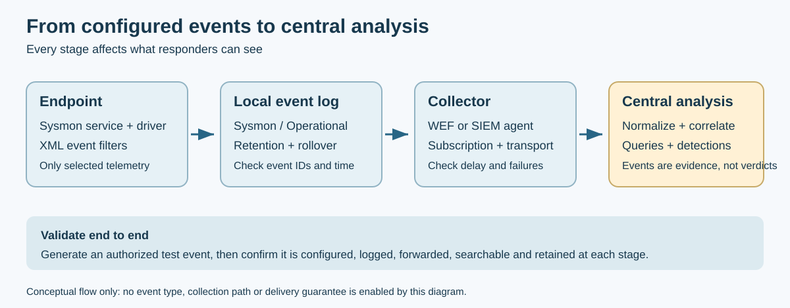

# 🪟 Windows Sysmon Deployment Guide

## 🎯 Purpose
Windows Sysmon deployment guide - covering installation, configuration (SwiftOnSecurity, Olaf Hartong configs), and key event IDs for endpoint visibility, threat hunting, and incident response.

## ⚙️ Function
Covers: Sysmon installation and update, configuration XML structure, critical event IDs (1/process create, 3/network, 7/image load, 8/CreateRemoteThread, 10/access, 11/file create, 22/DNS), hash algorithms, log forwarding to SIEM, and detection use cases per event type.

## 🏆 Goal
Configure Sysmon to emit selected endpoint events for collection and investigation. Coverage depends on the installed version, XML filters, Windows Event Log retention, and the collector; Sysmon does not analyze or classify attacks by itself.

## 📋 When to Use
- Setting up Windows endpoint visibility for a SOC or purple team environment
- Investigating a Windows compromise and auditing what Sysmon events are available
- Tuning Sysmon configuration to reduce noise while preserving detection coverage
- Building SIEM detection rules that reference Sysmon event IDs

**System Monitor (Sysmon)** records selected Windows activity in the Windows Event Log. Sysmon supplies telemetry; it does not analyze events, generate alerts, or block activity. On supported systems, choose either the built-in Windows optional feature or the standalone Sysinternals package. Their coexistence is not supported.

This guide covers installing, configuring, and maintaining Sysmon across your environment. Supported Windows versions and command-line options change; consult the current [Microsoft Sysmon documentation](https://learn.microsoft.com/en-us/sysinternals/downloads/sysmon) and the schema printed by the installed binary before deployment.



*Conceptual flow: Sysmon reports selected telemetry into the Windows event log; a collector forwards it for analysis. This does not imply every event is enabled or successfully collected.*

---

## 🎯 Why Sysmon?

Windows provides several logging sources. Sysmon can add configurable endpoint events that complement native logs; it is not a universal replacement for built-in telemetry.

| Telemetry | What Sysmon can provide | Important limit |
|---|---|---|
| Process creation | Command line, parent context and process GUID (Event ID 1) | Fields depend on OS and configuration |
| Image hashes | Configured hashes for process images | Does not hash every file-creation event |
| Network connections | Process-linked connection metadata (Event ID 3) | Disabled by default; enable and filter deliberately |
| Driver and image loads | Driver-load metadata (Event ID 6) and selected image-load metadata (Event ID 7) | Event 7 is disabled by default; volume and useful fields depend on filters and version |
| File and registry activity | Selected event types | Coverage depends on filters and can be incomplete |
| Central analysis | Can be collected by WEC or SIEM agents | Sysmon does not analyze events or guarantee delivery |

---

## 📋 Prerequisites

### System Requirements

| Component | Requirement |
|-----------|-------------|
| OS | Standalone Sysinternals package: Windows 11+ client and Windows Server 2019+ per current download page. Built-in optional feature: Windows 11 and Windows Server 2025; confirm exact OS build/support in Microsoft documentation. |
| Architecture | x86 or x64 (use appropriate binary) |
| Privileges | Local Administrator |
| Disk Space | ~5 MB (plus log storage) |

### Choose a deployment type

- **Built-in Windows feature:** Available on supported Windows 11 and Windows Server 2025 systems. It does not coexist with standalone Sysmon. Follow Microsoft's [enable and configure guide](https://learn.microsoft.com/en-us/windows/security/operating-system-security/sysmon/how-to-enable-sysmon), including checking for and removing a standalone installation first. The built-in feature uses the same Sysmon event channel, but its event payload behavior and update lifecycle can differ; validate your collector against the platform you deploy.
- **Standalone Sysinternals package:** Use the download and installation steps below for supported client and server versions. Do not install this on a device already using built-in Sysmon.

For the built-in feature, an elevated PowerShell session can enable the optional feature and install it with the default configuration:

```powershell
Get-Service sysmon* -ErrorAction SilentlyContinue
Enable-WindowsOptionalFeature -Online -FeatureName Sysmon
sysmon -i
```

If `Get-Service` returns an existing Sysmon service, identify which implementation is installed before proceeding. Do not enable the optional feature beside standalone Sysmon.

### Required Downloads (standalone package)

1. **Sysmon Binary:** [Microsoft Sysinternals](https://learn.microsoft.com/en-us/sysinternals/downloads/sysmon)
2. **Configuration File:** Choose based on your needs (see Configuration Options below)

---

## 📥 Part 1: Downloading Standalone Sysmon

### Method 1: Direct Download

Download from the official Sysinternals page:
```
https://download.sysinternals.com/files/Sysmon.zip
```

### Method 2: PowerShell Download

```powershell
# Create a tools directory
New-Item -ItemType Directory -Path "C:\Tools\Sysmon" -Force

# Download Sysmon
Invoke-WebRequest -Uri "https://download.sysinternals.com/files/Sysmon.zip" -OutFile "C:\Tools\Sysmon\Sysmon.zip"

# Extract the archive
Expand-Archive -Path "C:\Tools\Sysmon\Sysmon.zip" -DestinationPath "C:\Tools\Sysmon" -Force
```

### Verify the Download

Always verify the binary before deployment:

```powershell
# Check digital signature
Get-AuthenticodeSignature "C:\Tools\Sysmon\Sysmon64.exe"

# Verify it's signed by Microsoft
(Get-AuthenticodeSignature "C:\Tools\Sysmon\Sysmon64.exe").SignerCertificate.Subject
```

The signer should be `CN=Microsoft Corporation`.

---

## ⚙️ Part 2: Configuration Options

Sysmon's power comes from its XML configuration file. Choose a configuration based on your environment and expertise.

### Option 1: SwiftOnSecurity Config

A community configuration that can be a useful starting point. Review its filters and event coverage against your own collection, retention, and detection requirements before deployment.

```powershell
Review the repository's current release and change history, then place the reviewed configuration at `C:\Tools\Sysmon\sysmonconfig.xml`. Prefer a reviewed, versioned copy over downloading a moving branch directly.

``````

Validate the selected revision in a pilot before broad rollout and retain the exact configuration used for change review and rollback.

### Option 2: Olaf Hartong's Sysmon Modular

A modular approach allowing granular control over what gets logged.

```powershell
# Clone the repository
git clone https://github.com/olafhartong/sysmon-modular.git C:\Tools\sysmon-modular

Build and review a merged configuration from the modules at a pinned commit. Avoid using a moving branch as an unattended production source.

``````

**Pros:**
- Highly customizable
- Modular structure for easy editing
- Maps to MITRE ATT&CK framework
- Includes attack-specific detection rules

**Best for:** Advanced users, threat hunters, red team detection

### Option 3: Microsoft MSTIC-Sysmon (Reference)

Microsoft publishes Sysmon schemas and reference material. Consult the repository for current contents and use a separately reviewed configuration for deployment:

- Repository: <https://github.com/microsoft/MSTIC-Sysmon>

### Option 4: Custom Configuration

Start with a minimal config and build from there:

```xml
<!-- Replace this schema version with one reported by your target Sysmon binary (`sysmon64.exe -s`). -->
<Sysmon schemaversion="4.90">
    <HashAlgorithms>md5,sha256,IMPHASH</HashAlgorithms>
    <EventFiltering>
        <!-- Log all process creation -->
        <ProcessCreate onmatch="exclude" />
        
        <!-- Log all network connections -->
        <NetworkConnect onmatch="exclude" />
        
        <!-- Log file creation in sensitive locations -->
        <FileCreate onmatch="include">
            <TargetFilename condition="contains">\Downloads\</TargetFilename>
            <TargetFilename condition="contains">\Temp\</TargetFilename>
            <TargetFilename condition="contains">\AppData\</TargetFilename>
        </FileCreate>
        
        <!-- Log registry persistence locations -->
        <RegistryEvent onmatch="include">
            <TargetObject condition="contains">CurrentVersion\Run</TargetObject>
            <TargetObject condition="contains">CurrentVersion\RunOnce</TargetObject>
        </RegistryEvent>
    </EventFiltering>
</Sysmon>
```

---

## 🚀 Part 3: Installation

### Single Machine Installation

Open an **Administrator Command Prompt** or **PowerShell**:

```cmd
cd C:\Tools\Sysmon

# Install with configuration (64-bit)
sysmon64.exe -accepteula -i sysmonconfig.xml

# For 32-bit systems
sysmon.exe -accepteula -i sysmonconfig.xml
```

### Common Command-Line Options

| Option | Purpose |
|---|---|
| `-i [config.xml]` | Install service and driver; optionally load configuration |
| `-c [config.xml]` | Update or display the active configuration |
| `-m` | Install the event manifest |
| `-s` | Print the configuration schema |
| `-u [force]` | Uninstall the service and driver |

Use the selected implementation's own documentation and schema output to validate configuration. The schema version is independent of the binary version, and older compatible schemas may be accepted; use the target binary's output rather than assuming a fixed value. Configure event types and hashes in XML; do not assume a switch enables every event.

### Verify Installation

```powershell
# Check service status
Get-Service Sysmon64

# View current configuration
sysmon64.exe -c

# Check driver is loaded
sc query Sysmon64
```

---

## 🏢 Part 4: Enterprise Deployment

### Method 1: Group Policy Deployment

#### Step 4.1: Create a Network Share

```powershell
# On a file server, create and share the Sysmon folder
New-Item -ItemType Directory -Path "C:\Deploy\Sysmon" -Force
New-SmbShare -Name "Sysmon$" -Path "C:\Deploy\Sysmon" -ReadAccess "Domain Computers"
```

Copy `sysmon64.exe`, `sysmon.exe`, and `sysmonconfig.xml` to this share.

#### Step 4.2: Create the Installation Script

Create `Install-Sysmon.bat`:

```batch
@echo off
setlocal

set SYSMON_SHARE=\\fileserver\Sysmon$
set SYSMON_LOCAL=C:\Windows\Sysmon

:: Check if already installed
sc query Sysmon64 >nul 2>&1
if %errorlevel%==0 (
    echo Sysmon already installed, updating configuration...
    "%SYSMON_LOCAL%\Sysmon64.exe" -c "%SYSMON_SHARE%\sysmonconfig.xml"
    goto :end
)

:: Create local directory
if not exist "%SYSMON_LOCAL%" mkdir "%SYSMON_LOCAL%"

:: Copy files locally
copy /Y "%SYSMON_SHARE%\Sysmon64.exe" "%SYSMON_LOCAL%\"
copy /Y "%SYSMON_SHARE%\sysmonconfig.xml" "%SYSMON_LOCAL%\"

:: Install Sysmon
"%SYSMON_LOCAL%\Sysmon64.exe" -accepteula -i "%SYSMON_LOCAL%\sysmonconfig.xml"

:end
endlocal
```

#### Step 4.3: Create GPO

1. Open **Group Policy Management Console**
2. Create a new GPO: `Sysmon Deployment`
3. Navigate to: **Computer Configuration → Policies → Windows Settings → Scripts → Startup**
4. Add `Install-Sysmon.bat`
5. Link the GPO to target OUs

### Method 2: PowerShell Remoting

Create the destination directory before copying. If the remote block reads a UNC share, confirm the target computer can access it; remoting does not automatically forward operator credentials through a second network hop. Otherwise stage files through the remoting session.

```powershell
$computers = Get-Content "C:\targets.txt"
$sysmonPath = "\\fileserver\Sysmon$"

foreach ($computer in $computers) {
    Invoke-Command -ComputerName $computer -ScriptBlock {
        param($path)
        
        # Create the destination before copying
        New-Item -ItemType Directory -Path "C:\Windows\Sysmon" -Force | Out-Null
        Copy-Item "$path\Sysmon64.exe" -Destination "C:\Windows\Sysmon\" -Force
        Copy-Item "$path\sysmonconfig.xml" -Destination "C:\Windows\Sysmon\" -Force
        
        # Install
        Start-Process -FilePath "C:\Windows\Sysmon\Sysmon64.exe" -ArgumentList "-accepteula -i C:\Windows\Sysmon\sysmonconfig.xml" -Wait -NoNewWindow
        
    } -ArgumentList $sysmonPath
    
    Write-Host "Installed on $computer" -ForegroundColor Green
}
```

### Method 3: Microsoft Endpoint Configuration Manager (SCCM/MECM)

1. Create an Application in MECM
2. **Installation Program:** `sysmon64.exe -accepteula -i sysmonconfig.xml`
3. **Uninstall Program:** `sysmon64.exe -u`
4. **Detection Method:** Registry key `HKLM\SYSTEM\CurrentControlSet\Services\Sysmon64`
5. Deploy to target collection

---

## 📝 Part 5: Key Event IDs

Sysmon Event IDs identify event types. They are observations to investigate, not conclusions about intent.

### Critical Events for Security Monitoring

Event IDs identify telemetry types; they are not enabled uniformly and are not findings by themselves. Network Event ID 3 is disabled by default. Confirm each event's filter, platform support, log retention and collector coverage for the installed version before building detections.

| Event ID | Name | Why It Matters |
|----------|------|----------------|
| **1** | Process Create | Provides process image, command line and parent context that can support investigation |
| **3** | Network Connect | Provides process-linked connection metadata that can support investigation of unusual peers or processes |
| **6** | Driver Load | Records driver-load metadata, including configured hashes and signature information |
| **7** | Image Load | Records configured module-load metadata; investigate unusual paths and process context |
| **8** | CreateRemoteThread | Potential cross-process thread creation; investigate source, target, access context and corroborating telemetry. The event alone does not prove malicious injection. |
| **10** | Process Access | Records one process opening another; access to LSASS needs context and corroboration |
| **11** | File Create | Can help investigate selected file creation or overwrite activity |
| **12/13/14** | Registry Events | Can help investigate selected registry key/value changes |
| **15** | FileCreateStreamHash | Alternate Data Stream abuse (hiding payloads) |
| **17/18** | Pipe Events | Record named-pipe creation and connection activity; a pipe is not inherently malicious |
| **22** | DNS Query | Provides process-associated DNS-query metadata; query patterns need corroboration |
| **23** | File Delete | Records selected deletions and can archive the file; confirm configuration and archive policy |
| **25** | Process Tampering | Reports process-image tampering signals; investigate with process and memory context |

### Event ID 1: Process Creation (Most Important)

This event records process creation when enabled by the active configuration. Available fields and values depend on the host and Sysmon version:

```
Event ID: 1
UtcTime: 2024-01-15 14:23:45.123
ProcessGuid: {12345678-1234-1234-1234-123456789abc}
ProcessId: 4532
Image: C:\Windows\System32\WindowsPowerShell\v1.0\powershell.exe
CommandLine: powershell.exe -enc SQBFAFgAIAAoAE4AZQB3AC0ATwBiAGoAZQBjAHQA...
CurrentDirectory: C:\Users\victim\
User: DOMAIN\username
ParentProcessGuid: {12345678-1234-1234-1234-123456789def}
ParentImage: C:\Program Files\Microsoft Office\root\Office16\WINWORD.EXE
ParentCommandLine: "WINWORD.EXE" /n "C:\Users\victim\Downloads\invoice.docm"
```

**Red Flags:**
- Encoded PowerShell (`-enc`, `-e`, `-encodedcommand`)
- Office applications spawning cmd.exe or PowerShell
- Processes running from `\Temp\`, `\Downloads\`, `\AppData\`
- Unusual parent/child relationships

### Event ID 3: Network Connection

```
Event ID: 3
UtcTime: 2024-01-15 14:23:47.456
ProcessGuid: {12345678-1234-1234-1234-123456789abc}
ProcessId: 4532
Image: C:\Windows\System32\WindowsPowerShell\v1.0\powershell.exe
User: DOMAIN\username
Protocol: tcp
SourceIp: 192.168.1.100
SourcePort: 49234
DestinationIp: 198.51.100.20
DestinationPort: 443
DestinationHostname: example.invalid
```

**Red Flags:**
- Connections from unexpected processes (notepad.exe, calc.exe)
- Connections to known-bad IPs or unusual geolocations
- Non-browser processes connecting on port 80/443
- High port-count connections (scanning)

### Event ID 10: Process Access

Critical for detecting credential theft:

```
Event ID: 10
SourceImage: C:\Temp\mimikatz.exe
TargetImage: C:\Windows\System32\lsass.exe
GrantedAccess: 0x1010
```

**Investigate:**
- Unexpected LSASS access, checking the process identity, signer, user, access mask and surrounding activity
- Access-mask values only in the context of the host, expected software and the relevant rule; they are not universal indicators

Examples below are synthetic placeholders, not threat indicators.

### Event ID 22: DNS Query

```
Event ID: 22
ProcessId: 4532
QueryName: data.evil-domain.com
QueryResults: 192.168.1.50
Image: C:\Windows\System32\WindowsPowerShell\v1.0\powershell.exe
```

**Red Flags:**
- DNS queries from unexpected processes
- High entropy domain names (DGA)
- Unusually long subdomains (DNS tunneling)

---

## 🧪 Part 6: Testing and Verification

### Basic Functionality Test

1. **Open PowerShell** and run a simple command:

```powershell
whoami
hostname
ipconfig
```

2. **Check Event Viewer:**
   - Navigate to: `Applications and Services Logs → Microsoft → Windows → Sysmon → Operational`
   - Look for Event ID 1 entries

3. **PowerShell Query:**

```powershell
Get-WinEvent -FilterHashtable @{
    LogName = "Microsoft-Windows-Sysmon/Operational"
    Id = 1
    StartTime = (Get-Date).AddMinutes(-10)
} | Format-List TimeCreated, Message
```

### Network Connection Test

```powershell
# Generate a network connection
Invoke-WebRequest -Uri "https://www.google.com" -UseBasicParsing | Out-Null

# Check for Event ID 3
Get-WinEvent -LogName "Microsoft-Windows-Sysmon/Operational" -MaxEvents 50 | 
    Where-Object { $_.Id -eq 3 } |
    Select-Object -First 5 |
    Format-List TimeCreated, Message
```

### Atomic Red Team Testing

Atomic Red Team tests can alter system state, require dependencies, trigger security controls, or leave artifacts. Use them only on a dedicated, disposable system you are authorized to test. Before running one, read its full test definition, prerequisites and cleanup steps; pin and review the selected test/framework version. Confirm that Sysmon collection is active, run only the selected test, then verify and clean up its effects. Do not pipe a remote installer script directly into PowerShell or run an entire technique by default. See the [official getting-started guidance](https://github.com/redcanaryco/atomic-red-team/wiki/Getting-started) and [Invoke-AtomicRedTeam documentation](https://github.com/redcanaryco/invoke-atomicredteam/wiki).

---

## 🔄 Part 7: Configuration Updates

### Update Configuration on Running System

```cmd
# Update config without reinstalling
sysmon64.exe -c sysmonconfig-new.xml
```

### View Current Configuration

```cmd
sysmon64.exe -c
```

### Validate Configuration File

Before deploying, validate your XML:

```powershell
# Check XML is well-formed
[xml]$config = Get-Content "sysmonconfig.xml"
Write-Host "Configuration is valid XML" -ForegroundColor Green
```

### Automated Config Updates via GPO

Create `Update-SysmonConfig.bat`:

```batch
@echo off
set CONFIG_SHARE=\\fileserver\Sysmon$\sysmonconfig.xml
C:\Windows\Sysmon\Sysmon64.exe -c "%CONFIG_SHARE%"
```

Schedule via Group Policy Preferences → Scheduled Tasks.

---

## 🔗 Part 8: SIEM Integration

### Wazuh Integration

To collect Sysmon events with a Wazuh Windows agent, configure the event channel in the agent and verify that events arrive at the manager:

```xml
<!-- In ossec.conf on the Windows agent -->
<localfile>
    <location>Microsoft-Windows-Sysmon/Operational</location>
    <log_format>eventchannel</log_format>
</localfile>
```

### Windows Event Forwarding (WEF)

Create a subscription for Sysmon events:

```xml
<QueryList>
    <Query Id="0" Path="Microsoft-Windows-Sysmon/Operational">
        <Select Path="Microsoft-Windows-Sysmon/Operational">*</Select>
    </Query>
</QueryList>
```

### Splunk Universal Forwarder

Add to `inputs.conf`:

```ini
[WinEventLog://Microsoft-Windows-Sysmon/Operational]
disabled = 0
renderXml = true
index = sysmon
```

### Elastic Agent / Winlogbeat

```yaml
winlogbeat.event_logs:
  - name: Microsoft-Windows-Sysmon/Operational
    event_id: 1, 3, 6, 7, 8, 10, 11, 12, 13, 14, 15, 17, 18, 22, 23, 25
```

---

## 📊 Part 9: Log Management

### Event Log Size Configuration

Increase the default Sysmon log size to prevent rollover:

```powershell
# Set log to 1 GB
wevtutil sl Microsoft-Windows-Sysmon/Operational /ms:1073741824
```

Via Group Policy:
- Navigate to: **Computer Configuration → Administrative Templates → Windows Components → Event Log Service → Sysmon**
- Set **Maximum Log Size** to desired value

### Log Rotation and Archival

```powershell
# Export only under approved evidence-retention procedures
$date = Get-Date -Format "yyyy-MM-dd"
wevtutil epl "Microsoft-Windows-Sysmon/Operational" "C:\Logs\Sysmon-$date.evtx"
# Clearing is destructive: verify the export, retention policy and incident status first.
# Do not clear during an active investigation or before confirmed central collection.
# wevtutil cl "Microsoft-Windows-Sysmon/Operational"
```

### Storage Estimation

| Events/Day | Daily Size | Monthly Size |
|------------|------------|--------------|
| 10,000 | ~50 MB | ~1.5 GB |
| 100,000 | ~500 MB | ~15 GB |
| 1,000,000 | ~5 GB | ~150 GB |

Tune your configuration to reduce noise and manage storage effectively.

---

## ❗ Part 10: Troubleshooting

### Sysmon Not Logging Events

**Check service status:**
```powershell
Get-Service Sysmon64
```

**Verify driver is loaded:**
```cmd
fltmc
```
Look for the Sysmon driver in the output.

**Check for configuration errors:**
```cmd
sysmon64.exe -c
```

### High CPU or Memory Usage

Do not apply blanket exclusions for common Windows processes as a generic performance fix; they can remove security-relevant telemetry. Measure event volume and resource use, identify the specific noisy rule, then tune it while documenting the coverage you give up.

**Identify problematic rules:**
1. Start with a minimal config
2. Add rules incrementally
3. Monitor resource usage

**Common culprits:**
- Overly broad `FileCreate` rules
- Logging all `ImageLoad` events
- No exclusions for noisy system processes

Use a narrowly scoped, tested exclusion only when you can explain why the activity is safe in your environment and what detection coverage the exclusion removes.

### Events Missing

**Check filter logic:**
- `onmatch="include"` = whitelist (only log matching)
- `onmatch="exclude"` = blacklist (log everything except matching)

**Verify event types are enabled:**
```xml
<!-- This logs ALL process creations -->
<ProcessCreate onmatch="exclude" />

<!-- This logs NOTHING (empty include) -->
<ProcessCreate onmatch="include" />
```

### Uninstalling Sysmon

```cmd
# Uninstall and remove driver
sysmon64.exe -u

# Force uninstall if standard fails
sysmon64.exe -u force
```

### Driver Name Conflicts

If you've used a custom driver name and forgot it:

```powershell
# Find the driver
Get-WmiObject Win32_SystemDriver | Where-Object { $_.PathName -like "*sysmon*" }
```

---

## 🛡️ Part 11: Protect and Monitor Sysmon

Sysmon does not hide itself from attackers, and renaming its driver is not a substitute for endpoint protection or tamper monitoring. Use approved endpoint controls, restrict administrative access, centrally collect service/configuration events, and alert on unexpected stops or configuration changes. Test hardening against supported update and recovery procedures before broad deployment.

### Monitor Sysmon Service

Monitor Event ID 4 for service state changes and Event ID 16 for Sysmon configuration changes. These events are not filterable; confirm both are retained and forwarded:

```powershell
Get-WinEvent -LogName "Microsoft-Windows-Sysmon/Operational" | 
    Where-Object { $_.Id -eq 4 } |
    Select-Object TimeCreated, Message
```

### Protect the Binary and Configuration

Manage write permissions through endpoint-management and application-control policy. Do not apply an example ACL blindly: installed paths, service identity, update method and recovery requirements vary. Keep the binary and XML configuration versioned, verify their publisher/hash, and test update and rollback on a representative endpoint.

---

## 📚 Additional Resources

- [Sysmon Documentation (Microsoft)](https://learn.microsoft.com/en-us/sysinternals/downloads/sysmon)
- [Enable built-in Sysmon in Windows](https://learn.microsoft.com/en-us/windows/security/operating-system-security/sysmon/how-to-enable-sysmon)
- [Sysmon functionality and built-in feature lifecycle](https://learn.microsoft.com/en-us/windows/security/operating-system-security/sysmon/overview)
- [SwiftOnSecurity Sysmon Config](https://github.com/SwiftOnSecurity/sysmon-config)
- [Sysmon Modular (Olaf Hartong)](https://github.com/olafhartong/sysmon-modular)
- [TrustedSec Sysmon Community Guide](https://github.com/trustedsec/SysmonCommunityGuide)
- [MITRE ATT&CK Sysmon Mappings](https://attack.mitre.org/datasources/)

---

## 🗂️ Quick Reference

### Installation Commands

| Action | Command |
|--------|---------|
| Install | `sysmon64.exe -accepteula -i config.xml` |
| Update Config | `sysmon64.exe -c config.xml` |
| View Config | `sysmon64.exe -c` |
| Uninstall | `sysmon64.exe -u` |

### Event Log Locations

| Item | Path |
|------|------|
| Event Log | `Microsoft-Windows-Sysmon/Operational` |
| Event Viewer Path | `Applications and Services Logs → Microsoft → Windows → Sysmon → Operational` |
| Standalone binary | `Sysmon64.exe` (path depends on installation) |
| Driver | `SysmonDrv.sys` (name/path can vary) |

### PowerShell Quick Queries

```powershell
# Last 10 process creations
Get-WinEvent -LogName "Microsoft-Windows-Sysmon/Operational" -MaxEvents 10 | Where-Object {$_.Id -eq 1}

# Network connections in last hour
Get-WinEvent -LogName "Microsoft-Windows-Sysmon/Operational" -MaxEvents 100 | Where-Object {$_.Id -eq 3 -and $_.TimeCreated -gt (Get-Date).AddHours(-1)}

# LSASS access attempts
Get-WinEvent -LogName "Microsoft-Windows-Sysmon/Operational" | Where-Object {$_.Id -eq 10 -and $_.Message -like "*lsass*"}
```

---

*Part of the Incident Response & Log Aggregation Branch*

## Related Files
- [../../../README.md](../../../README.md) - IncidentResponse section index
- [../Linux/auditd_syslog.md](../Linux/auditd_syslog.md) - Linux equivalent: auditd
- [../Linux/osquery.md](../Linux/osquery.md) - Cross-platform endpoint visibility
- [../../SIEM/splunk.md](../../SIEM/splunk.md) - Splunk for Sysmon event analysis
- [../../SIEM/wazuh.md](../../SIEM/wazuh.md) - Wazuh for Sysmon log ingestion

