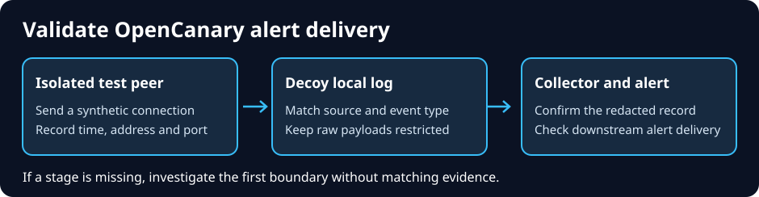

# 🍯 Open-Source Honeypot Deployment with OpenCanary

<div align="center">

**Deception-based intrusion detection on a Raspberry Pi — built from real trial and error**

*Part of the [ULTIMATE CYBERSECURITY MASTER GUIDE](../../README.md) · [Incident Response](../README.md) section*


</div>

---

**Current SIEM extension:** [OpenCanary → Wazuh native JSON rules](./wazuh-honeypot-integration.md), [Raspberry Pi deployment](./raspberry-pi-honeypot-lab.md) and [Proxmox decoy VM isolation](./proxmox-vm-honeynet.md). OpenCanary events can be created by legitimate asset scans and monitoring; investigate context before attributing intent.

**SIEM/DIY extension:** [Native OpenCanary JSON → Wazuh](./wazuh-honeypot-integration.md), [Raspberry Pi Lab](./raspberry-pi-honeypot-lab.md) and [Proxmox isolation](./proxmox-vm-honeynet.md). A decoy can also be contacted by legitimate inventory, monitoring or authorized scans; verify context before assigning intent.

## 🎯 Purpose
Guide for deploying [OpenCanary](https://github.com/thinkst/opencanary), a lightweight open-source honeypot, as an early-warning deception layer. Its enabled modules record specific interactions with decoy services such as SSH, FTP, and HTTP.

## ⚙️ Function
Covers why OpenCanary was the tool that actually worked after two other honeypots failed, install and dependency troubleshooting, multi-service configuration, safely running a honeypot on a common port without losing real SSH access, email alerting, and log analysis.

## 🏆 Goal
Get a low-resource honeypot running and logging real attacker interaction — reliably, on hardware as modest as a Raspberry Pi 3B — without burning hours on the installer dead-ends this guide already walked into so you don't have to.

## 📋 When to Use
- Standing up a low-interaction honeypot to catch and log automated attack traffic
- A "which honeypot should I actually use" decision — this documents why the popular first picks (HoneyPi, Cowrie) aren't always the smooth path
- Placing a honeypot on a Pi or small VM with limited resources
- Deciding what to do with a spare device on your network (see [Homelab/HomeLab_Setup.md](https://github.com/Pnwcomputers/ULTIMATE-CYBERSECURITY-MASTER-GUIDE/blob/main/Homelab/HomeLab_Setup.md)'s honeypot-device option)

> 📝 **Note:** This guide is informational/educational, covering the general deployment path rather than one specific live network.

---

## 📋 Table of Contents

- [What a Honeypot Actually Buys You](#-what-a-honeypot-actually-buys-you)
- [Why OpenCanary (and Not the First Two Things Tried)](#-why-opencanary-and-not-the-first-two-things-tried)
- [Deployment Workflow](#-deployment-workflow)
- [Installation](#-installation)
- [Freeing the Ports the Honeypot Needs](#-freeing-the-ports-the-honeypot-needs)
- [Configuration](#-configuration)
- [Running It](#-running-it)
- [Email Alerting](#-email-alerting)
- [Log Analysis](#-log-analysis)
- [Common Gotchas](#-common-gotchas)
- [⚠️ Security Notes](#️-security-notes)
- [Resources](#-resources)

---

## 🎯 What a Honeypot Actually Buys You

A decoy can make unexpected service contacts easier to spot. Inventory, monitoring, authorized
testing and configuration errors can also generate events. Establish which sources are expected,
review policy and timing, and correlate an unexpected event with other evidence before assigning
intent. Module settings, network reachability and log delivery affect what the decoy can observe.

This makes it a strong **complement** to (not a replacement for) the detection layers covered elsewhere in this repo — see the [IDS/IPS guides](../IDS%26IPS/readme.md) for signature/protocol-based detection on real production traffic.

---

## 🔍 Why OpenCanary (and Not the First Two Things Tried)

Three honeypots were actually attempted on a Pi 3B, in this order:

| Attempt | Result |
|---|---|
| **HoneyPi** | Installer script ran and exited cleanly, but never created a running service or log file — nothing to show for it, no clear error to debug either |
| **Cowrie** | `git clone` repeatedly produced an incomplete repository — missing the `bin/cowrie` executable script needed to even start the install process |
| **OpenCanary** | Installed successfully after resolving a chain of Python dependency issues (see [Installation](#-installation)) — this is the one that actually worked |

**The takeaway:** Cowrie is usually cited as the "best balance" honeypot for a Pi, and on a healthy environment it likely is. But if you hit a silently-broken installer or a mysteriously incomplete git clone, don't burn hours re-trying the same tool — **OpenCanary is a legitimate, lighter-weight fallback**, not a downgrade. It's pure Python, has fewer moving parts, and emulates more services out of the box (SSH, FTP, HTTP, HTTPS, Telnet, MySQL, MSSQL, SMB, RDP, TFTP, NTP, SNMP, and more) than an SSH/Telnet-only honeypot like Cowrie.

---

## 🚀 Deployment Workflow

```text
1. Prep:
   └─> Pick hardware (a Pi 3B is sufficient) and isolate it — a honeypot
       should never sit on the same trust level as production systems.
   └─> Decide which service ports it will emulate.

2. Free the ports:
   └─> If emulating SSH on port 22, move the box's REAL SSH daemon to a
       different port FIRST, before starting the honeypot.

3. Install:
   └─> Install OpenCanary and its dependencies in an isolated venv
       and run pip check before starting the service.

4. Configure:
   └─> Edit /etc/opencanaryd/opencanary.conf — enable the services you
       want, set realistic banners.

5. Start & validate:
   └─> Start the daemon, confirm each emulated service actually bound
       to its port, connect from a SEPARATE machine to generate a test
       hit, confirm it logs.

6. Alert & persist:
   └─> Configure email alerting for real-time notification.
   └─> Add a systemd unit so it survives reboots.

7. Monitor:
   └─> Review logs regularly; every hit is signal, not noise.
```

---

## 🔧 Installation

### Install into an isolated environment

Use the [upstream installation instructions](https://github.com/thinkst/opencanary/blob/master/README.md)
and keep OpenCanary's dependencies separate from system Python:

```bash
sudo apt update
sudo apt install -y python3-dev python3-pip python3-venv libssl-dev libffi-dev libpcap-dev
sudo python3 -m venv /opt/opencanary-venv
sudo /opt/opencanary-venv/bin/python -m pip install --upgrade pip
sudo /opt/opencanary-venv/bin/python -m pip install opencanary
sudo /opt/opencanary-venv/bin/python -m pip check
sudo /opt/opencanary-venv/bin/opencanaryd --copyconfig
```

Resolve installation failures inside this environment. Do not use `--no-deps`
or override system Python protections to bypass a dependency conflict. For an
existing global installation, preserve the configuration and stop the old service
before switching its executable paths; do not blindly remove distro packages.

The commands and service unit below use the same absolute environment path.
Optional service emulations can require additional system packages; install only
those required for the services you enable, following upstream documentation.

---

## 🔌 Freeing the Ports the Honeypot Needs

**Do this before starting OpenCanary if you're emulating SSH on port 22.** Attackers and automated scanners overwhelmingly target the *standard* ports — putting the honeypot's SSH listener on a high port like 8022 will make it nearly invisible to the exact scanning traffic it exists to catch.

Move the box's real SSH daemon off port 22 first:

```bash
sudo nano /etc/ssh/sshd_config
# Change: Port 22   ->   Port 2222
sudo systemctl restart sshd
```

Confirm you can still reach the real SSH service on the new port **before** proceeding — getting locked out of a headless Pi over this is an easy, avoidable mistake:

```bash
ssh -p 2222 user@<pi-ip>
```

Only once that's confirmed working should OpenCanary be configured to bind port 22.

---

## ⚙️ Configuration

Generate the default config, then edit it:

```bash
sudo /opt/opencanary-venv/bin/opencanaryd --copyconfig
sudo nano /etc/opencanaryd/opencanary.conf
```

A working multi-service configuration:

```json
{
    "device.node_id": "opencanary-1",
    "ip.ignorelist": [],
    "git.enabled": false,

    "ssh.enabled": true,
    "ssh.port": 22,
    "ssh.version": "SSH-2.0-OpenSSH_5.1p1 Debian-5ubuntu1",

    "ftp.enabled": true,
    "ftp.port": 21,
    "ftp.banner": "FTP server ready",

    "http.enabled": true,
    "http.port": 80,
    "http.banner": "Apache/2.2.22 (Ubuntu)",
    "httpproxy.enabled": false,

    "telnet.enabled": true,
    "telnet.port": 23,
    "telnet.banner": "Welcome",

    "mysql.enabled": true,
    "mysql.port": 3306,
    "mysql.banner": "5.5.43-0ubuntu0.14.04.1",

    "smb.enabled": true,
    "smb.auditfile": "/var/log/samba-audit.log",
    "smb.domain": "corp",

    "portscan.enabled": true,

    "redis.enabled": false,
    "rdp.enabled": false,
    "sip.enabled": false,
    "snmp.enabled": false,
    "ntp.enabled": false,
    "tftp.enabled": false,
    "tcpbanner.enabled": false,
    "mssql.enabled": false,
    "vnc.enabled": false,

    "logger": {
        "class": "PyLogger",
        "kwargs": {
            "formatters": { "plain": { "format": "%(message)s" } },
            "handlers": {
                "console": {
                    "class": "logging.StreamHandler",
                    "stream": "ext://sys.stdout"
                },
                "file": {
                    "class": "logging.FileHandler",
                    "filename": "/var/tmp/opencanary.log"
                }
            }
        }
    }
}
```

Enable only the services that make sense for what you're trying to attract — a wider spread (as above) catches more scanner types, but every additional emulated service is one more thing to keep an eye on. Realistic banners matter: a default/generic banner is more likely to tip off a careful attacker that it's a decoy.

---

## ▶️ Running It

```bash
sudo /opt/opencanary-venv/bin/opencanaryd --start
sudo /opt/opencanary-venv/bin/opencanaryd --status
```

Expect a startup warning like this — it's normal, not an error, since binding to low ports (22, 80, 21) requires root:

```
WARNING: OpenCanary will not drop root user or group privileges after launching.
Set both --uid=nobody and --gid=nogroup (or another low privilege user/group) to silence this warning.
```

### Persist across reboots

```bash
sudo nano /etc/systemd/system/opencanary.service
```

```ini
[Unit]
Description=OpenCanary Honeypot
After=network.target

[Service]
Type=forking
ExecStart=/opt/opencanary-venv/bin/opencanaryd --start
ExecStop=/opt/opencanary-venv/bin/opencanaryd --stop
Restart=on-failure

[Install]
WantedBy=multi-user.target
```

```bash
sudo systemctl daemon-reload
sudo systemctl enable opencanary
```

### Validate from a separate machine



1. From a separate authorized peer on the isolated lab network, open one connection to the enabled
   decoy listener. Record the UTC time, source address and destination port. A local host test can
   confirm the listener separately from the network path.
2. Match the recorded attributes in the local log using the metadata filter below. When testing
   an authentication event, use a disposable username and dummy secret. OpenCanary's SSH module
   can record supplied passwords in the event payload. [Upstream SSH module](https://github.com/thinkst/opencanary/blob/master/opencanary/modules/ssh.py)
3. If forwarding is enabled, confirm the corresponding redacted event reaches the collector and
   produces the expected alert. A local event confirms collection at the decoy. Delivery requires
   evidence at the destination.

---

## 📧 Email Alerting

OpenCanary can route events through an SMTP handler. Before using it, verify the formatter and recipients. For production notifications, forward redacted event metadata through an approved collector and keep raw authentication payloads restricted.

```json
"handlers": {
    "SMTP": {
        "class": "logging.handlers.SMTPHandler",
        "mailhost": ["smtp.gmail.com", 587],
        "fromaddr": "you@example.com",
        "toaddrs": ["you@example.com"],
        "subject": "OpenCanary Alert",
        "credentials": ["you@example.com", "your-app-password"],
        "secure": []
    }
}
```

**Gmail-specific gotcha:** an app password is displayed with spaces in Google's UI for readability (`abcd efgh ijkl mnop`) but must be entered **without spaces** wherever you actually use it. This trips people up because it's easy to copy the displayed, spaced version verbatim.

---

## 🔍 Log Analysis

The file-handler configuration above writes JSON events. OpenCanary uses numeric `logtype` values.
Its current source defines `4000` for a new SSH connection, `4002` for an SSH login attempt, and
`2000` for an FTP login attempt. Confirm the mapping for your installed release. The following
reader prints selected metadata fields for those events and skips malformed or unrelated records.
[OpenCanary logger constants](https://github.com/thinkst/opencanary/blob/master/opencanary/logger.py)

```bash
python3 - /var/tmp/opencanary.log <<'PY'
import json
import sys

fields = ("utc_time", "node_id", "src_host", "dst_host", "dst_port", "logtype")
with open(sys.argv[1], encoding="utf-8") as events:
    for line in events:
        try:
            event = json.loads(line)
        except json.JSONDecodeError:
            continue
        if isinstance(event, dict) and event.get("logtype") in (4000, 4002, 2000):
            print(json.dumps({name: event.get(name) for name in fields}))
PY
```

For centralizing these logs into a SIEM alongside your other detection sources, see **[IncidentResponse/log_agg.md](https://github.com/Pnwcomputers/ULTIMATE-CYBERSECURITY-MASTER-GUIDE/blob/main/IncidentResponse/log_agg.md)** and **[IncidentResponse/SIEM/README.md](https://github.com/Pnwcomputers/ULTIMATE-CYBERSECURITY-MASTER-GUIDE/blob/main/IncidentResponse/SIEM/README.md)**.

---

### Starred companion: OpenCanary log review

[OpenCanaryChecker](https://github.com/7h30th3r0n3/OpenCanaryChecker) is a community script for parsing OpenCanary logs into more accessible activity summaries. Review the script and its dependencies before introducing it into an investigation; preserve original logs, timestamps and hashes as the evidence of record. Use the **upstream [OpenCanary](https://github.com/thinkst/opencanary)** documentation for current sensor configuration.

## 🩹 Common Gotchas

| Symptom | Cause | Fix |
|---|---|---|
| `error: externally-managed-environment` on `pip install` | PEP 668 blocking system-wide pip installs on modern Debian/Ubuntu | Use the isolated environment above; do not override system Python protections |
| `uninstall-no-record-file` on `urllib3` (or similar) during install | pip trying to uninstall a package that `apt`, not pip, originally installed | Install the complete dependency set in the isolated environment; leave distro packages intact |
| `ModuleNotFoundError: No module named 'pkg_resources'` | `setuptools` missing/incompatible with the Python version | `sudo /opt/opencanary-venv/bin/python -m pip install setuptools` |
| `ModuleNotFoundError: No module named 'simplejson'` | Dependency not pulled in by `--no-deps` install | `sudo /opt/opencanary-venv/bin/python -m pip install simplejson` |
| `.../opencanaryd: line 48: /usr/local/bin/twistd: No such file or directory` | `twisted` (which provides `twistd`) missing | `sudo /opt/opencanary-venv/bin/python -m pip install twisted` |
| Honeypot barely gets any hits | Emulated services on non-standard ports (e.g. SSH on 8022) | Move real SSH off 22 first, then run the honeypot's SSH listener *on* 22 — scanners target standard ports |
| Locked out of the box after moving SSH | Didn't verify the new SSH port worked before restarting the daemon | Always test the new port from a second terminal/session before closing the original one |
| Installer runs, "succeeds," nothing is actually running | Some pre-packaged honeypot installers (not OpenCanary specifically) exit cleanly without creating the service they claim to | Verify with `systemctl status <service>` and check for an actual log file being written, don't trust installer exit codes alone |

---

## ⚠️ Security Notes

```
═══════════════════════════════════════════════════════════════
                    ⚠️ CRITICAL WARNING ⚠️
═══════════════════════════════════════════════════════════════

► ISOLATE IT. A honeypot exists to be attacked — never place it on
  the same network segment/trust level as production systems. If
  it's compromised (rare with a low-interaction honeypot like
  OpenCanary, but not impossible), it should have nothing
  reachable worth pivoting to.

► DON'T LOCK YOURSELF OUT. Moving real SSH off port 22 to make
  room for the honeypot is safe ONLY if you verify the new port
  works from a separate session before you rely on it.

► LOW-INTERACTION ≠ ZERO-RISK. OpenCanary simulates services
  rather than running real vulnerable ones (unlike some
  high-interaction honeypots), which keeps risk low — but keep it
  patched and don't assume "it's just a honeypot" means it's safe
  to neglect.

► EVERY HIT IS A REAL EVENT. There's no legitimate reason for
  anything to touch a honeypot. Don't let alerts pile up unread —
  the signal-to-noise ratio here is better than almost any other
  detection source in this repo.

═══════════════════════════════════════════════════════════════
```

---

## 📚 Resources

- **OpenCanary GitHub:** [github.com/thinkst/opencanary](https://github.com/thinkst/opencanary)
- **OpenCanary docs:** [opencanary.readthedocs.io](https://opencanary.readthedocs.io)
- **Canarytokens (complementary project, same maintainers):** [canarytokens.org](https://canarytokens.org)
- **Cowrie (alternative, SSH/Telnet-focused):** [github.com/cowrie/cowrie](https://github.com/cowrie/cowrie)

---

<div align="center">

## Related Files
- [IDS & IPS Deployment Guides](../IDS%26IPS/readme.md) - Signature/protocol-based detection on real traffic, the complement to this deception-based approach
- [IncidentResponse/log_agg.md](https://github.com/Pnwcomputers/ULTIMATE-CYBERSECURITY-MASTER-GUIDE/blob/main/IncidentResponse/log_agg.md) - Centralized log collection, including wireless IDS forwarding patterns applicable here too
- [IncidentResponse/SIEM/README.md](https://github.com/Pnwcomputers/ULTIMATE-CYBERSECURITY-MASTER-GUIDE/blob/main/IncidentResponse/SIEM/README.md) - Forward honeypot alerts into a SIEM for correlation with other detection sources
- [PlayBooks/unauth_access.md](https://github.com/Pnwcomputers/ULTIMATE-CYBERSECURITY-MASTER-GUIDE/blob/main/PlayBooks/unauth_access.md) - Unauthorized-access investigation playbook; a honeypot trigger is explicitly a low-severity classification there
- [Homelab/HomeLab_Setup.md](https://github.com/Pnwcomputers/ULTIMATE-CYBERSECURITY-MASTER-GUIDE/blob/main/Homelab/HomeLab_Setup.md) - Repurposing spare lab hardware as a honeypot device

---

**🛡️ Use These Resources Responsibly**

*Every hit is real. There's no legitimate reason to touch a honeypot.*

**Repository**: [ULTIMATE CYBERSECURITY MASTER GUIDE](https://github.com/Pnwcomputers/ULTIMATE-CYBERSECURITY-MASTER-GUIDE)

**Maintained by**: [Pacific Northwest Computers](https://github.com/Pnwcomputers)

⭐ **Star this repo if you find it useful!** ⭐

</div>

---

[Section Index](readme.md) | [Master Index](../../README.md) | [Legal Notice](../../LEGAL.md)
