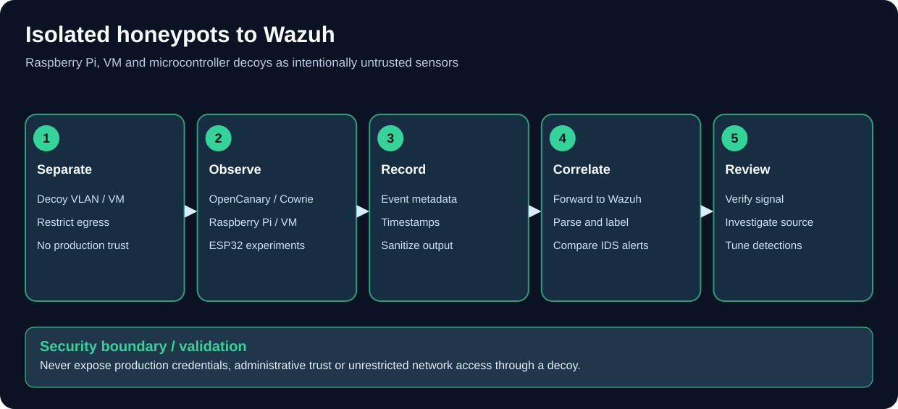

# 🍯 Honeypot Deployment Guides

<div align="center">

**Deception-based detection — decoys that exist purely to be attacked**

*Part of the [ULTIMATE CYBERSECURITY MASTER GUIDE](../../README.md) · [Incident Response](../README.md) section*


</div>

---

**Containerized honeypot operations:** Review [Docker/Compose diagnostics and cleanup precautions](../../ContainerSecurity/docker-cli-operations-reference.md) before changing T-Pot or other Docker-backed deception deployments. Persistent alert/data volumes need a tested backup and recovery plan.

## 🎯 Purpose
Index for the Honeypots sub-section for self-hosted deception-technology build guides, so a blue teamer can deploy a low-noise, high-signal decoy layer alongside the traffic-based detection covered elsewhere in this repo.

## ⚙️ Function
Links to a full build guide per platform; full install, real dependency/installer gotchas from actual builds, service configuration, alerting, and log analysis. Plus guidance on how a honeypot fits alongside IDS/IPS and SIEM.

## 🏆 Goal
Enable a practitioner to stand up a working honeypot that reliably logs attacker interaction, on hardware as modest as a Raspberry Pi, without repeating the installer dead-ends a real build already ran into.

## 📋 When To Use
- Standing up a honeypot for the first time and deciding which platform to use
- An installer "succeeds" but nothing is actually running or logging
- Deciding what to do with a spare device on your network
- Looking for a low-effort, high-confidence detection source to complement Suricata/Zeek or a wireless IDS

---

## 📋 Table Of Contents

- [Overview](#-overview)
- [Platform Comparison](#️-platform-comparison)
- [Deployment Guides](#-deployment-guides)
- [DIY Hardware and Wazuh Reporting](#diy-hardware-and-wazuh-reporting)
- [How This Fits With IDS/IPS and SIEM](#-how-this-fits-with-idsips-and-siem)
- [Deployment Workflow](#-deployment-workflow)
- [⚠️ Security Notes](#️-security-notes)
- [Contributing](#-contributing)
- [Resources](#-resources)

---

## 🎯 Overview

A **honeypot** is a decoy vulnerable "fake service or system" with no legitimate reason to ever be touched. Unlike a signature-based IDS or a wireless sensor, it doesn't need tuning against a baseline of normal traffic, because it has no intended business traffic. **However, asset inventory, vulnerability scanners, health checks and authorized tests can still contact a decoy**, so every hit deserves classification rather than being assumed malicious. That makes it one of the highest signal-to-noise detection sources available, for very little compute.

This sub-section favors **hands-on, from-a-real-build detail** where it exists; the OpenCanary and HoneyPi guides document actual installer/dependency failures hit during a real deployment, including a genuine "HoneyPi" name collision with an unrelated project that explains one of them. The Cowrie, Dionaea, and T-Pot guides are sourced from current official documentation rather than a live build log, and are marked as such internally; they're no less accurate, just a different provenance.

> [!TIP]
> New to detection infrastructure generally? A honeypot pairs well with, but doesn't
> replace, the guides in [../IDS&IPS/](../IDS%26IPS/readme.md). Start there for
> traffic-based detection, and add a honeypot here for a decoy layer.

---

## 🗂️ Platform Comparison

| Platform | Guide | Type | Resource Footprint | Captures / Emulates |
|---|---|---|---|---|
| 🐍 **[OpenCanary](./opencanary.md)** | Low-interaction | Very low — runs on a Pi 3B | SSH, FTP, HTTP(S), Telnet, MySQL, MSSQL, SMB, RDP, TFTP, NTP, SNMP, port-scan detection |
| 🐚 **[Cowrie](./cowrie.md)** | Medium-to-high interaction | Low-moderate | Full emulated SSH/Telnet shell session — records real attacker commands, keystrokes, and file up/downloads, not just the login attempt |
| 🕷️ **[Dionaea](./dionaea.md)** | Low-interaction, payload-focused | Low (Docker) | FTP, SMB, MySQL, MSSQL, TFTP, MQTT, SIP, Memcached — captures the actual **malware payload** dropped by an exploit, not just the connection |
| 🍯🐝 **[HoneyPi](./honeypi.md)** | Low-interaction | Very low — runs on a Pi | Port-scan detection (via PSAD), FTP, Telnet, VNC — built for **internal**-network placement rather than internet-facing decoys |
| 🐳 **[T-Pot](./tpot.md)** | Multi-platform (20+ honeypots at once) | High — 8-16 GB RAM, 128+ GB disk | Everything above plus ~15 more (ConPot, Honeytrap, ADBHoney, Heralding, Log4Pot, and more), with Elastic Stack dashboards and an attack map bundled in |

---

## 📚 Deployment Guides

### 🐍 [OpenCanary](./opencanary.md)
A lightweight, pure-Python low-interaction honeypot. Covers why it was the platform that actually worked after two other honeypots (HoneyPi, Cowrie) hit dead ends on the same hardware, the real dependency-resolution chain on modern Debian/Ubuntu (PEP 668, `pkg_resources`, `simplejson`, `twisted`), safely freeing port 22 for the honeypot without losing real SSH access, multi-service configuration, email alerting, and log analysis one-liners.

### 🐚 [Cowrie](./cowrie.md)
A medium-to-high interaction SSH/Telnet honeypot that emulates a full fake shell in Python, recording everything an attacker does once "in" — not just that they tried. Covers the current, simpler pip-based install (vs. the older git-clone path that's more prone to breaking), listening on port 22 without losing real SSH access, and session replay for forensic review.

### 🕷️ [Dionaea](./dionaea.md)
A low-interaction honeypot purpose-built to let automated exploit attempts complete far enough to deliver their actual payload, which Dionaea then captures to disk. Covers the officially-recommended Docker deployment, the considerably longer from-source alternative, port planning across its wide service footprint, and handling captured samples safely.

### 🍯🐝 [HoneyPi](./honeypi.md)
A PSAD-based honeypot purpose-built for **internal**-network intrusion detection; catching an attacker already past the perimeter, rather than collecting internet-wide threat intelligence. **Opens with a name-collision warning:** "HoneyPi" also refers to a completely unrelated IoT beehive-monitoring project on GitHub, which is almost certainly what caused a real "installer succeeded but nothing was created" failure during an actual deployment attempt.

### 🐳 [T-Pot](./tpot.md)
The "go big" option: 20+ individual honeypots (including Cowrie and Dionaea) running as Docker containers under one orchestration layer, with Elastic Stack dashboards and an animated attack map out of the box. Covers sizing, the Hive/Sensor distributed-deployment model, customizing which honeypots run, and the update/backup maintenance model.

---

<a id="diy-hardware-and-wazuh-reporting"></a>
### DIY Hardware & Wazuh Reporting

**[Security and accuracy review (October 31, 2026)](./REVIEW-2026-10-31.md):** methods, limitations, CI results and the separate installer pinning issue.

| Guide | Deployment | What it adds |
| --- | --- | --- |
| [Raspberry Pi Honeypot Lab](./raspberry-pi-honeypot-lab.md) | Pi 3/4/5, Zero 2 W | OpenCanary, Cowrie and lightweight decoys with safe port/network design |
| [Proxmox VM Honeynet](./proxmox-vm-honeynet.md) | VM isolation | Honeypot VLAN design, Wazuh agents, safe captures and T-Pot resource planning |
| [Minimal DIY HTTP Sensor](./diy-sensor-lab.md) | Pi, mini PC, Linux VM | Python HTTP decoy with no credential/body collection, JSONL and tests |
| [ESP32/IoT Honeypots](./esp32-diy-honeypots.md) | ESP32 / C5 / C6 | Real hardware constraints and custom serial metadata-to-Wazuh bridge |
| [ESP32-S3: ShadowSentry & HoneyMire](./esp32-s3-honeypots.md) | ESP32-S3 | Device-specific firmware features, source links and safe export caveats |
| [Wazuh Honeypot Integration](./wazuh-honeypot-integration.md) | Any enrolled Linux collector | Native OpenCanary/Cowrie JSON, custom rule IDs and dashboards |

See the [Kismet + Wazuh](../IDS%26IPS/kismet-wazuh-wireless-lab.md) and [nzyme + Wazuh](../IDS%26IPS/nzyme-wazuh-integration.md) guides for **complementary wireless detections**. Correlation requires shared time/site context and trusted AP/client telemetry.

### Small Embedded Deception Sensors

[NanoC6 ESP32 Honeypot](https://github.com/7h30th3r0n3/NanoC6-ESP32-Honeypot) is a small-device option for learning about emulated services, persistent local records and webhook-based alerting. Consider it for a **segmented lab or tightly controlled low-interaction sensor**, not as a replacement for maintained full-system honeypots or a hardened SIEM feed. Restrict management access, isolate the network and verify event timestamps and delivery before relying on alerts.

<a id="-how-this-fits-with-idsips-and-siem"></a>
## 🤔 How This Fits With IDS/IPS & SIEM



*A honeypot must be segmented and treated as untrusted.*

```text
Want to detect attacks against your REAL production traffic?
  └─> Follow the linked IDS & IPS index above for wired and wireless sensing.
      These need tuning to separate real threats from normal traffic.

Want a dedicated detection tripwire for unusual connections
around where they shouldn't be?
  └─> A honeypot (this folder). Classify hits against authorized scanning and maintenance; not every hit is an attacker.

Want to correlate honeypot hits with everything else?
  └─> Follow the linked Honeypot → Wazuh guide above.
```

A honeypot is a **complement**, not a substitute, for traffic-based detection — it only sees traffic aimed directly at it, not the rest of your network. Confirm suspicious contacts against inventory and scan schedules before escalating.

---

## 🚀 Deployment Workflow

```text
1. Isolate:
   └─> Never place a honeypot at the same trust level as production
       systems. Assume it will be probed, possibly compromised.

2. Choose a platform:
   └─> Start with OpenCanary for a low-resource, multi-service decoy.
   └─> Want deep attacker session capture? -> Cowrie.
   └─> Want actual malware payloads, not just connection logs? -> Dionaea.
   └─> Want internal-network port-scan detection specifically? -> HoneyPi.
   └─> Have real hardware to spare and want 20+ honeypots plus
       dashboards out of the box? -> T-Pot.

3. Free real services off common ports:
   └─> If emulating SSH on 22, move the box's actual SSH daemon
       to another port FIRST and verify it before proceeding.

4. Deploy & validate:
   └─> Follow the platform guide end-to-end.
   └─> Generate a test hit from a SEPARATE machine, confirm it logs.

5. Alert & centralize:
   └─> Configure email/webhook alerting for real-time notice.
   └─> Forward logs to a SIEM for correlation with other sources.

6. Monitor:
   └─> Preserve every event as evidence; classify authorized scans,
       tests and misconfigurations before alleging malicious intent.
```

---

## ⚠️ Security Notes

```text
═══════════════════════════════════════════════════════════════
                    ⚠️ CRITICAL WARNING ⚠️
═══════════════════════════════════════════════════════════════

1. ISOLATION IS NOT OPTIONAL
   ► A honeypot exists to be attacked. It must never sit on the
     same segment/trust level as anything that matters. If it's
     compromised, it should have nothing reachable worth pivoting to.

2. DON'T LOCK YOURSELF OUT
   ► Moving real services off standard ports to make room for a
     honeypot listener is safe only if you verify the new port
     works from a SEPARATE session before relying on it.

3. LOW-INTERACTION ≠ ZERO-RISK
   ► Simulated services carry less risk than real vulnerable ones,
     but "it's just a honeypot" is not a reason to skip patching
     or monitoring it.

4. AUTHORIZATION
   ► Only deploy honeypots on networks you own or are explicitly
     authorized, in writing, to monitor.
═══════════════════════════════════════════════════════════════
```

---

## 🤝 Contributing

Contributions from blue teamers and deception-technology practitioners are welcome.

**What we accept:**
- ✅ Additional platform guides (Honeytrap, ConPot, Glutton, Heralding, Trapster Community — if you get one working cleanly, document it and add its row to the comparison table above)
- ✅ Real installer/dependency gotchas from an actual build — the more specific, the better
- ✅ Alerting/webhook integrations beyond email
- ✅ Log-forwarding configs into SIEM platforms covered in ../SIEM/

**Guidelines:**
1. Sanitize any real network details (IPs, hostnames) before sharing.
2. Document the platform **version** your guide was tested against.
3. Note explicitly if a "popular" tool didn't work cleanly for you and what did instead — that's often the most useful part.
4. Submit a PR describing the defensive value.

---

## 📚 Resources

- **OpenCanary GitHub:** <https://github.com/thinkst/opencanary>
- **Cowrie:** <https://github.com/cowrie/cowrie>
- **Dionaea:** <https://github.com/DinoTools/dionaea>
- **HoneyPi (the real one):** <https://github.com/mattymcfatty/HoneyPi>
- **T-Pot:** <https://github.com/telekom-security/tpotce>
- **Canarytokens (complementary project):** <https://canarytokens.org>
- **The Honeynet Project:** <https://www.honeynet.org/>
- **MITRE ATT&CK (mapping attacker behavior seen in honeypot logs):** <https://attack.mitre.org/>

---

## 🔗 Quick Links

- [⬅️ Incident Response section](../README.md)
- [🛡️ IDS & IPS Deployment Guides](../IDS%26IPS/readme.md)
- [📊 SIEM Deployment Guides](../SIEM/README.md)
- [📥 Log Aggregation primer](../log_agg.md)
- [🚷 Unauthorized Access Investigation playbook](../../PlayBooks/unauth_access.md)
- [🏠 Main Repository](../../README.md)

---

<div align="center">

**🛡️ Every decoy hit is a signal to investigate, not automatic proof of an attacker.**

*Maintained by [Pacific Northwest Computers (PNWC)](https://github.com/Pnwcomputers)*

</div>

---
[⬅️ Back to Master Index](../../README.md) | [🎯 Role Navigation](../../START_HERE.md) | [Legal Notice](../../LEGAL.md)
