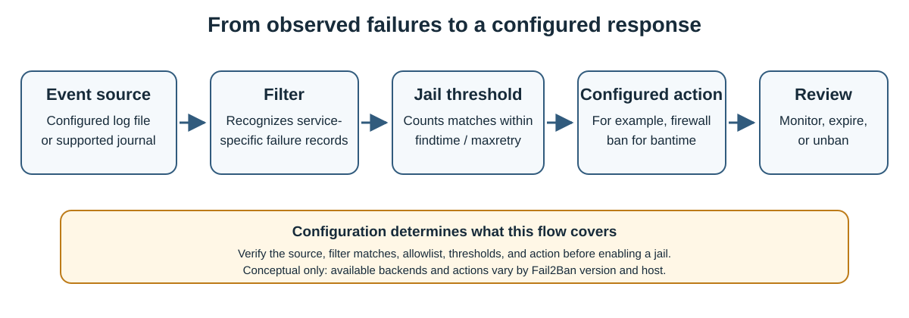

# 🚫 Fail2Ban: Log-Triggered Automatic Banning

<div align="center">

**Watches your logs, bans the IPs that earn it — the lightest-weight IPS in this repo**

*Part of the [ULTIMATE CYBERSECURITY MASTER GUIDE](../../README.md) · [Incident Response](../README.md) · [IDS & IPS](readme.md) section*


</div>

---

## 🎯 Purpose
Guide for deploying [Fail2Ban](https://github.com/fail2ban/fail2ban), a lightweight host tool that monitors configured logs or a supported backend, matches failures with filters, and runs configured actions when a jail threshold is reached. Firewall rules are a common action; the selected action and platform determine the actual response.

## ⚙️ Function
Covers install, the jail/filter/action configuration model, protecting SSH (the most common use case) plus other common services, testing a jail actually works, and the operational commands for inspecting and manually unbanning.

## 🏆 Goal
Configure a jail for a service whose authentication failures are recorded in a supported source and matched by an appropriate filter. Fail2Ban can add a host-level response to repeated failures; it does not replace strong authentication, application rate limits, or network-level monitoring.

## 📋 When to Use
- Consider it for exposed services when their logs or journal entries are available, a matching filter is appropriate, and the configured action fits the host.
- Use service-specific jails only after confirming the application’s log format, filter, and supported backend on the installed Fail2Ban version.
- You want *some* automatic response to brute-forcing without deploying a full network IDS/IPS stack
- A honeypot or IDS from elsewhere in this repo flagged repeated brute-force attempts and you want the actual mitigation, not just visibility

---

## 📋 Table of Contents

- [Where This Fits](#-where-this-fits)
- [Deployment Workflow](#-deployment-workflow)
- [Installation](#-installation)
- [The Jail / Filter / Action Model](#-the-jail--filter--action-model)
- [Protecting SSH](#-protecting-ssh)
- [Protecting Other Services](#-protecting-other-services)
- [Validating & Operating](#-validating--operating)
- [Common Gotchas](#-common-gotchas)
- [⚠️ Security Notes](#️-security-notes)
- [Resources](#-resources)

---

## 🎯 Where This Fits

Fail2Ban is not a replacement for [Suricata/Snort](./suricata+zeek.md) or [Security Onion](./security-onion.md). It does not inspect packets or understand protocols. A jail connects a configured log or supported backend to a filter and one or more actions. When the filter records enough failures within the configured window, the action runs; a firewall ban is common, but behavior depends on the selected action and host. Fail2Ban is useful for targeted, host-level responses to events its filters can reliably identify. It does not provide universal application coverage or replace strong authentication, application controls, or network monitoring.



*Conceptual flow only: the source, filter, thresholds, action, and ban duration depend on the service, installed version, and host configuration.*

---

## 🚀 Deployment Workflow

```text
1. Install:
   └─> apt install fail2ban (or your distro's equivalent).

2. Copy the default config to your override file:
   └─> jail.conf -> jail.local. Never edit jail.conf directly —
       package updates will overwrite it.

3. Set your baseline [DEFAULT] policy:
   └─> ignoreip (your own management IPs — don't lock yourself out),
       bantime, findtime, maxretry.

4. Enable the jails you need:
   └─> Enable only jails for services actually running, after confirming
       the log source, filter, and action match the host.

5. Restart and validate:
   └─> systemctl restart fail2ban
   └─> Deliberately fail auth a few times from a test IP, confirm
       the ban actually happens.

6. Operate:
   └─> fail2ban-client status <jail> to check state.
   └─> Unban manually when you lock out something legitimate.
```

---

## 🔧 Installation

```bash
sudo apt-get update
sudo apt-get install -y fail2ban
sudo systemctl enable fail2ban
sudo systemctl start fail2ban
```

Key files, all under `/etc/fail2ban/`:

| File | Purpose |
|---|---|
| `fail2ban.conf` | Global daemon settings — don't edit |
| `fail2ban.local` | Your overrides to the above, if needed |
| `jail.conf` | Default jail definitions — don't edit |
| `jail.local` | **Your jail overrides — edit this one** |
| `filter.d/` | Regex filter definitions (one per service type) |
| `action.d/` | Ban action definitions (firewall, mail, and other response actions) |
| `jail.d/` | Additional jail overrides, commonly split into `.conf` or `.local` files |

The pattern throughout Fail2Ban's config is the same as much of this repo's other tooling: never edit the `.conf` shipped by the package, always override in the matching `.local` file so package updates don't silently discard your changes.

---

## 🧩 The Jail / Filter / Action Model

- A **jail** ties a service to a filter and a response — "watch this log, using this pattern, and do this when it matches."
- A **filter** is the regex that recognizes a failure in that service's log format.
- An **action** is the configured response for a ban or unban event. Firewall rules are common, but the action can vary by platform and configuration.

Baseline `[DEFAULT]` section in `jail.local`:

```ini
[DEFAULT]
# Never ban these — include only management addresses you trust
ignoreip = 127.0.0.1/8 ::1 192.168.1.0/24
# Replace the example subnet with your actual management IPs/subnets.

# How long a ban lasts (seconds)
bantime = 3600

# The window failures are counted within (seconds)
findtime = 600

# Failures allowed before a ban triggers
maxretry = 5

# Optional email on ban (needs working local mail/SMTP)
# destemail = you@example.com
# sender = fail2ban@example.com
# mta = sendmail
# action = %(action_mwl)s
```

**Set `ignoreip` before enabling anything else.** Replace the example subnet with only addresses you administer: every address in an ignored range bypasses these jails. A wrong or overly broad range can protect hostile hosts or leave your management access exposed to lockout.

---

## 🔒 Protecting SSH

Enable the package-provided `sshd` jail and adjust only the policy values below. This minimal override deliberately inherits the installed package's filter, log backend, and log source; those defaults differ between distributions and package versions.

```ini
[sshd]
enabled = true
port = ssh
maxretry = 3
bantime = 3600
findtime = 600
```

> **Distro-specific source:** Keep the package's `backend` and `logpath` values unless you have verified the host's logging setup. Authentication log locations and backends vary. If you choose the systemd journal backend, it reads journal entries and does not use `logpath`; a file-based backend needs an existing, readable file and a filter that matches its format. Do not combine a guessed file path with a journald backend.

If you moved SSH to a non-standard port (a pattern used elsewhere in this repo's honeypot guides — see [Cowrie](../HoneyPot/cowrie.md) and [OpenCanary](../HoneyPot/opencanary.md)), update `port` to match.

---

## 🌐 Protecting Other Services

Fail2Ban ships filters for dozens of services out of the box. A couple of common additions:

```ini
[apache-auth]
enabled = true
port = http,https
filter = apache-auth
logpath = /var/log/apache2/error.log
maxretry = 5
bantime = 3600

[nginx-http-auth]
enabled = true
port = http,https
filter = nginx-http-auth
logpath = /var/log/nginx/error.log
maxretry = 5
bantime = 3600
```

Only enable jails for services actually running on the box — an enabled jail watching a log file that never gets written to is harmless but pointless.

---

## ✅ Validating & Operating

**Check jail status:**

```bash
sudo fail2ban-client status sshd
```

Output shows currently-failed counts, total failures, and the list of currently-banned IPs.

**Inspect the firewall action:** this example applies only when the configured action uses iptables and creates the `f2b-sshd` chain; names and commands differ with nftables, firewalld, and custom actions.

```bash
sudo iptables -L f2b-sshd -n --line-numbers
```

**Manually unban an IP** (e.g. you locked out something legitimate, or a test ban you triggered on purpose):

```bash
# Replace the example with the reviewed address in the sshd jail.
approved_ip='192.0.2.10'
sudo fail2ban-client status sshd
sudo fail2ban-client set sshd unbanip "$approved_ip"
```

**Dump the fully-resolved effective config** — invaluable when a jail isn't behaving as expected, since it shows the merged result of `jail.conf` → `jail.local` → `jail.d/*.conf`:

```bash
sudo fail2ban-client -d
```

**Test the filter against the actual source** before trusting it in production — a bad regex either misses real attacks or bans legitimate users. This command is for a file-based source; use the installed `fail2ban-regex --help` for journal-backed inputs:

```bash
sudo fail2ban-regex /var/log/auth.log /etc/fail2ban/filter.d/sshd.conf
```

---

## 🩹 Common Gotchas

| Symptom | Cause | Fix |
|---|---|---|
| Locked out of your own SSH session | Your own IP wasn't in `ignoreip` and you triggered the threshold (common while testing) | Add your management IP(s) to `ignoreip` *before* testing; if already locked out, access via console/out-of-band and run the unban command above |
| Jail shows `enabled = true` but never bans anything | `logpath` points at a file that doesn't exist or isn't being written on this distro (e.g. Ubuntu-style path used on RHEL) | Confirm the actual log path/backend for your specific distro — see the SSH section's distro-specific note above |
| Edits to `jail.conf` disappear after a package update | `jail.conf` is the package-managed default, meant to be read-only | Always edit `jail.local` (or drop files in `jail.d/`) instead — never `jail.conf` directly |
| Filter doesn't match despite obviously-failed log lines present | Log format differs slightly from what the bundled filter regex expects (common after a service version upgrade) | Use `fail2ban-regex` against the actual log file and filter to see exactly where the match fails |
| An active ban seems to disappear after a restart | Fail2Ban stores state in SQLite by default and restores bans that are still active; the database and retention settings may be customized | Check the configured `dbfile`, `dbpurgeage`, jail `bantime`, service logs, and `fail2ban-client status <jail>`; expired records are not a permanent ban history |

---

## ⚠️ Security Notes

```
═══════════════════════════════════════════════════════════════
                    ⚠️ CRITICAL WARNING ⚠️
═══════════════════════════════════════════════════════════════

► SET ignoreip BEFORE ANYTHING ELSE. This is the single most
  common way people lock themselves out of their own systems
  with this tool. Add every management IP you access the box
  from before enabling any jail.

► THIS IS A COMPLEMENT, NOT A REPLACEMENT. Fail2Ban stops
  simple brute-forcing; it does nothing against a slow, low-and-
  slow attack that stays under the threshold, or an attacker
  rotating source IPs. Pair it with the other detection layers
  in this repo, don't treat it as sufficient on its own.

► TEST FROM A SEPARATE SESSION. When validating a new jail,
  trigger the failure condition from a connection you're
  prepared to lose — never from the only session you have open
  to the box.

═══════════════════════════════════════════════════════════════
```

---

## 📚 Resources

- **Fail2Ban GitHub:** [github.com/fail2ban/fail2ban](https://github.com/fail2ban/fail2ban)
- **Bundled filter/jail reference:** `/etc/fail2ban/jail.conf` and `/etc/fail2ban/filter.d/` on any installed system — the shipped comments are thorough and version-accurate for your install

---

<div align="center">

## Related Files
- [IDS&IPS/README.md](readme.md) - Sub-section index and platform comparison
- [IDS&IPS/suricata+zeek.md](./suricata%2Bzeek.md) - Full network-level IDS/IPS for when log-based banning alone isn't enough
- [Honeypots/opencanary.md](../HoneyPot/opencanary.md) - A honeypot's SSH-port-move pattern this guide's SSH jail should be updated to match
- [Homelab/HomeLab_Setup.md](https://github.com/Pnwcomputers/ULTIMATE-CYBERSECURITY-MASTER-GUIDE/blob/main/Homelab/HomeLab_Setup.md) - Broader firewall/segmentation context this tool operates within

---

**🛡️ Use These Resources Responsibly**

*Detection first, blocking second.*

**Repository**: [ULTIMATE CYBERSECURITY MASTER GUIDE](https://github.com/Pnwcomputers/ULTIMATE-CYBERSECURITY-MASTER-GUIDE)

**Maintained by**: [Pacific Northwest Computers](https://github.com/Pnwcomputers)

⭐ **Star this repo if you find it useful!** ⭐

</div>
