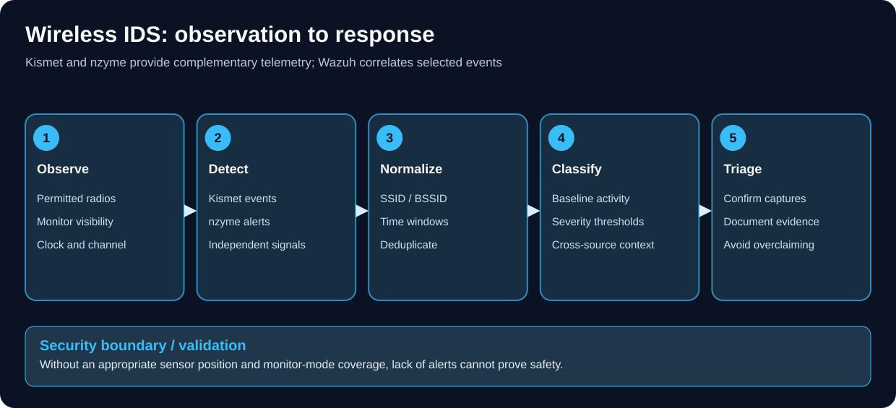

# 🛡️ IDS & IPS Deployment Guides

<div align="center">

**Intrusion Detection & Prevention — Wireless and Wired, Passive and Inline**

*Part of the [ULTIMATE CYBERSECURITY MASTER GUIDE](../../README.md) · [Incident Response](../README.md) section*


</div>

---

| Reference | Description |
|---|---|
| [Wireshark Master Filters](../../Documentation/wireshark-master-filters.md) | Indexed packet inspection filters |
| [Wireshark Field Cheat Sheet](../../Documentation/wireshark-cheatsheet.md) | Common protocol and frame fields |
| [802.11 Deauthentication/Disassociation](../../Documentation/wifi-deauthentication-detection.md) | Observe suspicious management-frame bursts |

Position your sensor correctly and corroborate telemetry before labeling an incident.

**Deception complement:** [Honeypot labs](../HoneyPot/readme.md) cover Raspberry Pi, ESP32-S3, VMs and [Wazuh reporting](../HoneyPot/wazuh-honeypot-integration.md). Decoys only see attempts aimed at them and do not replace actual Wi-Fi management-frame monitoring.

## 🎯 Purpose
Index for network and host intrusion detection/prevention guides, including wireless RF monitoring, wired packet inspection, turnkey NSM, and log-triggered host actions. These tools have different sensor placement, evidence, and response scopes; the guides do not guarantee complete environment coverage.

## ⚙️ Function
Links to platform-specific deployment and operations guides, with hardware, configuration, interface, validation and alert-triage guidance where applicable, plus notes on which traffic or event sources each tool can observe.

## 🏆 Goal
Help practitioners choose and validate complementary sensors and response tools while understanding visibility gaps, deployment limits, and false-positive risks.

## 📋 When To Use
- Standing up wireless or wired intrusion detection from scratch in a homelab or small network
- Deciding whether a given alert needs the wireless guide (rogue APs, deauth, evil twins) or the wired guide (network-based signatures, protocol anomalies)
- Choosing between IDS-only (passive/alerting) and IPS (inline/blocking) deployment
- Extending an existing detection stack with a second domain (e.g. you have wired IDS/IPS and want wireless coverage, or vice versa)

---

## 📋 Table Of Contents

- [Overview](#-overview)
- [Guide Comparison](#️-guide-comparison)
- [Deployment Guides](#-deployment-guides)
- [Which Guide Do I Need?](#-which-guide-do-i-need)
- [Deployment Workflow](#-deployment-workflow)
- [⚠️ Security Notes](#️-security-notes)
- [Contributing](#-contributing)
- [Resources](#-resources)

---

## 🎯 Overview



*Sensor position and channel coverage affect detection reliability.*

**IDS** (Intrusion Detection) passively watches traffic and alerts on suspicious activity. **IPS** (Intrusion Prevention) sits inline and can actively block it. Both terms apply equally to wireless (RF/802.11) and wired (Ethernet/IP) traffic — but the hardware, software, and failure modes involved are different enough that they're covered as separate guides here.

This sub-section provides **hands-on, from-a-real-build guides**, not vendor doc summaries. Where a build hit a genuine gotcha (a driver crashing under load, an interface name that doesn't match what the config expects, a ruleset that needs validation before it's trusted to block traffic), that gotcha is documented explicitly rather than glossed over.

> [!TIP]
> New to network visibility generally? Start with the log-aggregation prerequisite in
> [../log_agg.md](../log_agg.md), then pick a domain below.

---

## Unified Network Visibility & Asset Discovery

| Guide | Signal & Role |
|---|---|
| [Unified Wazuh, Snort, nzyme, Kismet & NetAlertX Architecture](./unified-network-visibility-architecture.md) | End-to-end sensor placement, event normalization, Wireshark evidence, lab acceptance |
| [Wazuh Manager, Indexer, Dashboard & Agents](../SIEM/wazuh.md) | Central event decoding/correlation, endpoint FIM, alerts & version gates |
| [Snort 3 IDS/IPS](./snort.md) | Wired packet signatures, Lua/rules, offline validation, TAP/SPAN/VM capture |
| [nzyme WIDS](./nzyme_wids.md) | Wi-Fi monitor radios, taps/nodes, deauth/rogue-AP monitoring |
| [nzyme → Wazuh](./nzyme-wazuh-integration.md) | Native alert events to normalized manager ingestion |
| [NetAlertX Device Discovery](../../Documentation/netalertx-device-discovery-monitoring.md) | Same-L2 and multi-VLAN asset presence and change alerts, **not** packet IDS |
| [Device Identification Tool Comparison](../../Documentation/network-device-discovery-comparison.md) | LibreNMS, Zabbix, NetBox, ntopng, arpwatch and alternatives |
| [Wireshark Defensive Investigations](../../Documentation/wireshark-defensive-investigations.md) | Reproducible deauth, MITM, DNS, VLAN and RF packet analysis |
| [LAN TAPs & SPAN](../../Documentation/network-taps-and-packet-visibility.md) | Capture hardware and sensor-visibility limits |

**Response boundary:** PMF can mitigate certain forged post-association Wi-Fi management frames but not jamming; WIDS detects and correlates. None of the above should automatically retaliate over RF or disconnect production devices on an unverified alert.

## 🗂️ Guide Comparison

| Guide | Domain | Engine(s) | Blocking (IPS) | Deployment Complexity |
|---|---|---|---|---|
| 📶 **[Kismet + Wazuh Wireless IDS Lab](./kismet-wazuh-wireless-lab.md)** | Wireless (802.11) + SIEM | Kismet + Wazuh | Detection only | Medium |
| 📡 **[nzyme_wids.md](./nzyme_wids.md)** | Wireless (802.11) | nzyme | ❌ Detection only | 🟡 MEDIUM |
| 📶 **[nzyme + Wazuh Integration](./nzyme-wazuh-integration.md)** | Wireless WIDS → SIEM | nzyme + Wazuh | Detection only | 🟡 MEDIUM |
| 🛡️ **[suricata+zeek.md](./suricata+zeek.md)** | Wired/Network | Suricata + Zeek | ✅ Suricata supports inline blocking | 🟡 MEDIUM |
| 🐷 **[snort.md](./snort.md)** | Wired/Network | Snort 2 or Snort 3 | ✅ Inline with a supported DAQ and correct placement; commands vary by generation | 🟡 MEDIUM (platform support and packaging vary) |
| 🧅 **[security-onion.md](./security-onion.md)** | Network NSM platform | Suricata + Zeek with Elastic services and SOC | ⚠️ Depends on sensor placement and configured Suricata mode | 🔴 HIGH for production roles; smaller eval/import options exist |
| 🚫 **[fail2ban.md](./fail2ban.md)** | Host-level (log-triggered) | Fail2Ban | ⚠️ Runs configured actions; firewall bans are common | 🟢 LOW |

---

## 📚 Deployment Guides

### [Kismet + Wazuh Wireless IDS Lab](./kismet-wazuh-wireless-lab.md)
Hands-on fixed-channel Kismet deauthentication monitoring, read-only API to JSONL, Wazuh custom severity/repetition rules, synthetic validation, offline packet-burst analysis, correlation, and dashboard build. Complements nzyme and wired Snort/Suricata; it does not inject or block Wi-Fi traffic.


### 📶 [nzyme + Wazuh Wireless Integration](./nzyme-wazuh-integration.md)
Configure per-network disconnection thresholds, forward nzyme native detection events to Wazuh by secure localhost webhook JSONL, and compare nzyme's grouped alerts with Kismet and independent AP/controller evidence. Includes sample code, service unit, Wazuh rules and synthetic tests.

### 📡 [nzyme Wids](./nzyme_wids.md)
Wireless Intrusion Detection System — a Proxmox VM node plus Raspberry Pi tap sensors with USB adapters. Covers node install on Ubuntu Server + PostgreSQL, the 2.4/5 GHz band-split sensor strategy, out-of-tree DKMS driver fixes for adapter chipsets that crash under channel hopping, and alert-tuning heuristics for telling a real rogue AP from RF noise. Detection-only — nzyme does not block wireless traffic.

### 🛡️ [Suricata & Zeek](./suricata+zeek.md)
Wired/network Intrusion Detection **and** Prevention — Suricata for signature-based detection with native inline blocking, Zeek as a complementary protocol-level NSM layer. Covers standalone Suricata install on Debian/Ubuntu (both passive `af-packet` and inline NFQUEUE/bridge patterns), the OPNsense/pfSense built-in package path, rule management, and the validation steps to run before ever flipping on blocking mode.

### 🐷 [Snort](./snort.md)
Version-aware Snort 2 and Snort 3 guidance, including their different configuration formats, installation paths, passive inspection, and inline prerequisites. A past repository-key failure is identified as specific to one attempt, not a current universal condition.

### 🧅 [Security Onion](./security-onion.md)
A free and open-source NSM platform that manages Suricata, Zeek, Elastic data services, and analyst workflows through SOC. Covers sizing, installation, node roles, sensor visibility, and how packet capture and events move through the system; exact components depend on deployment role and release.

### 🚫 [Fail2ban](./fail2ban.md)
A lightweight host tool that matches configured logs or supported backends with filters, then runs configured actions when a jail threshold is met. Firewall bans are common, but coverage and response depend on the service, filter, backend, and action.

---

<a id="complementary-inventory-and-detection-projects"></a>
### Complementary Inventory & Detection Projects

[NetAlertX](https://github.com/netalertx/NetAlertX) provides continuous network-device discovery and change visibility. It can help establish a device baseline and flag unfamiliar assets, but **it is not a replacement for packet-based IDS/IPS or a wireless intrusion detection sensor**. Correlate its findings with this section's [nzyme WIDS](./nzyme_wids.md), switch/AP logs, DHCP leases and authorized inventory before treating a device as hostile.

## 🤔 Which Guide Do I Need?

```text
Investigating a rogue access point, evil twin, or deauth attack?
  └─> nzyme_wids.md — this is the wireless domain.

Investigating a C2 beacon, malware signature hit, or protocol anomaly
on the wire?
  └─> suricata+zeek.md — this is the wired/network domain.

Want to actively block malicious traffic, not just alert on it?
  └─> suricata+zeek.md — nzyme is detection-only; Suricata supports IPS.

Building complete coverage from scratch?
  └─> Use complementary sensors where they add visibility. A wired
      sensor generally does not receive raw 802.11 management frames;
      controller logs or other sources may still expose related events.
      A wireless tap and wired sensor can also share some IP-layer data.
```

---

## 🚀 Deployment Workflow

```text
1. Prerequisites
   └─> Provision hardware/VMs per the per-guide requirements.
   └─> Read the visibility primer in ../log_agg.md.

2. Stand up detection (IDS mode)
   └─> Follow one guide end-to-end — install, configure, validate.
   └─> Run alert-only / detection-only first. Do not enable Suricata's
       IPS/blocking mode until this phase has been observed clean.

3. Tune alerts
   └─> Observe enough representative traffic to include normal peaks,
       maintenance windows, and expected client behavior.
   └─> Tune thresholds and review false positives using each guide's
       alert-triage / common-gotchas section.

4. Extend to prevention (optional, wired only)
   └─> If needed, pilot Suricata inline on a controlled path with a
       tested rollback method; monitor drops and service health during
       a staged rollout.

5. Centralize
   └─> Where a guide supports forwarding, send selected events to a
       SIEM — see ../SIEM/README.md — and preserve source and evidence
       limits when correlating wireless, wired, and host records.
```

---

## ⚠️ Security Notes

```text
═══════════════════════════════════════════════════════════════
                    ⚠️ CRITICAL WARNING ⚠️
═══════════════════════════════════════════════════════════════

1. VALIDATE BEFORE BLOCKING
   ► IPS (blocking) mode is an availability risk, not just a
     security control. Always run new detection in alert-only
     mode first and observe real traffic before enabling blocking.

2. THIRD-PARTY "FIXES"
   ► Be cautious of any "fix" that has you replace a project's
     official binaries with a third-party build, especially one
     that has you silence or edit a FAILING TEST to force it to
     pass. That is a red flag for tampered software regardless of
     source, and has no place on a security monitoring appliance.

3. EXPOSURE
   ► IDS/IPS management interfaces (node UIs, firewall web UIs)
     must never be exposed to the internet unauthenticated.

4. AUTHORIZATION
   ► Only deploy sensors/taps on networks you own or are
     explicitly authorized, in writing, to monitor.
═══════════════════════════════════════════════════════════════
```

---

## 🤝 Contributing

Contributions from SOC analysts, wireless security researchers, and detection engineers are welcome.

**What we accept:**
- ✅ Additional platform coverage (e.g. Snort, Kismet, Zenarmor/Sensei)
- ✅ Custom Suricata rules or nzyme alert-tuning heuristics
- ✅ Driver/hardware compatibility updates as adapters and kernels change
- ✅ Real gotchas from an actual build — the more specific, the better

**Guidelines:**
1. Sanitize any real network details (SSIDs, IPs, MACs) before sharing.
2. Document the platform **version** your config was tested against.
3. Submit a PR describing the defensive value.

---

## 📚 Resources

- **nzyme docs:** <https://docs.nzyme.org>
- **Suricata docs:** <https://docs.suricata.io>
- **Zeek docs:** <https://docs.zeek.org>
- **Emerging Threats rules:** <https://rules.emergingthreats.net>
- **Offline IDS validation:** [Suricata capture replay](suricata+zeek.md#-validation--testing).
- **MITRE ATT&CK (detection mapping):** <https://attack.mitre.org/>

---

## 🔗 Quick Links

- [⬅️ Incident Response section](../README.md)
- [📥 Log Aggregation primer](../log_agg.md)
- [📊 SIEM Deployment Guides](../SIEM/README.md)
- [🚷 Wireless Intrusion / Rogue AP IR procedure](../network_intrusion.md)
- [🏠 Main Repository](../../README.md)

---

<div align="center">

**🛡️ Visibility is the foundation of defense — deploy these tools ethically and legally.**

*Maintained by [Pacific Northwest Computers (PNWC)](https://github.com/Pnwcomputers)*

</div>

---
[⬅️ Back to Master Index](../../README.md) | [🎯 Role Navigation](../../START_HERE.md) | [Legal Notice](../../LEGAL.md)
