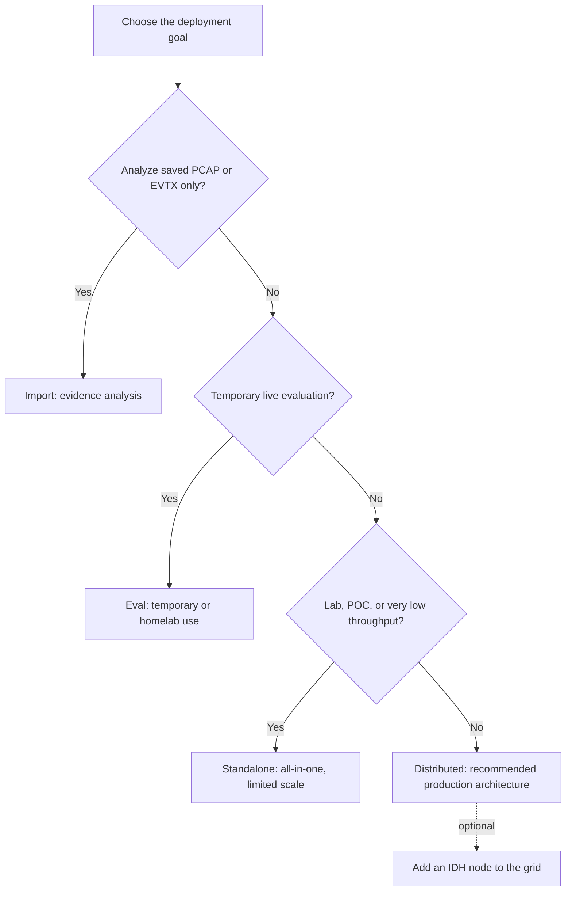

# 🧅 Security Onion: Turnkey Network Security Monitoring

<div align="center">

**A network security monitoring platform that combines Suricata, Zeek, Elastic data services, and analyst workflows in managed node roles**

*Part of the [ULTIMATE CYBERSECURITY MASTER GUIDE](../../README.md) · [Incident Response](../README.md) · [IDS & IPS](readme.md) section*


</div>

---

## 🎯 Purpose
Guide for deploying [Security Onion](https://securityonion.net/), a free and open-source platform for network security monitoring. It manages Suricata and Zeek sensors, Elastic-based log and search services, optional endpoint log collection, and analyst workflows through Security Onion Console (SOC). Available components and node roles depend on the selected installation type and release.

## ⚙️ Function
Covers representative node roles, hardware sizing, ISO installation, management and sniffing interface planning, and the data path from sensor capture to searchable events and analyst access. Role names and exact components vary by release.

## 🏆 Goal
Give operators the sizing and architecture facts to check before installing Security Onion; its published minimums are resource-intensive and vary by node role.

## 📋 When to Use
- You've already worked with standalone Suricata/Zeek and want the integrated dashboards, alerting, and case-management layer without building it yourself
- You want the NSM (network security monitoring) equivalent of what [T-Pot](../HoneyPot/tpot.md) is for honeypots — pre-integrated, appliance-style, dashboards included
- You have dedicated hardware to spare (this is **not** a Raspberry Pi project — see sizing below) and want full packet capture retention alongside alerts

---

## 📋 Table of Contents

- [What Security Onion Actually Is](#-what-security-onion-actually-is)
- [Architecture & Node Types](#️-architecture--node-types)
- [Hardware Sizing](#-hardware-sizing)
- [Installation](#-installation)
- [Post-Install Configuration](#-post-install-configuration)
- [Where the Pieces You Already Know Live](#-where-the-pieces-you-already-know-live)
- [Common Gotchas](#-common-gotchas)
- [⚠️ Security Notes](#️-security-notes)
- [Resources](#-resources)

---

## 🎯 What Security Onion Actually Is

Security Onion isn't a new detection engine — it's the same Suricata and Zeek covered in this repo's [standalone guide](./suricata+zeek.md), plus:

- **Elastic services** including Elasticsearch, Logstash, Kibana, and Redis, used according to the selected node roles
- **Elastic Agent** for transporting logs; Windows endpoints can optionally send Sysmon events through a supported collection configuration
- **Strelka** for file analysis, including YARA-based detections
- **Security Onion Console (SOC)** for alerts, hunt, cases, detections, and grid administration; the platform also provides analyst tools such as CyberChef
- Separate detection types: NIDS rules load into Suricata, Sigma rules into ElastAlert, and YARA rules into Strelka
- **IDH (Intrusion Detection Honeypot)** nodes run honeypot services and join an existing Security Onion grid as a dedicated node

Think of it as: everything you'd otherwise assemble by hand from this repo's Suricata/Zeek and SIEM guides, pre-wired together and given a management console.

---

## 🏗️ Architecture & Node Types

Security Onion supports everything from a single evaluation VM to a fully distributed enterprise deployment. Pick the smallest type that fits your actual need — sizing scales up dramatically with each step:

| Deployment or role | What it is | Typical fit |
|---|---|---|
| **Import** | Minimal installation for importing PCAP/EVTX files | Analyze saved evidence; not live monitoring |
| **Eval** | Single machine that sniffs live traffic with a reduced service set | Temporary evaluation or a homelab; **not for production** |
| **Standalone** | Manager and sensor components on one machine | Labs, POCs, or very low-throughput deployments; less scalable than distributed |
| **Distributed** (Manager, Sensor, Search) | Separates management, sensing, and search/storage across nodes | Recommended architecture for production and scaling |
| **IDH node** | Dedicated honeypot node that joins a Security Onion grid | Add honeypot coverage to an existing deployment |

This is a compact role summary, not the complete list; current releases also document ManagerSearch, Heavy, Fleet, and Receiver node roles. Security Onion Desktop is a separate analyst workstation option. Check the current [architecture documentation](https://docs.securityonion.net/en/3/main/architecture/) before designing a grid.



For a distributed deployment, configure the manager first, then join sensor, search, and optional IDH nodes. Confirm the current node roles and release-specific sizing upstream before installation.


*Conceptual distributed data path; exact services and storage placement depend on the selected node roles and release.*

---

## 🖥️ Hardware Sizing

These are published minimums, not sizing recommendations. Actual needs increase with enabled services, traffic volume, and log sources:

| Node Type | CPU cores | RAM | Storage | NICs |
|---|---:|---:|---:|---:|
| Desktop | 2 | 4 GB | 50 GB | 1 |
| Import | 2 | 4 GB | 100 GB | 1 |
| Eval | 4 | 8 GB | 200 GB | 2 |
| **Standalone** | **4** | **24 GB** | **200 GB** | **2** |
| Manager | 4 | 16 GB | 200 GB | 1 |
| ManagerSearch | 8 | 16 GB | 200 GB | 1 |
| Search node | 4 | 16 GB | 200 GB | 1 |
| Sensor | 4 | 12 GB | 200 GB | 2 |
| Heavy node | 4 | 16 GB | 200 GB | 2 |
| IDH node | 2 | 1 GB | 100 GB¹ | 1 |
| Fleet node | 4 | 4 GB | 200 GB | 1 |
| Receiver node | 2 | 8 GB | 200 GB | 1 |

**Standalone sizing caveat:** the 24 GB minimum may need swap to avoid issues, and the official docs recommend 32 GB or more even for a small amount of monitored traffic. More RAM does not change Standalone's intended fit: labs, POCs, and very low throughput. For production scalability, the official docs recommend a distributed architecture.

¹ The current hardware page conflicts on IDH storage: its minimum-spec table lists 12 GB while the detailed IDH section lists 100 GB. This guide uses the conservative 100 GB figure; confirm the exact release requirements before sizing.

**NIC planning:** you need one interface with an IP for management, and a **separate** interface with no IP dedicated to sniffing (fed by a TAP or SPAN port). Security Onion automatically disables NIC offload features (`tso`, `gso`, `gro`) on sniffing interfaces so Suricata/Zeek see accurate traffic — don't try to "fix" this yourself.

**Storage for full packet capture** can grow quickly: a continuous 50 Mbps stream is about 540 GB/day using decimal units, before filesystem or capture overhead. Actual volume depends on monitored traffic and capture settings. Size storage against a defined retention requirement.

**CPU architecture:** Security Onion supports x86-64 only; ARM devices such as Raspberry Pi are unsupported, including as IDH nodes. IDH has lower resource requirements but still needs to join a supported Security Onion grid.

---

## 🔧 Installation

1. **Review Hardware and Release Notes** on the [official docs](https://docs.securityonion.net/en/3/main/hardware/) before downloading anything — confirm your target hardware actually meets the node type you're planning.
2. **Download and verify the ISO** from the official [Download page](https://docs.securityonion.net/en/3/main/download/) — verify the checksum, don't skip this on a security tool.
3. **Boot the ISO** on hardware meeting the minimum specs for your chosen node type.
4. **Follow the installer prompts** to completion, then reboot.
5. **Log in** with the username/password set during install. Setup starts automatically.

If Setup doesn't auto-start (e.g. after manually exiting it), restart it explicitly:

```bash
sudo SecurityOnion/setup/so-setup iso
```

6. Proceed through **Configuration** — choose your node type (Import / Eval / Standalone / Distributed manager-first), set network interfaces (management vs. sniffing), and complete the guided setup.

> ⚠️ **Get the hostname right the first time.** Setup generates certificates based on the hostname during install, and changing the hostname afterward is not supported. This isn't a "fix it later" setting.

For a distributed deployment, install and fully configure the **Manager** node first, then join **Sensor**/**Search** nodes to it — nodes are approved via **Administration → Grid Members** on the Manager after they attempt to join.

---

## ⚙️ Post-Install Configuration

- **Security Onion Console (SOC)** is your main web UI — alerts, dashboards, hunt, cases, detections, PCAP retrieval, and grid administration all live here.
- **Kibana** is available underneath SOC for deeper Elastic-native dashboarding.
- Add host-level visibility with **Elastic Agent** or supported syslog sources. On Windows, Sysmon can add endpoint events that Elastic Agent transports to Security Onion.
- Detections are managed centrally but run in different engines: NIDS rules in Suricata, Sigma in ElastAlert, and YARA in Strelka. Their configuration and update behavior differ.

---

## 🔗 Where the Pieces You Already Know Live

If you've already worked through this repo's other guides, Security Onion's components map directly:

| You already know this from... | It shows up in Security Onion as... |
|---|---|
| [Suricata & Zeek](./suricata+zeek.md) | The NIDS/NSM engine layer — same engines, centrally managed rules and config |
| [SIEM: ELK Stack](https://github.com/Pnwcomputers/ULTIMATE-CYBERSECURITY-MASTER-GUIDE/blob/main/IncidentResponse/SIEM/elk_stack.md) | The Elasticsearch/Logstash/Kibana backend, pre-wired to ingest Suricata/Zeek output automatically |
| [Honeypots](../HoneyPot/readme.md) | The IDH (Intrusion Detection Honeypot) node type — a purpose-built, low-resource honeypot role in the grid |
| [Endpoint Visibility: Sysmon](https://github.com/Pnwcomputers/ULTIMATE-CYBERSECURITY-MASTER-GUIDE/blob/main/IncidentResponse/Endpoint-Visibility/Windows/sysmon.md) | Sysmon event logs can be collected through a configured Elastic Agent; Sysmon itself is not the transport agent |

This is the practical value proposition: if you understand Suricata, Zeek, and ELK from this repo's other guides already, you're not learning new detection concepts here — you're learning how Security Onion wires the pieces together and manages them centrally.

---

## 🩹 Common Gotchas

| Symptom | Cause | Fix |
|---|---|---|
| Standalone install is unstable / services keep restarting | Hardware sized at the bare 24 GB RAM floor, no swap configured | Add swap space, or better, provision 32 GB+ if monitoring any real traffic — the docs are explicit that the minimum is genuinely minimal |
| Suricata/Zeek show dropped packets or inaccurate traffic view | NIC offload features (`tso`/`gso`/`gro`) weren't disabled on the sniffing interface | The installer does this automatically on interfaces it identifies as sniffing-only (no IP) — confirm the interface has no IP assigned if this persists |
| Can't change the hostname after a botched initial setup | Certificates were generated against the original hostname during install; this is explicitly unsupported to change later | Reinstall rather than fight it — this is a documented hard limitation, not a bug to work around |
| Distributed sensor won't join the manager | Node approval step skipped | Check **Administration → Grid Members → Pending Members** on the Manager and explicitly Review/Accept the joining node |
| Running out of disk far faster than expected | Packet capture retention wasn't sized against traffic and capture settings | Recalculate from representative traffic and configured capture behavior, then add a safety margin |
| Tried it on a Raspberry Pi or other ARM hardware | Security Onion supports x86-64 only, including for IDH nodes | Use a supported x86-64 host; IDH's low resource minimum does not make it ARM-compatible, and an IDH node joins a Security Onion grid |

---

## ⚠️ Security Notes

```
═══════════════════════════════════════════════════════════════
                    ⚠️ CRITICAL WARNING ⚠️
═══════════════════════════════════════════════════════════════

► FULL PACKET CAPTURE CAN STORE TRAFFIC CONTENT. When Suricata
  PCAP is enabled and set to capture all traffic (the default),
  it retains packet content, not just metadata. Conditional
  capture and retention settings change what is stored and for
  how long. Protect PCAP storage and analyst access accordingly.

► DEDICATED MANAGEMENT NETWORK RECOMMENDED. Keep the management
  interface off the general network where possible; SOC and
  Kibana access should be restricted to trusted administrators.

► GET THE HOSTNAME RIGHT BEFORE INSTALLING. Certificates are
  tied to it permanently — there is no supported migration path
  if you get this wrong.

► SIZE STORAGE FOR YOUR ACTUAL RETENTION NEEDS BEFORE DEPLOYING,
  not after. Running out of disk on a system holding full packet
  captures of your network traffic is a worse failure mode than
  most other tools in this repo.

═══════════════════════════════════════════════════════════════
```

---

## 📚 Resources

- **Security Onion docs:** [docs.securityonion.net](https://docs.securityonion.net/en/3/main/)
- **Architecture and event flow:** [Architecture](https://docs.securityonion.net/en/3/main/architecture/), [Ingest](https://docs.securityonion.net/en/3/main/ingest/), and [Full Packet Capture](https://docs.securityonion.net/en/3/main/full-packet-capture/)
- **Current minimum hardware:** [Hardware requirements](https://docs.securityonion.net/en/3/main/hardware/)
- **Detection engine mapping:** [Rules overview](https://docs.securityonion.net/en/3/main/rules/)
- **Sysmon collection:** [Sysmon](https://docs.securityonion.net/en/3/main/sysmon/)
- **Intrusion Detection Honeypot:** [IDH](https://docs.securityonion.net/en/3/main/idh/)
- **Security Onion GitHub:** [github.com/Security-Onion-Solutions/securityonion](https://github.com/Security-Onion-Solutions/securityonion)
- **Security Onion Solutions (official appliances/support):** [securityonionsolutions.com](https://securityonionsolutions.com)
- **Community support (GitHub Discussions):** linked from the official docs site

---

<div align="center">

## Related Files
- [IDS&IPS/README.md](readme.md) - Sub-section index and platform comparison
- [IDS&IPS/suricata+zeek.md](./suricata%2Bzeek.md) - The standalone version of this platform's core detection engines
- [Honeypots/tpot.md](../HoneyPot/tpot.md) - The honeypot-domain equivalent of this "everything pre-integrated" approach
- [Honeypots/README.md](../HoneyPot/readme.md) - Including the IDH honeypot role this platform can run natively
- [IncidentResponse/SIEM/elk_stack.md](https://github.com/Pnwcomputers/ULTIMATE-CYBERSECURITY-MASTER-GUIDE/blob/main/IncidentResponse/SIEM/elk_stack.md) - The standalone version of the backend this platform bundles
- [IncidentResponse/SIEM/wazuh.md](https://github.com/Pnwcomputers/ULTIMATE-CYBERSECURITY-MASTER-GUIDE/blob/main/IncidentResponse/SIEM/wazuh.md) - Available as a host-visibility integration alongside this platform

---

**🛡️ Use These Resources Responsibly**

*Detection first, blocking second.*

**Repository**: [ULTIMATE CYBERSECURITY MASTER GUIDE](https://github.com/Pnwcomputers/ULTIMATE-CYBERSECURITY-MASTER-GUIDE)

**Maintained by**: [Pacific Northwest Computers](https://github.com/Pnwcomputers)

⭐ **Star this repo if you find it useful!** ⭐

</div>
