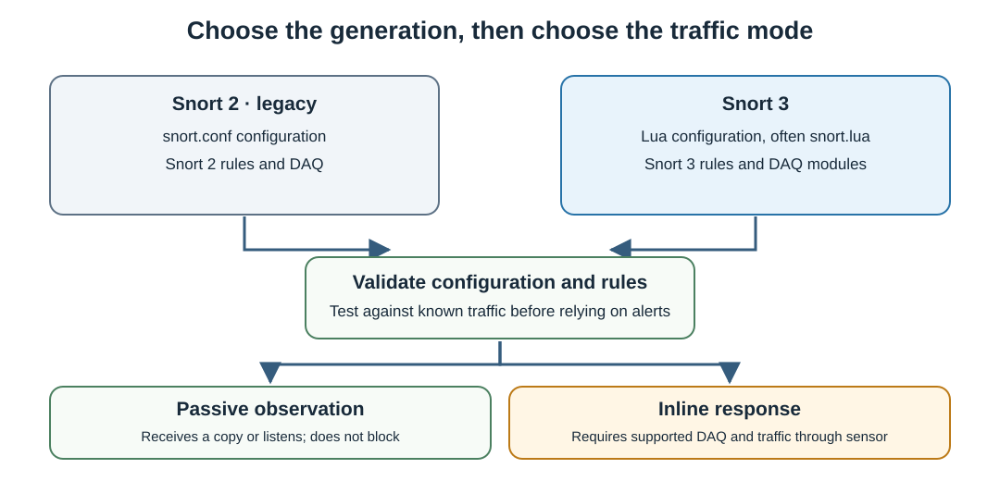

# 🐷 Snort: Signature-Based IDS/IPS

<div align="center">

**The original open-source IDS, that is still relevant! It's just a bit harder to install cleanly than its modern alternative**

*Part of the [ULTIMATE CYBERSECURITY MASTER GUIDE](../../README.md) · [Incident Response](../README.md) · [IDS & IPS](readme.md) section*


</div>

---

## 🎯 Purpose
Guide for deploying [Snort](https://www.snort.org/), the original open-source signature-based IDS/IPS, now maintained by Cisco. Covers every install path people actually try, honestly documents where the official packaging currently falls short, and gives the informed choice between sticking with Snort and moving to [Suricata](./suricata+zeek.md) instead.

## ⚙️ Function
Covers the four install paths (default repos, official Snort repo, from-source build, Snort 3 release package), rule configuration, running in IDS vs. IPS mode, and — because it's the honest outcome of a real attempt — when and why to pivot to Suricata instead.

## 🏆 Goal
Get a working decision, not just a working install: know which install path is worth trying first on your platform, and recognize quickly when Snort's current packaging friction means your time is better spent on Suricata.

## 📋 When to Use
- You specifically need Snort (existing rule sets, organizational standard, familiarity) rather than an open choice of engine
- `sudo apt install snort` fails or isn't available on your distro and you need the alternative paths
- You hit `gpg: no valid OpenPGP data found` adding Snort's official repository — this guide's gotcha section covers it directly
- Deciding, with full information, whether to keep pushing on Snort or switch to [Suricata](./suricata+zeek.md)

> 📝 **Note:** A real attempt at this exact install hit a broken official repository key and ultimately moved to Suricata successfully instead. That outcome is documented honestly below rather than glossed over — this guide will get you a working Snort if the paths below work for your platform, but won't pretend the path is as smooth as Suricata's currently is.

---

## 📋 Table of Contents

- [Snort vs. Suricata — The Honest Comparison](#-snort-vs-suricata--the-honest-comparison)
- [Deployment Workflow](#-deployment-workflow)
- [Installation](#-installation)
- [Configuration](#-configuration)
- [Running in IDS vs. IPS Mode](#-running-in-ids-vs-ips-mode)
- [Common Gotchas](#-common-gotchas)
- [When to Pivot to Suricata](#-when-to-pivot-to-suricata)
- [⚠️ Security Notes](#️-security-notes)
- [Resources](#-resources)

---

## 🎯 Snort vs. Suricata — The Honest Comparison

| Comparison | Snort | Suricata |
|---|---|---|
| Packet processing | Snort 2 uses one packet thread per process; Snort 3 supports multiple packet threads per process | Multi-threaded engine |
| Rule language | Its own, large community rule ecosystem (Talos/Snort rules) | Compatible with Snort-style rules, plus its own extensions (`http.uri`, `dns.query`, etc.) |
| Official package availability | Inconsistent across distros/versions — see gotchas below | Available in standard Debian/Ubuntu repos, actively maintained |
| Protocol-aware inspection | Present but less extensive | Deeper protocol decoders (TLS, HTTP/2, DNS) |
| Maintainer | Cisco (via Talos) | Open Information Security Foundation (OISF) |

Both are legitimate, capable engines. The practical difference this repo's own experience surfaced is **packaging friction**, not detection capability — see [Common Gotchas](#-common-gotchas).



*Conceptual version and traffic-mode map; paths and module names depend on the installed release and platform.*

---

## 🚀 Deployment Workflow

```text
1. Try the simple path first:
   └─> sudo apt update && sudo apt install snort
   └─> If this works and gives a current-enough version, you're done
       with install — skip to Configuration.

2. If not available or too old, try the official repo:
   └─> Add Snort's apt repository and key.
   └─> KNOWN ISSUE: the key URL has been unreliable — see gotchas
       before spending much time here.

3. If the official repo fails, choose:
   └─> Build from source (Snort 2.9.x — dependency-heavy, slow).
   └─> Install the Snort 3 .deb release directly from GitHub.
   └─> OR: pivot to Suricata (see When to Pivot, below).

4. Configure:
   └─> Set HOME_NET/EXTERNAL_NET, enable local.rules.
   └─> Write or import detection rules.

5. Validate in IDS (alert-only) mode first:
   └─> Never jump straight to IPS/blocking mode.

6. Only after validation, consider IPS mode:
   └─> Understand this requires inline placement (NFQUEUE or AF_PACKET).
```

---

## 🔧 Installation

Choose the engine generation and platform first. Snort 2 and Snort 3 use different configuration formats and DAQ generations; package names and supported binaries vary by operating system. Avoid mixing a Snort 2 tutorial with a Snort 3 package.

### Snort 3 (recommended for new deployments)

Use the [official Snort downloads and Snort 3 installation documentation](https://www.snort.org/downloads). Follow the instructions for the exact operating system and release you are running, including the required Snort 3 DAQ and dependencies. The official page lists current source releases and separate platform resources; it does not guarantee a matching prebuilt package for every distribution.

After installation, check the version and available DAQ modules:

```bash
snort -V
snort --daq-list
```

### Snort 2 (legacy compatibility)

Use Snort 2 only when a rule set, platform, or existing deployment specifically requires it. The official site keeps Snort 2 sources and releases separate from Snort 3. Confirm the release and its dependency documentation on the [official downloads page](https://www.snort.org/downloads); do not use a Snort 2 `snort.conf` as a Snort 3 configuration.

### Repository and package caution

This guide previously included a fixed apt repository recipe, a specific 2.9.20 source build, and an example GitHub `.deb` filename. Those instructions are distribution- and release-dependent and are not a universal current install path. Check the official downloads for the current files and supported platforms before installing. A failed repository-key fetch is a report from one past attempt, not proof that the same endpoint is currently broken.

---

## ⚙️ Configuration

Snort configuration and rule examples are version-specific.

### Snort 3

Snort 3 uses a Lua configuration file, commonly named `snort.lua`. Its location depends on how it was installed. Start by validating the installed configuration:

```bash
snort -c /path/to/snort.lua -T
```

Load a local Snort 3 rule file explicitly when testing it:

```bash
snort -c /path/to/snort.lua -R /path/to/local.rules -r sample.pcap
```

A Snort 3 `snort.lua` can configure networks and rule loading. Consult the installed defaults and the [Snort 3 configuration guide](https://docs.snort.org/start/configuration) before copying settings between installations. If Snort 2 and Snort 3 are both installed, their DAQ modules can be separate; Snort 3 may need an explicit `--daq-dir`. Use `snort --daq-list` to confirm which modules are available.

### Snort 2 compatibility

Snort 2 uses the legacy `snort.conf` format and familiar `HOME_NET`, `EXTERNAL_NET`, and `include $RULE_PATH/local.rules` directives. Do not paste this file into a Snort 3 installation. Snort 3 provides `snort2lua` to help convert older configuration files, but review and validate the converted output before use.

Rule syntax and supported options can differ across releases. Keep rules matched to the engine generation and validate against a packet capture and representative traffic before relying on alerts.

---

## ▶️ Running in IDS vs. IPS Mode

Start with passive observation. For Snort 3, validate the configuration, then test against a packet capture or a monitored interface. The paths below are examples; use the configuration, DAQ module, and interface names from the local installation.

**Snort 3 passive interface example:**

```bash
snort -c /path/to/snort.lua -R /path/to/local.rules -i eth0 -A alert_fast
```

Passive capture observes traffic and cannot block it. Snort 3 inline operation requires an inline-capable DAQ and traffic actually traversing the sensor. For example, the official guide shows AFPacket with a pair of interfaces:

```bash
snort -Q --daq afpacket -i "eth0:eth1"
```

Do not add `-Q` to a one-interface monitoring command and assume that traffic will be blocked. Validate rules, interface pairing, fail-open/fail-closed behavior, and a recovery path in a controlled lab before putting inline blocking on a production path. See the [Snort 3 traffic inspection guide](https://docs.snort.org/start/inspection) and the general [IDS & IPS guide](readme.md).

---

## 🩹 Common Gotchas

| Symptom | Likely cause | Next step |
|---|---|---|
| `snort.conf` is rejected or missing | Snort 3 was installed but Snort 2 configuration instructions were followed | Locate the installed `snort.lua`; validate with `snort -c /path/to/snort.lua -T`. |
| `snort --daq-list` shows no expected module | The DAQ module is absent, or Snort is looking in a different module directory | Follow the install instructions for the matching Snort generation; if both generations are installed, check Snort 3's `--daq-dir`. |
| A rule does not load or alert | Rule syntax/options may not match the installed generation, or the test traffic did not exercise the rule | Validate the configuration and test the rule with a known packet capture; check the engine's diagnostics. |
| Inline mode starts but does not block the expected path | The DAQ is not inline-capable or traffic is not traversing the paired sensor interfaces | Verify the DAQ mode, topology, and inline test in a controlled lab before relying on blocking. |
| A package or download name from a guide is unavailable | Release assets and platform support change over time | Select the matching current release from the [official Snort downloads](https://www.snort.org/downloads) and follow its platform-specific instructions. |

---

## 🔀 When to Pivot to Suricata

If the current official instructions do not support your platform, or the install is not a good fit for the deployment, compare the options and consider Suricata. A prior attempt recorded in this guide moved to Suricata after package/repository friction on one setup; that report is specific to its date and environment, not proof that Snort's current download path is broken. Suricata:

- Installs cleanly from standard Debian/Ubuntu repos with a single `apt install suricata`
- Is natively multi-threaded, which matters more than it sounds on constrained hardware like a Raspberry Pi
- Has its own full deployment guide in this repo: **[IDS & IPS: Suricata & Zeek](./suricata+zeek.md)**

This isn't a blanket "always use Suricata instead" — if you have an organizational reason to standardize on Snort specifically (existing Talos rule licensing, existing infrastructure, team familiarity), the paths above will get you there. But if you're choosing an engine freely and just hit the packaging wall, that's a legitimate signal, not a reason to keep fighting the installer.

---

## ⚠️ Security Notes

```
═══════════════════════════════════════════════════════════════
                    ⚠️ CRITICAL WARNING ⚠️
═══════════════════════════════════════════════════════════════

► VALIDATE BEFORE BLOCKING. IPS (-Q, inline/NFQUEUE) mode is an
  availability risk, not just a security control — a misfiring
  rule can drop legitimate traffic. Run alert-only for at least
  1-2 weeks before enabling inline blocking, same as every other
  IDS/IPS in this repo.

► VERIFY THIRD-PARTY DOWNLOADS. When fetching a Snort 3 release
  or a source tarball, confirm the URL is the official
  snort.org/GitHub release page — don't follow a link from a
  random tutorial without checking it matches.

► KEEP RULES CURRENT. An IDS with a stale ruleset gives false
  confidence. Whichever install path you use, establish a rule
  update cadence (Snort's official rule feeds require a free or
  paid Talos subscription depending on rule tier).

═══════════════════════════════════════════════════════════════
```

---

## 📚 Resources

- **Snort official site:** [snort.org](https://www.snort.org/)
- **Snort 3 GitHub releases:** [github.com/snort3/snort3/releases](https://github.com/snort3/snort3/releases)
- **Snort rule documentation (Talos):** [snort.org/documents](https://www.snort.org/documents)
- **Snort 3 command line:** [Command line basics](https://docs.snort.org/start/help)
- **Snort 3 configuration:** [Configuration guide](https://docs.snort.org/start/configuration)
- **Snort 3 traffic modes:** [Reading traffic](https://docs.snort.org/start/inspection)

---

<div align="center">

## Related Files
- [IDS&IPS/README.md](readme.md) - Sub-section index and platform comparison
- [IDS&IPS/suricata+zeek.md](./suricata%2Bzeek.md) - The modern alternative this guide's real-world attempt pivoted to
- [Tradecraft/network-detection.md](https://github.com/Pnwcomputers/ULTIMATE-CYBERSECURITY-MASTER-GUIDE/blob/main/Tradecraft/network-detection.md) - Rule-writing depth that transfers directly from Suricata syntax to Snort's
- [Homelab/HomeLab_Setup.md](https://github.com/Pnwcomputers/ULTIMATE-CYBERSECURITY-MASTER-GUIDE/blob/main/Homelab/HomeLab_Setup.md) - VLAN/firewall placement context for where an IDS/IPS sits in a lab network

---

**🛡️ Use These Resources Responsibly**

*Detection first, blocking second.*

**Repository**: [ULTIMATE CYBERSECURITY MASTER GUIDE](https://github.com/Pnwcomputers/ULTIMATE-CYBERSECURITY-MASTER-GUIDE)

**Maintained by**: [Pacific Northwest Computers](https://github.com/Pnwcomputers)

⭐ **Star this repo if you find it useful!** ⭐

</div>
