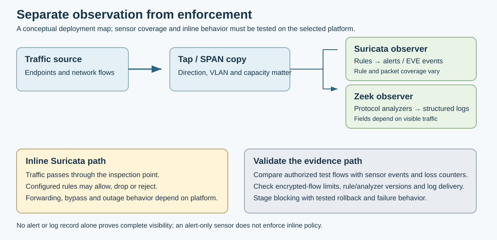
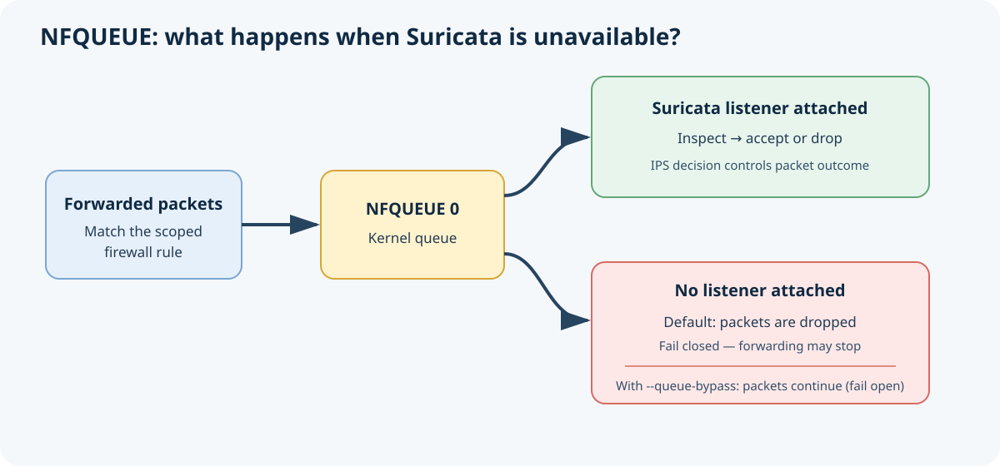
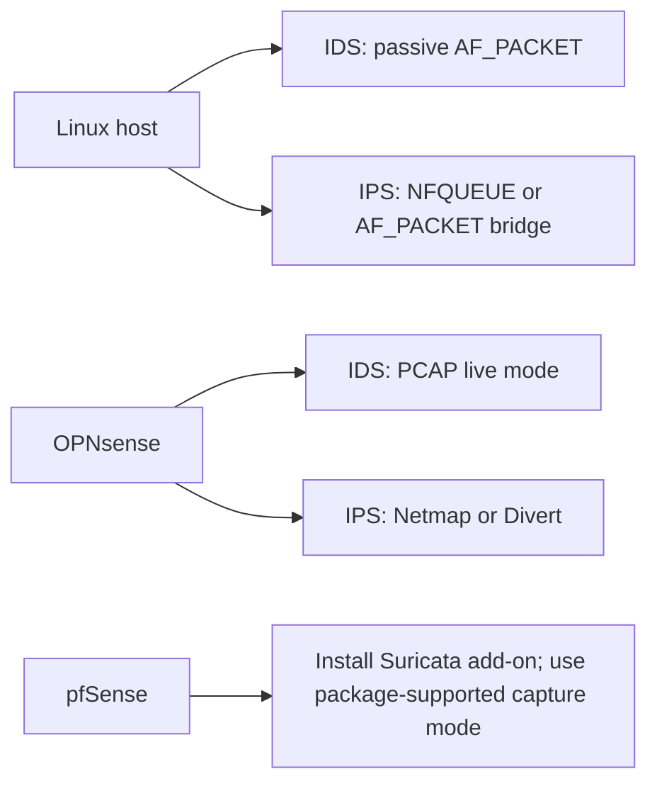

# 🛡️ Intrusion Detection & Intrusion Prevention with Suricata & Zeek

<div align="center">

**Signature-based blocking + protocol-level network security monitoring, standalone or on a firewall VM**

*Part of the [ULTIMATE CYBERSECURITY MASTER GUIDE](../../README.md)*


</div>

---

## 🎯 Purpose
Guide for deploying an open-source network Intrusion Detection/Prevention System. Suricata for signature-based detection and inline blocking, Zeek for protocol-level network security monitoring (NSM). Run on Linux, through OPNsense's integrated IDS/IPS service, or through pfSense's add-on package; capture modes and setup differ by platform.

## ⚙️ Function
Covers choosing IDS-only (passive/tap) vs IPS (inline/blocking) deployment mode, standalone Suricata install on Debian/Ubuntu, OPNsense's integrated IDS/IPS interface, and the separate pfSense Suricata add-on, rule management, Zeek as a complementary NSM layer, validation/testing, and the gotchas that actually cost time during a real build.

## 🏆 Goal
Get a homelab or small-network operator from bare hardware to a validated, alert-tuned IDS with a clear, informed path to IPS (active blocking) only after the detection side has been proven safe.

## 📋 When to Use
- Standing up network-level threat detection from scratch, on a dedicated box or a firewall VM
- Deciding whether to run Suricata inline (IPS) or as a passive tap (IDS only)
- An update or package install on a Suricata-hosting firewall VM hangs or behaves oddly
- Extending detection with Zeek's protocol logs for hunting/forensics beyond signature alerts

> 📝 **Note:** This guide is informational/educational, covering the general deployment path rather than one specific live network. Where a real build surfaced a non-obvious gotcha, it's called out explicitly.

---

## 📋 Table of Contents

- [IDS vs IPS: What You're Actually Choosing](#-ids-vs-ips-what-youre-actually-choosing)
- [Engine Comparison](#️-engine-comparison)
- [Deployment Workflow](#-deployment-workflow)
- [Standalone Suricata (Debian/Ubuntu)](#-standalone-suricata-debianubuntu)
- [Suricata on OPNsense/pfSense](#-suricata-on-opnsensepfsense)
- [Rule Management](#-rule-management)
- [Zeek as a Complementary NSM Layer](#-zeek-as-a-complementary-nsm-layer)
- [Validation & Testing](#-validation--testing)
- [Common Gotchas](#-common-gotchas)
- [⚠️ Security Notes](#️-security-notes)
- [Resources](#-resources)

---

## 🎯 IDS vs IPS: What You're Actually Choosing

| Mode | What it does | Failure behavior | Deployment |
|---|---|---|---|
| **IDS** (Intrusion *Detection*) | Passively inspects a copy of traffic, generates alerts | For a truly passive tap/SPAN copy, a sensor outage does not interrupt the observed forwarding path, but visibility is lost. A host or capture-path failure can still affect traffic if it is not actually passive. | Tap/SPAN/mirror port, or passive capture mode |
| **IPS** (Intrusion *Prevention*) | Sits inline, actively drops/rejects matching traffic in real time | Fails differently depending on config; can fail open (bypass) or fail closed (outage) | Inline bridge, or Linux-specific `af-packet`/NFQUEUE IPS modes |

**The practical rule:** validate in passive or alert-only mode first. Move to blocking only after confirming capture coverage, ruleset behavior, expected and benign traffic, throughput, update and rollback procedures, and an explicit change window. There is no universal observation period; use representative traffic and risk-based acceptance criteria. Inline failure behavior depends on the capture method and firewall/bypass configuration.

---

## 🗂️ Engine Comparison

| Engine | Type | Blocking (IPS) | Strength | Weakness |
|---|---|---|---|---|
| **Suricata** | Signature and protocol-aware | ✅ Yes (native) | Multi-threaded engine, protocol-aware detection, supported community rule sources | Coverage depends on enabled rules, protocol visibility, version, and tuning |
| **Snort** | Signature-based | ✅ Yes (native) | Mature engine with established rule sources and documentation | Capabilities and performance depend on Snort version, DAQ, rules, hardware, and configuration; benchmark the target workload |
| **Zeek** | Protocol analysis and scripting | ❌ No. Not an inline traffic blocker | Structured protocol logs such as `conn.log`, `dns.log` and `ssl.log`; available fields depend on analyzers, traffic and configuration | Does not guarantee payload visibility or complete capture; steeper scripting learning curve |

Suricata can provide signature-based IDS/IPS and protocol-aware outputs; Zeek provides complementary protocol analysis and structured logs. Whether to deploy one or both depends on coverage needs, capture capacity, privacy constraints, operational skill and storage. Neither replaces validation of sensor placement or packet loss.

---



*Conceptual only: observed coverage depends on placement, traffic visibility, capture capacity, rules and analyzer configuration. Inline forwarding and bypass behavior are platform-specific.*

## 🚀 Deployment Workflow

```text
1. Placement:
   └─> IDS: receive a TAP/SPAN copy or use the platform's passive mode.
   └─> IPS: inline only after IDS-mode validation and rollback planning.

2. Install:
   └─> Linux: use a supported distribution package or the official OISF package source.
   └─> OPNsense: configure its integrated IDS/IPS service.
   └─> pfSense: install the Suricata add-on package.

3. Capture setup:
   └─> Select the actual interface and capture mode for that platform.
   └─> Linux AF_PACKET/NFQUEUE settings do not apply to firewall GUIs.

4. Rules:
   └─> Use sources available for the installed version; check standalone source IDs
       with `suricata-update list-sources` or the firewall's ruleset page.
   └─> Begin in alert-only mode.

5. Validate:
   └─> Replay an approved capture with matching and benign controls.
   └─> Check expected events, capture loss, benign workflows, and rollback.

6. IPS cutover (optional):
   └─> Use a limited, monitored scope and a planned change window.
   └─> Test failure/bypass behavior and confirm a recovery path first.

7. Extend visibility:
   └─> Add Zeek to a feed that the sensor and mirror can sustain.
   └─> Forward events to a SIEM when useful.
```


---

## 🔧 Standalone Suricata (Debian/Ubuntu)

### Install

```bash
sudo apt update
sudo apt install -y suricata
```

### Identify Your Capture Interface

```bash
ip -br link
```

Don't assume `eth0`
Cloud images, Proxmox VMs (`ens18`, `enp6s18`, etc.), and physical NICs on different distros all name interfaces differently. 
Confirm it before editing config.

### Configure `af-packet` Capture

Edit `/etc/suricata/suricata.yaml`:

```yaml
vars:
  address-groups:
    HOME_NET: "[10.0.0.0/8, 172.16.0.0/12, 192.168.0.0/16]"

af-packet:
  - interface: enp6s18        # your actual interface, not a placeholder
    cluster-id: 99
    cluster-type: cluster_flow
    defrag: yes
    use-mmap: yes
    ring-size: 200000
```

This runs Suricata in **passive IDS mode** — It inspects a copy of traffic and alerts, without sitting inline.

### For IPS Inline Blocking on Standalone Linux

Two common patterns:

- **NFQUEUE** — The rule below is a deliberately broad **IPv4 example**: it queues every packet traversing the host's `FORWARD` chain, not just a selected LAN or service. Do not paste it unchanged on a production gateway. Replace it with a rule scoped to the authorized interface, subnet, direction, and traffic you intend to inspect; confirm its order relative to other firewall rules.
  ```bash
  # Example only: all IPv4 forwarded traffic enters queue 0
  sudo iptables -I FORWARD -j NFQUEUE --queue-num 0
  ```
  Configure the `nfq` section and run Suricata with `-q 0` in IPS mode. By default, if no userspace queue listener is attached, queued packets are dropped (fail closed), which can interrupt forwarding while Suricata is stopped or unhealthy. The iptables `--queue-bypass` option makes packets continue when the listener is absent (fail open); it preserves connectivity but removes Suricata's blocking during that failure. Choose deliberately and verify the exact behavior for your kernel/rules.
- **AF_PACKET IPS mode (bridge)** — Two NICs bridged, Suricata inspects and forwards/drops between them. Requires the box to sit physically/logically inline on the network path; failure behavior depends on the bridge and bypass configuration.

Before applying a queue rule, keep an out-of-band management path where possible and prepare a rollback command that deletes the exact rule you added. Test both the Suricata-running and listener-absent cases in a lab or maintenance window, and confirm recovery before widening scope.



*Default NFQUEUE handling is fail closed; `--queue-bypass` makes the queue fail open when no listener is attached. Exact behavior should be validated on the target host.*

Either way, **do not enable inline mode until you've validated in IDS/alert-only mode first** (see [Validation & Testing](#-validation--testing)).

### Enable and Start

```bash
sudo suricata-update
sudo systemctl enable --now suricata
sudo systemctl status suricata
```

---

## 🔩 Suricata on OPNsense/pfSense

### OPNsense (integrated IDS/IPS service)

OPNsense includes Suricata through its IDS/IPS interface; you do not install the pfSense add-on package there. The current [OPNsense IDS/IPS manual](https://docs.opnsense.org/manual/ips.html) names these capture modes:

| OPNsense capture mode | Use | Important constraint |
|---|---|---|
| **PCAP live mode (IDS)** | Alert-only/passive inspection | Select the interface where traffic is visible; promiscuous mode may be needed for a mirrored feed |
| **Netmap (IPS)** | Inline inspection and packet drops | Requires supported real interfaces; disable hardware offloading and check NIC/driver support |
| **Divert (IPS)** | Firewall-rule-directed inspection and drops | Requires firewall rules using Divert-to; follow the platform manual |



Choose the interface that actually sees the traffic. Capturing on WAN behind NAT can show translated addresses rather than internal clients. In IPS mode, the OPNsense manual requires supported real interfaces; with VLANs, enable IPS on the parent interface. Disable hardware offloading for IPS as described in the current platform manual.

Use the IDS/IPS ruleset page to review the providers available in the installed release. Install/enable the sources and policies you need, then apply the configuration. Availability varies by release and installed plugins; do not assume a fixed provider list or update time. Avoid copying Linux `af-packet` YAML into OPNsense.

### pfSense (Suricata add-on package)

pfSense provides Suricata as an add-on package through **System → Packages → Available Packages**. The package list and UI can vary by release; use the current [Netgate package documentation](https://docs.netgate.com/pfsense/en/latest/packages/list.html) and [IDS/IPS package guidance](https://docs.netgate.com/pfsense/en/latest/packages/snort/index.html) before installing or changing capture mode.

The menu and available options differ from OPNsense. Use the installed Suricata package's interface/rules pages, and verify inline-mode support for the exact NIC, driver, and release before enabling it. Do not apply OPNsense menu paths or Linux `af-packet` examples to pfSense.

On either firewall, begin in IDS/alert-only mode. Move to blocking only after validating coverage, rule behavior against expected and benign traffic, throughput, update handling, and rollback procedures. Use a defined change window and retain a recovery path for management access.

---

## 📜 Rule Management

```bash
# Update rules (standalone Linux)
suricata-update

# List and enable rule sources
suricata-update list-sources
suricata-update enable-source et/open          # Emerging Threats (free)
suricata-update enable-source abuse.ch/sslbl-blacklist  # current SSLBL source ID
# Check 'suricata-update list-sources' for current IDs; don't use deprecated sslbl-c2.

# Test rules against a pcap before trusting them live
suricata -r capture.pcap -l /tmp/logs/ -c /etc/suricata/suricata.yaml

# Validate config/rule syntax
suricata --engine-analysis -c /etc/suricata/suricata.yaml
```

For writing custom rules, tuning performance (CPU affinity, `af-packet` ring sizing), and a working set of example detection rules (C2 stagers, DNS tunneling, download cradles), see the full reference: **[Tradecraft/network-detection.md](https://github.com/Pnwcomputers/ULTIMATE-CYBERSECURITY-MASTER-GUIDE/blob/main/Tradecraft/network-detection.md)** — this guide intentionally doesn't duplicate that material.

---

## 🔍 Zeek as a Complementary NSM Layer

Zeek is a passive network analysis platform, not an inline blocker. It can produce structured protocol logs such as `conn.log`, `dns.log`, `http.log`, `ssl.log` and `files.log`; the available fields depend on protocol visibility, analyzers, plugins and configuration. TLS encryption limits application payload visibility, while metadata can remain observable. Zeek does not extract every file merely because it logs a file-analysis event. If Suricata and Zeek share a mirror feed, confirm the switch and sensor can sustain the combined packet rate and monitor capture-loss indicators; shared placement does not guarantee full coverage.

```bash
# Option 1: distribution-provided package, if supported and available
sudo apt update
apt-cache policy zeek
# sudo apt install -y zeek  # Use only after confirming version and platform

# Option 2: Zeek project's OBS packages, Ubuntu 24.04 only
# See https://docs.zeek.org/en/lts/install.html (reviewed 2026-11-24)
curl --fail --show-error --silent --location \
  --proto '=https' --proto-redir '=https' \
  'https://download.opensuse.org/repositories/security:/zeek/xUbuntu_24.04/Release.key' \
  --output /tmp/zeek-obs-Release.key
gpg --show-keys --with-fingerprint /tmp/zeek-obs-Release.key
# STOP and independently verify the repository key fingerprint with its publisher.
# Only after verification:
gpg --dearmor --output /tmp/zeek-obs.gpg /tmp/zeek-obs-Release.key
sudo install -m 0644 /tmp/zeek-obs.gpg /usr/share/keyrings/zeek-obs.gpg
printf '%s\n' 'deb [signed-by=/usr/share/keyrings/zeek-obs.gpg] https://download.opensuse.org/repositories/security:/zeek/xUbuntu_24.04/ /' | \
  sudo tee /etc/apt/sources.list.d/security-zeek.list
sudo apt update
apt-cache policy zeek-8.0
sudo apt install -y zeek-8.0
rm -f /tmp/zeek-obs-Release.key /tmp/zeek-obs.gpg
```

The Ubuntu 24.04 snippet chooses the **Zeek 8.0 LTS package family** rather than an unpinned rolling `zeek` package; confirm support and exact available revision before deployment. Installing from OBS grants package-signing trust, so obtain the repository fingerprint independently and stop if it does not match. On a different distribution or release, follow [official Zeek installation guidance](https://docs.zeek.org/en/lts/install.html) rather than reusing this repository path. The package typically installs under `/opt/zeek`; confirm the actual path, then set the capture interface in its `etc/node.cfg`. Interface-name verification is as important here as for Suricata.

If you only have a single NIC on a VM/appliance and no mirror port available, running Zeek directly on a firewall VM that already sees all routed traffic (rather than trying to mirror to a separate box) avoids needing extra port-mirroring infrastructure.

For the full log reference table, `zeek-cut` analysis one-liners, JA3/JA3S fingerprinting, and Zeek detection scripts, see **[Tradecraft/network-detection.md](https://github.com/Pnwcomputers/ULTIMATE-CYBERSECURITY-MASTER-GUIDE/blob/main/Tradecraft/network-detection.md)** — again, not duplicated here.

---

## ✅ Validation & Testing

Replay an approved synthetic or sanitized capture offline with a lab configuration and a version-matched ruleset. Replace the two paths with local files:

```bash
capture='./fixtures/authorized-test.pcap'
config='./lab/suricata.yaml'

if [ -r "$capture" ] && [ -r "$config" ] && output_dir=$(mktemp -d); then
    printf 'Suricata output directory: %s\n' "$output_dir"
    suricata -r "$capture" -c "$config" -l "$output_dir"
else
    printf '%s\n' 'Check the fixture and configuration paths and temporary-directory permissions.' >&2
    false
fi
```

The [Suricata CLI reference](https://docs.suricata.io/en/latest/command-line-options.html) documents offline PCAP mode. Check the configured alert output and record expected and observed rule IDs, input timestamps, and benign control results. Separately validate a live sensor's monitored interface and delivery to the SIEM when a lab is available. See the [Lab Verification Matrix](../../Documentation/LAB-VERIFICATION-MATRIX.md).

---

## 🩹 Common Gotchas

| Symptom | Cause | Fix |
|---|---|---|
| No alerts at all, engine reports running | Interface name in config doesn't match the real capture interface | Verify with `ip -br link` (Linux) or check the actual driver name (`em0`/`em1`, not `eth0`) on BSD-based firewalls |
| Testing from the sensor/firewall itself produces nothing | Suricata/Zeek can only inspect traffic passing *through* the box, not traffic *originating from* it | Test from a separate client device on the network |
| Firmware/package update hangs on a Suricata-hosting firewall VM | IDS/IPS (and similar deep-inspection packages) can be memory-hungry; a VM sized for basic routing runs out of headroom during package installs | Check actual free RAM (not just what's allocated) before assuming a network/mirror problem; temporarily stopping the IDS service during updates can free enough memory to complete them |
| Legitimate traffic gets blocked right after enabling IPS mode | A rule or policy blocks a legitimate workflow, or promotion criteria were incomplete | Revert to alert-only, inspect the matching rule and affected flow, tune/disable narrowly, repeat representative validation, then use a reviewed change window and rollback plan |
| High CPU or capture loss under load | Traffic exceeds available capture, CPU, memory, or storage capacity; capture-mode-specific tuning may also be needed | Check engine statistics and capture-loss indicators, then benchmark a representative load. Suricata is multi-threaded, but tuning depends on the OS, NIC/driver, and capture mode; see [Tradecraft/network-detection.md](https://github.com/Pnwcomputers/ULTIMATE-CYBERSECURITY-MASTER-GUIDE/blob/main/Tradecraft/network-detection.md) |

---

## ⚠️ Security Notes

```
═══════════════════════════════════════════════════════════════
                    ⚠️ CRITICAL WARNING ⚠️
═══════════════════════════════════════════════════════════════

► IPS (blocking) mode is an availability risk, not just a
  security control. A misfiring rule in inline mode can take
  down legitimate traffic — DNS, updates, VoIP, anything with an
  uncommon-but-valid pattern. Always validate in alert-only mode
  first against representative traffic; use explicit acceptance checks and a rollback plan.

► An IDS/IPS box on a network path is a high-value target. Keep
  it patched, restrict management access, and don't expose its
  web UI/SSH to anything but a trusted management network.

► COMMUNITY RULES ARE A STARTING POINT, NOT A COMPLETE
  SOLUTION. Provider availability and licensing vary by platform.
  Review what is enabled, validate matches against traffic, and
  tune policies for your environment's risk profile.

═══════════════════════════════════════════════════════════════
```

---

## 📚 Resources

- **Suricata IPS concepts:** [IPS mode](https://docs.suricata.io/en/latest/ips/ips-concept.html) · [Linux inline setup](https://docs.suricata.io/en/latest/ips/setting-up-ipsinline-for-linux.html)
- **Suricata EVE JSON:** [event output fields](https://docs.suricata.io/en/latest/output/eve/eve-json-format.html)
- **Zeek log reference:** [current log files](https://docs.zeek.org/en/current/reference/zeekscript/log-files.html)
- **Zeek monitoring and capture:** [monitoring](https://docs.zeek.org/en/current/about/monitoring.html) · [capture-loss logs](https://docs.zeek.org/en/current/reference/logs/capture-loss-and-reporter.html)
- **Suricata docs:** [docs.suricata.io](https://docs.suricata.io)
- **Zeek docs:** [docs.zeek.org](https://docs.zeek.org)
- **Emerging Threats rules:** [rules.emergingthreats.net](https://rules.emergingthreats.net)
- **OPNsense IDS/IPS:** [current manual](https://docs.opnsense.org/manual/ips.html)
- **pfSense package setup:** [Package list](https://docs.netgate.com/pfsense/en/latest/packages/list.html) · [IDS/IPS packages](https://docs.netgate.com/pfsense/en/latest/packages/snort/index.html)
- **Detection validation:** [offline capture replay](#-validation--testing) and the [lab verification matrix](../../Documentation/LAB-VERIFICATION-MATRIX.md).

---

<div align="center">

## Related Files
- [Tradecraft/network-detection.md](https://github.com/Pnwcomputers/ULTIMATE-CYBERSECURITY-MASTER-GUIDE/blob/main/Tradecraft/network-detection.md) - Rule writing, Zeek log analysis, C2/lateral-movement detection deep dive (the depth this guide intentionally doesn't duplicate)
- [IncidentResponse/SIEM/wazuh.md](https://github.com/Pnwcomputers/ULTIMATE-CYBERSECURITY-MASTER-GUIDE/blob/main/IncidentResponse/SIEM/wazuh.md) - Forward Suricata/Zeek alerts into a SIEM for correlation and dashboards
- [IncidentResponse/log_agg.md](https://github.com/Pnwcomputers/ULTIMATE-CYBERSECURITY-MASTER-GUIDE/blob/main/IncidentResponse/log_agg.md) - Centralized log collection, including firewall log forwarding
- [Homelab/HomeLab_Setup.md](https://github.com/Pnwcomputers/ULTIMATE-CYBERSECURITY-MASTER-GUIDE/blob/main/Homelab/HomeLab_Setup.md) - VLAN segmentation and firewall placement context for a lab deployment
- [IncidentResponse/IDS/nzyme_wids.md](nzyme-wazuh-integration.md) - The wireless-domain counterpart to this wired/network IDS/IPS guide

---

**🛡️ Use These Resources Responsibly**

*Detection first, blocking second.*

**Repository**: [ULTIMATE CYBERSECURITY MASTER GUIDE](https://github.com/Pnwcomputers/ULTIMATE-CYBERSECURITY-MASTER-GUIDE)

**Maintained by**: [Pacific Northwest Computers](https://github.com/Pnwcomputers)

⭐ **Star this repo if you find it useful!** ⭐

</div>
