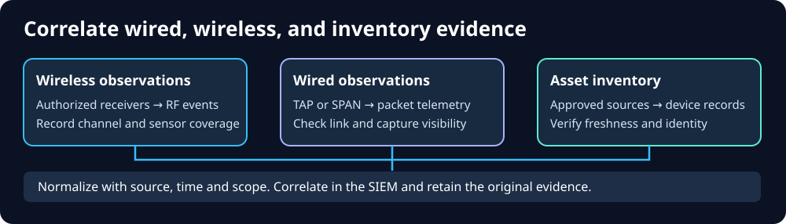

# Unified Network Visibility: Wazuh, Snort 3, nzyme, NetAlertX, Kismet & Wireshark

_Reviewed: 2026-11-21. Reference architecture and synthetic test plan only. No deployment or live alarm delivery has been verified._

> [!CAUTION]
> **Authorized monitoring only.** Use explicitly permitted networks, separate capture and management interfaces, restrict packet/event retention and disable automatic retaliatory transmissions. Validate actual packet and event paths before using these controls for production incident response. See [Legal Notice](../../LEGAL.md).

## Purpose & What Each Component Contributes

A useful network defense stack combines **multiple kinds of evidence**. One tool cannot reliably identify every device, prove radio attack attribution and inspect every encrypted session.

| Product | Primary Evidence | Capture / Input | Limits |
|---|---|---|---|
| [NetAlertX](../../Documentation/netalertx-device-discovery-monitoring.md) | Device arrival/departure & inventory changes | ARP, DHCP, SNMP, controller integrations, authorized scans | Not a WIDS or packet IDS, limited by VLAN/scanner scope and randomized MACs |
| [nzyme](./nzyme_wids.md) | Wi-Fi RF events: rogue AP candidates, disconnection trends, fingerprints | Supported monitor-mode sensor taps | Hopping channels and missing frames create visibility gaps |
| [Kismet](../../Wardriving/kismet.md) | 802.11/BLE sightings, alerts, GPS/coverage data | Supported Wi-Fi/BLE datasources | No sensor sees all RF; telemetry may be privacy-sensitive |
| [Snort 3](./snort.md) | Packet/flow signature matches | TAP, SPAN, vSwitch mirror, owned endpoint captures | Only receives visible packets, misses unmirrored paths |
| [Wazuh](../SIEM/wazuh.md) | Endpoint, security event, FIM and normalized sensor alerts | Wazuh agents / collectors / custom rules | An ingested log need not match an alert rule |
| [Wireshark](../../Documentation/wireshark-defensive-investigations.md) | Detailed packet inspection and analyst corroboration | Captures from eligible sources | Filtering does not add packet coverage or decrypt TLS/DoH |
| [LibreNMS / ntopng / NetBox](../../Documentation/network-device-discovery-comparison.md) | Health, flows or managed asset source of truth | SNMP/flow exporters/planned inventory | Different problems; not drop-in substitutes |

## Reference Topology



Wireless observations come from the configured Kismet or nzyme radios. A TAP or managed
mirror supplies wired packet data to the relevant analyzer. NetAlertX inventory uses its
configured discovery sources. Forward supported events through the selected collector and
retain references to the original observations for later review.

The diagram shows **logical data flow**, not a claim that any native integration has been preconfigured. A host-network NetAlertX container does not turn a Proxmox guest into a mirrored packet sensor. Access to radio captures or raw packets still requires its own receiving hardware/source.

## Small Homelab Implementation Profile

| Component | Practical Lab Candidate | Security Gate |
|---|---|---|
| Sensor host | Pi 4/5 or Linux mini PC with stable SSD/UPS | Powered USB, measured capture drops, NTP |
| Wi-Fi capture | Verified AR9271/MT7612U adapter in monitor mode | Owned AP/channel, legal band; fixed channel for precise burst analysis |
| Wired capture | Rated 1G+ copper TAP or managed switch SPAN | Full duplex directions, speed, no production impact |
| Snort 3 VM | Supported Linux guest with actual mirrored/pass-through packet source | Offline synthetic rule test before running live |
| nzyme | Supported node on VM, tap on sensor host | Version-matched config and protected secrets |
| NetAlertX | Protected container in management environment | Host-network/capability review; same-L2 ARP limit |
| Wazuh | Pinned stable manager/indexer/dashboard plus approved agents | Ingest auth/TLS, rule tests, storage and dashboard access |
| Analyst | Wireshark + source records + time normalization | Evidence hash, privacy redactions and triage notes |

## Data Normalization Without False Attribution

Use a single **synthetic** event schema for integration tests, and preserve the raw upstream event separately.

```json
{"source":"nzyme","event_family":"wireless_disconnection","timestamp_utc":"2026-11-21T12:01:00Z","site":"lab","sensor_id":"wifi-monitor-01","observed_vlan":null,"asset_key":null,"confidence":"candidate","evidence_ref":"synthetic-event-01"}
```

Do not join an nzyme BSSID to a NetAlertX client MAC and announce "same device" without independent proof. Match on site and time first, then corroborate MAC/BSSID/SSID, AP logs, switchport, DHCP, controller and identity under privacy rules.

| Event | Minimum Fields | Validate |
|---|---|---|
| nzyme wireless alert | Node/tap, channel, BSSID/SSID where permitted, event type, original timestamp | AP state and channel coverage |
| Kismet alert | Sensor, type, first/last seen, channel/source, recorded confidence | A relevant capture and known alert throttling |
| Snort JSON | Rule SID, source/destination IP:port, timestamp, packet/flow reference | Original PCAP, rule revision, correct packet visibility |
| NetAlertX change | Device key, subnet/VLAN, plugin/source, old/new state | DHCP/switch NAC and MAC privacy behavior |
| Wazuh endpoint | Agent ID, rule ID, original event, host time, severity | Endpoint inventory and independent host logs |

## Integration Verification Sequence

1. **Deploy separately:** Validate health/version, data source, clock, storage and access policy for each component before integrations.
2. **Confirm actual visibility:** Send benign owned ICMP/DNS/HTTPS flows; verify the TAP/SPAN/endpoint capture sees appropriate directions. For wireless, receive owned beacons with correct channel and antenna.
3. **Validate standalone detection:** Use an offline lab PCAP and benign local rule for Snort; verify nzyme/Kismet alert subscription/format using synthetic notifications where supported. Avoid live deauth generation.
4. **Test normalization:** Capture an example of each *real installed-version schema*, redact it, map stable fields and write newline-delimited JSON to a protected log.
5. **Test Wazuh:** Use installed \`wazuh-logtest\` and the repository's [Synthetic Rule Validation](../../Documentation/WAZUH-SYNTHETIC-RULE-VALIDATION.md). A parser test is not evidence of successful dashboard delivery.
6. **Test dashboard end-to-end:** Compare event counts, timestamps, duplicates, severity, data retention and drop counters.
7. **Create harmless incident exercise:** A controlled new lab device appears while its endpoint performs a benign SSH login and DNS query. Analysts should see corresponding inventory/endpoint/network events **without** auto-blocking or misattributing radio traffic.
8. **Restore:** Stop any temporary capture, remove synthetic data under retention policy and document cleanup.

## Threat Scenarios, Response & Blind Spots

| Scenario | Sensors | Likely False Positives | Sensible Control |
|---|---|---|---|
| Suspected deauth flood | nzyme, Kismet, Wireshark radio | Legitimate AP reboot/roaming, nearby interferers | PMF where available, AP log verification, RF channel review |
| New unknown device | NetAlertX, NAC, switch | Private MAC, guest onboarding, virtual adapter | VLAN isolation, 802.1X, review port and device owner |
| MITM / rogue DNS | Endpoint Wireshark, DHCP/RA, Snort/Zeek, Wazuh | HA gateway, DNS64, approved proxy | DHCP snooping, DAI, RA Guard, TLS validation, secure DNS |
| Excessive service probes | Snort, Zeek, Wazuh, firewall | Vulnerability inventory or normal management | Default-deny ACL, scoped scan windows |
| Suspicious BLE device | Kismet BLE, dedicated sniffer | Legitimate beacon, rotating address | Secure pairing, inventory and minimum retained identifiers |
| VLAN escape suspicion | Switch config/ACL logs, endpoint capture | Port mis-tagging, mirror strips tags | Untagged/tagged audits and positive/negative tests |

## Important Non-Goals

- Do not have WIDS "fight back" by sending deauthentication, jamming or spoofed management frames.
- Do not claim NetAlertX tracks a person because a device name or MAC changed.
- Do not infer that Snort receives Wi-Fi management frames merely because the sensor VM has a virtual Ethernet NIC.
- Do not equate DNSSEC with encryption or DoH with authenticated signed DNS data.
- Do not use automatic active response before explicit tuning, reversible change control and known false-positive handling.

## References & Cross-Links

- [NetAlertX Device Discovery](../../Documentation/netalertx-device-discovery-monitoring.md)
- [nzyme WIDS](./nzyme_wids.md) & [nzyme→Wazuh](./nzyme-wazuh-integration.md)
- [Kismet→Wazuh](./kismet-wazuh-wireless-lab.md)
- [Snort 3](./snort.md) & [Wazuh](../SIEM/wazuh.md)
- [Wireshark Defensive Investigations](../../Documentation/wireshark-defensive-investigations.md)
- [VLAN, ACL, DMZ & SPAN](../../Documentation/network-segmentation-dmz-acl-vlan.md) & [LAN TAPs](../../Documentation/network-taps-and-packet-visibility.md)
- [Counter-Surveillance](../../Documentation/counter-surveillance-wireless-threats.md) & [DNS Security](../../Documentation/dns-hijacking-secure-dns.md)

---

[IDS/IPS Index](./readme.md) | [Incident Response](../README.md) | [Legal Notice](../../LEGAL.md)
